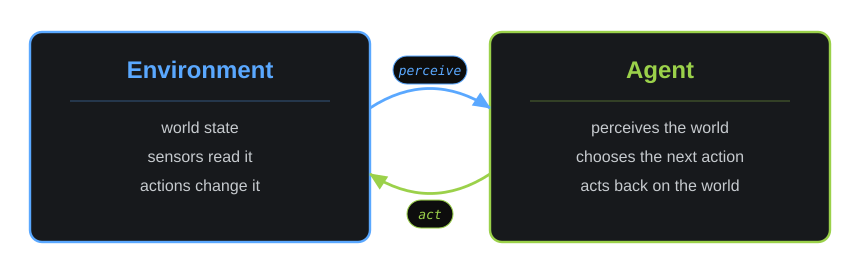
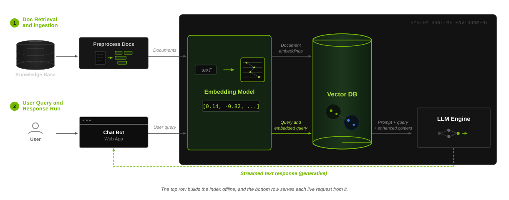

# Securing Agents with OpenShell and NemoClaw

> **This is the Chinese (zh) localization fork** of the NeMoClaw DLI course, maintained at
> [`DLI / expand-the-funnel / NeMoClawDLI-zh`](https://gitlab-master.nvidia.com/dli/expand-the-funnel/nemoclawdli-zh).
> It is adapted for **non-Brev local deployment (WSL2 + Docker and DGX Spark Station)** and will carry Simplified Chinese
> content once the full course is verified to run end-to-end without Brev. Until then, course
> content remains in English. For the upstream English source see
> [`NVDLI/NemoClawDLI`](https://github.com/NVDLI/NemoClawDLI).

The planned public home is
[`NVDLI/NemoClawDLI-zh`](https://github.com/NVDLI/NemoClawDLI-zh). Publication remains pending OSRB
approval. [`RELEASE_STATUS.json`](RELEASE_STATUS.json) is the machine-readable source for current
publication state. Passing repository checks does not replace NVIDIA legal, security, or release
approval.

## About the course

An agent connects a model to tools, memory, and a routing decision that repeats until its task is done. This course builds that loop, then connects it to current frameworks. You'll go from a single API call to agent coordination, grounded retrieval, deep planning, and safe deployment using OpenClaw, NVIDIA NemoClaw™, and OpenShell.

Every lesson is an editable browser exercise. Later modules use NemoClaw and OpenShell to run and inspect an agent locally — no Brev launchable required.

> **Note:** This repository releases the course and validation tools. NemoClaw and its runtime remain external dependencies.

## Course path

### Module 1: build the agent loop



Start with the observation-action loop. Add model calls, state, tools, and a clear stop condition.

### Module 2: coordinate and ground the work



Add explicit routing, parallel work, retrieval over your own sources, and deeper planning.

### Modules 3 and 4: run and constrain the agent


Connect the design to NemoClaw, keep an agent running locally, then use OpenShell to constrain tools, files, and network access.

## What you will learn

- Build a basic agent loop and identify its core components.
- Implement reliable tool use and function calling within an agent system.
- Design and coordinate multi-agent systems using structured routing patterns.
- Utilize OpenShell to configure agent identities and ensure safe, sandboxed operations.
- Deploy and manage autonomous agents while building persistent skill libraries.

## Take the course

Start at [`web/index.html`](web/index.html), then open the
[`NemoClaw course`](web/nemoclaw/index.html). Interactive model exercises require a user-supplied
NVIDIA API key.

**In this fork (local non-Brev deployment):** Modules 3 and 4 connect to the local
openshell-sandbox Docker container instead of a Brev launchable. Supported on Windows 11 +
WSL2 + Docker (no GPU required) and DGX Spark Station (native Ubuntu Linux, GPU optional).
Start all services with `bash start_proxies.sh` before opening the course pages — see
[`LOCAL_STARTUP_GUIDE.md`](LOCAL_STARTUP_GUIDE.md) for full instructions.

The learner release is a static browser site. It does not vendor learner credentials. The
NemoClaw product and runtime are external dependencies, not releases of this course repository.

## Run it locally (non-Brev)

This fork is designed to run without a Brev launchable on two supported platforms:

- **Windows 11 + WSL2 + Docker** — all services run inside Ubuntu-24.04 on WSL2
- **DGX Spark Station (native Ubuntu Linux)** — same services, native Docker; access course pages directly from the DGX browser or from a Windows browser via SSH port forwarding

The full step-by-step procedure — including one-time NeMoClaw installation and onboarding — is in
[`LOCAL_STARTUP_GUIDE.md`](LOCAL_STARTUP_GUIDE.md). Architecture notes and troubleshooting are in
[`LOCAL_DEPLOYMENT_NOTES.md`](LOCAL_DEPLOYMENT_NOTES.md).

**Prerequisites (both platforms):** Docker, NeMoClaw + OpenShell installed (see `LOCAL_STARTUP_GUIDE.md` § 0), an NVIDIA API key.

**Every-session quick start:**

```bash
# 1. Set your API key
export NVAPI_KEY="nvapi-..."

# 2. Start all background services in one command
#    WSL2:  bash "/mnt/c/…/repo/start_proxies.sh"
#    DGX:   bash ~/nemoclaw-zh/start_proxies.sh

# 3. Recover the container, set up the forward service, fix iptables rules
#    (see LOCAL_STARTUP_GUIDE.md steps 1c–1f for the full commands)

# DGX only — two options to access course pages:
#   Option A: open Firefox directly on the DGX at http://localhost:8081/...
#   Option B: SSH tunnel from Windows (see LOCAL_STARTUP_GUIDE.md § 0.5 for port details)
#    ssh -L 8081:localhost:8081 -L 8010:localhost:8010 -L 8011:localhost:8011 <user>@<dgx-ip>
```

First open `http://localhost:8081/web/nemoclaw/03a-kickstart.html` to enter your API key and
bearer token and confirm the full chain is working (health check). Then navigate to
`http://localhost:8081/web/nemoclaw/01a-loop.html` and proceed through the pages in order:
01a, 01b, 01c, 02a … 03a, 03b, 03c, 04a, 04b, 04c.

### Original build-based local run

The upstream repo supports a build-based local run (no Docker required) for pages that do not
need a launchable. Install Python 3.11+, Node.js 20+, pnpm, and Chromium, then:

```bash
git clone https://github.com/NVDLI/NemoClawDLI.git
cd NemoClawDLI
bash scripts/build/build_pages.sh public
python3 -m http.server -d public 8000
```

Open `http://localhost:8000/nemoclaw/`. Modules 3 and 4 still require a launchable in this mode.

## Contribute

Questions, corrections, teaching ideas, runtime observations, and source leads belong in structured
Issues. Discussions will accept broader questions after public community intake is approved and
enabled. Security reports must use the private route in [`SECURITY.md`](SECURITY.md), never a public
Issue or Discussion.

Code remains an untrusted proposal until required checks and an authorized human review accept it.
Every patch needs an Issue, a declared blast radius, validation evidence, and DCO signoff. No
contributor, maintainer, or agent may approve its own protected merge or release.
Human approval does not replace a missing control or resolve unverified release risk.

Start with [`CONTRIBUTING.md`](CONTRIBUTING.md). It owns setup, issue and patch paths, signoff,
validation, localization ownership, and contributor credit. The
[`Code of Conduct`](CODE_OF_CONDUCT.md), [`support policy`](SUPPORT.md), and
[`DCO`](DCO.md) define the remaining contributor-facing terms.

## Verify a change

Install the local hooks, then run the fast gate:

```bash
bash scripts/build/install-hooks.sh
python3 scripts/validation/release_gate.py --tier fast --no-write
```

Use `--tier ship` before release or after a cross-cutting contract change. The
[`release test plan`](docs/release-test-plan.md) maps claims to evidence. Browser prerequisites and
render checks live in [`docs/lab_runtime_testing.md`](docs/lab_runtime_testing.md).

Release threat-model evidence lives in [`docs/security-design.md`](docs/security-design.md).
Its source-backed graph covers the learner runtime and release supply chain. CI rejects missing
services, unlabeled trust-boundary flows, broken evidence, connector collisions, and stale output.
The generated review design and diagram carry matching architecture fingerprints. A report that
does not preserve that binding remains Unknown until the submitted attachments are confirmed.
Repository-owned mitigations, unresolved host or provider requirements, residual risks, and
non-applicable recommendations are separated in
[`docs/security-control-disposition.md`](docs/security-control-disposition.md).

## How the repository guides agents

[`AGENTS.md`](AGENTS.md) is the cross-harness contract. Each source directory has a `SKILL.html`
that routes work to the relevant files and checks. Deterministic validators, protected host rules,
and human review remain authoritative when agent context, model behavior, or contributor experience
varies.

The compact design note
[`Rapidly-Evolving Agentic Compliance Suite`](docs/agentic-compliance-suite.md) explains this
workflow pattern, its limits, and how the repository implements it. The name describes an
engineering approach, not a certification, product, or substitute for approval.

## Project map

| Path | Purpose |
| --- | --- |
| [`web/`](web/SKILL.html) | Browser course, shared runtime, figures, materials, and dependency evidence |
| [`i18n/`](i18n/SKILL.html) | Reviewed locale overlays built with the canonical course |
| [`scripts/`](scripts/SKILL.html) | Build, validation, runtime, compliance, and material tooling |
| [`docs/`](docs/SKILL.html) | Design, test, deployment, security, and release contracts |
| [`SKILL.html`](SKILL.html) | Repository map for people and agents |

The repository ships the static course and its validation tools. It does not ship a lab operating
system, service stack, or base container. The
[`browser dependency inventory`](web/nemoclaw/dependencies.html) identifies code learners receive.
[`THIRD_PARTY_LICENSES.md`](THIRD_PARTY_LICENSES.md) and
[`THIRD-PARTY-NOTICES.md`](THIRD-PARTY-NOTICES.md) cover software and material relationships.

## Governance, release, and license

The intended public course repository is an NVIDIA-owned Full-OSS-Project, OSS Type I. That
classification applies only to this DLI course repository. The governing system must approve it
before public cutover.

[`docs/release_playbook.md`](docs/release_playbook.md) owns maintainer roles, public GitHub setup,
protected publication, and internal integration cadence. [`CHANGELOG.md`](CHANGELOG.md) records
version history. [`docs/product-design.md`](docs/product-design.md) defines the release boundary,
and [`docs/security-design.md`](docs/security-design.md) defines its trust boundaries.

The proposed public release uses the [Apache License 2.0](LICENSE). Contributions use the same
inbound license with DCO signoff; this project does not require a separate CLA.
