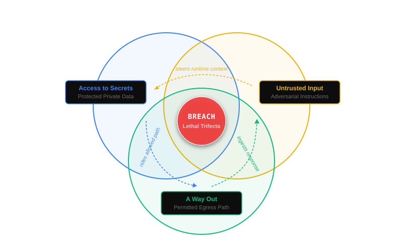

# 使用 OpenShell 和 NemoClaw 构建安全智能体

> 从一次模型调用出发，逐步实现智能体协作、有依据的检索、深度规划与更安全的执行。NemoClaw 提供参考技术栈；OpenShell 提供 sandbox。

| 开始学习 | 准备实验环境 | 使用模型 |
| --- | --- | --- |
| **[打开课程](i18n/zh/web/nemoclaw/index.html)** | **[本地环境配置指南](LOCAL_STARTUP_GUIDE.md)** | **[打开 NVIDIA Build](https://build.nvidia.com/?ncid=ref-dli-146986)** |
| 完成四个模块。 | 在本地（WSL2 或 DGX Spark）安装 NeMoClaw。 | 根据提示创建 API 密钥。 |

[](LICENSE)

---

> **这是 NeMoClaw DLI 课程的中文版本**。
> 本仓库针对 **non-Brev 本地部署（WSL2 + Docker 和 DGX Spark Station）** 进行了适配，并提供简体中文课程内容。
> 英文上游源码请参阅
> [`NVDLI/NemoClawDLI`](https://github.com/NVDLI/NemoClawDLI)。

计划发布的公共主页为
[`NVDLI/NemoClawDLI-zh`](https://github.com/NVDLI/NemoClawDLI-zh)。发布仍需获得 OSRB 批准。
当前发布状态以机器可读文件 [`RELEASE_STATUS.json`](RELEASE_STATUS.json) 为准。仓库检查通过并不能替代
NVIDIA 的法律、安全或发布审批。

## 课程简介

智能体将模型连接到工具和记忆，再通过路由决策持续运行，直至完成任务。本课程将从零开始构建这样的系统，
随后把这些理念与当前的智能体框架联系起来。您将从一次 API 调用起步，逐步学习智能体协作、有依据的检索、
深度规划，以及如何使用 OpenClaw、NVIDIA NemoClaw™ 和 OpenShell 实现安全部署。

每节课都是可编辑的浏览器练习。后续模块使用 NemoClaw 和 OpenShell 在本地运行智能体并观察其行为，无需 Brev launchable。

> **注意：** 本仓库发布课程及其验证工具。NemoClaw 及其运行时仍是外部依赖项。

## 课程路径

### 模块 1：构建智能体循环


从观察—行动循环入手，逐步加入模型调用、状态、工具以及明确的停止条件。

### 模块 2：协调任务并提供可靠依据


加入显式路由、并行任务、基于自有资料的检索以及更深入的规划。

### 模块 3 和模块 4：运行并约束智能体



将这一设计连接到 NemoClaw，在本地持续运行智能体，再使用 OpenShell 限制其工具、文件和网络访问。

## 学习目标

- 构建基本的智能体循环，并识别其核心组件
- 在智能体系统中实现可靠的工具使用和函数调用
- 使用结构化路由模式设计和协调多智能体系统
- 使用 OpenShell 配置智能体身份，并确保操作安全地在 sandbox 中执行
- 部署和管理自主智能体，同时构建可持久保留的技能库

## 学习课程

启动本地服务后，请打开 `http://localhost:8081/`。该地址默认进入简体中文课程；课程顶部的语言菜单
可在简体中文和 English 之间切换。中文源文件位于 [`i18n/zh/web`](i18n/zh/web)，英文源文件位于
[`web`](web)。模型练习需要使用学员自行提供的 NVIDIA API 密钥。

**在这个本地 non-Brev 分支中：** 模块 3 和模块 4 连接本地的 openshell-sandbox Docker 容器，
而不是 Brev launchable。支持 Windows 11 + WSL2 + Docker（不要求 GPU）和 DGX Spark Station
（原生 Ubuntu Linux，GPU 可选）。打开课程页面前，请运行 `bash start_proxies.sh` 启动所有服务；
完整说明请参阅 [`LOCAL_STARTUP_GUIDE.md`](LOCAL_STARTUP_GUIDE.md)。

面向学员的版本是一个静态浏览器站点，不会捆绑学员凭据。NemoClaw 产品和运行时是外部依赖项，
不属于本课程仓库发布的内容。

## 在本地运行（non-Brev）

本分支无需 Brev launchable，支持以下两个平台：

- **Windows 11 + WSL2 + Docker**：所有服务均在 WSL2 的 Ubuntu 24.04 中运行。
- **DGX Spark Station（原生 Ubuntu Linux）**：使用相同服务并通过原生 Docker 运行；可以直接从 DGX
  上的浏览器访问课程页面，也可以通过 SSH 端口转发从 Windows 浏览器访问。

完整的分步操作流程（包括一次性的 NeMoClaw 安装和初始配置）请参阅
[`LOCAL_STARTUP_GUIDE.md`](LOCAL_STARTUP_GUIDE.md)。

**两个平台的前提条件：** 已安装 Docker、NeMoClaw 和 OpenShell（请参阅 `LOCAL_STARTUP_GUIDE.md` 第 0 节），
并准备一个 NVIDIA API 密钥。

**每次使用时的快速启动步骤：**

```bash
# 1. Set your API key
export NVAPI_KEY="nvapi-..."

# 2. Start all background services in one command
#    WSL2:  bash "/mnt/c/…/repo/start_proxies.sh"
#    DGX:   bash ~/nemoclaw-zh/start_proxies.sh

# 3. Recover the container, set up the forward service, fix iptables rules
#    (see LOCAL_STARTUP_GUIDE.md steps 1c–1f for the full commands)

# DGX only — two options to access course pages:
#   Option A: open Firefox directly on the DGX at http://localhost:8081/...
#   Option B: SSH tunnel from Windows (see LOCAL_STARTUP_GUIDE.md § 0.5 for port details)
#    ssh -L 8081:localhost:8081 -L 8010:localhost:8010 -L 8011:localhost:8011 <user>@<dgx-ip>
```

打开 `http://localhost:8081/` 后会默认进入中文课程。请先前往
`http://localhost:8081/zh/nemoclaw/03a-kickstart.html`，输入 API 密钥和 bearer token，
并通过健康检查确认整条链路正常。然后前往 `http://localhost:8081/zh/nemoclaw/01a-loop.html`，
按以下顺序完成各页面：01a、01b、01c、02a……03a、03b、03c、04a、04b、04c。

### 本仓库的静态构建方式

对于不需要 launchable 的页面，也可以使用静态构建方式在本地运行（无需 Docker）。
请安装 Python 3.11+、Node.js 20+、pnpm 和 Chromium，然后运行：

```bash
bash scripts/build/build_pages.sh public
python3 -m http.server -d public 8000
```

打开 `http://localhost:8000/` 后会默认进入简体中文课程，也可以通过课程顶部的语言菜单切换到 English。
在此模式下，模块 3 和模块 4 仍需要 launchable。

## 参与贡献

如需提出问题、修正内容、分享教学建议、报告运行时观察结果或提供资料线索，请创建结构化 Issue。
公共社区接收渠道获得批准并启用后，Discussions 将用于接收更广泛的问题。安全问题必须通过
[`SECURITY.md`](SECURITY.md) 中的私密渠道报告，切勿创建公开 Issue 或 Discussion。

在所需检查通过并由获授权的人员审核接受之前，所有代码都只是尚未受信任的提案。
每个补丁都需要对应的 Issue、明确的影响范围、验证证据和 DCO sign-off。
任何贡献者、维护者或智能体都不能审批自己提交的受保护合并或版本发布。
人工审批不能替代缺失的控制措施，也不能消除尚未验证的发布风险。

请先阅读 [`CONTRIBUTING.md`](CONTRIBUTING.md)，其中规定了环境设置、Issue 和补丁提交流程、
sign-off、验证、本地化责任和贡献者署名方式。其余面向贡献者的条款由
[`行为准则`](CODE_OF_CONDUCT.md)、[`支持政策`](SUPPORT.md)和 [`DCO`](DCO.md) 定义。

## 验证更改

安装本地 hook，然后运行 fast gate：

```bash
bash scripts/build/install-hooks.sh
python3 scripts/validation/release_gate.py --tier fast --no-write
```

发布前或修改了跨模块约定后，请使用 `--tier ship`。各项声明及其验证证据的对应关系请参阅
[`发布测试计划`](docs/release-test-plan.md)。浏览器前提条件和渲染检查说明位于
[`docs/lab_runtime_testing.md`](docs/lab_runtime_testing.md)。

发布威胁模型的证据位于 [`docs/security-design.md`](docs/security-design.md)。其中基于来源构建的关系图
涵盖学员运行时和发布供应链。CI 会拒绝缺少服务、未标记信任边界流、证据损坏、连接器冲突和输出过期等问题。
生成的审阅设计和图表使用相同的架构指纹。提交的附件得到确认前，未保持这种绑定关系的报告将保持 Unknown 状态。
仓库负责的缓解措施、尚未解决的主机或提供商要求、剩余风险和不适用的建议分别记录在
[`docs/security-control-disposition.md`](docs/security-control-disposition.md) 中。

## 仓库如何指导智能体

[`AGENTS.md`](AGENTS.md) 是跨运行环境的约定。每个源码目录都包含一个 `SKILL.html`，
用于将任务引导至相应的文件和检查项。当智能体上下文、模型行为或贡献者经验不同时，
确定性验证器、受保护的主机规则和人工审核仍具有最终效力。

精简设计文档
[`Rapidly-Evolving Agentic Compliance Suite`](docs/agentic-compliance-suite.md) 介绍了这种工作流模式、
它的局限性及本仓库的实现方式。该名称描述的是一种工程方法，并非认证、产品或审批替代方案。

## 项目结构

| 路径 | 用途 |
| --- | --- |
| [`web/`](web/SKILL.html) | 浏览器课程、共享运行时、图表、资料和依赖项证据 |
| [`i18n/`](i18n/SKILL.html) | 与规范课程一同构建、经过审核的语言覆盖层 |
| [`scripts/`](scripts/SKILL.html) | 构建、验证、运行时、合规和资料工具 |
| [`docs/`](docs/SKILL.html) | 设计、测试、部署、安全和发布约定 |
| [`SKILL.html`](SKILL.html) | 面向人员和智能体的仓库地图 |

本仓库发布静态课程及其验证工具，不发布实验环境操作系统、服务栈或基础容器。
[`浏览器依赖项清单`](web/nemoclaw/dependencies.html)列出了学员会收到的代码。
软件和资料的关联关系由 [`THIRD_PARTY_LICENSES.md`](THIRD_PARTY_LICENSES.md) 和
[`THIRD-PARTY-NOTICES.md`](THIRD-PARTY-NOTICES.md) 说明。

## 治理、发布和许可证

计划公开发布的课程仓库是 NVIDIA 所有的 Full-OSS-Project、OSS Type I 项目。
此分类仅适用于该 DLI 课程仓库。公开发布前必须获得主管系统的批准。

[`docs/release_playbook.md`](docs/release_playbook.md) 规定了维护者角色、公共 GitHub 设置、
受保护的发布流程和内部集成周期。[`CHANGELOG.md`](CHANGELOG.md) 记录版本历史，
[`docs/product-design.md`](docs/product-design.md) 定义发布边界，
[`docs/security-design.md`](docs/security-design.md) 定义信任边界。

计划公开发布的版本采用双许可证：NVIDIA 编写的源代码采用
[Apache License 2.0](LICENSE)，NVIDIA 编写的文档、skills 和素材采用
[Creative Commons Attribution 4.0 International (CC-BY-4.0)](LICENSE)，
同时包含文档和代码的文件同时适用这两套条款。第三方素材保留其原有许可证，不会被重新授权；
详见 [`THIRD-PARTY-NOTICES.md`](THIRD-PARTY-NOTICES.md) 和
[`THIRD_PARTY_LICENSES.md`](THIRD_PARTY_LICENSES.md)。
贡献内容使用相同的入站许可证并要求 DCO sign-off；本项目不要求签署单独的 CLA。
签署方式和完整的 DCO 1.1 文本见 [`CONTRIBUTING.md`](CONTRIBUTING.md)。

NVIDIA 的名称、徽标和商标不授权一般性重复使用。
