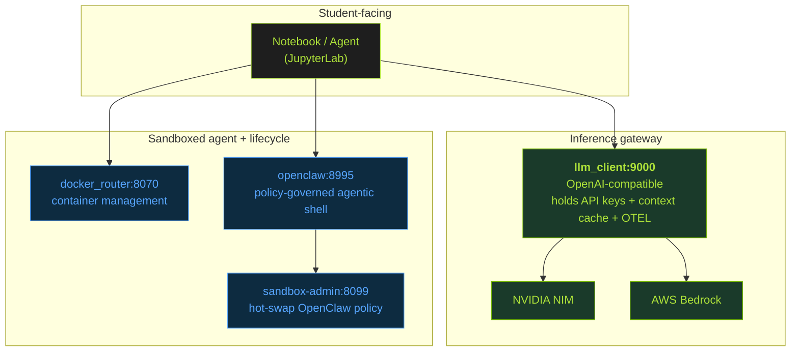

<br>
<a href="https://www.nvidia.com/en-us/training/">
    <div style="width: 55%; background-color: white; margin-top: 50px;">
    </div>
</a>
<h1 style="line-height: 1.4;"><font color="#76b900"><b>Lab Services</b></font></h1>
<h2><b>Service Map</b>: All Microservices at a Glance</h2>
<br>

This notebook is your entry point to the lab's microservice layer.  Each service has its
own detailed notebook linked below.

---

## Services the released course runs against

The released course (nemoclaw, Securing Agents) is browser-only and reaches the lab
through nginx. Its live runtime subset is the model gateway plus the sandboxed-agent
control plane; everything else here is retained shared infrastructure that the course
does not call directly.

| Service | Port | Notebook | Consumed by |
| :--- | :--- | :--- | :--- |
| **llm_client** | 9000 | [`00_llm_client.md`](00_llm_client.md) | nemoclaw (sole keyholder; every model call routes through it) |
| **openclaw** | 8995 | [`00_openclaw.md`](00_openclaw.md) | nemoclaw (the sandboxed agent the course drives in Modules 3 and 4) |
| **sandbox-admin** | 8099 | [`00_sandbox_admin.md`](00_sandbox_admin.md) | nemoclaw (hot-swaps the OpenClaw policy the course demonstrates) |

## Supporting infrastructure

The course does not call this service directly, but the lab relies on it to manage
the sandboxed-agent containers.

| Service | Port | Notebook | Role |
| :--- | :--- | :--- | :--- |
| **docker_router** | 8070 | [`00_docker_router.md`](00_docker_router.md) | container lifecycle behind an allow-list; holds the Docker socket |

## Quick health check

```python
import requests

services = {
    "llm_client":    "http://llm_client:9000/health",
    "docker_router": "http://docker_router:8070/health",
    "openclaw":      "http://openshell:8995/health",
    "sandbox-admin": "http://sandbox-admin:8099/admin/health",
}

for name, url in services.items():
    try:
        r = requests.get(url, timeout=5)
        print(f"  {'OK' if r.ok else 'WARN':4}  {name:<20} HTTP {r.status_code}")
    except Exception as e:
        print(f"  ERR   {name:<20} {str(e)[:50]}")
```

## Architecture diagram



*The shared substrate. The released course routes inference through `llm_client:9000` (the only service that holds API keys) and drives the sandboxed agent through `openclaw:8995` with policy hot-swaps via `sandbox-admin:8099`. The remaining sidecars stay in the stack as retained shared infrastructure.*

**Also documented:** [`openclaw/SOUL.md`](openclaw/SOUL.md) (OpenClaw agent identity seed).

