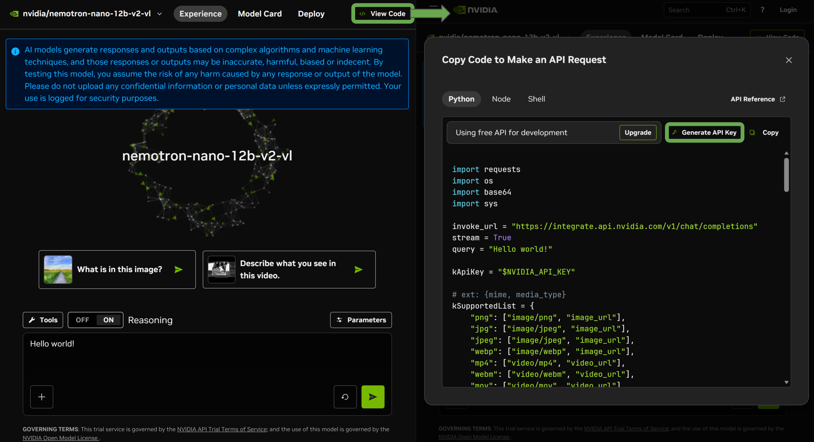
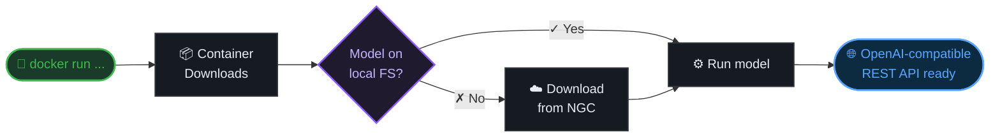

<!-- dli-course-cell {"id":"1-Intro-to-Prompting/11-Nvidia-NIM:0","index":0,"schema":"dli-course-cell/1.0","source_sha256":"7d8bdea4ffcbad10387b9a0356e5e9ab73d45072a49856593fac7e24a703e728","type":"markdown"} -->
 
<a href="https://www.nvidia.com/en-us/training/">
    

    

</a>
<h1 style="line-height: 1.4;"><b>Building LLM Applications With Prompt Engineering</b></h1>
<h2><b>NVIDIA NIM and the API Catalog</b></h2>
 
<!-- /dli-course-cell -->

<!-- dli-course-cell {"id":"1-Intro-to-Prompting/11-Nvidia-NIM:1","index":1,"schema":"dli-course-cell/1.0","source_sha256":"bc2268945dc1c41b72289fa2ed41de766f90ca8c568e089261dcc25173ae04fd","type":"markdown"} -->
## Objective

By the time you complete this notebook you will be able to:

- Understand what NVIDIA Inference Microservices (NIMs) are
- Know how we will utilize the NVIDIA API Catalog to conduct prompt engineering
- Understand the benefits of local NIM deployment for production workloads
<!-- /dli-course-cell -->

<!-- dli-course-cell {"id":"1-Intro-to-Prompting/11-Nvidia-NIM:2","index":2,"schema":"dli-course-cell/1.0","source_sha256":"cb3f91d54eee30e53e35b2b99905f70f169ed549fd78909d3dac2defc9ed8d3b","type":"markdown"} -->
---
<!-- /dli-course-cell -->

<!-- dli-course-cell {"id":"1-Intro-to-Prompting/11-Nvidia-NIM:3","index":3,"schema":"dli-course-cell/1.0","source_sha256":"9af1d02d160c80b1740da44fd934bf6371a23c31ee22f5a96783f3a4d2b692a3","type":"markdown"} -->
## NVIDIA Inference Microservices
<!-- /dli-course-cell -->

<!-- dli-course-cell {"id":"1-Intro-to-Prompting/11-Nvidia-NIM:4","index":4,"schema":"dli-course-cell/1.0","source_sha256":"ad7bc7dc781e2b2c3f5ebbd6c067f194489ce5eae399514667a64f4222c69280","type":"markdown"} -->
NVIDIA NIM is a set of easy-to-use microservices designed for secure, reliable deployment of high performance AI model inference across the cloud, data center and workstations. Supporting a wide range of AI models, including open-source community and NVIDIA AI Foundation models, it ensures seamless, scalable AI inferencing, on premises or in the cloud, implementing industry standard APIs.
<!-- /dli-course-cell -->

<!-- dli-course-cell {"id":"1-Intro-to-Prompting/11-Nvidia-NIM:5","index":5,"schema":"dli-course-cell/1.0","source_sha256":"cb3f91d54eee30e53e35b2b99905f70f169ed549fd78909d3dac2defc9ed8d3b","type":"markdown"} -->
---
<!-- /dli-course-cell -->

<!-- dli-course-cell {"id":"1-Intro-to-Prompting/11-Nvidia-NIM:6","index":6,"schema":"dli-course-cell/1.0","source_sha256":"b9ba485821ba6f3b284f018526d680c2deff2bd050ba0e144c91080f8bd43b13","type":"markdown"} -->
## The NVIDIA API Catalog

The **NVIDIA API Catalog,** accessible at [**build.nvidia.com**](https://build.nvidia.com/explore/discover), provides instant access to a variety of NIM-powered endpoints. You can browse available models ranging from open-source LLMs such as [**Nemotron 3 Super**](https://build.nvidia.com/nvidia/nemotron-3-super-120b-a12b) to image generation models such as [**Stable-Diffusion-XL**](https://build.nvidia.com/explore/visual-design#stable-diffusion-xl) and [**FLUX.1**](https://build.nvidia.com/black-forest-labs/flux_1-dev).

On the API Catalog, you can preview how a model will perform by interacting with the Graphical User Interface, and you can obtain API keys to interact with the models programmatically.

> 
<!-- /dli-course-cell -->

<!-- dli-course-cell {"id":"1-Intro-to-Prompting/11-Nvidia-NIM:7","index":7,"schema":"dli-course-cell/1.0","source_sha256":"cb3f91d54eee30e53e35b2b99905f70f169ed549fd78909d3dac2defc9ed8d3b","type":"markdown"} -->
---
<!-- /dli-course-cell -->

<!-- dli-course-cell {"id":"1-Intro-to-Prompting/11-Nvidia-NIM:8","index":8,"schema":"dli-course-cell/1.0","source_sha256":"3fd00d176bb77f8788c9a937af3e9bac3aa029439d8b95aa1eb4e38f06ca5ba1","type":"markdown"} -->
## The Course Environment
<!-- /dli-course-cell -->

<!-- dli-course-cell {"id":"1-Intro-to-Prompting/11-Nvidia-NIM:9","index":9,"schema":"dli-course-cell/1.0","source_sha256":"4ae22d2d6e4becbc1859e23e0ba097d20900ca90891cc38a5deeadf1fcce13e0","type":"markdown"} -->
In this course, we will use the NVIDIA API Catalog to access the [**nvidia/nemotron-nano-12b-v2-vl**](https://build.nvidia.com/nvidia/nemotron-nano-12b-v2-vl) model. The API Catalog provides a convenient way to experiment with models and develop prompt engineering skills without needing to manage GPU infrastructure.

We've configured this environment with the necessary credentials to access the API, so you can focus on learning prompt engineering techniques rather than setup details.

Using the API Catalog is an excellent way to:
- **Prototype quickly**: Start experimenting with models immediately without any infrastructure setup
- **Learn and iterate**: Develop your prompt engineering skills with fast feedback loops
- **Explore models**: Try different models to find the best fit for your use case
<!-- /dli-course-cell -->

<!-- dli-course-cell {"id":"1-Intro-to-Prompting/11-Nvidia-NIM:10","index":10,"schema":"dli-course-cell/1.0","source_sha256":"cb3f91d54eee30e53e35b2b99905f70f169ed549fd78909d3dac2defc9ed8d3b","type":"markdown"} -->
---
<!-- /dli-course-cell -->

<!-- dli-course-cell {"id":"1-Intro-to-Prompting/11-Nvidia-NIM:11","index":11,"schema":"dli-course-cell/1.0","source_sha256":"19ff9bb45f6858e4ad0bdc5d6bcfdc8706489df8a30c219b8fa9dedb42be5e77","type":"markdown"} -->
## Moving to Local Deployment with NIM
<!-- /dli-course-cell -->

<!-- dli-course-cell {"id":"1-Intro-to-Prompting/11-Nvidia-NIM:12","index":12,"schema":"dli-course-cell/1.0","source_sha256":"d117da165b991b3be55907ec6d70b49723f44f1ab485957c9fd1f039184964ec","type":"markdown"} -->
While the API Catalog is great for learning and prototyping, you may eventually want to deploy NIMs locally or in your own infrastructure. NIM microservices are packaged as container images on a per model/model family basis, and can be deployed on NVIDIA GPUs with sufficient memory.

<!-- /dli-course-cell -->

<!-- dli-course-cell {"id":"1-Intro-to-Prompting/11-Nvidia-NIM:13","index":13,"schema":"dli-course-cell/1.0","source_sha256":"76c6107d7993603a5b2e734345b41de6133adcb0a942df628974e4da0c3b9a13","type":"markdown"} -->
Local NIM deployments offer several benefits for production workloads:

- **Speed**: LLM NIM microservices are supported with pre-generated optimized engines for a diverse range of cutting edge LLM architectures, allowing for low latency when making inference.
- **Cost at Scale**: API-hosted LLMs can become expensive for large-scale or high-volume needs. Local deployments offer a more cost-effective solution for production workloads, as you can scale by adding computing resources or distributing across multiple machines.
- **Data Privacy**: Keep sensitive data within your own infrastructure rather than sending it to external APIs.
- **Customization and Control**: Running a model locally gives you full control over your AI applications, including the ability to fine-tune models and customize the serving infrastructure.
<!-- /dli-course-cell -->

<!-- dli-course-cell {"id":"1-Intro-to-Prompting/11-Nvidia-NIM:14","index":14,"schema":"dli-course-cell/1.0","source_sha256":"cb3f91d54eee30e53e35b2b99905f70f169ed549fd78909d3dac2defc9ed8d3b","type":"markdown"} -->
---
<!-- /dli-course-cell -->

<!-- dli-course-cell {"id":"1-Intro-to-Prompting/11-Nvidia-NIM:15","index":15,"schema":"dli-course-cell/1.0","source_sha256":"be031d37bb75d96ef08ca9ec5b0e83bb6f91172f60d3c31a78feae8d7dc4a0b0","type":"markdown"} -->
## Conclusion
<!-- /dli-course-cell -->

<!-- dli-course-cell {"id":"1-Intro-to-Prompting/11-Nvidia-NIM:16","index":16,"schema":"dli-course-cell/1.0","source_sha256":"77419d9de1b3bdf021aca22f0f7c853530a3160281c9e3994a213d2a6397a423","type":"markdown"} -->
In this notebook you were introduced to NVIDIA NIM microservices and the API Catalog. The API Catalog makes it easy to get started with powerful language models, and when you're ready for production, you can deploy NIMs in your own infrastructure.

Now let's proceed to the next notebook, where you will begin to interact with the Nemotron Nano 12b V2-VL endpoint through the API Catalog.

---

<!-- NEXT_STEP_CARD -->

Continue the unified course path

<strong>Next step:</strong> Open <code>1-Intro-to-Prompting/12-Hello-OpenAI.ipynb</code> next: <strong>Hello World with OpenAI Library</strong>.

<strong>Before moving on:</strong> Keep one concrete route or model inventory detail in mind, because the next notebook turns that runtime surface into your first inspectable client request.

<!-- /dli-course-cell -->
