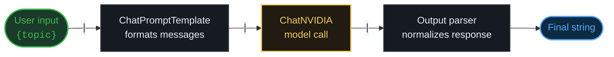

<!-- dli-course-cell {"id":"2-Chains/21-LCEL:0","index":0,"schema":"dli-course-cell/1.0","source_sha256":"914f04845c58649bc2bb8d07a4c078870917adb06bb809044d7b77ddeba8168d","type":"markdown"} -->
<br>
<a href="https://www.nvidia.com/en-us/training/">
    <div style="width: 55%; background-color: white; margin-top: 50px;">
    </div>
</a>
<h1 style="line-height: 1.4;"><font color="#76b900"><b>Building LLM Applications With Prompt Engineering</b></font></h1>
<h2><b>LangChain Expression Language and Chains</b></h2>
<br>
<!-- /dli-course-cell -->

<!-- dli-course-cell {"id":"2-Chains/21-LCEL:1","index":1,"schema":"dli-course-cell/1.0","source_sha256":"83cd5af8c82665f8ddd3c28e6cea9ae277b5f9c9df612d603deaaa1669145ea5","type":"markdown"} -->
In this notebook you will learn about LangChain runnables, and the ability to compose them into chains using LangChain Expression Language (LCEL).


<!-- /dli-course-cell -->

<!-- dli-course-cell {"id":"2-Chains/21-LCEL:2","index":2,"schema":"dli-course-cell/1.0","source_sha256":"cb3f91d54eee30e53e35b2b99905f70f169ed549fd78909d3dac2defc9ed8d3b","type":"markdown"} -->
---
<!-- /dli-course-cell -->

<!-- dli-course-cell {"id":"2-Chains/21-LCEL:3","index":3,"schema":"dli-course-cell/1.0","source_sha256":"7ed1d5d3598d9dfd44ff52aa769434d46ec975cd34ded253e39b3b255ea9be1a","type":"markdown"} -->
## Objectives
<!-- /dli-course-cell -->

<!-- dli-course-cell {"id":"2-Chains/21-LCEL:4","index":4,"schema":"dli-course-cell/1.0","source_sha256":"263987ccb32bb2daaf740de38f5e30760c8f7e486c4933953bb5b24734394cf5","type":"markdown"} -->
By the time you complete this notebook you will:

- Understand LangChain runnables as units of work in LangChain.
- Intentionally use LLM instances and prompt templates as runnables.
- Create and use runnable output parsers.
- Compose runnables into LangChain chains using LCEL pipe syntax.
<!-- /dli-course-cell -->

<!-- dli-course-cell {"id":"2-Chains/21-LCEL:5","index":5,"schema":"dli-course-cell/1.0","source_sha256":"cb3f91d54eee30e53e35b2b99905f70f169ed549fd78909d3dac2defc9ed8d3b","type":"markdown"} -->
---
<!-- /dli-course-cell -->

<!-- dli-course-cell {"id":"2-Chains/21-LCEL:6","index":6,"schema":"dli-course-cell/1.0","source_sha256":"d357b415148d05679d1f9802803fc0a4a039f4ece72445b0c3c596b0eb555b52","type":"markdown"} -->
## Imports
<!-- /dli-course-cell -->

<!-- dli-course-cell {"id":"2-Chains/21-LCEL:7","index":7,"schema":"dli-course-cell/1.0","source_sha256":"15c4faff0506ab4a6c5ecc8309bc6973b78baaa56fe695589969a8508e0c97e4","type":"code"} -->
```python
import os
from langchain_nvidia_ai_endpoints import ChatNVIDIA
from langchain_core.prompts import ChatPromptTemplate
from langchain_core.output_parsers import StrOutputParser
```
<!-- /dli-course-cell -->

<!-- dli-course-cell {"id":"2-Chains/21-LCEL:8","index":8,"schema":"dli-course-cell/1.0","source_sha256":"cb3f91d54eee30e53e35b2b99905f70f169ed549fd78909d3dac2defc9ed8d3b","type":"markdown"} -->
---
<!-- /dli-course-cell -->

<!-- dli-course-cell {"id":"2-Chains/21-LCEL:9","index":9,"schema":"dli-course-cell/1.0","source_sha256":"70f5e78e300511808de404ed1d62799fc55c2b20e6c2a33706e13dbca5acc811","type":"markdown"} -->
## Create a Model Instance
<!-- /dli-course-cell -->

<!-- dli-course-cell {"id":"2-Chains/21-LCEL:10","index":10,"schema":"dli-course-cell/1.0","source_sha256":"fe8a07f8e29704ed8c72091c34ce44956cd4b2a6331a6a6220553baac2abf3d3","type":"code"} -->
```python
base_url = os.getenv("NVIDIA_BASE_URL")

# Use the model selected in the course connection panel, or keep the lesson default.
model = os.getenv("NVIDIA_MODEL") or "nvidia/nemotron-nano-12b-v2-vl"
# model = "nvidia/nemotron-3-nano-30b-a3b"  # Compatible fallback; responses may differ.
# model = "meta/llama-3.3-70b-instruct"  # Legacy fallback; responses may differ more.

llm = ChatNVIDIA(base_url=base_url, model=model, temperature=0)
```
<!-- /dli-course-cell -->

<!-- dli-course-cell {"id":"2-Chains/21-LCEL:11","index":11,"schema":"dli-course-cell/1.0","source_sha256":"cb3f91d54eee30e53e35b2b99905f70f169ed549fd78909d3dac2defc9ed8d3b","type":"markdown"} -->
---
<!-- /dli-course-cell -->

<!-- dli-course-cell {"id":"2-Chains/21-LCEL:12","index":12,"schema":"dli-course-cell/1.0","source_sha256":"0967e2ae8b6245d3c0b5b38b74b6d01930cf1ecd0ece0013f97a11624ce03ad0","type":"markdown"} -->
## LangChain Runnables
<!-- /dli-course-cell -->

<!-- dli-course-cell {"id":"2-Chains/21-LCEL:13","index":13,"schema":"dli-course-cell/1.0","source_sha256":"7034238abba8117e2d1ef766c36a629b8cb9f04371f23009fb5eb62edf8f61a2","type":"markdown"} -->
In the previous notebook you learned to create simple LangChain prompt templates, and to instantiate them with specific values for their template placeholders with the `invoke` method.
<!-- /dli-course-cell -->

<!-- dli-course-cell {"id":"2-Chains/21-LCEL:14","index":14,"schema":"dli-course-cell/1.0","source_sha256":"01a7cf3f4bafdab28817407f046caf32baae3e37a19fac70c6f003c7092957a5","type":"code"} -->
```python
template = ChatPromptTemplate.from_template("Answer the following question: {question}")
prompt = template.invoke({"question": "In what city is NVIDIA world headquarters?"})
```
<!-- /dli-course-cell -->

<!-- dli-course-cell {"id":"2-Chains/21-LCEL:15","index":15,"schema":"dli-course-cell/1.0","source_sha256":"b71e99e7c2650709dc246e4a32057cf2b52053a54155e90912f1410749ca76a9","type":"markdown"} -->
You also know, that when sending a prompt to an LLM instance that we have created in LangChain (in our case the LangChain component `ChatNVIDIA`), that we use the model instances's `invoke` method.
<!-- /dli-course-cell -->

<!-- dli-course-cell {"id":"2-Chains/21-LCEL:16","index":16,"schema":"dli-course-cell/1.0","source_sha256":"fc5180592c76daa5bf979a5ce07e760641772a4aeb3a75ff2203cd9b44dfd3a2","type":"code"} -->
```python
response = llm.invoke(prompt)
```
<!-- /dli-course-cell -->

<!-- dli-course-cell {"id":"2-Chains/21-LCEL:17","index":17,"schema":"dli-course-cell/1.0","source_sha256":"35f34aa5871a45206476cd2bedf842a376da78d3e182f455fab6549b6d3598d7","type":"code"} -->
```python
print(response.content)
```
<!-- /dli-course-cell -->

<!-- dli-course-cell {"id":"2-Chains/21-LCEL:18","index":18,"schema":"dli-course-cell/1.0","source_sha256":"59fbe3fbb562e91d954209f9746e22853dfe6bb6ce5673220febf31e3dd5567c","type":"markdown"} -->
The presence of the `invoke` method on both LLM instances, and on prompt templates is not coincidental, they are both LangChain **runnables**.

In LangChain, a **runnable** is a unit of work that can be invoked (as we've done with both LLM instances and prompt templates), batched and streamed (as we have done with LLM instances) and also transformed and composed (which we have not done yet).

Just to sanity check this, let's try the `batch` method, which we've used with LLM instances, but not on our prompt templates. Since prompt templates are runnables, like LLM instances, and since runnables can be batched, the following ought to work.
<!-- /dli-course-cell -->

<!-- dli-course-cell {"id":"2-Chains/21-LCEL:19","index":19,"schema":"dli-course-cell/1.0","source_sha256":"b027ea0b668b01c529eda999d7d3238140980f4efb0ec757ced2a134cf83bfe0","type":"code"} -->
```python
questions = [
    {"question": "In what city is NVIDIA world headquarters?"},
    {"question": "When was NVIDIA founded?"},
    {"question": "Who is the CEO of NVIDIA?"},
]
```
<!-- /dli-course-cell -->

<!-- dli-course-cell {"id":"2-Chains/21-LCEL:20","index":20,"schema":"dli-course-cell/1.0","source_sha256":"1d8847da49ac71da51f120378705fa430f28c35cb285378a6d0b03fe9fc54f50","type":"code"} -->
```python
prompts = template.batch(questions)
```
<!-- /dli-course-cell -->

<!-- dli-course-cell {"id":"2-Chains/21-LCEL:21","index":21,"schema":"dli-course-cell/1.0","source_sha256":"eb7526362ee7678cb5650f67d90cfdb84485363ca148ff3993ded032560941fb","type":"code"} -->
```python
prompts
```
<!-- /dli-course-cell -->

<!-- dli-course-cell {"id":"2-Chains/21-LCEL:22","index":22,"schema":"dli-course-cell/1.0","source_sha256":"cb3f91d54eee30e53e35b2b99905f70f169ed549fd78909d3dac2defc9ed8d3b","type":"markdown"} -->
---
<!-- /dli-course-cell -->

<!-- dli-course-cell {"id":"2-Chains/21-LCEL:23","index":23,"schema":"dli-course-cell/1.0","source_sha256":"d9fe1dfcaa0a77e70644a2c75bf551ba0674b0988aff40d46ad74d367630e714","type":"markdown"} -->
## LangChain Expression Language (LCEL)
<!-- /dli-course-cell -->

<!-- dli-course-cell {"id":"2-Chains/21-LCEL:24","index":24,"schema":"dli-course-cell/1.0","source_sha256":"39e2d4156479c5ac32bc6c97df3c6ab87ff6d001c3749bb788ca675c29695ef7","type":"markdown"} -->
LCEL is a declarative way to compose runnables into **chains**: reusable compositions of functionality. We chain runnables together through LCEL's pipe `|` operator, which at a high level, will pipe the output of one runnable to the next.

For those of you who have worked with the Unix command line, you'll be familar with the `|` operator as a way to chain together the functionality of various programs in service of a larger goal.

If you don't know any Bash, don't worry too much about the following cell, but for those of you who do, you'll see we create a chain via the pipe operator to print "hello pipes" with `echo`, reverse the string with `rev` and then uppercase the reversed string with `tr`.
<!-- /dli-course-cell -->

<!-- dli-course-cell {"id":"2-Chains/21-LCEL:25","index":25,"schema":"dli-course-cell/1.0","source_sha256":"a45c672d55693655516bb9df5369645f39455afc7ea4f718127399e205e26244","type":"code"} -->
```python
%%bash
echo hello pipes | rev | tr 'a-z' 'A-Z'
```
<!-- /dli-course-cell -->

<!-- dli-course-cell {"id":"2-Chains/21-LCEL:26","index":26,"schema":"dli-course-cell/1.0","source_sha256":"4482227875898e64041d4d2e1b63c1f84c9d5cf7932c1b9c848a784ba817ee49","type":"markdown"} -->
Similarly, and just as conveniently and powerfully, we can pipe together a great deal of LangChain functionality using LCEL's pipe operator.
<!-- /dli-course-cell -->

<!-- dli-course-cell {"id":"2-Chains/21-LCEL:27","index":27,"schema":"dli-course-cell/1.0","source_sha256":"cb3f91d54eee30e53e35b2b99905f70f169ed549fd78909d3dac2defc9ed8d3b","type":"markdown"} -->
---
<!-- /dli-course-cell -->

<!-- dli-course-cell {"id":"2-Chains/21-LCEL:28","index":28,"schema":"dli-course-cell/1.0","source_sha256":"9105e80112a3200b4fda74729bcf24f16669cb9091db1bd0da15d615593a09c8","type":"markdown"} -->
## A Simple Chain
<!-- /dli-course-cell -->

<!-- dli-course-cell {"id":"2-Chains/21-LCEL:29","index":29,"schema":"dli-course-cell/1.0","source_sha256":"3c1f15b6bff9384b6ae824e1a98213594e583a383256bad91c93d188888f0175","type":"markdown"} -->
Let's begin with a simple chain, relevant to the work you've already been doing. Just to keep everything where we can see it we will define here again our LLM instance and a prompt template.
<!-- /dli-course-cell -->

<!-- dli-course-cell {"id":"2-Chains/21-LCEL:30","index":30,"schema":"dli-course-cell/1.0","source_sha256":"02c89d921471a3ab99d0a479da98c5f71d2bac8f831f5973921962e9076b2174","type":"code"} -->
```python
llm = ChatNVIDIA(base_url=base_url, model=model, temperature=0)
template = ChatPromptTemplate.from_template("Answer the following question: {question}")
```
<!-- /dli-course-cell -->

<!-- dli-course-cell {"id":"2-Chains/21-LCEL:31","index":31,"schema":"dli-course-cell/1.0","source_sha256":"362dfddab66246cd2abd95f112c83a1a2877e60908a0676c147984eae39e8f47","type":"markdown"} -->
Now we'll create our first LCEL chain by composing these 2 together with a pipe. It makes sense intuitively that we'll want to utilize the prompt template first, and then send the resulting prompt to the LLM, so in our pipe we will put the template first.
<!-- /dli-course-cell -->

<!-- dli-course-cell {"id":"2-Chains/21-LCEL:32","index":32,"schema":"dli-course-cell/1.0","source_sha256":"cc1f840c9be3309aeb3471666d3f41928d469a2c3d22b28d2f5d825090f50173","type":"code"} -->
```python
chain = template | llm
```
<!-- /dli-course-cell -->

<!-- dli-course-cell {"id":"2-Chains/21-LCEL:33","index":33,"schema":"dli-course-cell/1.0","source_sha256":"81ef23e72849d1357a17ef2c8021b87c20b749ed2fa280128ecce897e6a95ad5","type":"markdown"} -->
We can visualize the computational graph represented by `chain` using the following helper method on the chain.
<!-- /dli-course-cell -->

<!-- dli-course-cell {"id":"2-Chains/21-LCEL:34","index":34,"schema":"dli-course-cell/1.0","source_sha256":"825435ddb4c251b4667a35f9b0ed46feb2d9ce58a5851f084ba40dd6f782d2da","type":"code"} -->
```python
print(chain.get_graph().draw_ascii())
```
<!-- /dli-course-cell -->

<!-- dli-course-cell {"id":"2-Chains/21-LCEL:35","index":35,"schema":"dli-course-cell/1.0","source_sha256":"9f5d04256c711a913408edd805f1af0540bdd752b9908266248fe73755e77ead","type":"markdown"} -->
As you can see, the chain will expect a `PromptInput` which will be piped into our `ChatPromptTemplate` which will then be piped into our `ChatNVIDIA` model which will finally produce the `ChatNVIDIAOutput`.

Additionally, we can ascertain what kinds of inputs our chain expects, this time using a different helper method.
<!-- /dli-course-cell -->

<!-- dli-course-cell {"id":"2-Chains/21-LCEL:36","index":36,"schema":"dli-course-cell/1.0","source_sha256":"6ef96b6e0c6c344d12149db18c2a82cffe7495affedf5fee84320965bf6fb53a","type":"code"} -->
```python
chain.input_schema.model_json_schema()
# chain.output_schema.model_json_schema()
```
<!-- /dli-course-cell -->

<!-- dli-course-cell {"id":"2-Chains/21-LCEL:37","index":37,"schema":"dli-course-cell/1.0","source_sha256":"056eaf62b430bf1e1aa35499704af3fc2a4affdfbebdea28b5058e3e01dc911f","type":"markdown"} -->
The above is a [Pydantic](https://docs.pydantic.dev/latest/) object, which we're not going to cover in depth right now, but you'll notice immediately its `required` field states explicitly the name of any properties we are required to pass into `chain`.
<!-- /dli-course-cell -->

<!-- dli-course-cell {"id":"2-Chains/21-LCEL:38","index":38,"schema":"dli-course-cell/1.0","source_sha256":"653f474a27aa0ef73d21ede0ee953ad23ea848fac2eab076b37b1681bf684a61","type":"markdown"} -->
Chains are composed of runnables, but are also runnables themselves. Thus, just like we would with any other runnable, we can use its `invoke` method.

We know the beginning of our chain expects a prompt input, and that the prompt template expects us to supply a value for `question`, so we'll invoke the chain while providing the expected value.
<!-- /dli-course-cell -->

<!-- dli-course-cell {"id":"2-Chains/21-LCEL:39","index":39,"schema":"dli-course-cell/1.0","source_sha256":"f610cc5582b93ccdba22aa7f57e1cc374cf22262f21f5158000b4bff15fc7dea","type":"code"} -->
```python
chain.invoke({"question": "Who founded NVIDIA?"})
```
<!-- /dli-course-cell -->

<!-- dli-course-cell {"id":"2-Chains/21-LCEL:40","index":40,"schema":"dli-course-cell/1.0","source_sha256":"26906d4dd1526dd3a83872a79b06e3f687057f9d9937b025378124d6c0efb3d2","type":"markdown"} -->
It looks like we received a message from the model just like we have when invoking the model instance directly. Let's save the response and see if we view its `content` field as we've been able to do previously.
<!-- /dli-course-cell -->

<!-- dli-course-cell {"id":"2-Chains/21-LCEL:41","index":41,"schema":"dli-course-cell/1.0","source_sha256":"d0f114ecdc786640669b6aa2969b37c97448fd963b49d20873d0e8b608c89b5b","type":"code"} -->
```python
answer = chain.invoke({"question": "Who founded NVIDIA?"})
```
<!-- /dli-course-cell -->

<!-- dli-course-cell {"id":"2-Chains/21-LCEL:42","index":42,"schema":"dli-course-cell/1.0","source_sha256":"178fa84300edbcba2bb8212ef8e7c53347b58b4ff9404f8b3516bae25f79989f","type":"code"} -->
```python
print(answer.content)
```
<!-- /dli-course-cell -->

<!-- dli-course-cell {"id":"2-Chains/21-LCEL:43","index":43,"schema":"dli-course-cell/1.0","source_sha256":"cb3f91d54eee30e53e35b2b99905f70f169ed549fd78909d3dac2defc9ed8d3b","type":"markdown"} -->
---
<!-- /dli-course-cell -->

<!-- dli-course-cell {"id":"2-Chains/21-LCEL:44","index":44,"schema":"dli-course-cell/1.0","source_sha256":"c8134c3d6df75db2966263f46fefc5480e42c8d95ac7ea599b7eaf22b92558be","type":"markdown"} -->
## Output Parsers
<!-- /dli-course-cell -->

<!-- dli-course-cell {"id":"2-Chains/21-LCEL:45","index":45,"schema":"dli-course-cell/1.0","source_sha256":"b83c11795a876ffb19c165b2277095e4f036f49c969ac096cb5fe8b702ad1461","type":"markdown"} -->
Another core LangChain component is **output parsers**, which are classes to help structure LLM responses. Output parsers are, like LLM instances and prompt templates, runnables, which means we can use them in chains.

Let's begin with perhaps the most straightforward output parser, `StrOutputParser`, which is going to save us all the repetitive boilerplate of fishing the `content` field out of our model responses.

First we import the `StrOutputParser` class.
<!-- /dli-course-cell -->

<!-- dli-course-cell {"id":"2-Chains/21-LCEL:46","index":46,"schema":"dli-course-cell/1.0","source_sha256":"92176d137fa3cffa6ccc73142f1ca8e07174da0d6a4412a5412a9b6edff2868c","type":"code"} -->
```python
from langchain_core.output_parsers import StrOutputParser
```
<!-- /dli-course-cell -->

<!-- dli-course-cell {"id":"2-Chains/21-LCEL:47","index":47,"schema":"dli-course-cell/1.0","source_sha256":"6cfd376872666fd38a1397bbddb644a2fdd8a5f0c9b3101b74fc3320ba0c9d58","type":"markdown"} -->
Next we create an instance of the parser. For more advanced parsing techniques, some of which we'll see later, we can instantiate the parser with a variety of arguments, but for this simple parser we don't need to pass in any arguments when instantiating it.
<!-- /dli-course-cell -->

<!-- dli-course-cell {"id":"2-Chains/21-LCEL:48","index":48,"schema":"dli-course-cell/1.0","source_sha256":"a45d5e7d2a81f7cdc07183c70e44e42aa65c9d434cd853383f168af4980f7d4d","type":"code"} -->
```python
parser = StrOutputParser()
```
<!-- /dli-course-cell -->

<!-- dli-course-cell {"id":"2-Chains/21-LCEL:49","index":49,"schema":"dli-course-cell/1.0","source_sha256":"9a33e1cd00f1eb26a5693fd186b78f0c6c5881670ada759d564891454117a4f7","type":"markdown"} -->
Given our claims above about all runnables having `invoke`, `batch` and `stream` methods, we would expect to be able to call them on `parser`.
<!-- /dli-course-cell -->

<!-- dli-course-cell {"id":"2-Chains/21-LCEL:50","index":50,"schema":"dli-course-cell/1.0","source_sha256":"6aadccf066f4b39fc6b0836889f09bb8be6151437671946d226922e2ae8dbf51","type":"code"} -->
```python
parser.invoke('parse this string')
```
<!-- /dli-course-cell -->

<!-- dli-course-cell {"id":"2-Chains/21-LCEL:51","index":51,"schema":"dli-course-cell/1.0","source_sha256":"e564c8f67d48695f25e761306ab5405472791d4e0adf6d5975e31d15c9fbe605","type":"code"} -->
```python
parser.batch(['parse this string', 'and this string too'])
```
<!-- /dli-course-cell -->

<!-- dli-course-cell {"id":"2-Chains/21-LCEL:52","index":52,"schema":"dli-course-cell/1.0","source_sha256":"0d4e5b224bb858852b3c555ef53bb6d204c439d86e2201f30591210d3ed8abd3","type":"markdown"} -->
Additionally, and most importantly, we would also expect to be able to use `parser` in a chain. Let's recreate the chain from earlier but extend it by piping the model ouput into the output parser.
<!-- /dli-course-cell -->

<!-- dli-course-cell {"id":"2-Chains/21-LCEL:53","index":53,"schema":"dli-course-cell/1.0","source_sha256":"5b7cd86e712b80f37ff3d0f2ebf117eeece92c6a160e6dfb349708e5b1620d6e","type":"code"} -->
```python
chain = template | llm | parser
```
<!-- /dli-course-cell -->

<!-- dli-course-cell {"id":"2-Chains/21-LCEL:54","index":54,"schema":"dli-course-cell/1.0","source_sha256":"d504e510d03513772af24a826cfde5606455b10a761a5e6bbde9fdde3a469059","type":"markdown"} -->
Again, we can visualize the computational graph represented by `chain` using the following helper method on the chain.
<!-- /dli-course-cell -->

<!-- dli-course-cell {"id":"2-Chains/21-LCEL:55","index":55,"schema":"dli-course-cell/1.0","source_sha256":"825435ddb4c251b4667a35f9b0ed46feb2d9ce58a5851f084ba40dd6f782d2da","type":"code"} -->
```python
print(chain.get_graph().draw_ascii())
```
<!-- /dli-course-cell -->

<!-- dli-course-cell {"id":"2-Chains/21-LCEL:56","index":56,"schema":"dli-course-cell/1.0","source_sha256":"39fa449a8fe824dd663ca02fde5bb4437f8f8282a19ea8e683e1ee4f8a8ace26","type":"markdown"} -->
And now let's invoke the chain, passing in the expected arguments.
<!-- /dli-course-cell -->

<!-- dli-course-cell {"id":"2-Chains/21-LCEL:57","index":57,"schema":"dli-course-cell/1.0","source_sha256":"aebfd36ccda35a9ce5649300895e2daa50e979a9f6eeb275e8dfe783860e355b","type":"code"} -->
```python
chain.invoke({"question": "Who invented the use of the pipe symbol in Unix systems?"})
```
<!-- /dli-course-cell -->

<!-- dli-course-cell {"id":"2-Chains/21-LCEL:58","index":58,"schema":"dli-course-cell/1.0","source_sha256":"6ba4207cfb2c8b8ea4abc9ba25ecc5b68ec8d5efd4c45fe2727a93a167cfe4d7","type":"markdown"} -->
We hope you'll agree that being able to create declarative chains like this is a huge improvement over our previous methods.
<!-- /dli-course-cell -->

<!-- dli-course-cell {"id":"2-Chains/21-LCEL:59","index":59,"schema":"dli-course-cell/1.0","source_sha256":"cb3f91d54eee30e53e35b2b99905f70f169ed549fd78909d3dac2defc9ed8d3b","type":"markdown"} -->
---
<!-- /dli-course-cell -->

<!-- dli-course-cell {"id":"2-Chains/21-LCEL:60","index":60,"schema":"dli-course-cell/1.0","source_sha256":"49f4994ad0a449fb45e7ed65a650819979dea4a4f3ad9e07517b11dd1a495236","type":"markdown"} -->
## Exercise: Translation Revisited
<!-- /dli-course-cell -->

<!-- dli-course-cell {"id":"2-Chains/21-LCEL:61","index":61,"schema":"dli-course-cell/1.0","source_sha256":"9f48a101ff60f615159b91b9fcc3691cf8524091b5deb66a630a1a79227257b5","type":"markdown"} -->
Create a chain that is able to translate a given statement, source language, and target language you specify.

If you get stuck, check out the _Solution_ below.
<!-- /dli-course-cell -->

<!-- dli-course-cell {"id":"2-Chains/21-LCEL:62","index":62,"schema":"dli-course-cell/1.0","source_sha256":"58fa68be734d1b62b1ced799ad754353678f5cc20147be2dd226208550872042","type":"markdown"} -->
### Your Work Here
<!-- /dli-course-cell -->

<!-- dli-course-cell {"id":"2-Chains/21-LCEL:63","index":63,"schema":"dli-course-cell/1.0","source_sha256":"e3b0c44298fc1c149afbf4c8996fb92427ae41e4649b934ca495991b7852b855","type":"code"} -->
```python
```
<!-- /dli-course-cell -->

<!-- dli-course-cell {"id":"2-Chains/21-LCEL:64","index":64,"schema":"dli-course-cell/1.0","source_sha256":"eb90ed3f74a5e9009c6633c2e44657cd53d6fb3a6a0427e0f2be9986882c3530","type":"markdown"} -->
### Solution
<!-- /dli-course-cell -->

<!-- dli-course-cell {"id":"2-Chains/21-LCEL:65","index":65,"schema":"dli-course-cell/1.0","source_sha256":"5fbc8d8e0d87d1cc1e871ca48f046f85e238b7f20dc956f88a55a53dbc6644ee","type":"code"} -->
```python
translate_template = ChatPromptTemplate.from_template("""Translate the following statement from {from_language} to {to_language}. \
Provide only the translated text: {statement}""")
```
<!-- /dli-course-cell -->

<!-- dli-course-cell {"id":"2-Chains/21-LCEL:66","index":66,"schema":"dli-course-cell/1.0","source_sha256":"d3999c444b36d537114c8e57362dea59e553578388fc17e44ceea94883476df4","type":"code"} -->
```python
translation_chain = translate_template | llm | parser
```
<!-- /dli-course-cell -->

<!-- dli-course-cell {"id":"2-Chains/21-LCEL:67","index":67,"schema":"dli-course-cell/1.0","source_sha256":"6f207421e50e3e4e40debd3446b689379e2e7780927036929debc94a678fa23d","type":"code"} -->
```python
print(translation_chain.get_graph().draw_ascii())
```
<!-- /dli-course-cell -->

<!-- dli-course-cell {"id":"2-Chains/21-LCEL:68","index":68,"schema":"dli-course-cell/1.0","source_sha256":"01691399f894df76cca931d35acc1a86ae9947cb108669a3ea8540b3207ca735","type":"code"} -->
```python
translation_chain.input_schema.model_json_schema()
```
<!-- /dli-course-cell -->

<!-- dli-course-cell {"id":"2-Chains/21-LCEL:69","index":69,"schema":"dli-course-cell/1.0","source_sha256":"e0a64d09040b7454d216f9cc39a3cad0ff2b325bd7ff2c7341068efa25bd0dcd","type":"code"} -->
```python
translation_chain.invoke({
    "from_language": "English",
    "to_language": "German",
    "statement": "No matter who you are it's fun to learn new things."
})
```
<!-- /dli-course-cell -->

<!-- dli-course-cell {"id":"2-Chains/21-LCEL:70","index":70,"schema":"dli-course-cell/1.0","source_sha256":"cb3f91d54eee30e53e35b2b99905f70f169ed549fd78909d3dac2defc9ed8d3b","type":"markdown"} -->
---
<!-- /dli-course-cell -->

<!-- dli-course-cell {"id":"2-Chains/21-LCEL:71","index":71,"schema":"dli-course-cell/1.0","source_sha256":"30ac03ff33731529441be8fbe52a3bd0d4c5ec830e806d54692168ebb7f98ada","type":"markdown"} -->
## Summary
<!-- /dli-course-cell -->

<!-- dli-course-cell {"id":"2-Chains/21-LCEL:72","index":72,"schema":"dli-course-cell/1.0","source_sha256":"471620aaf75fedc55073ee816f5e6a2acf83a5c08127622fe7d3f18a647649be","type":"markdown"} -->
In this notebook you learned how to work with runnables, and in particular, 3 of the core LangChain runnables: LLM instances, prompt templates, and output parsers.

In the next notebook we will continue our focus on creating and composing runnables by introducing the ability to create custom runnables.

---

<!-- NEXT_STEP_CARD -->

<div style="border-left: 6px solid #76B900; background: #f7fdf2; padding: 14px 18px; border-radius: 10px; margin: 20px 0;">
<p style="margin: 0 0 6px; color: #315c00; font-weight: 700; letter-spacing: .04em; text-transform: uppercase;">Continue the unified course path</p>
<p style="margin: 0 0 8px; color: black;"><strong>Next step:</strong> Open <code>2-Chains/22-Runnable-Functions.ipynb</code> next: <strong>Runnable Functions</strong>.</p>
<p style="margin: 0; color: black;"><strong>Before moving on:</strong> Keep one place where an explicit parser or prompt boundary clarified the workflow, because the next notebook extends that same runnable idea with your own custom logic.</p>
</div>
<!-- /dli-course-cell -->
