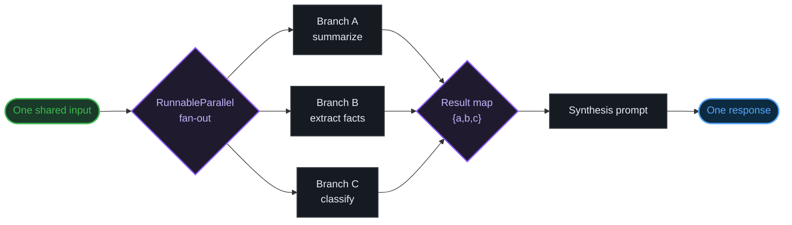

<!-- dli-course-cell {"id":"2-Chains/24-Parallel-Chains:0","index":0,"schema":"dli-course-cell/1.0","source_sha256":"88e1eca075d13d2087192579b6336cb33621e7f71f89e0ab6154c0f04865dc95","type":"markdown"} -->
<br>
<a href="https://www.nvidia.com/en-us/training/">
    <div style="width: 55%; background-color: white; margin-top: 50px;">
    </div>
</a>
<h1 style="line-height: 1.4;"><font color="#76b900"><b>Building LLM Applications With Prompt Engineering</b></font></h1>
<h2><b>Parallel Chains</b></h2>
<br>
<!-- /dli-course-cell -->

<!-- dli-course-cell {"id":"2-Chains/24-Parallel-Chains:1","index":1,"schema":"dli-course-cell/1.0","source_sha256":"f60fd89319c2f9d6548a7ead9cc42f0c121a846097e6e3a00c7ccb3f06642868","type":"markdown"} -->
In this notebook you'll learn how to creae and use parallel chains to easuly run independent events concurrently (or at least in a non-blocking way).


<!-- /dli-course-cell -->

<!-- dli-course-cell {"id":"2-Chains/24-Parallel-Chains:2","index":2,"schema":"dli-course-cell/1.0","source_sha256":"cb3f91d54eee30e53e35b2b99905f70f169ed549fd78909d3dac2defc9ed8d3b","type":"markdown"} -->
---
<!-- /dli-course-cell -->

<!-- dli-course-cell {"id":"2-Chains/24-Parallel-Chains:3","index":3,"schema":"dli-course-cell/1.0","source_sha256":"7ed1d5d3598d9dfd44ff52aa769434d46ec975cd34ded253e39b3b255ea9be1a","type":"markdown"} -->
## Objectives
<!-- /dli-course-cell -->

<!-- dli-course-cell {"id":"2-Chains/24-Parallel-Chains:4","index":4,"schema":"dli-course-cell/1.0","source_sha256":"94c87b0ff9966307388628026ee302f8b97f00aca8c57ff9de5a23deaa7f6568","type":"markdown"} -->
By the time you complete this notebook you will:

- Be able to create and use chains that execute in parallel
- Think about and identify opportunities for parallelism in your chains
<!-- /dli-course-cell -->

<!-- dli-course-cell {"id":"2-Chains/24-Parallel-Chains:5","index":5,"schema":"dli-course-cell/1.0","source_sha256":"cb3f91d54eee30e53e35b2b99905f70f169ed549fd78909d3dac2defc9ed8d3b","type":"markdown"} -->
---
<!-- /dli-course-cell -->

<!-- dli-course-cell {"id":"2-Chains/24-Parallel-Chains:6","index":6,"schema":"dli-course-cell/1.0","source_sha256":"d357b415148d05679d1f9802803fc0a4a039f4ece72445b0c3c596b0eb555b52","type":"markdown"} -->
## Imports
<!-- /dli-course-cell -->

<!-- dli-course-cell {"id":"2-Chains/24-Parallel-Chains:7","index":7,"schema":"dli-course-cell/1.0","source_sha256":"6ce8c64cc27cf259c1c2248dafef09e7c7a07e38b3705966b65e7185fd3ba288","type":"code"} -->
```python
import os
from langchain_nvidia_ai_endpoints import ChatNVIDIA
from langchain_core.prompts import ChatPromptTemplate
from langchain_core.output_parsers import StrOutputParser
from langchain_core.runnables import RunnableLambda, RunnableParallel
```
<!-- /dli-course-cell -->

<!-- dli-course-cell {"id":"2-Chains/24-Parallel-Chains:8","index":8,"schema":"dli-course-cell/1.0","source_sha256":"cb3f91d54eee30e53e35b2b99905f70f169ed549fd78909d3dac2defc9ed8d3b","type":"markdown"} -->
---
<!-- /dli-course-cell -->

<!-- dli-course-cell {"id":"2-Chains/24-Parallel-Chains:9","index":9,"schema":"dli-course-cell/1.0","source_sha256":"70f5e78e300511808de404ed1d62799fc55c2b20e6c2a33706e13dbca5acc811","type":"markdown"} -->
## Create a Model Instance
<!-- /dli-course-cell -->

<!-- dli-course-cell {"id":"2-Chains/24-Parallel-Chains:10","index":10,"schema":"dli-course-cell/1.0","source_sha256":"fe8a07f8e29704ed8c72091c34ce44956cd4b2a6331a6a6220553baac2abf3d3","type":"code"} -->
```python
base_url = os.getenv("NVIDIA_BASE_URL")

# Use the model selected in the course connection panel, or keep the lesson default.
model = os.getenv("NVIDIA_MODEL") or "nvidia/nemotron-nano-12b-v2-vl"
# model = "nvidia/nemotron-3-nano-30b-a3b"  # Compatible fallback; responses may differ.
# model = "meta/llama-3.3-70b-instruct"  # Legacy fallback; responses may differ more.

llm = ChatNVIDIA(base_url=base_url, model=model, temperature=0)
```
<!-- /dli-course-cell -->

<!-- dli-course-cell {"id":"2-Chains/24-Parallel-Chains:11","index":11,"schema":"dli-course-cell/1.0","source_sha256":"cb3f91d54eee30e53e35b2b99905f70f169ed549fd78909d3dac2defc9ed8d3b","type":"markdown"} -->
---
<!-- /dli-course-cell -->

<!-- dli-course-cell {"id":"2-Chains/24-Parallel-Chains:12","index":12,"schema":"dli-course-cell/1.0","source_sha256":"051e7611f53641640ec81179f1f1f9f39d449a2dc47e586ee96fc9fe36a98e59","type":"markdown"} -->
## Parallel Chain Execution
<!-- /dli-course-cell -->

<!-- dli-course-cell {"id":"2-Chains/24-Parallel-Chains:13","index":13,"schema":"dli-course-cell/1.0","source_sha256":"b7e1f9b578ed72deec3e68836795c5505fb449fedf1c5b326b19f8a03cdcde88","type":"markdown"} -->
For the previous set of exercises you composed multiple chains to operate on a set of inputs **serially**, or in order. As a matter of fact, our task required us to do so: we needed to perform the spell and grammar checking prior to generating the additional text.

At times, when thinking about a chain of tasks we wish to perform, we might ascertain that some of the tasks can be performed in parallel. The great news is that LCEL provides us with easy to use syntax for the parallel execution of runnables in our chains.

We're going to begin our study of parallel chain execution with a non-LLM-related set of tasks, just to get familiar with the syntax, after which we'll apply what we've learned to create a chain that utilizes multiple LLM chains working in parallel.
<!-- /dli-course-cell -->

<!-- dli-course-cell {"id":"2-Chains/24-Parallel-Chains:14","index":14,"schema":"dli-course-cell/1.0","source_sha256":"cb3f91d54eee30e53e35b2b99905f70f169ed549fd78909d3dac2defc9ed8d3b","type":"markdown"} -->
---
<!-- /dli-course-cell -->

<!-- dli-course-cell {"id":"2-Chains/24-Parallel-Chains:15","index":15,"schema":"dli-course-cell/1.0","source_sha256":"cc1d68d821f999543dcec34c5bf171ea56aa25c3c2223f21b6b2b646035f2a0f","type":"markdown"} -->
## Identifying Opportunites for Parallel Execution
<!-- /dli-course-cell -->

<!-- dli-course-cell {"id":"2-Chains/24-Parallel-Chains:16","index":16,"schema":"dli-course-cell/1.0","source_sha256":"164827ca16c42445be203e81663cac3c22ca7302c547e1d9d069d2d92a94f19d","type":"markdown"} -->
It may seem obvious, but before we can perform parallel execution, we need to identify when it is possible. You may already be well-practiced thinking about the possibility of parallel execution from work you've done in other programming settings, but if not, it's a skill you'll pick up quickly.

In general, you just need to consider when the ouput of one process is required as the input to another. In such a case you've discovered the need for serial execution between the two process. If, however, both (or many) processes can operate without relying on the work of other processes, you likely have an opportunity to do parallel work.

Let's construct a toy example to explore this a little further. Let's say we have a piece of text...
<!-- /dli-course-cell -->

<!-- dli-course-cell {"id":"2-Chains/24-Parallel-Chains:17","index":17,"schema":"dli-course-cell/1.0","source_sha256":"f7ccadb94ac179faa9bd7b094ab8505df984f5fefcdbd4ce912b352c8a096de3","type":"code"} -->
```python
text = 'building large language models with prompt engineering'
```
<!-- /dli-course-cell -->

<!-- dli-course-cell {"id":"2-Chains/24-Parallel-Chains:18","index":18,"schema":"dli-course-cell/1.0","source_sha256":"4ae2cfdf9664c5df8366a98de95e7c4d0f0fa89aa52c60f3211630dde8eae883","type":"markdown"} -->
...and we would like to perform two pieces of work on it:
1. Title case the text
2. Count the number of words the text contains

If we ask ourselves whether or not the output to either of these tasks is needed as inputs to the other, we quicky understand that the answer is "no". Therefore, these tasks can be performed independently and because they can be performed independently they could also be exectuted in parallel.
<!-- /dli-course-cell -->

<!-- dli-course-cell {"id":"2-Chains/24-Parallel-Chains:19","index":19,"schema":"dli-course-cell/1.0","source_sha256":"cb3f91d54eee30e53e35b2b99905f70f169ed549fd78909d3dac2defc9ed8d3b","type":"markdown"} -->
---
<!-- /dli-course-cell -->

<!-- dli-course-cell {"id":"2-Chains/24-Parallel-Chains:20","index":20,"schema":"dli-course-cell/1.0","source_sha256":"4dbf916558a202b6f27285553508e143a306e797706a6160689ec8f236568d52","type":"markdown"} -->
## Constructing Parallel Runnables
<!-- /dli-course-cell -->

<!-- dli-course-cell {"id":"2-Chains/24-Parallel-Chains:21","index":21,"schema":"dli-course-cell/1.0","source_sha256":"f747504edbc9c36498b8d288eef7a82d63ecbec01e2a707db1d910f169eadb44","type":"markdown"} -->
Understanding that for our toy problem we could perform the 2 constituent tasks in parallel, let's look at how to accomplish this with LangChain.

To begin, let's create two runnables using `RunnableLambda` that each capture one of the sub-tasks we wish to perform.

First we define a runnable for title casing input text.
<!-- /dli-course-cell -->

<!-- dli-course-cell {"id":"2-Chains/24-Parallel-Chains:22","index":22,"schema":"dli-course-cell/1.0","source_sha256":"846624abb3e5197fe281c565848d578bb8ad6520b15c33276d787d7b3b252ac5","type":"code"} -->
```python
title_case = RunnableLambda(lambda text: text.title())
```
<!-- /dli-course-cell -->

<!-- dli-course-cell {"id":"2-Chains/24-Parallel-Chains:23","index":23,"schema":"dli-course-cell/1.0","source_sha256":"4142bc0691edd0e9561c1ca0192adb030e2f87b32e3f651a0175a105fadc3cad","type":"markdown"} -->
Next we define a runnable for counting the number of words in a given text.
<!-- /dli-course-cell -->

<!-- dli-course-cell {"id":"2-Chains/24-Parallel-Chains:24","index":24,"schema":"dli-course-cell/1.0","source_sha256":"59faa70a53c22cb623615911d489cf4affd738bf678bb406454a79f933e32434","type":"code"} -->
```python
count_words = RunnableLambda(lambda text: len(text.split()))
```
<!-- /dli-course-cell -->

<!-- dli-course-cell {"id":"2-Chains/24-Parallel-Chains:25","index":25,"schema":"dli-course-cell/1.0","source_sha256":"65b13e9e47c3552774f8e4911bfbfe3fbea8d18c98ffd5dbe85d3c033804e57d","type":"markdown"} -->
We can invoke both runnables with our text sample and see that they behave as expected.
<!-- /dli-course-cell -->

<!-- dli-course-cell {"id":"2-Chains/24-Parallel-Chains:26","index":26,"schema":"dli-course-cell/1.0","source_sha256":"b405ad71a5c6869d5860def7c3fd868a9c9a98ca8163e3542a9a8da78a913b6f","type":"code"} -->
```python
title = title_case.invoke(text)
title
```
<!-- /dli-course-cell -->

<!-- dli-course-cell {"id":"2-Chains/24-Parallel-Chains:27","index":27,"schema":"dli-course-cell/1.0","source_sha256":"0fa29fe688bbac3c74ecb27460c69fafedfcb9eba790ede895de0f5f02ff4891","type":"code"} -->
```python
word_count = count_words.invoke(text)
word_count
```
<!-- /dli-course-cell -->

<!-- dli-course-cell {"id":"2-Chains/24-Parallel-Chains:28","index":28,"schema":"dli-course-cell/1.0","source_sha256":"6073bb069a654aa141636b6b9395fc3c75e664a0c583d3a5d5d8e72b261da045","type":"markdown"} -->
If we wanted to crate a chain to execute these 2 steps serially, we could pipe them together, though care needs to be taken about the order of the serial pipe.
<!-- /dli-course-cell -->

<!-- dli-course-cell {"id":"2-Chains/24-Parallel-Chains:29","index":29,"schema":"dli-course-cell/1.0","source_sha256":"7ec6d3a1084daee0d6f4fb8407dbb38b56ffafef754767d55a1a34fe34e4a9ee","type":"code"} -->
```python
serial_chain = title_case | count_words # And NOT count_words | title_case
serial_chain.invoke(text)
```
<!-- /dli-course-cell -->

<!-- dli-course-cell {"id":"2-Chains/24-Parallel-Chains:30","index":30,"schema":"dli-course-cell/1.0","source_sha256":"eafd7e7e394fb45cb6d9cf21b1a83360654f8ac06b62e8919241f3f5d987a929","type":"markdown"} -->
In order to create a parallel chain in LCEL we can use `RunnableParallel` which expects as input a dictionary where each property is one of the runnables that we would like to execute in parallel.

As with any Python dictionary, ours needs to contain key/value pairs. In the case of parallel chain execution the key is an arbitrary value we set, and the value is the runnable itself.

The parallel chain will return a dictionary with the same properties we specify, with the keys we set being mapped to the results of the runnables we passed in.

An example will clarify.
<!-- /dli-course-cell -->

<!-- dli-course-cell {"id":"2-Chains/24-Parallel-Chains:31","index":31,"schema":"dli-course-cell/1.0","source_sha256":"e337302085b4718b1b45532af48aa0c251791dc765565ec4694165db8a5bf5f1","type":"code"} -->
```python
parallel_chain = RunnableParallel({'title': title_case, 'word_count': count_words})
```
<!-- /dli-course-cell -->

<!-- dli-course-cell {"id":"2-Chains/24-Parallel-Chains:32","index":32,"schema":"dli-course-cell/1.0","source_sha256":"efc1e6b5f8ebc00f66def5b3f249adccc88cb07955641e0286486334a9874bdd","type":"code"} -->
```python
parallel_chain.invoke(text)
```
<!-- /dli-course-cell -->

<!-- dli-course-cell {"id":"2-Chains/24-Parallel-Chains:33","index":33,"schema":"dli-course-cell/1.0","source_sha256":"c5b817a291742f2d8d01f71238564d24e368870914d1d9d9e6dbb40f330cc032","type":"markdown"} -->
If we take a look at the computational graph for `parallel_chain` we can see that it indicates the two runnables (`title_case` and `count_words`) are being executed in parallel.
<!-- /dli-course-cell -->

<!-- dli-course-cell {"id":"2-Chains/24-Parallel-Chains:34","index":34,"schema":"dli-course-cell/1.0","source_sha256":"36cc5742300494f1bb79b9222d2a39215900fca9b42ca0693ea195abbe50d4a2","type":"code"} -->
```python
print(parallel_chain.get_graph().draw_ascii())
```
<!-- /dli-course-cell -->

<!-- dli-course-cell {"id":"2-Chains/24-Parallel-Chains:35","index":35,"schema":"dli-course-cell/1.0","source_sha256":"cb3f91d54eee30e53e35b2b99905f70f169ed549fd78909d3dac2defc9ed8d3b","type":"markdown"} -->
---
<!-- /dli-course-cell -->

<!-- dli-course-cell {"id":"2-Chains/24-Parallel-Chains:36","index":36,"schema":"dli-course-cell/1.0","source_sha256":"7db37f07757f7e1ecaf94a76771fe2363af5221e5cf6abdfbb19d5c6497d1e47","type":"markdown"} -->
## Using Parallel Outputs
<!-- /dli-course-cell -->

<!-- dli-course-cell {"id":"2-Chains/24-Parallel-Chains:37","index":37,"schema":"dli-course-cell/1.0","source_sha256":"00090dca296e5410c1b863d5dc05a0cb1cc18e799ed26d0b34fad76ded736233","type":"markdown"} -->
Parallel chains are runnables and therefore can be composed with other runnables.

We should keep in mind that the output of a parallel chain is a dictionary. Some runnables, like prompt templates, expect dictionary values as their input, but others may not.

Of course, we can construct custom runnables to handle the output of parallel runnables, if needed.

With our current toy exercise, for example, should we wish to create a simple printout for our title-cased title and its word count, we could create a runnable that expects a dictionary as its input and uses its values to construct the output.
<!-- /dli-course-cell -->

<!-- dli-course-cell {"id":"2-Chains/24-Parallel-Chains:38","index":38,"schema":"dli-course-cell/1.0","source_sha256":"b68bec78f2e2fbd357c2248fb9640cd15655becc0409588f34ff32da62f71e15","type":"code"} -->
```python
describe_title = RunnableLambda(lambda x: f"'{x['title']}' has {x['word_count']} words.")
```
<!-- /dli-course-cell -->

<!-- dli-course-cell {"id":"2-Chains/24-Parallel-Chains:39","index":39,"schema":"dli-course-cell/1.0","source_sha256":"23833eac3c5cf48b5bf4415959a1f591a1999eb76e7d5c1d424fb86615b47baa","type":"markdown"} -->
Just to test `describe_title` out, let's invoke it with a dictionary.
<!-- /dli-course-cell -->

<!-- dli-course-cell {"id":"2-Chains/24-Parallel-Chains:40","index":40,"schema":"dli-course-cell/1.0","source_sha256":"549bd060313cc146270f95edf6735a1f1332c1b3495dcd899db7ac1f086e1a9e","type":"code"} -->
```python
describe_title.invoke({'title': title, 'word_count': word_count})
```
<!-- /dli-course-cell -->

<!-- dli-course-cell {"id":"2-Chains/24-Parallel-Chains:41","index":41,"schema":"dli-course-cell/1.0","source_sha256":"6030adcbbea71d00110f0b27bee6f4718bc197ca1f12207f87b5066e2616807c","type":"markdown"} -->
Seeing that this works as expected, let's add it to our existing chain.
<!-- /dli-course-cell -->

<!-- dli-course-cell {"id":"2-Chains/24-Parallel-Chains:42","index":42,"schema":"dli-course-cell/1.0","source_sha256":"2d48ac636d939b53b8dabf0e00c7286f4c9f67025ee00d6526e947ab74f661fe","type":"code"} -->
```python
final_chain = parallel_chain | describe_title
```
<!-- /dli-course-cell -->

<!-- dli-course-cell {"id":"2-Chains/24-Parallel-Chains:43","index":43,"schema":"dli-course-cell/1.0","source_sha256":"2808ee5e4d6976a7f26f563929e91e5666bbacfe4571097fa861b5878688966f","type":"markdown"} -->
Looking at our final chain, we can see it has been extended, and now contains parallel and serial components.
<!-- /dli-course-cell -->

<!-- dli-course-cell {"id":"2-Chains/24-Parallel-Chains:44","index":44,"schema":"dli-course-cell/1.0","source_sha256":"992de61aea6a1eeb7b696e5fbbfd97d499db2c8a97230a2fda53180a950d8fbd","type":"code"} -->
```python
print(final_chain.get_graph().draw_ascii())
```
<!-- /dli-course-cell -->

<!-- dli-course-cell {"id":"2-Chains/24-Parallel-Chains:45","index":45,"schema":"dli-course-cell/1.0","source_sha256":"a0e07d3adae2cce479a0e2092a2969c0d31cbd0e14a06119efe9ca98bd547207","type":"markdown"} -->
And we can invoke it with a given title.
<!-- /dli-course-cell -->

<!-- dli-course-cell {"id":"2-Chains/24-Parallel-Chains:46","index":46,"schema":"dli-course-cell/1.0","source_sha256":"8328c768331677dc34b0d87de6173ff4a3f94196661def6b7ad9719d6a1ede6c","type":"code"} -->
```python
final_chain.invoke(title)
```
<!-- /dli-course-cell -->

<!-- dli-course-cell {"id":"2-Chains/24-Parallel-Chains:47","index":47,"schema":"dli-course-cell/1.0","source_sha256":"cb3f91d54eee30e53e35b2b99905f70f169ed549fd78909d3dac2defc9ed8d3b","type":"markdown"} -->
---
<!-- /dli-course-cell -->

<!-- dli-course-cell {"id":"2-Chains/24-Parallel-Chains:48","index":48,"schema":"dli-course-cell/1.0","source_sha256":"fcc921ea027e1d19aa3b585afb1e442ac4cb5f869f12d3f8934bf2b342ece7f1","type":"markdown"} -->
## Dictionary Literal Syntax for Parallel Runnables
<!-- /dli-course-cell -->

<!-- dli-course-cell {"id":"2-Chains/24-Parallel-Chains:49","index":49,"schema":"dli-course-cell/1.0","source_sha256":"02d60d6321ff95166bc52281adf0c1222b01a2e124f3ca540f377c1f67a886e3","type":"markdown"} -->
As a matter of convenience, LCEL allows us to replace calls to `RunnableParallel` with simply the dictionary literal we would have passed into `RunnableParallel`.

As an example, here's a definition of `final_chain` fully articulated, and using a call to `RunnableParallel`.
<!-- /dli-course-cell -->

<!-- dli-course-cell {"id":"2-Chains/24-Parallel-Chains:50","index":50,"schema":"dli-course-cell/1.0","source_sha256":"d7c46d8b62c6418c4171305a6f92dadd2fdd2abdbda463eba3bcb15742f183ec","type":"code"} -->
```python
final_chain = RunnableParallel({'title': title_case, 'word_count': count_words}) | describe_title
```
<!-- /dli-course-cell -->

<!-- dli-course-cell {"id":"2-Chains/24-Parallel-Chains:51","index":51,"schema":"dli-course-cell/1.0","source_sha256":"6ce9165a15fa3625e72e197f6c280405ca96d414eef2f1c6354f3aef9f979676","type":"markdown"} -->
Should we wish, we could rewrite the chain as follows, removing the call to `RunnableParallel` and leaving only the dictionary literal:
<!-- /dli-course-cell -->

<!-- dli-course-cell {"id":"2-Chains/24-Parallel-Chains:52","index":52,"schema":"dli-course-cell/1.0","source_sha256":"37eaa9bef9ed9c87c8bb808033bdae2676ed8a8a535bd177e3fd8315c10d0a2f","type":"code"} -->
```python
final_chain = {'title': title_case, 'word_count': count_words} | describe_title
```
<!-- /dli-course-cell -->

<!-- dli-course-cell {"id":"2-Chains/24-Parallel-Chains:53","index":53,"schema":"dli-course-cell/1.0","source_sha256":"8328c768331677dc34b0d87de6173ff4a3f94196661def6b7ad9719d6a1ede6c","type":"code"} -->
```python
final_chain.invoke(title)
```
<!-- /dli-course-cell -->

<!-- dli-course-cell {"id":"2-Chains/24-Parallel-Chains:54","index":54,"schema":"dli-course-cell/1.0","source_sha256":"93f8435f55cae91b6537ed882614abea20135932e17a1e5754464f24e13a0071","type":"markdown"} -->
There are some gotcha's to this syntax, however. For example, if we tried to rewrite our earlier `parallel_chain`...
<!-- /dli-course-cell -->

<!-- dli-course-cell {"id":"2-Chains/24-Parallel-Chains:55","index":55,"schema":"dli-course-cell/1.0","source_sha256":"e337302085b4718b1b45532af48aa0c251791dc765565ec4694165db8a5bf5f1","type":"code"} -->
```python
parallel_chain = RunnableParallel({'title': title_case, 'word_count': count_words})
```
<!-- /dli-course-cell -->

<!-- dli-course-cell {"id":"2-Chains/24-Parallel-Chains:56","index":56,"schema":"dli-course-cell/1.0","source_sha256":"d17bbf15ed08c78ad0b3b9d697545e04ac695e9eb15ec8d2a2e2e6a6786e883a","type":"markdown"} -->
...which contains no pipe characters and is only the single parallel runnable, it would look like this.
<!-- /dli-course-cell -->

<!-- dli-course-cell {"id":"2-Chains/24-Parallel-Chains:57","index":57,"schema":"dli-course-cell/1.0","source_sha256":"b23d4667352f7fd1a0805d9428c02f5823d3344e8d715cceacd2bfaa6ec0c5d7","type":"code"} -->
```python
parallel_chain = {'title': title_case, 'word_count': count_words}
```
<!-- /dli-course-cell -->

<!-- dli-course-cell {"id":"2-Chains/24-Parallel-Chains:58","index":58,"schema":"dli-course-cell/1.0","source_sha256":"241ff60807bb09d48065236b67ade840ad988d43f4324bf89dd6f8e3b6d2aa7d","type":"markdown"} -->
This looks good and didn't throw any errors when we defined it, but if now we try to invoke it, you'll see we get an attribute error about dict objects not having invoke attributes, which is true.
<!-- /dli-course-cell -->

<!-- dli-course-cell {"id":"2-Chains/24-Parallel-Chains:59","index":59,"schema":"dli-course-cell/1.0","source_sha256":"3226d2be73997efa86bf7b847766a9dde861639a675393839fbd1ce5cb89bd5e","type":"code"} -->
```python
try:
    parallel_chain.invoke(title)
except AttributeError as e:
    print(e)
```
<!-- /dli-course-cell -->

<!-- dli-course-cell {"id":"2-Chains/24-Parallel-Chains:60","index":60,"schema":"dli-course-cell/1.0","source_sha256":"9ba3bef754cbb4ec8c80c050eed3c14da5cb71eaa1d3c7b4dc26991d8f190fc7","type":"markdown"} -->
The takeaway is that you're always safe using `RunnableParallel`, and even if you prefer the dict literal syntax, use `RunnableParallel` when the Python interpreter would not be able to understand that your runnable isn't simply a Python dict.
<!-- /dli-course-cell -->

<!-- dli-course-cell {"id":"2-Chains/24-Parallel-Chains:61","index":61,"schema":"dli-course-cell/1.0","source_sha256":"cb3f91d54eee30e53e35b2b99905f70f169ed549fd78909d3dac2defc9ed8d3b","type":"markdown"} -->
---
<!-- /dli-course-cell -->

<!-- dli-course-cell {"id":"2-Chains/24-Parallel-Chains:62","index":62,"schema":"dli-course-cell/1.0","source_sha256":"23483807b624926ff1bc47f22d117faa57529233711c302600bc4785b1feac86","type":"markdown"} -->
## Exercise: Create a Chain with Parallel LLM Tasks
<!-- /dli-course-cell -->

<!-- dli-course-cell {"id":"2-Chains/24-Parallel-Chains:63","index":63,"schema":"dli-course-cell/1.0","source_sha256":"5a35e2891806e3b5fe1ccd81b58de914dec0e8f3a97b65f0d64b74c476a1711f","type":"markdown"} -->
We are going to revisit an exercise you completed several notebooks ago when we introduced you to prompt templates, but before you learned about LCEL chains.

If you recall you were given the following list of statements...
<!-- /dli-course-cell -->

<!-- dli-course-cell {"id":"2-Chains/24-Parallel-Chains:64","index":64,"schema":"dli-course-cell/1.0","source_sha256":"86f037fc5fd934fff591b13e3198018e622abc99507d58d799f5d57b9dfa449d","type":"code"} -->
```python
statements = [
    "I had a fantastic time hiking up the mountain yesterday.",
    "The new restaurant downtown serves delicious vegetarian dishes.",
    "I am feeling quite stressed about the upcoming project deadline.",
    "Watching the sunset at the beach was a calming experience.",
    "I recently started reading a fascinating book about space exploration."
]
```
<!-- /dli-course-cell -->

<!-- dli-course-cell {"id":"2-Chains/24-Parallel-Chains:65","index":65,"schema":"dli-course-cell/1.0","source_sha256":"6a5009ce196869044ac645244c68cdff806f695d19c84d49ff581bb40747e020","type":"markdown"} -->
...after which you created prompts for sentiment analysis, main topic extraction, and followup question generation and ultimately created a summary output that looked like the following:
<!-- /dli-course-cell -->

<!-- dli-course-cell {"id":"2-Chains/24-Parallel-Chains:66","index":66,"schema":"dli-course-cell/1.0","source_sha256":"6d4b6b422783227fc93040241e4ed5c0d87a289e4077c23614ef0d2e9ba030bd","type":"markdown"} -->
<blockquote><pre>
Statement: I had a fantastic time hiking up the mountain yesterday.
Overall sentiment: Positive
Main topic: Hiking
Followup question: What were some of the most challenging or memorable parts of your hiking experience?

Statement: The new restaurant downtown serves delicious vegetarian dishes.
Overall sentiment: Positive
Main topic: Vegetarian restaurants.
Followup question: What types of vegetarian dishes are served at the new downtown restaurant that are worth trying?

Statement: I am feeling quite stressed about the upcoming project deadline.
Overall sentiment: Negative
Main topic: Project deadline stress
Followup question: How do you typically manage stress and pressure when working towards a significant deadline in a project?

Statement: Watching the sunset at the beach was a calming experience.
Overall sentiment: Positive
Main topic: The experience of watching a sunset at the beach.
Followup question: What are some other activities that people often do at the beach at sunset?

Statement: I recently started reading a fascinating book about space exploration.
Overall sentiment: Positive
Main topic: Space exploration
Followup question: What are some of the most significant discoveries or achievements made in the field of space exploration that the book might touch on?
</pre></blockquote>
<!-- /dli-course-cell -->

<!-- dli-course-cell {"id":"2-Chains/24-Parallel-Chains:67","index":67,"schema":"dli-course-cell/1.0","source_sha256":"10a1651269b215d044ab9648458554ca92ff7c7cc16599073b04697d1fb26106","type":"markdown"} -->
For this exercise you are going again to produce the same summary output given the same list, however, you are going to do so using chains, and especially, using parallel chains where possible.
<!-- /dli-course-cell -->

<!-- dli-course-cell {"id":"2-Chains/24-Parallel-Chains:68","index":68,"schema":"dli-course-cell/1.0","source_sha256":"e3a4644e33f4ae01e57f11b1f35fdcc3c794b41222cbcf6830a66c73509496c5","type":"markdown"} -->
### Runnables for Your Work
<!-- /dli-course-cell -->

<!-- dli-course-cell {"id":"2-Chains/24-Parallel-Chains:69","index":69,"schema":"dli-course-cell/1.0","source_sha256":"4ab7214839290c41f0e3776fa7ab73bf57adab89ee219f3f21e644cad741201a","type":"markdown"} -->
To get you started, and to avoid you repeating work you've already done elsewhere, we'll provide you with several runnables that you are going to use in your solution.

First are the 3 prompt templates needed for your LLM-related tasks.
<!-- /dli-course-cell -->

<!-- dli-course-cell {"id":"2-Chains/24-Parallel-Chains:70","index":70,"schema":"dli-course-cell/1.0","source_sha256":"983f547953a25de9240f597a89592e4f9de01625fbfef03dfda8be8aeafb297f","type":"code"} -->
```python
sentiment_template = ChatPromptTemplate.from_template("""In a single word, either 'positive' or 'negative', \
provide the overall sentiment of the following piece of text: {text}""")
```
<!-- /dli-course-cell -->

<!-- dli-course-cell {"id":"2-Chains/24-Parallel-Chains:71","index":71,"schema":"dli-course-cell/1.0","source_sha256":"5bcb6be93daf01372f29fb920fd98c2158f9c79032e97fbf0776d31de4efb801","type":"code"} -->
```python
main_topic_template = ChatPromptTemplate.from_template("""Identify and state, as concisely as possible, the main topic \
of the following piece of text. Only provide the main topic and no other helpful comments. Text: {text}""")
```
<!-- /dli-course-cell -->

<!-- dli-course-cell {"id":"2-Chains/24-Parallel-Chains:72","index":72,"schema":"dli-course-cell/1.0","source_sha256":"7389f4b1ee0631dfb8ee44b70ad0c4e8910fdbe6e9f67674298b26e983bcc04b","type":"code"} -->
```python
followup_template = ChatPromptTemplate.from_template("""What is an appropriate and interesting followup question that would help \
me learn more about the provided text? Only supply the question. Text: {text}""")
```
<!-- /dli-course-cell -->

<!-- dli-course-cell {"id":"2-Chains/24-Parallel-Chains:73","index":73,"schema":"dli-course-cell/1.0","source_sha256":"d5c762bb555114440203e64b05431133b2b997d2a00ee8beee42b1800be306b3","type":"markdown"} -->
Next is an output parser.
<!-- /dli-course-cell -->

<!-- dli-course-cell {"id":"2-Chains/24-Parallel-Chains:74","index":74,"schema":"dli-course-cell/1.0","source_sha256":"a45d5e7d2a81f7cdc07183c70e44e42aa65c9d434cd853383f168af4980f7d4d","type":"code"} -->
```python
parser = StrOutputParser()
```
<!-- /dli-course-cell -->

<!-- dli-course-cell {"id":"2-Chains/24-Parallel-Chains:75","index":75,"schema":"dli-course-cell/1.0","source_sha256":"7a27b21a053680ce05588578f08b7bc39be650cf0032a418699d91562a7b054d","type":"markdown"} -->
Finally is a custom runnable which expects a dictionary as input with 4 values(`statement`, `sentiment`, `main_topic`, `followup`), and produces the text output we desire for this task.
<!-- /dli-course-cell -->

<!-- dli-course-cell {"id":"2-Chains/24-Parallel-Chains:76","index":76,"schema":"dli-course-cell/1.0","source_sha256":"7d3606ea152f62abfdd3243ed5b5e5262f6e64229aac278b5793028e56cc480f","type":"code"} -->
```python
output_formatter = RunnableLambda(lambda responses: (
    f"Statement: {responses['statement']}\n"
    f"Overall sentiment: {responses['sentiment']}\n"
    f"Main topic: {responses['main_topic']}\n"
    f"Followup question: {responses['followup']}\n"
))
```
<!-- /dli-course-cell -->

<!-- dli-course-cell {"id":"2-Chains/24-Parallel-Chains:77","index":77,"schema":"dli-course-cell/1.0","source_sha256":"66e7f60b3e2c34dd629d7641b2f90e158d894102a496a40977b04e53c2d89c96","type":"markdown"} -->
### Plan Your Chain(s)
<!-- /dli-course-cell -->

<!-- dli-course-cell {"id":"2-Chains/24-Parallel-Chains:78","index":78,"schema":"dli-course-cell/1.0","source_sha256":"3772eab2fcc157bef94e55de43d0ffb283444e37bfa09520bc87af6f5a080696","type":"markdown"} -->
Before doing any additional coding, spend some time thinking through how you ought to compose your chain, including any sub-chains. In particular, consider where in our task we can utilize parallel execution.

Feel free to use the cell immediately below to write down your thoughts and articulate a plan of action. When you're done compare it to our *Solution Plan* below.
<!-- /dli-course-cell -->

<!-- dli-course-cell {"id":"2-Chains/24-Parallel-Chains:79","index":79,"schema":"dli-course-cell/1.0","source_sha256":"3e45103c40a34752c14a7b30e1f865167f563ef4813cb91d1ac78b21101597aa","type":"markdown"} -->
### Your Plan Here
<!-- /dli-course-cell -->

<!-- dli-course-cell {"id":"2-Chains/24-Parallel-Chains:80","index":80,"schema":"dli-course-cell/1.0","source_sha256":"e3b0c44298fc1c149afbf4c8996fb92427ae41e4649b934ca495991b7852b855","type":"markdown"} -->
<!-- /dli-course-cell -->

<!-- dli-course-cell {"id":"2-Chains/24-Parallel-Chains:81","index":81,"schema":"dli-course-cell/1.0","source_sha256":"4b9f912172428c609c8cdd2ca0c85443e6f5e946e27dc3ff405240105a16a8b7","type":"markdown"} -->
### Solution Plan
<!-- /dli-course-cell -->

<!-- dli-course-cell {"id":"2-Chains/24-Parallel-Chains:82","index":82,"schema":"dli-course-cell/1.0","source_sha256":"0ac4e4b48c6b82c7c8616fbe20578e9e045659f745c0a12b82151eeb613010d4","type":"markdown"} -->
The inputs and outputs for our full chain will be:

<blockquote><pre>
statements -> formatted_output
</pre></blockquote>

Working backwards from `formatted_output` we know that we are going to need 4 values to provide it:
<blockquote><pre>
statements ->
[statement, sentiment, main_topic, followup_question] ->
formatted_output
</pre></blockquote>

We ought to be able to capture `statement` from `statements` somehow and just pipe it through the chain, but for `sentiment`, `main_topic`, and `followup_question` these each will need to be their own LLM chain:

<blockquote><pre>
statements ->
[
    statement,
    sentiment_template -> llm -> parser,
    main_topic_template -> llm -> parser,
    followup_question_template -> llm -> parser
] ->
formatted_output
</pre></blockquote>

As an observation, it looks like everything in my outline in between the brackets `[` and `]` can be done independently of each other, so it's likely I'll be able to perform parallel execution there.

In order to move from my 4 parallel chains, which will return a dictionary to `formatted_output` I'll need to use the `output_formatter` runnable defined above.

<blockquote><pre>
statements ->
[
    statement,
    sentiment_template -> llm -> parser,
    main_topic_template -> llm -> parser,
    followup_question_template -> llm -> parser
] ->
output_formatter ->
formatted_output
</pre></blockquote>

As a final detail, I need to prepare my inputs (`statments`), which are currently strings, for use in the prompt templates, which each expect a dictionary with a `text` property.

<blockquote><pre>
statements ->
prep_statements_for_templates ->
[
    statement,
    sentiment_template -> llm -> parser,
    main_topic_template -> llm -> parser,
    followup_question_template -> llm -> parser
] ->
output_formatter ->
formatted_output
</pre></blockquote>

This looks like a good description and with it I'm ready to plan my next steps forward:


1) Create a custom runnable to convert my string inputs to dictionaries with a text field for use by the prompt templates.
2) Create 1 chain each for sentiment analysis, main topic extraction, and followup question generation (3 chains total)
3) Create a parallel chain with the 3 chains you just created, plus one more runnable (a custom runnable) that captures the passed-in text under the key `statement` (as is expected by the output formatter).
4) Chain together the `prep_for_inputs` runnable, the parallel chain, and the `output_formatter` runnable.
5) Use the full chain to batch process `statements`.
<!-- /dli-course-cell -->

<!-- dli-course-cell {"id":"2-Chains/24-Parallel-Chains:83","index":83,"schema":"dli-course-cell/1.0","source_sha256":"58fa68be734d1b62b1ced799ad754353678f5cc20147be2dd226208550872042","type":"markdown"} -->
### Your Work Here
<!-- /dli-course-cell -->

<!-- dli-course-cell {"id":"2-Chains/24-Parallel-Chains:84","index":84,"schema":"dli-course-cell/1.0","source_sha256":"b7e713a1eaa20fd572ff6a8fd5c1b9a54a3234b7f7604917f36b20b3c84140ba","type":"markdown"} -->
If you're up for it, jump right in and implement the desired functionality.

If you'd like to work through the exercise with some step-by-step guidance, open up the *Walkthrough* section immediately below.
<!-- /dli-course-cell -->

<!-- dli-course-cell {"id":"2-Chains/24-Parallel-Chains:85","index":85,"schema":"dli-course-cell/1.0","source_sha256":"e3b0c44298fc1c149afbf4c8996fb92427ae41e4649b934ca495991b7852b855","type":"code"} -->
```python
```
<!-- /dli-course-cell -->

<!-- dli-course-cell {"id":"2-Chains/24-Parallel-Chains:86","index":86,"schema":"dli-course-cell/1.0","source_sha256":"ab4647b3a89a95fdc30036524ef700d4028f35820e6aaa60e1cafdeed7efb9c0","type":"markdown"} -->
## Walkthrough
<!-- /dli-course-cell -->

<!-- dli-course-cell {"id":"2-Chains/24-Parallel-Chains:87","index":87,"schema":"dli-course-cell/1.0","source_sha256":"89c606d980d8ce227c1e213ceb2df395844e1fa13128ec8868f3944f283bf2c6","type":"markdown"} -->
In this walkthrough we'll follow the course of action laid out in the *Solution Plan* above, namely:

1) Create a custom runnable to convert your string inputs to dictionaries with a `text` field for use by the prompt templates.
2) Create 1 chain each for sentiment analysis, main topic extraction, and followup question generation (3 chains total)
3) Create a parallel chain with the 3 chains you just created, plus one more runnable (a custom runnable) that captures the passed-in text under the key `statement` (as is expected by the output formatter).
4) Chain together the `prep_for_inputs` runnable, the parallel chain, and the `output_formatter` runnable.
5) Use the full chain to batch process `statements`.
<!-- /dli-course-cell -->

<!-- dli-course-cell {"id":"2-Chains/24-Parallel-Chains:88","index":88,"schema":"dli-course-cell/1.0","source_sha256":"648194a35cf8c587468fc04e8f4ab49fdd7e4288a6eeb01413e7af17960f4cbb","type":"markdown"} -->
### Prepare Inpute for Prompt Templates
<!-- /dli-course-cell -->

<!-- dli-course-cell {"id":"2-Chains/24-Parallel-Chains:89","index":89,"schema":"dli-course-cell/1.0","source_sha256":"68acd96dff7b4984ee6de6ea2d5c3c8399a1bc9812a721209376e07662e03ff9","type":"markdown"} -->
Create a custom runnable to convert your string inputs to dictionaries with a `text` field for use by the prompt templates.

Feel free to check out the *Solution* below if you get stuck.
<!-- /dli-course-cell -->

<!-- dli-course-cell {"id":"2-Chains/24-Parallel-Chains:90","index":90,"schema":"dli-course-cell/1.0","source_sha256":"58fa68be734d1b62b1ced799ad754353678f5cc20147be2dd226208550872042","type":"markdown"} -->
### Your Work Here
<!-- /dli-course-cell -->

<!-- dli-course-cell {"id":"2-Chains/24-Parallel-Chains:91","index":91,"schema":"dli-course-cell/1.0","source_sha256":"e3b0c44298fc1c149afbf4c8996fb92427ae41e4649b934ca495991b7852b855","type":"code"} -->
```python
```
<!-- /dli-course-cell -->

<!-- dli-course-cell {"id":"2-Chains/24-Parallel-Chains:92","index":92,"schema":"dli-course-cell/1.0","source_sha256":"eb90ed3f74a5e9009c6633c2e44657cd53d6fb3a6a0427e0f2be9986882c3530","type":"markdown"} -->
### Solution
<!-- /dli-course-cell -->

<!-- dli-course-cell {"id":"2-Chains/24-Parallel-Chains:93","index":93,"schema":"dli-course-cell/1.0","source_sha256":"3c54051e3ae8bf68567ce28552a70432c92cc5128c166cc8f5475a6ef9a73435","type":"code"} -->
```python
prep_for_template = RunnableLambda(lambda text: {"text": text})
```
<!-- /dli-course-cell -->

<!-- dli-course-cell {"id":"2-Chains/24-Parallel-Chains:94","index":94,"schema":"dli-course-cell/1.0","source_sha256":"1ae13081abe20dadf8cd2b7afe4f201200d7b6320a55c8fba15ce612c3cfd26c","type":"markdown"} -->
### Create LLM Chains
<!-- /dli-course-cell -->

<!-- dli-course-cell {"id":"2-Chains/24-Parallel-Chains:95","index":95,"schema":"dli-course-cell/1.0","source_sha256":"651cda139104b03e85fadc26785dd94c6cb89f0e02428ee691140f6f43463fa7","type":"markdown"} -->
Create 1 chain each for sentiment analysis, main topic extraction, and followup question generation (3 chains total). Each chain should use the appropriate prompt template, along with our LLM instance and output parser.

Feel free to check out the *Solution* below if you get stuck.
<!-- /dli-course-cell -->

<!-- dli-course-cell {"id":"2-Chains/24-Parallel-Chains:96","index":96,"schema":"dli-course-cell/1.0","source_sha256":"58fa68be734d1b62b1ced799ad754353678f5cc20147be2dd226208550872042","type":"markdown"} -->
### Your Work Here
<!-- /dli-course-cell -->

<!-- dli-course-cell {"id":"2-Chains/24-Parallel-Chains:97","index":97,"schema":"dli-course-cell/1.0","source_sha256":"e3b0c44298fc1c149afbf4c8996fb92427ae41e4649b934ca495991b7852b855","type":"code"} -->
```python
```
<!-- /dli-course-cell -->

<!-- dli-course-cell {"id":"2-Chains/24-Parallel-Chains:98","index":98,"schema":"dli-course-cell/1.0","source_sha256":"eb90ed3f74a5e9009c6633c2e44657cd53d6fb3a6a0427e0f2be9986882c3530","type":"markdown"} -->
### Solution
<!-- /dli-course-cell -->

<!-- dli-course-cell {"id":"2-Chains/24-Parallel-Chains:99","index":99,"schema":"dli-course-cell/1.0","source_sha256":"4a460e0eac5cab7b3ed0d9e45518a72fbdeae89ccfcba56c1e8db441a6ea9443","type":"code"} -->
```python
sentiment_chain = sentiment_template | llm | parser
main_topic_chain = main_topic_template | llm | parser
followup_chain = followup_template | llm | parser
```
<!-- /dli-course-cell -->

<!-- dli-course-cell {"id":"2-Chains/24-Parallel-Chains:100","index":100,"schema":"dli-course-cell/1.0","source_sha256":"2759a3373eaa54b125a1815d486ce0826d1bcc3f583b37ce6a488c1d4970eca0","type":"markdown"} -->
### Create a Parallel Chain
<!-- /dli-course-cell -->

<!-- dli-course-cell {"id":"2-Chains/24-Parallel-Chains:101","index":101,"schema":"dli-course-cell/1.0","source_sha256":"2b2accc46e677bba423b98dd772941ac33f1b98a48d9a9d9e312f948bb3eee00","type":"markdown"} -->
Create a parallel chain with the 3 chains you just created, plus one more runnable (a custom runnable) that captures the passed-in text under the key `statement` (as is expected by the output formatter).

Feel free to check out the *Solution* below if you get stuck.
<!-- /dli-course-cell -->

<!-- dli-course-cell {"id":"2-Chains/24-Parallel-Chains:102","index":102,"schema":"dli-course-cell/1.0","source_sha256":"58fa68be734d1b62b1ced799ad754353678f5cc20147be2dd226208550872042","type":"markdown"} -->
### Your Work Here
<!-- /dli-course-cell -->

<!-- dli-course-cell {"id":"2-Chains/24-Parallel-Chains:103","index":103,"schema":"dli-course-cell/1.0","source_sha256":"e3b0c44298fc1c149afbf4c8996fb92427ae41e4649b934ca495991b7852b855","type":"code"} -->
```python
```
<!-- /dli-course-cell -->

<!-- dli-course-cell {"id":"2-Chains/24-Parallel-Chains:104","index":104,"schema":"dli-course-cell/1.0","source_sha256":"eb90ed3f74a5e9009c6633c2e44657cd53d6fb3a6a0427e0f2be9986882c3530","type":"markdown"} -->
### Solution
<!-- /dli-course-cell -->

<!-- dli-course-cell {"id":"2-Chains/24-Parallel-Chains:105","index":105,"schema":"dli-course-cell/1.0","source_sha256":"1ff17309c7843836068e6afb1ad04daf3ac02103ab681deff1027c01933cdc27","type":"code"} -->
```python
parallel_chain = RunnableParallel({
    "sentiment": sentiment_chain,
    "main_topic": main_topic_chain,
    "followup": followup_chain,
    "statement": RunnableLambda(lambda x: x['text'])
})
```
<!-- /dli-course-cell -->

<!-- dli-course-cell {"id":"2-Chains/24-Parallel-Chains:106","index":106,"schema":"dli-course-cell/1.0","source_sha256":"1fc69318a6f2a700631da4833b4973720276458e4528ff9027dac0b35beb53f5","type":"markdown"} -->
### Compose Main Chain Out of Sub-chains
<!-- /dli-course-cell -->

<!-- dli-course-cell {"id":"2-Chains/24-Parallel-Chains:107","index":107,"schema":"dli-course-cell/1.0","source_sha256":"aa70e2dfc9216036638195046316b6d13f219cfdd8c504971e488ec072c5592e","type":"markdown"} -->
Chain together the `prep_for_inputs` runnable, the parallel chain, and the `output_formatter` runnable.

Feel free to check out the *Solution* below if you get stuck.
<!-- /dli-course-cell -->

<!-- dli-course-cell {"id":"2-Chains/24-Parallel-Chains:108","index":108,"schema":"dli-course-cell/1.0","source_sha256":"58fa68be734d1b62b1ced799ad754353678f5cc20147be2dd226208550872042","type":"markdown"} -->
### Your Work Here
<!-- /dli-course-cell -->

<!-- dli-course-cell {"id":"2-Chains/24-Parallel-Chains:109","index":109,"schema":"dli-course-cell/1.0","source_sha256":"e3b0c44298fc1c149afbf4c8996fb92427ae41e4649b934ca495991b7852b855","type":"code"} -->
```python
```
<!-- /dli-course-cell -->

<!-- dli-course-cell {"id":"2-Chains/24-Parallel-Chains:110","index":110,"schema":"dli-course-cell/1.0","source_sha256":"eb90ed3f74a5e9009c6633c2e44657cd53d6fb3a6a0427e0f2be9986882c3530","type":"markdown"} -->
### Solution
<!-- /dli-course-cell -->

<!-- dli-course-cell {"id":"2-Chains/24-Parallel-Chains:111","index":111,"schema":"dli-course-cell/1.0","source_sha256":"87770b8eea060cb0f60a0e101d82cdd1440a0a2d24dd25dbacf7b772be84fb01","type":"code"} -->
```python
chain = prep_for_template | parallel_chain | output_formatter
```
<!-- /dli-course-cell -->

<!-- dli-course-cell {"id":"2-Chains/24-Parallel-Chains:112","index":112,"schema":"dli-course-cell/1.0","source_sha256":"825435ddb4c251b4667a35f9b0ed46feb2d9ce58a5851f084ba40dd6f782d2da","type":"code"} -->
```python
print(chain.get_graph().draw_ascii())
```
<!-- /dli-course-cell -->

<!-- dli-course-cell {"id":"2-Chains/24-Parallel-Chains:113","index":113,"schema":"dli-course-cell/1.0","source_sha256":"79aa304451e0ac1920ade22942221f9b2861710c577f50a3390913798efc7ed8","type":"markdown"} -->
### Execute the Chain
<!-- /dli-course-cell -->

<!-- dli-course-cell {"id":"2-Chains/24-Parallel-Chains:114","index":114,"schema":"dli-course-cell/1.0","source_sha256":"a2acd7751012d86e765b25ad2b0224b2200da7edb5d26cd9f5764edd88fcbdf6","type":"markdown"} -->
Use the full chain to batch process `statements`.

Feel free to check out the *Solution* below if you get stuck.
<!-- /dli-course-cell -->

<!-- dli-course-cell {"id":"2-Chains/24-Parallel-Chains:115","index":115,"schema":"dli-course-cell/1.0","source_sha256":"58fa68be734d1b62b1ced799ad754353678f5cc20147be2dd226208550872042","type":"markdown"} -->
### Your Work Here
<!-- /dli-course-cell -->

<!-- dli-course-cell {"id":"2-Chains/24-Parallel-Chains:116","index":116,"schema":"dli-course-cell/1.0","source_sha256":"e3b0c44298fc1c149afbf4c8996fb92427ae41e4649b934ca495991b7852b855","type":"code"} -->
```python
```
<!-- /dli-course-cell -->

<!-- dli-course-cell {"id":"2-Chains/24-Parallel-Chains:117","index":117,"schema":"dli-course-cell/1.0","source_sha256":"eb90ed3f74a5e9009c6633c2e44657cd53d6fb3a6a0427e0f2be9986882c3530","type":"markdown"} -->
### Solution
<!-- /dli-course-cell -->

<!-- dli-course-cell {"id":"2-Chains/24-Parallel-Chains:118","index":118,"schema":"dli-course-cell/1.0","source_sha256":"05dcf2f09d540ed093fd0dcf882cfcfc38b438ddcaa2b04736fa66789665c82e","type":"code"} -->
```python
formatted_outputs = chain.batch(statements)
```
<!-- /dli-course-cell -->

<!-- dli-course-cell {"id":"2-Chains/24-Parallel-Chains:119","index":119,"schema":"dli-course-cell/1.0","source_sha256":"ad90c0a3cb6847b8e63a062e950a0d4b24786358ac870f5fe431442e3fcf1fd5","type":"code"} -->
```python
for output in formatted_outputs:
    print(output)
```
<!-- /dli-course-cell -->

<!-- dli-course-cell {"id":"2-Chains/24-Parallel-Chains:120","index":120,"schema":"dli-course-cell/1.0","source_sha256":"cb3f91d54eee30e53e35b2b99905f70f169ed549fd78909d3dac2defc9ed8d3b","type":"markdown"} -->
---
<!-- /dli-course-cell -->

<!-- dli-course-cell {"id":"2-Chains/24-Parallel-Chains:121","index":121,"schema":"dli-course-cell/1.0","source_sha256":"30ac03ff33731529441be8fbe52a3bd0d4c5ec830e806d54692168ebb7f98ada","type":"markdown"} -->
## Summary
<!-- /dli-course-cell -->

<!-- dli-course-cell {"id":"2-Chains/24-Parallel-Chains:122","index":122,"schema":"dli-course-cell/1.0","source_sha256":"9990a4681ee80d2794749d4c7056b05078f43fb715bf3be4efeda71c03e73d63","type":"markdown"} -->
This notebook concludes this section, where you learned how to work in many ways with LangChain runnables, including the creation of custom runnables, and how to chain them together in a variety of manners and for an assortment of tasks.

You'll be composing runnables into chains for the duration of the workshop, starting in the next section, where you'll dive into LangChain messages, and how to leverage your understanding of them in a variey of ways to control the outputs of the LLMs you work with.

---

<!-- NEXT_STEP_CARD -->

<div style="border-left: 6px solid #76B900; background: #f7fdf2; padding: 14px 18px; border-radius: 10px; margin: 20px 0;">
<p style="margin: 0 0 6px; color: #315c00; font-weight: 700; letter-spacing: .04em; text-transform: uppercase;">Continue the unified course path</p>
<p style="margin: 0 0 8px; color: black;"><strong>Next step:</strong> Open <code>3-Prompting-With-Messages/30-Section-Introduction.ipynb</code> next: <strong>Section 3: Prompting With Messages</strong>.</p>
<p style="margin: 0; color: black;"><strong>Before moving on:</strong> Choose one branching workflow that benefited from parallel composition, then carry that mental model into the next section where message roles become another explicit control surface.</p>
</div>
<!-- /dli-course-cell -->
