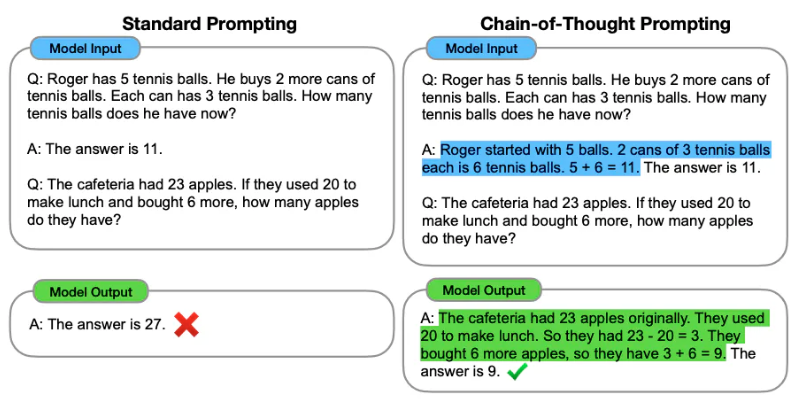

<!-- dli-course-cell {"id":"3-Prompting-With-Messages/34-Chain-of-Thought:0","index":0,"schema":"dli-course-cell/1.0","source_sha256":"ba97ba20ad88c49d0ca7a1884366a0df1205fd3af10091a6abd37552144f840a","type":"markdown"} -->
<br>
<a href="https://www.nvidia.com/en-us/training/">
    <div style="width: 55%; background-color: white; margin-top: 50px;">
    </div>
</a>
<h1 style="line-height: 1.4;"><font color="#76b900"><b>Building LLM Applications With Prompt Engineering</b></font></h1>
<h2><b>Chain-of-Thought Prompting</b></h2>
<br>
<!-- /dli-course-cell -->

<!-- dli-course-cell {"id":"3-Prompting-With-Messages/34-Chain-of-Thought:1","index":1,"schema":"dli-course-cell/1.0","source_sha256":"126c76722d4e3006ff9597478abe079bcc42af07fa492efc4a85721204b68210","type":"markdown"} -->
In this notebook, you will learn about one of the most famous prompting techniques called Chain-of-Thought prompting.
<!-- /dli-course-cell -->

<!-- dli-course-cell {"id":"3-Prompting-With-Messages/34-Chain-of-Thought:2","index":2,"schema":"dli-course-cell/1.0","source_sha256":"cb3f91d54eee30e53e35b2b99905f70f169ed549fd78909d3dac2defc9ed8d3b","type":"markdown"} -->
---
<!-- /dli-course-cell -->

<!-- dli-course-cell {"id":"3-Prompting-With-Messages/34-Chain-of-Thought:3","index":3,"schema":"dli-course-cell/1.0","source_sha256":"7ed1d5d3598d9dfd44ff52aa769434d46ec975cd34ded253e39b3b255ea9be1a","type":"markdown"} -->
## Objectives
<!-- /dli-course-cell -->

<!-- dli-course-cell {"id":"3-Prompting-With-Messages/34-Chain-of-Thought:4","index":4,"schema":"dli-course-cell/1.0","source_sha256":"8378d621a4551663d23cf5d53cd9bd81f3e64b150f327ae235699ed2ba344e24","type":"markdown"} -->
By the time you complete this notebook you will:

- Learn Chain-of-Thought prompting
- Encounter and appreciate LLM hallucination
<!-- /dli-course-cell -->

<!-- dli-course-cell {"id":"3-Prompting-With-Messages/34-Chain-of-Thought:5","index":5,"schema":"dli-course-cell/1.0","source_sha256":"cb3f91d54eee30e53e35b2b99905f70f169ed549fd78909d3dac2defc9ed8d3b","type":"markdown"} -->
---
<!-- /dli-course-cell -->

<!-- dli-course-cell {"id":"3-Prompting-With-Messages/34-Chain-of-Thought:6","index":6,"schema":"dli-course-cell/1.0","source_sha256":"d357b415148d05679d1f9802803fc0a4a039f4ece72445b0c3c596b0eb555b52","type":"markdown"} -->
## Imports
<!-- /dli-course-cell -->

<!-- dli-course-cell {"id":"3-Prompting-With-Messages/34-Chain-of-Thought:7","index":7,"schema":"dli-course-cell/1.0","source_sha256":"15c4faff0506ab4a6c5ecc8309bc6973b78baaa56fe695589969a8508e0c97e4","type":"code"} -->
```python
import os
from langchain_nvidia_ai_endpoints import ChatNVIDIA
from langchain_core.prompts import ChatPromptTemplate
from langchain_core.output_parsers import StrOutputParser
```
<!-- /dli-course-cell -->

<!-- dli-course-cell {"id":"3-Prompting-With-Messages/34-Chain-of-Thought:8","index":8,"schema":"dli-course-cell/1.0","source_sha256":"cb3f91d54eee30e53e35b2b99905f70f169ed549fd78909d3dac2defc9ed8d3b","type":"markdown"} -->
---
<!-- /dli-course-cell -->

<!-- dli-course-cell {"id":"3-Prompting-With-Messages/34-Chain-of-Thought:9","index":9,"schema":"dli-course-cell/1.0","source_sha256":"70f5e78e300511808de404ed1d62799fc55c2b20e6c2a33706e13dbca5acc811","type":"markdown"} -->
## Create a Model Instance
<!-- /dli-course-cell -->

<!-- dli-course-cell {"id":"3-Prompting-With-Messages/34-Chain-of-Thought:10","index":10,"schema":"dli-course-cell/1.0","source_sha256":"fe8a07f8e29704ed8c72091c34ce44956cd4b2a6331a6a6220553baac2abf3d3","type":"code"} -->
```python
base_url = os.getenv("NVIDIA_BASE_URL")

# Use the model selected in the course connection panel, or keep the lesson default.
model = os.getenv("NVIDIA_MODEL") or "nvidia/nemotron-nano-12b-v2-vl"
# model = "nvidia/nemotron-3-nano-30b-a3b"  # Compatible fallback; responses may differ.
# model = "meta/llama-3.3-70b-instruct"  # Legacy fallback; responses may differ more.

llm = ChatNVIDIA(base_url=base_url, model=model, temperature=0)
```
<!-- /dli-course-cell -->

<!-- dli-course-cell {"id":"3-Prompting-With-Messages/34-Chain-of-Thought:11","index":11,"schema":"dli-course-cell/1.0","source_sha256":"cb3f91d54eee30e53e35b2b99905f70f169ed549fd78909d3dac2defc9ed8d3b","type":"markdown"} -->
---
<!-- /dli-course-cell -->

<!-- dli-course-cell {"id":"3-Prompting-With-Messages/34-Chain-of-Thought:12","index":12,"schema":"dli-course-cell/1.0","source_sha256":"2368505c96376e129a9dc8cfa236851394e087be685e2f88252cc02c1125393b","type":"markdown"} -->
## LLMs Jump to Conclusions
<!-- /dli-course-cell -->

<!-- dli-course-cell {"id":"3-Prompting-With-Messages/34-Chain-of-Thought:13","index":13,"schema":"dli-course-cell/1.0","source_sha256":"8e279aa14ba8cb68f6cdf07d0b2bf000fa0713b331424ea98b2af0769252e261","type":"markdown"} -->
Since LLMs are primarily designed to generate what is most likely to come next in a stream of text, it's no surprise that they can often "jump to conclusions" in scenarios that actually require complex reasoning.

Consider the following example, which challenges the LLM to do some multiplication. Before invoking the LLM, we'll use Python to provide us with the actual answer.
<!-- /dli-course-cell -->

<!-- dli-course-cell {"id":"3-Prompting-With-Messages/34-Chain-of-Thought:14","index":14,"schema":"dli-course-cell/1.0","source_sha256":"f6fee45ee3ff30620d6a2026f1c2992a8aa917863c3475d188111e3588e6977f","type":"code"} -->
```python
expression1 = "345 * 88888"
expression2 = "345*88888"
eval(expression1), eval(expression2)
```
<!-- /dli-course-cell -->

<!-- dli-course-cell {"id":"3-Prompting-With-Messages/34-Chain-of-Thought:15","index":15,"schema":"dli-course-cell/1.0","source_sha256":"8da4c8392109721ff6a6ffa3b9655cec542fa797ac69d6dcfc22453918ed4785","type":"code"} -->
```python
print(llm.invoke(f'What is {expression1}? Give me just the answer').content)
print(llm.invoke(f'What is {expression2}? Give me just the answer').content)
```
<!-- /dli-course-cell -->

<!-- dli-course-cell {"id":"3-Prompting-With-Messages/34-Chain-of-Thought:16","index":16,"schema":"dli-course-cell/1.0","source_sha256":"99112fcd1595d867e6798c5c1b42f8906f65374c00ff8524e3c10b5bceb84480","type":"markdown"} -->
This answer is incorrect, but given what we know about LLMs, again, that they are designed primarily to generate the most likely response given the data they were trained on, it may not come as a surprise.

Significant changes are likely to occur in coming years, but as it stands, and in spite of the common use of terms like "Artificial **Intelligence**", LLMs are not well suited, at least not without additional user support, to deliberate step by step reasoning. Rather, LLMs are, because of their design, well suited to jumping to conclusions.
<!-- /dli-course-cell -->

<!-- dli-course-cell {"id":"3-Prompting-With-Messages/34-Chain-of-Thought:17","index":17,"schema":"dli-course-cell/1.0","source_sha256":"cb3f91d54eee30e53e35b2b99905f70f169ed549fd78909d3dac2defc9ed8d3b","type":"markdown"} -->
---
<!-- /dli-course-cell -->

<!-- dli-course-cell {"id":"3-Prompting-With-Messages/34-Chain-of-Thought:18","index":18,"schema":"dli-course-cell/1.0","source_sha256":"53455b10d5e342aeb904ee30e10dac838d3e94bca7eacfaa699417391e1c4fb7","type":"markdown"} -->
## Hallucination
<!-- /dli-course-cell -->

<!-- dli-course-cell {"id":"3-Prompting-With-Messages/34-Chain-of-Thought:19","index":19,"schema":"dli-course-cell/1.0","source_sha256":"bf502aacbc5dba04bd7dabd13bab5cb2615c112f37b05ed0d35e20afa4f4d190","type":"markdown"} -->
This phenomenon of LLMs generating incorrect information, often with what appears like "confidence" to outside observers, is called **hallucination**. Because of their design, an LLM will usually say something incorrect (unbeknownst to the LLM itself) rather than say nothing at all. While it's true that LLMs over time are hallucinating less, and that over time they will continue to improve in this regard, hallucination is an inherent characteristic of LLM generation.

Regarding LLM hallucination, you need to commit the following golden rules to memory:
1. All LLMs hallucinate.
2. You are responsible for what your LLMs generate in your applications.
<!-- /dli-course-cell -->

<!-- dli-course-cell {"id":"3-Prompting-With-Messages/34-Chain-of-Thought:20","index":20,"schema":"dli-course-cell/1.0","source_sha256":"cb3f91d54eee30e53e35b2b99905f70f169ed549fd78909d3dac2defc9ed8d3b","type":"markdown"} -->
---
<!-- /dli-course-cell -->

<!-- dli-course-cell {"id":"3-Prompting-With-Messages/34-Chain-of-Thought:21","index":21,"schema":"dli-course-cell/1.0","source_sha256":"be7f2f893ee6967a75a00b6bfc738c8aba1b19359550b48720f866939ff08ae3","type":"markdown"} -->
## Chain-of-Thought Prompting
<!-- /dli-course-cell -->

<!-- dli-course-cell {"id":"3-Prompting-With-Messages/34-Chain-of-Thought:22","index":22,"schema":"dli-course-cell/1.0","source_sha256":"745d1de4c228872c2bee4cab651d070187d79c53b2c0ab71f6034f12178cd66a","type":"markdown"} -->
Returning to the main subject matter of this notebook, while LLMs are not well-suited to long-form deliberate reasoning, there are techniques we can utilize to guide LLMs towards taking a more deliberate step by step approach when the task demands it. One such technique is call Chain-of-Thought

Introduced in 2023, [**Chain-of-Thought(CoT) prompting**](https://arxiv.org/pdf/2201.11903) is still one of the most popular prompting techniques. It supports complex reasoning capabilities by encouraging LLMs to break down complex problems into intermediate steps. CoT prompting involves providing examples that demonstrate step-by-step reasoning to solve a problem.

Here is the example from the paper that introduced CoT prompting.
<!-- /dli-course-cell -->

<!-- dli-course-cell {"id":"3-Prompting-With-Messages/34-Chain-of-Thought:23","index":23,"schema":"dli-course-cell/1.0","source_sha256":"03ab6cda45a24c08f9604cda024ef4baef43d88d0a48ca315b5d600a1875267a","type":"markdown"} -->

<!-- /dli-course-cell -->

<!-- dli-course-cell {"id":"3-Prompting-With-Messages/34-Chain-of-Thought:24","index":24,"schema":"dli-course-cell/1.0","source_sha256":"16dc5c8fdd156d7acc72703a070bd7f9a38cea822e5e9e2ab4e4f64e0c24ec57","type":"markdown"} -->
As you can see in the right-hand-side example, by modeling for the LLM that it ought to break the complex task into smaller subtasks that it is more likely to be able to perform, the model is given "time to think" and can do better at tasks requiring complex reasoning.
<!-- /dli-course-cell -->

<!-- dli-course-cell {"id":"3-Prompting-With-Messages/34-Chain-of-Thought:25","index":25,"schema":"dli-course-cell/1.0","source_sha256":"cb3f91d54eee30e53e35b2b99905f70f169ed549fd78909d3dac2defc9ed8d3b","type":"markdown"} -->
---
<!-- /dli-course-cell -->

<!-- dli-course-cell {"id":"3-Prompting-With-Messages/34-Chain-of-Thought:26","index":26,"schema":"dli-course-cell/1.0","source_sha256":"d4f520538eccfbd19ba36e42f91a6b9e3a62e8b4071708d418b038a39c2d0d67","type":"markdown"} -->
## Chain-of-Though Multiplication
<!-- /dli-course-cell -->

<!-- dli-course-cell {"id":"3-Prompting-With-Messages/34-Chain-of-Thought:27","index":27,"schema":"dli-course-cell/1.0","source_sha256":"350cd2b2284b8f41cba132907db8a69c2a0173ff13b28c5f0320e826f011bcf4","type":"markdown"} -->
Let's try a CoT prompt for 3-digit long multiplication. We will start with an example multiplication prompt.
<!-- /dli-course-cell -->

<!-- dli-course-cell {"id":"3-Prompting-With-Messages/34-Chain-of-Thought:28","index":28,"schema":"dli-course-cell/1.0","source_sha256":"51572650d853b91d8ddff70f82a330745fd485aaea248ee65b385c1d3b927b55","type":"code"} -->
```python
example_problem = 'What is 678 * 789?'
```
<!-- /dli-course-cell -->

<!-- dli-course-cell {"id":"3-Prompting-With-Messages/34-Chain-of-Thought:29","index":29,"schema":"dli-course-cell/1.0","source_sha256":"83cc95eedf77ad528ddfa939e7519eb86695f6c49c1fe4209e59d8eb98a670e2","type":"markdown"} -->
Next, we'll supply a chain-of-thought example of working through the problem step by step.
<!-- /dli-course-cell -->

<!-- dli-course-cell {"id":"3-Prompting-With-Messages/34-Chain-of-Thought:30","index":30,"schema":"dli-course-cell/1.0","source_sha256":"e9368e825e2c87f58f077d9f95f9c5808b2a9a775b20cf1b893c1528691aa44e","type":"code"} -->
```python
example_cot = '''\
Let me break this down into steps. First I'll break down 789 into hundreds, tens, and ones:

789 -> 700 + 80 + 9

Next I'll multiply 678 by each of these values, storing the intermediate results:

678 * 700 -> 678 * 7 * 100 -> 4746 * 100 -> 474600

My first intermediate result is 474600.

678 * 80 -> 678 * 8 * 10 -> 5424 * 10 -> 54240

My second intermediate result is 54240.

678 * 9 -> 6102

My third intermediate result is 6102.

My three intermediate results are 474600, 54240, and 6102.

Adding the first two intermediate results I get 474600 + 54240 -> 528840.

Adding 528840 to the last intermediate result I get 528840 + 6102 -> 534942

The final result is 534942.
'''
```
<!-- /dli-course-cell -->

<!-- dli-course-cell {"id":"3-Prompting-With-Messages/34-Chain-of-Thought:31","index":31,"schema":"dli-course-cell/1.0","source_sha256":"fb531ae960d15f61b50e22538c87f70d5e942b7c76d7e464f7e29f39a7c1e2f1","type":"markdown"} -->
With our example problem and example CoT response, we can construct a one-shot prompt template.
<!-- /dli-course-cell -->

<!-- dli-course-cell {"id":"3-Prompting-With-Messages/34-Chain-of-Thought:32","index":32,"schema":"dli-course-cell/1.0","source_sha256":"40770d7cf1b77876050f9a3327507e1f6d1a9c9aa4f2bb310c7edc4edfb9b955","type":"code"} -->
```python
multiplication_template = ChatPromptTemplate.from_messages([
    ('human', example_problem),
    ('ai', example_cot),
    ('human', '{long_multiplication_prompt}')
])
```
<!-- /dli-course-cell -->

<!-- dli-course-cell {"id":"3-Prompting-With-Messages/34-Chain-of-Thought:33","index":33,"schema":"dli-course-cell/1.0","source_sha256":"b6c5c334c79219ff99c6ba2c4d3d36d0b3929644ac130310ad08ff831e2d41d0","type":"markdown"} -->
We'll now use this template in a simple chain.
<!-- /dli-course-cell -->

<!-- dli-course-cell {"id":"3-Prompting-With-Messages/34-Chain-of-Thought:34","index":34,"schema":"dli-course-cell/1.0","source_sha256":"a55a0348b2697fe2b715b1e98b6c9a55fc2ead18d595c4172bea61288d0d530a","type":"code"} -->
```python
multiplication_chain = multiplication_template | llm | StrOutputParser()
```
<!-- /dli-course-cell -->

<!-- dli-course-cell {"id":"3-Prompting-With-Messages/34-Chain-of-Thought:35","index":35,"schema":"dli-course-cell/1.0","source_sha256":"2435a3c47c01805afd7c08b1622dfe0a1a40e767d688bda201c85b5a20892f91","type":"markdown"} -->
Let's revisit the original multiplication problem we tasked the LLM with to see if it does any better.
<!-- /dli-course-cell -->

<!-- dli-course-cell {"id":"3-Prompting-With-Messages/34-Chain-of-Thought:36","index":36,"schema":"dli-course-cell/1.0","source_sha256":"574edc0ea7529510f1fc7391c6c6b3c84a55f0b4ad81608578e99d47c4edbe08","type":"code"} -->
```python
print(multiplication_chain.invoke(f'What is {expression1}?'))
# print(multiplication_chain.invoke(f'What is {expression2}?'))
# print(multiplication_chain.invoke(f'What is {expression2+"88888"}?'))
```
<!-- /dli-course-cell -->

<!-- dli-course-cell {"id":"3-Prompting-With-Messages/34-Chain-of-Thought:37","index":37,"schema":"dli-course-cell/1.0","source_sha256":"d1f24536d5a78ea5411379493186a411113c4546a5a68a430fbb3043e12535da","type":"code"} -->
```python
print(f"{expression1} = {eval(expression1)}")
print(f"{expression2} = {eval(expression2)}")
print(f"{expression2+'88888'} = {eval(expression2+'88888'):,}")
```
<!-- /dli-course-cell -->

<!-- dli-course-cell {"id":"3-Prompting-With-Messages/34-Chain-of-Thought:38","index":38,"schema":"dli-course-cell/1.0","source_sha256":"644622b0f665a88f340accb46d9277f589e64df7a4a5f1d121d22786e05c546e","type":"markdown"} -->
As you can see, the LLM followed the example in our CoT prompt, taking the problem step by step, and in this case, generated the correct response.
<!-- /dli-course-cell -->

<!-- dli-course-cell {"id":"3-Prompting-With-Messages/34-Chain-of-Thought:39","index":39,"schema":"dli-course-cell/1.0","source_sha256":"cb3f91d54eee30e53e35b2b99905f70f169ed549fd78909d3dac2defc9ed8d3b","type":"markdown"} -->
---
<!-- /dli-course-cell -->

<!-- dli-course-cell {"id":"3-Prompting-With-Messages/34-Chain-of-Thought:40","index":40,"schema":"dli-course-cell/1.0","source_sha256":"c464ee1235e749d9089466fcd3dc79f2ac19f50c26c33d43df3c9a212619b215","type":"markdown"} -->
## Zero-shot Chain-of-Thought Prompting
<!-- /dli-course-cell -->

<!-- dli-course-cell {"id":"3-Prompting-With-Messages/34-Chain-of-Thought:41","index":41,"schema":"dli-course-cell/1.0","source_sha256":"18d457ea24759d795839ee2637f7cebb77ffbe963e759cd04a458a2fa446c69b","type":"markdown"} -->
CoT prompting can get really verbose, and as we mentioned earlier, you shouldn't be shy about writing long prompts when needed to accomplish your goals.

That said, there are more elegant ways to leverage CoT methods with LLMs. One such variant is called [Zero-shot CoT](https://arxiv.org/abs/2205.11916). This prompting technique simply adds "Let's think step by step" to the prompt without supplying verbose CoT examples, and it has been shown to work quite well.

Let's construct a new prompt template to try Zero-shot CoT on long multiplication, following the example in the paper, simply supplying the language "Let's think step by step".
<!-- /dli-course-cell -->

<!-- dli-course-cell {"id":"3-Prompting-With-Messages/34-Chain-of-Thought:42","index":42,"schema":"dli-course-cell/1.0","source_sha256":"def2dbd1f7a3a6be32213d440230ead6b3c20e4bdb681a217902cd78351d03e8","type":"code"} -->
```python
zero_shot_cot_prompt = ChatPromptTemplate([
    ("human", "{long_multiplication_prompt} Let's think step by step.")
])
```
<!-- /dli-course-cell -->

<!-- dli-course-cell {"id":"3-Prompting-With-Messages/34-Chain-of-Thought:43","index":43,"schema":"dli-course-cell/1.0","source_sha256":"553dd1ec9cd9140483e98362009196157596f4ca7aecd8220bc88dba58b4cd99","type":"code"} -->
```python
zero_shot_multiplication_chain = zero_shot_cot_prompt | llm | StrOutputParser()
```
<!-- /dli-course-cell -->

<!-- dli-course-cell {"id":"3-Prompting-With-Messages/34-Chain-of-Thought:44","index":44,"schema":"dli-course-cell/1.0","source_sha256":"c6d36f0de4c27c32fa98758789d5134f6a3299a4b35a779783d3b031d0d34e5d","type":"code"} -->
```python
print(zero_shot_multiplication_chain.invoke(f'What is {expression1}?'))
# print(zero_shot_multiplication_chain.invoke(f'What is {expression2}?'))
# print(zero_shot_multiplication_chain.invoke(f'What is {expression2+"88888"}?'))
```
<!-- /dli-course-cell -->

<!-- dli-course-cell {"id":"3-Prompting-With-Messages/34-Chain-of-Thought:45","index":45,"schema":"dli-course-cell/1.0","source_sha256":"1781295099b2848067fed561326409414abe59805a2ef3736928161093b42135","type":"code"} -->
```python
print(f"{expression1} = {eval(expression1):,}")
print(f"{expression2} = {eval(expression2):,}")
print(f"{expression2+'88888'} = {eval(expression2+'88888'):,}")
```
<!-- /dli-course-cell -->

<!-- dli-course-cell {"id":"3-Prompting-With-Messages/34-Chain-of-Thought:46","index":46,"schema":"dli-course-cell/1.0","source_sha256":"6d6b6f6c486a4a8a3f88519fcc373c7dd51b35abf734608d10efdd5a83647be4","type":"markdown"} -->
For our 3-digit long multiplication problem, simply prompting the model to think step by step performed as well as our more verbose CoT prompt.
<!-- /dli-course-cell -->

<!-- dli-course-cell {"id":"3-Prompting-With-Messages/34-Chain-of-Thought:47","index":47,"schema":"dli-course-cell/1.0","source_sha256":"cb3f91d54eee30e53e35b2b99905f70f169ed549fd78909d3dac2defc9ed8d3b","type":"markdown"} -->
---
<!-- /dli-course-cell -->

<!-- dli-course-cell {"id":"3-Prompting-With-Messages/34-Chain-of-Thought:48","index":48,"schema":"dli-course-cell/1.0","source_sha256":"823fc00f1abff90da9e434f642e1400c43d134869c9444c1bb57a508c1cf908e","type":"markdown"} -->
## CoT Prompting In Practice
<!-- /dli-course-cell -->

<!-- dli-course-cell {"id":"3-Prompting-With-Messages/34-Chain-of-Thought:49","index":49,"schema":"dli-course-cell/1.0","source_sha256":"01a3fa3573ea2e894e0f95704f7dcf5828c0bf788b15c8481cd1696d5b2f84b3","type":"markdown"} -->
As with many other aspects of prompt engineering, especially given the variety of LLMs available (both now and in the future) it's difficult to give hard and fast rules about when and how exactly to employ CoT prompting. That said, we can offer you some good general guidelines to follow.

- Develop your prompts iteratively. Start simple, try zero-shot CoT when you think it might be helpful, and expand to use more verbose example-based CoT prompting when the need arises.
- Consider the use of external, non-LLM tools for tasks that LLMs may not be well-suited for (like math). We are going to look at tool use later in the workshop but the general idea is that LLMs are incredible, but not necessarily for every single task. Reflect if you will on the case of long multiplication about how fast, reliable, and effective simple Python is. Don't fall into the old adage _"If all you have is a hammer, everything looks like a nail."_ LLMs are only one of your many tools to use while building LLM-based applications.
<!-- /dli-course-cell -->

<!-- dli-course-cell {"id":"3-Prompting-With-Messages/34-Chain-of-Thought:50","index":50,"schema":"dli-course-cell/1.0","source_sha256":"cb3f91d54eee30e53e35b2b99905f70f169ed549fd78909d3dac2defc9ed8d3b","type":"markdown"} -->
---
<!-- /dli-course-cell -->

<!-- dli-course-cell {"id":"3-Prompting-With-Messages/34-Chain-of-Thought:51","index":51,"schema":"dli-course-cell/1.0","source_sha256":"05ecb27416c46a21d591adc8fe49bbf1c425f3fca18c9d6ff11ff21dd6701cb5","type":"markdown"} -->
## Exercise: Use an LLM to Solve a Word Problem
<!-- /dli-course-cell -->

<!-- dli-course-cell {"id":"3-Prompting-With-Messages/34-Chain-of-Thought:52","index":52,"schema":"dli-course-cell/1.0","source_sha256":"987c409548760e55cff910b7f158251f5fc115eea0c2526073df574940cc2a3a","type":"markdown"} -->
For this exercise, use what you've learned in this notebook to a correct response back from our LLM to the following word problem.
<!-- /dli-course-cell -->

<!-- dli-course-cell {"id":"3-Prompting-With-Messages/34-Chain-of-Thought:53","index":53,"schema":"dli-course-cell/1.0","source_sha256":"e62c6545c4ea10c189fe6041f89aef2f41a5c46db44a463bae44bed003b9a41c","type":"code"} -->
```python
word_problem = (
    "Michael's car travels at 40 miles per hour. He is driving from 1 PM to 4 PM"
    "and then travels back at a rate of 25 miles per hour due to heavy traffic."
    " How long in terms of minutes did it take him to get back?"
)
```
<!-- /dli-course-cell -->

<!-- dli-course-cell {"id":"3-Prompting-With-Messages/34-Chain-of-Thought:54","index":54,"schema":"dli-course-cell/1.0","source_sha256":"00fdaabfea5eeda8a64fbdb9ee78e3d111553cc46761a6c65a0f927cc0fc1710","type":"markdown"} -->
Before beginning your work, here is the actual solution to the word problem.

<blockquote>
Michael drove 40 miles per hour for 3 hours, which means he drove 120 miles.

To come back at a rate of 25 miles per hour, it would have taken him 4.8 hours (120 miles / 25 mph) which is equivalent to **288** minutes (4.8 hours * 60 minutes/hour).

The correct answer is **288**.
</blockquote>

Feel free to check out the *Solution* below if you get stuck.
<!-- /dli-course-cell -->

<!-- dli-course-cell {"id":"3-Prompting-With-Messages/34-Chain-of-Thought:55","index":55,"schema":"dli-course-cell/1.0","source_sha256":"58fa68be734d1b62b1ced799ad754353678f5cc20147be2dd226208550872042","type":"markdown"} -->
### Your Work Here
<!-- /dli-course-cell -->

<!-- dli-course-cell {"id":"3-Prompting-With-Messages/34-Chain-of-Thought:56","index":56,"schema":"dli-course-cell/1.0","source_sha256":"e3b0c44298fc1c149afbf4c8996fb92427ae41e4649b934ca495991b7852b855","type":"code"} -->
```python
```
<!-- /dli-course-cell -->

<!-- dli-course-cell {"id":"3-Prompting-With-Messages/34-Chain-of-Thought:57","index":57,"schema":"dli-course-cell/1.0","source_sha256":"eb90ed3f74a5e9009c6633c2e44657cd53d6fb3a6a0427e0f2be9986882c3530","type":"markdown"} -->
### Solution
<!-- /dli-course-cell -->

<!-- dli-course-cell {"id":"3-Prompting-With-Messages/34-Chain-of-Thought:58","index":58,"schema":"dli-course-cell/1.0","source_sha256":"0b902d49ce60c8e46aad35ad53dbc5ad3bd17178045a700527ca80f50a626bd2","type":"markdown"} -->
There are lots of ways to solve this, but we opted to include a system message encouraging the LLM to always break their work into smaller tasks and showing their work, and then, appending the cannonical zero-shot CoT prompt to whatever the human user passes in.
<!-- /dli-course-cell -->

<!-- dli-course-cell {"id":"3-Prompting-With-Messages/34-Chain-of-Thought:59","index":59,"schema":"dli-course-cell/1.0","source_sha256":"65f16c4047e84569378ba3ff3af9d70c479c28858e636604df90592fc1bde8ef","type":"code"} -->
```python
template = ChatPromptTemplate.from_messages([
    ('system', 'You are an expert word problem solver. You always break your problem down into smaller tasks and show your work.'),
    ('human', '{prompt}\n\nLet\'s think step by step.')
])
```
<!-- /dli-course-cell -->

<!-- dli-course-cell {"id":"3-Prompting-With-Messages/34-Chain-of-Thought:60","index":60,"schema":"dli-course-cell/1.0","source_sha256":"c26a4f25af6941727aaf2485c27f6629c1fc793472420e03e5d6157cb1deb20a","type":"code"} -->
```python
chain = template | llm | StrOutputParser()
```
<!-- /dli-course-cell -->

<!-- dli-course-cell {"id":"3-Prompting-With-Messages/34-Chain-of-Thought:61","index":61,"schema":"dli-course-cell/1.0","source_sha256":"24874545bc118bdf967e91a9cd317f502a140cfe31b74b61caa22401f8fc806a","type":"code"} -->
```python
print(chain.invoke(word_problem))
```
<!-- /dli-course-cell -->

<!-- dli-course-cell {"id":"3-Prompting-With-Messages/34-Chain-of-Thought:62","index":62,"schema":"dli-course-cell/1.0","source_sha256":"cb3f91d54eee30e53e35b2b99905f70f169ed549fd78909d3dac2defc9ed8d3b","type":"markdown"} -->
---
<!-- /dli-course-cell -->

<!-- dli-course-cell {"id":"3-Prompting-With-Messages/34-Chain-of-Thought:63","index":63,"schema":"dli-course-cell/1.0","source_sha256":"30ac03ff33731529441be8fbe52a3bd0d4c5ec830e806d54692168ebb7f98ada","type":"markdown"} -->
## Summary
<!-- /dli-course-cell -->

<!-- dli-course-cell {"id":"3-Prompting-With-Messages/34-Chain-of-Thought:64","index":64,"schema":"dli-course-cell/1.0","source_sha256":"2a28fc3c2bb37f14b89077c180604d52dc67cfd9d0c2d894f2ecefa2c04b2a95","type":"markdown"} -->
In this notebook, you experienced LLM hallucination, reflected on your models' natural inclinations to jump to conclusions, and learned several Chain-of-Thought prompting techniques to assist LLMs in performing tasks requiring step by step reasoning.

In the next notebook, you are going to learn how to make a chatbot using the prompt engineering techniques you now have at your disposal.

---

<!-- NEXT_STEP_CARD -->

<div style="border-left: 6px solid #76B900; background: #f7fdf2; padding: 14px 18px; border-radius: 10px; margin: 20px 0;">
<p style="margin: 0 0 6px; color: #315c00; font-weight: 700; letter-spacing: .04em; text-transform: uppercase;">Continue the unified course path</p>
<p style="margin: 0 0 8px; color: black;"><strong>Next step:</strong> Open <code>3-Prompting-With-Messages/35-Reasoning-Models.ipynb</code> next: <strong>Reasoning Models</strong>.</p>
<p style="margin: 0; color: black;"><strong>Before moving on:</strong> Save one task where explicit reasoning helped, because the next notebook asks whether a reasoning-specialized model changes that tradeoff enough to justify the extra cost.</p>
</div>
<!-- /dli-course-cell -->
