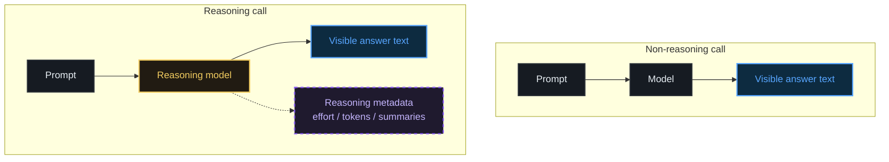

<!-- dli-course-cell {"id":"3-Prompting-With-Messages/35-Reasoning-Models:0","index":0,"schema":"dli-course-cell/1.0","source_sha256":"14c89a3546252d34c6d662a8f2d060e3674459eeb7a1d3e4bbcde69a2adeab14","type":"markdown"} -->
<br>
<a href="https://www.nvidia.com/en-us/training/">
    <div style="width: 55%; background-color: white; margin-top: 50px;">
    </div>
</a>
<h1 style="line-height: 1.4;"><font color="#76b900"><b>Building LLM Applications With Prompt Engineering</b></font></h1>
<h2><b>Reasoning Models</b></h2>
<br>
<!-- /dli-course-cell -->

<!-- dli-course-cell {"id":"3-Prompting-With-Messages/35-Reasoning-Models:1","index":1,"schema":"dli-course-cell/1.0","source_sha256":"b169ff65734918583c83017d19af07ad8caea13cc9730b0f420d6e87a866958a","type":"markdown"} -->
<!-- REASONING_MODEL_POLICY_NEMOTRON_20260505 -->
This notebook intentionally uses two different Nemotron models:

- `nvidia/nemotron-nano-12b-v2-vl` is the direct-response baseline. It is the right default for ordinary prompt iteration, structured output, routing, and tool-use examples.
- `nvidia/nemotron-3-nano-omni-30b-a3b-reasoning` is reserved for tasks where the extra deliberation is the point. It can process text, image, audio, and video inputs, but here you use it to study reasoning behavior through the same chat interface.

Do not treat the reasoning model as the default model for the whole course. The lesson is to choose it only when the task justifies the additional latency, output length, and parsing care.

<!-- /dli-course-cell -->

<!-- dli-course-cell {"id":"3-Prompting-With-Messages/35-Reasoning-Models:2","index":2,"schema":"dli-course-cell/1.0","source_sha256":"a21a9a8d8999e57c5b13df5cdc07ac2035968550292c87f89d9d683080a26577","type":"markdown"} -->
In the previous notebook, we learned about Chain-of-Thought (CoT) prompting, a technique where we *prompt* an LLM to think step by step. But what if the model could do this automatically, without needing to be prompted?

That's exactly what **reasoning models** are designed to do. In this notebook, we'll explore these specialized models, understand their trade-offs, and learn how to work with them in practice.
<!-- /dli-course-cell -->

<!-- dli-course-cell {"id":"3-Prompting-With-Messages/35-Reasoning-Models:3","index":3,"schema":"dli-course-cell/1.0","source_sha256":"8c8b40e8bf4c3ee313e7f295962f593f8859127407bd3c5ab8c723ffe6fe0767","type":"markdown"} -->

<!-- /dli-course-cell -->

<!-- dli-course-cell {"id":"3-Prompting-With-Messages/35-Reasoning-Models:4","index":4,"schema":"dli-course-cell/1.0","source_sha256":"f52d711103d50a437830c6fbcd04fb4bab49a0f82f6d26d1c791c6e8488dd090","type":"markdown"} -->
---
<!-- /dli-course-cell -->

<!-- dli-course-cell {"id":"3-Prompting-With-Messages/35-Reasoning-Models:5","index":5,"schema":"dli-course-cell/1.0","source_sha256":"b26ff6af131f904716148b6f227caffe5f5198c9e12a91e20aa9b5a96550f28b","type":"markdown"} -->
## Objectives
<!-- /dli-course-cell -->

<!-- dli-course-cell {"id":"3-Prompting-With-Messages/35-Reasoning-Models:6","index":6,"schema":"dli-course-cell/1.0","source_sha256":"c2483453462031540429b81dc27c59f7e383d833cf667741cfd4e3b0b48aadb6","type":"markdown"} -->
By the time you complete this notebook you will:

- Understand what reasoning models are and how they differ from standard LLMs
- Recognize the trade-offs involved in using reasoning models
- Learn how to handle the "thinking" tokens that reasoning models produce
- Be able to integrate reasoning models into LangChain chains
<!-- /dli-course-cell -->

<!-- dli-course-cell {"id":"3-Prompting-With-Messages/35-Reasoning-Models:7","index":7,"schema":"dli-course-cell/1.0","source_sha256":"f52d711103d50a437830c6fbcd04fb4bab49a0f82f6d26d1c791c6e8488dd090","type":"markdown"} -->
---
<!-- /dli-course-cell -->

<!-- dli-course-cell {"id":"3-Prompting-With-Messages/35-Reasoning-Models:8","index":8,"schema":"dli-course-cell/1.0","source_sha256":"87a675d1e3345ac466aefabd1a8bce507e6bf76eee0be8e97aba3d15fa00b243","type":"markdown"} -->
## Imports
<!-- /dli-course-cell -->

<!-- dli-course-cell {"id":"3-Prompting-With-Messages/35-Reasoning-Models:9","index":9,"schema":"dli-course-cell/1.0","source_sha256":"9e665180223d18348e595b10192406141dd0d4f8545da4f5dfe563bd0cc44af5","type":"code"} -->
```python
import os
import re
import time

from langchain_nvidia_ai_endpoints import ChatNVIDIA
from langchain_core.prompts import ChatPromptTemplate
from langchain_core.output_parsers import StrOutputParser, JsonOutputParser
from langchain_core.runnables import RunnableLambda
from langchain_core.messages import AIMessage
```
<!-- /dli-course-cell -->

<!-- dli-course-cell {"id":"3-Prompting-With-Messages/35-Reasoning-Models:10","index":10,"schema":"dli-course-cell/1.0","source_sha256":"f52d711103d50a437830c6fbcd04fb4bab49a0f82f6d26d1c791c6e8488dd090","type":"markdown"} -->
---
<!-- /dli-course-cell -->

<!-- dli-course-cell {"id":"3-Prompting-With-Messages/35-Reasoning-Models:11","index":11,"schema":"dli-course-cell/1.0","source_sha256":"a4fa246becfeb007a738a1b6d7f18962fa35f6659442272899f48091be1705ce","type":"markdown"} -->
## Create Model Instances
<!-- /dli-course-cell -->

<!-- dli-course-cell {"id":"3-Prompting-With-Messages/35-Reasoning-Models:12","index":12,"schema":"dli-course-cell/1.0","source_sha256":"1068dbfed8cde98a2122c266436fcbc3f586116c397b7281a4b35a9935111705","type":"markdown"} -->
In this notebook, we'll be comparing a standard LLM with a reasoning model. Let's create both.

For our reasoning model, we'll use [**`nvidia/nemotron-3-nano-omni-30b-a3b-reasoning`**](https://build.nvidia.com/nvidia/nemotron-3-nano-omni-30b-a3b-reasoning). It is NVIDIA's Nemotron 3 Nano Omni reasoning model: a 30B-total, 3B-active omnimodal model intended for tasks that benefit from deliberate analysis across rich inputs.
<!-- /dli-course-cell -->

<!-- dli-course-cell {"id":"3-Prompting-With-Messages/35-Reasoning-Models:13","index":13,"schema":"dli-course-cell/1.0","source_sha256":"014cb3f558a811200db3036b3bc8138ef661b5e160e1422ebeab358dcc29ae5f","type":"code"} -->
```python
base_url = os.getenv("NVIDIA_BASE_URL")

# Our standard model (same as previous notebooks)
standard_llm = ChatNVIDIA(base_url=base_url, model='nvidia/nemotron-nano-12b-v2-vl', temperature=0)

# A reasoning model
reasoning_llm = ChatNVIDIA(
    base_url=base_url,
    model='nvidia/nemotron-3-nano-omni-30b-a3b-reasoning',
    temperature=0.5,             # See model card for task-specific temperature/sampling parameter recommendations.
    max_completion_tokens=2048,  # Reasoning models need enough room for analysis plus the final answer.
)
```
<!-- /dli-course-cell -->

<!-- dli-course-cell {"id":"3-Prompting-With-Messages/35-Reasoning-Models:14","index":14,"schema":"dli-course-cell/1.0","source_sha256":"f52d711103d50a437830c6fbcd04fb4bab49a0f82f6d26d1c791c6e8488dd090","type":"markdown"} -->
---
<!-- /dli-course-cell -->

<!-- dli-course-cell {"id":"3-Prompting-With-Messages/35-Reasoning-Models:15","index":15,"schema":"dli-course-cell/1.0","source_sha256":"7ba10a428638680f2cc7d153a3a836903c342c12f88d7555ade0cb2e60f3b057","type":"markdown"} -->
## Streaming Printing Helper
<!-- /dli-course-cell -->

<!-- dli-course-cell {"id":"3-Prompting-With-Messages/35-Reasoning-Models:16","index":16,"schema":"dli-course-cell/1.0","source_sha256":"c97a9c308f7aac3808b423deead06105a70fc63eb5e02c17f5baaec4529d8283","type":"markdown"} -->
In this notebook we will use the following helper function to print streaming responses from the LLM.
<!-- /dli-course-cell -->

<!-- dli-course-cell {"id":"3-Prompting-With-Messages/35-Reasoning-Models:17","index":17,"schema":"dli-course-cell/1.0","source_sha256":"c748645bfcdf169f7a69453a8516d6ba20207c36ca518c50debabc68a79064bf","type":"code"} -->
```python
def sprint(stream):
    for chunk in stream:
        if chunk.additional_kwargs.get('reasoning'):            ## If there is reasoning, we will display it.
            print(chunk.additional_kwargs.get('reasoning', ""), end='', flush=True)
        if chunk.content:
            print("\033[1m" + chunk.content + "\033[0m", end='', flush=True) ## Otherwise, we will print output in bold.
```
<!-- /dli-course-cell -->

<!-- dli-course-cell {"id":"3-Prompting-With-Messages/35-Reasoning-Models:18","index":18,"schema":"dli-course-cell/1.0","source_sha256":"cb3f91d54eee30e53e35b2b99905f70f169ed549fd78909d3dac2defc9ed8d3b","type":"markdown"} -->
---
<!-- /dli-course-cell -->

<!-- dli-course-cell {"id":"3-Prompting-With-Messages/35-Reasoning-Models:19","index":19,"schema":"dli-course-cell/1.0","source_sha256":"dac9298fc816ff017bd167ef3d23461a224bb2c3b83e897d0727e8c44cbd9b5e","type":"markdown"} -->
## Reasoning Models
<!-- /dli-course-cell -->

<!-- dli-course-cell {"id":"3-Prompting-With-Messages/35-Reasoning-Models:20","index":20,"schema":"dli-course-cell/1.0","source_sha256":"c8f03836301545f5ffe4077bec4c57fff506b20c92e2be0658dadaaa9846355e","type":"markdown"} -->
In a previous notebook, you learned that standard LLMs tend to "jump to conclusions" because they're designed to predict the most likely next token. We showed how Chain-of-Thought prompting can help by explicitly asking the model to think step by step.

**Reasoning models** take this a step further. They are trained (or fine-tuned) to *automatically* engage in extended internal reasoning before producing their final answer. You don't need to prompt them to think step by step: they do it naturally.

Let's see this in action with a puzzle requiring some multi-step logical thinking. We'll present both models with the same problem and compare their responses.
<!-- /dli-course-cell -->

<!-- dli-course-cell {"id":"3-Prompting-With-Messages/35-Reasoning-Models:21","index":21,"schema":"dli-course-cell/1.0","source_sha256":"a07ccf8129c09e91986bcb5569a8343eb91d638c07a8aa99b489ac80a8cdcfd8","type":"code"} -->
```python
problem = """You are a world-class logician. Read the following short story carefully:
Alice, Bob, and Charlie are the only three people in a house. At midnight, exactly one of them is in the kitchen, exactly one is in the bedroom, and exactly one is in the bathroom.
The light in the kitchen is on.
Alice hates bright lights and never enters a room that has its light on.
Bob is afraid of the dark and never enters a room that has its light off.
Charlie always tells the truth.
Charlie says: “Bob is in the bathroom.”
Where is each person, and is the bedroom light on or off?
Answer with exactly three sentences: one stating where Alice is, one stating where Bob is, and one stating where Charlie is, plus a fourth sentence about the bedroom light.
Show every step of your reasoning first. Do not guess."""
```
<!-- /dli-course-cell -->

<!-- dli-course-cell {"id":"3-Prompting-With-Messages/35-Reasoning-Models:22","index":22,"schema":"dli-course-cell/1.0","source_sha256":"703d4d95b459c314f3860823110b4a573b2cdeb98ca3ff50507e5589dc415cab","type":"markdown"} -->
If you're interested try to work the problem out for yourself. When you're ready view the solution by viewing the cell immediately below.
<!-- /dli-course-cell -->

<!-- dli-course-cell {"id":"3-Prompting-With-Messages/35-Reasoning-Models:23","index":23,"schema":"dli-course-cell/1.0","source_sha256":"4f202504dc4114d7c175216f829cca4c60b59e8f7c4ff6858af1f4409d4e44d1","type":"markdown"} -->
<details><summary><b>Click to show solution</b></summary>
<blockquote><pre>Alice is in the bedroom.  
Bob is in the bathroom.  
Charlie is in the kitchen.  
The bedroom light is off.
</pre></blockquote></details>
<!-- /dli-course-cell -->

<!-- dli-course-cell {"id":"3-Prompting-With-Messages/35-Reasoning-Models:24","index":24,"schema":"dli-course-cell/1.0","source_sha256":"1e30bcebbb53bea1d224e8eaae675e6ebb6704d2f244a3e854951a1eaa6d41ff","type":"markdown"} -->
First, let's see how our non-reasoning model performson this tricky logic puzzle.
<!-- /dli-course-cell -->

<!-- dli-course-cell {"id":"3-Prompting-With-Messages/35-Reasoning-Models:25","index":25,"schema":"dli-course-cell/1.0","source_sha256":"6baafd4a922c8d23ec8588fce8800be59a9cb6f875b4b73a434bc7104aa7d479","type":"code"} -->
```python
## Diagnostic Check: What's actually coming out of the stream.
# stream = standard_llm.stream(problem)
# print(next(stream))
# print(next(stream))
sprint(standard_llm.stream(problem))
```
<!-- /dli-course-cell -->

<!-- dli-course-cell {"id":"3-Prompting-With-Messages/35-Reasoning-Models:26","index":26,"schema":"dli-course-cell/1.0","source_sha256":"d57a8ad04535afa68ba82f51c64cb511509d97f4c0cd6b4c4625332940f71638","type":"markdown"} -->
And now let's give the problem to a reasoning model.
<!-- /dli-course-cell -->

<!-- dli-course-cell {"id":"3-Prompting-With-Messages/35-Reasoning-Models:27","index":27,"schema":"dli-course-cell/1.0","source_sha256":"6303e7f0f5cee42e1fe49bf81ca845e216c7212deeb352d94bcc36a6e40d179f","type":"code"} -->
```python
## Diagnostic Check: What's actually coming out of the stream.
# stream = reasoning_llm.stream(problem)
# print(next(stream))
# print(next(stream))

sprint(reasoning_llm.stream(problem))
```
<!-- /dli-course-cell -->

<!-- dli-course-cell {"id":"3-Prompting-With-Messages/35-Reasoning-Models:28","index":28,"schema":"dli-course-cell/1.0","source_sha256":"3788f881dc8854169b7a90478a9d2cbd11237417923d78984e1b09639b4d7666","type":"markdown"} -->
Notice the difference? The standard model gives a quick, direct answer. The reasoning model, on the other hand, produces a much longer response that includes its step-by-step thinking process.

**Why is reasoning coming as a new argument:** If you looked behind the server, the reasoning model wraps its internal deliberation in `<think></think>` tags or similar. This is the model "thinking out loud" before giving its final answer. The API parses this out and delivers it through a different pathway, hence the additional argument which gets returned per chunk.
<!-- /dli-course-cell -->

<!-- dli-course-cell {"id":"3-Prompting-With-Messages/35-Reasoning-Models:29","index":29,"schema":"dli-course-cell/1.0","source_sha256":"f52d711103d50a437830c6fbcd04fb4bab49a0f82f6d26d1c791c6e8488dd090","type":"markdown"} -->
---
<!-- /dli-course-cell -->

<!-- dli-course-cell {"id":"3-Prompting-With-Messages/35-Reasoning-Models:30","index":30,"schema":"dli-course-cell/1.0","source_sha256":"f735429b5636ffcb59b6da67839bdabd90da784507eab8ec6de53cae7825d646","type":"markdown"} -->
## The Trade-Offs
<!-- /dli-course-cell -->

<!-- dli-course-cell {"id":"3-Prompting-With-Messages/35-Reasoning-Models:31","index":31,"schema":"dli-course-cell/1.0","source_sha256":"ae752a8de09ecb2a8d116e30c339e13167686f1cdfa8bda550e6e1ade1e05ea5","type":"markdown"} -->
If reasoning models are better at complex problems, why not use them for everything? There are important trade-offs to consider:

1. **Latency**: Reasoning models take longer to respond because they generate many more tokens.
2. **Cost**: More tokens means higher costs (in API-based scenarios) or more compute (in self-hosted scenarios).
3. **Overkill for simple tasks**: For straightforward questions (like the example above), the extra reasoning adds no value.

Let's measure the latency difference on a simple task.
<!-- /dli-course-cell -->

<!-- dli-course-cell {"id":"3-Prompting-With-Messages/35-Reasoning-Models:32","index":32,"schema":"dli-course-cell/1.0","source_sha256":"d4bf5f0d942c7639e2aaf4586d0524341a1b24a15bcc67bd75d814888ee04dc7","type":"code"} -->
```python
simple_task = "Summarize the benefits of exercise in one sentence."

# Time the standard model
start = time.time()
standard_response = standard_llm.invoke(simple_task)
standard_time = time.time() - start

# Time the reasoning model
start = time.time()
reasoning_response = reasoning_llm.invoke(simple_task)
reasoning_time = time.time() - start

standard_text = standard_response.content or ""
reasoning_text = reasoning_response.content or ""
reasoning_trace = reasoning_response.additional_kwargs.get("reasoning_content", "")

print(f"Standard model:  {standard_time:.1f} seconds, {len(standard_text)} answer characters")
print(f"Reasoning model: {reasoning_time:.1f} seconds, {len(reasoning_text)} answer characters")
print(f"Reasoning trace: {len(reasoning_trace)} hidden/side-channel characters")
print(f"\nThe reasoning model was {reasoning_time/standard_time:.1f}x slower for this simple task.")
```
<!-- /dli-course-cell -->

<!-- dli-course-cell {"id":"3-Prompting-With-Messages/35-Reasoning-Models:33","index":33,"schema":"dli-course-cell/1.0","source_sha256":"7e9ca67d39ac4cd3142b8e5d5b3a7f44a6e26cebc6020be0854ca8e39faa6f08","type":"markdown"} -->
As you can see, the reasoning model takes significantly longer, even for a task that doesn't require complex reasoning. This is an important consideration when designing your applications: **use reasoning models when the task genuinely benefits from extended deliberation**.
<!-- /dli-course-cell -->

<!-- dli-course-cell {"id":"3-Prompting-With-Messages/35-Reasoning-Models:34","index":34,"schema":"dli-course-cell/1.0","source_sha256":"f52d711103d50a437830c6fbcd04fb4bab49a0f82f6d26d1c791c6e8488dd090","type":"markdown"} -->
---
<!-- /dli-course-cell -->

<!-- dli-course-cell {"id":"3-Prompting-With-Messages/35-Reasoning-Models:35","index":35,"schema":"dli-course-cell/1.0","source_sha256":"f83508c60b93319692423ddcb935dd05db0c6019b3792c606544ad4df5dcc8e5","type":"markdown"} -->
## Handling Thinking Tokens
<!-- /dli-course-cell -->

<!-- dli-course-cell {"id":"3-Prompting-With-Messages/35-Reasoning-Models:36","index":36,"schema":"dli-course-cell/1.0","source_sha256":"99eb29a7e37919ef365e4ec2fafaa60d63389ca04be630d544a4f3ff069c04ec","type":"markdown"} -->
As we saw above, our NIM-hosted model separates thinking into `additional_kwargs['reasoning_content']`, keeping `.content` clean. However, not all reasoning models or endpoints work this way. There are two common paradigms you'll encounter:

1. **Structured API fields** — The serving infrastructure parses thinking server-side and places it in a separate response field (like `reasoning_content`). This is what our NIM endpoint does.
2. **Inline `<think>` tags** — Some models or self-hosted endpoints leave `<think>...</think>` tags directly in the response text.

To build robust applications, it's good practice to handle both cases. Let's create a helper function that does this.
<!-- /dli-course-cell -->

<!-- dli-course-cell {"id":"3-Prompting-With-Messages/35-Reasoning-Models:37","index":37,"schema":"dli-course-cell/1.0","source_sha256":"e311c4fec94c3a9b861c81395bf94da78e601477ddbd11ec190526adfb4efc52","type":"code"} -->
```python
test_message = "<think>Let me think about his for a second....</think>Thinking is great!"
re.sub(r'<think>.*?</think>', '', test_message, flags=re.DOTALL)
```
<!-- /dli-course-cell -->

<!-- dli-course-cell {"id":"3-Prompting-With-Messages/35-Reasoning-Models:38","index":38,"schema":"dli-course-cell/1.0","source_sha256":"1345c147572679a58ba1412a349d2cd55682d9e99bd46e0f469c1b3b1243e0ea","type":"markdown"} -->
Let's create a simple helper function using the same method to work on our model respones.
<!-- /dli-course-cell -->

<!-- dli-course-cell {"id":"3-Prompting-With-Messages/35-Reasoning-Models:39","index":39,"schema":"dli-course-cell/1.0","source_sha256":"e309839be662e083e6b8eb53cb2deaea6785696eb00a57aaec8bc61816282a59","type":"code"} -->
```python
def strip_thinking(message):
    """Return the final answer while dropping model-specific reasoning traces.

    Some reasoning models emit <think>...</think> in visible content.
    Nemotron 3 Nano Omni exposes reasoning in additional_kwargs instead, while
    message.content carries the final answer.
    """
    content = message.content or ""
    cleaned = re.sub(r'<think>.*?</think>', '', content, flags=re.DOTALL)
    if '<think>' in cleaned:
        cleaned = re.sub(r'<think>.*', '', cleaned, flags=re.DOTALL)
    return AIMessage(content=cleaned.strip(), additional_kwargs={})
```
<!-- /dli-course-cell -->

<!-- dli-course-cell {"id":"3-Prompting-With-Messages/35-Reasoning-Models:40","index":40,"schema":"dli-course-cell/1.0","source_sha256":"316c75a8bd088890dbfd38595b648d49fea54a1cdfe97b6a6af614a68efb16e5","type":"markdown"} -->
Let's test this helper with a fresh response from our reasoning model. Since our NIM endpoint separates thinking into `additional_kwargs`, the `.content` field is already clean. The `strip_thinking` function handles this gracefully, and will also work if you switch to a model that uses inline `<think>` tags.
<!-- /dli-course-cell -->

<!-- dli-course-cell {"id":"3-Prompting-With-Messages/35-Reasoning-Models:41","index":41,"schema":"dli-course-cell/1.0","source_sha256":"4e117b02f7cd7f3ae928a5bc5c6ea4db310316b3fe0d894deaa013cee219d393","type":"code"} -->
```python
response = reasoning_llm.invoke("What is the capital of France?")
```
<!-- /dli-course-cell -->

<!-- dli-course-cell {"id":"3-Prompting-With-Messages/35-Reasoning-Models:42","index":42,"schema":"dli-course-cell/1.0","source_sha256":"21d791244b89993d4f05c9bd45680ef5cb186acbe6834ba0fa4e94c4ed1b113e","type":"code"} -->
```python
print(response.content)
print("\nReasoning trace preview:")
print(response.additional_kwargs.get("reasoning_content", "")[:500])
```
<!-- /dli-course-cell -->

<!-- dli-course-cell {"id":"3-Prompting-With-Messages/35-Reasoning-Models:43","index":43,"schema":"dli-course-cell/1.0","source_sha256":"692d4762181a2379f32b040dc7fddd58bf40bd472e7e3cde69c08298d85fa1ce","type":"code"} -->
```python
stripped_response = strip_thinking(response)
```
<!-- /dli-course-cell -->

<!-- dli-course-cell {"id":"3-Prompting-With-Messages/35-Reasoning-Models:44","index":44,"schema":"dli-course-cell/1.0","source_sha256":"984183c1d07595ba05f5944a7753fde67afd162ca7a4e907c3ebcd3e509fc420","type":"code"} -->
```python
print(stripped_response.content)
```
<!-- /dli-course-cell -->

<!-- dli-course-cell {"id":"3-Prompting-With-Messages/35-Reasoning-Models:45","index":45,"schema":"dli-course-cell/1.0","source_sha256":"e9d2dbf44f2cd30416bd105510fbb0ad445a5966d1a5ee284419502daea389c1","type":"code"} -->
```python
visible_content = response.content or ""
reasoning_trace = response.additional_kwargs.get("reasoning_content", "")
print(f"Visible answer before stripping: {len(visible_content)} characters")
print(f"Reasoning trace side channel: {len(reasoning_trace)} characters")
print(f"After stripping: {len(stripped_response.content)} characters")
```
<!-- /dli-course-cell -->

<!-- dli-course-cell {"id":"3-Prompting-With-Messages/35-Reasoning-Models:46","index":46,"schema":"dli-course-cell/1.0","source_sha256":"70118502ca8aec2df0a1398ab23f58cde0f6f2c0bbc12eba8915f02fd47aad8d","type":"markdown"} -->
**Important Note:** The format of reasoning traces is not standardized across models. Some models use visible `<think>` tags; Nemotron 3 Nano Omni exposes reasoning in response metadata such as `reasoning_content` while keeping the final answer in `content`. Always check the model documentation and inspect one response before you wire a reasoning model into a parser or tool call.

That said, the principle remains the same: you'll need to handle this content appropriately for your use case.
<!-- /dli-course-cell -->

<!-- dli-course-cell {"id":"3-Prompting-With-Messages/35-Reasoning-Models:47","index":47,"schema":"dli-course-cell/1.0","source_sha256":"f52d711103d50a437830c6fbcd04fb4bab49a0f82f6d26d1c791c6e8488dd090","type":"markdown"} -->
---
<!-- /dli-course-cell -->

<!-- dli-course-cell {"id":"3-Prompting-With-Messages/35-Reasoning-Models:48","index":48,"schema":"dli-course-cell/1.0","source_sha256":"a6f4efd0ba9cea89becf40fc96908e5c7b8a70fad25f3288df1ee379cdde9898","type":"markdown"} -->
## Integrating into Chains
<!-- /dli-course-cell -->

<!-- dli-course-cell {"id":"3-Prompting-With-Messages/35-Reasoning-Models:49","index":49,"schema":"dli-course-cell/1.0","source_sha256":"12b73100681942b132b76c06e40b4d58a3a0c0b44eaf06c48b249e24a6f6ea10","type":"markdown"} -->
Now, how do we use our `strip_thinking` function in a LangChain chain? If you recall from earlier notebooks, we can use `RunnableLambda` to wrap any Python function and make it part of a chain.

Let's build a chain that uses the reasoning model and cleanly strips out the thinking process.
<!-- /dli-course-cell -->

<!-- dli-course-cell {"id":"3-Prompting-With-Messages/35-Reasoning-Models:50","index":50,"schema":"dli-course-cell/1.0","source_sha256":"af9bf56a01f4268c44c49d3b968fdbdbe837ec009a4b3fc4a7604a5ae22eb742","type":"code"} -->
```python
def add_think_scope(message):
    message.content = "<think>Let me think first... I got it!</think>" + message.content
    return message

clean_reasoning_chain = reasoning_llm | add_think_scope | RunnableLambda(strip_thinking) | StrOutputParser()
```
<!-- /dli-course-cell -->

<!-- dli-course-cell {"id":"3-Prompting-With-Messages/35-Reasoning-Models:51","index":51,"schema":"dli-course-cell/1.0","source_sha256":"47c704740e6ab6dbee257b40c289e61b7543381d991247775ac79856ec98c87c","type":"code"} -->
```python
result = clean_reasoning_chain.invoke("In one sentence, what's the best thing anyone of any age can do?")
print(result)
```
<!-- /dli-course-cell -->

<!-- dli-course-cell {"id":"3-Prompting-With-Messages/35-Reasoning-Models:52","index":52,"schema":"dli-course-cell/1.0","source_sha256":"de4ee323d1d3cd028689674da9413b6909b8fd7c5614710445242fdef21caa4f","type":"markdown"} -->
The chain works as follows:
1. `reasoning_llm` generates a response with a final answer plus model-specific reasoning metadata.
2. `RunnableLambda(strip_thinking)` keeps the final answer and drops visible or side-channel reasoning traces.
3. `StrOutputParser()` extracts the clean string content.

The user or downstream runnables in the chain see only the polished final answer, while the model still benefits from its internal reasoning process.
<!-- /dli-course-cell -->

<!-- dli-course-cell {"id":"3-Prompting-With-Messages/35-Reasoning-Models:53","index":53,"schema":"dli-course-cell/1.0","source_sha256":"f52d711103d50a437830c6fbcd04fb4bab49a0f82f6d26d1c791c6e8488dd090","type":"markdown"} -->
---
<!-- /dli-course-cell -->

<!-- dli-course-cell {"id":"3-Prompting-With-Messages/35-Reasoning-Models:54","index":54,"schema":"dli-course-cell/1.0","source_sha256":"a46c87645913b12cd01f6ca84c7926feafcdbdea0c0202783a4fc63109bdd572","type":"markdown"} -->
## Why Stripping Matters: Structured Output
<!-- /dli-course-cell -->

<!-- dli-course-cell {"id":"3-Prompting-With-Messages/35-Reasoning-Models:55","index":55,"schema":"dli-course-cell/1.0","source_sha256":"401def6cfb717095f975485eeb1a033a5570261e68d5388f158d8538a7916206","type":"markdown"} -->
You might wonder: "Why bother stripping the thinking tokens? Can't I just ignore them?"

For some use cases, you can. But for others, particularly structured output parsing (which we'll be looking at in greater depth later in the workshop), the thinking tokens will break your pipeline. Let's see this in action.
<!-- /dli-course-cell -->

<!-- dli-course-cell {"id":"3-Prompting-With-Messages/35-Reasoning-Models:56","index":56,"schema":"dli-course-cell/1.0","source_sha256":"fec652f4932776db38ac3635dc36e048016022cdf37e1a45845e7404301b1962","type":"code"} -->
```python
prompt = ChatPromptTemplate.from_messages([
    ("system", "You are a helpful assistant. Respond with JSON only, no additional text."),
    ("human", "Extract name and age as JSON: {text}")
])

parser = JsonOutputParser() # Will parse key entities in the final output into a JSON object
```
<!-- /dli-course-cell -->

<!-- dli-course-cell {"id":"3-Prompting-With-Messages/35-Reasoning-Models:57","index":57,"schema":"dli-course-cell/1.0","source_sha256":"d8ff630689478ee13ad497b6f3fae1ace45bf6a03b9ac8a304a5892104c73487","type":"markdown"} -->
First, let's try **without** stripping the thinking tokens.
<!-- /dli-course-cell -->

<!-- dli-course-cell {"id":"3-Prompting-With-Messages/35-Reasoning-Models:58","index":58,"schema":"dli-course-cell/1.0","source_sha256":"f93bf6efbdea2cc04a85483cc97acb442e5e15a446bf5980585795a6f254d7c2","type":"code"} -->
```python
chain_without_strip = prompt | add_think_scope | reasoning_llm | parser

try:
    result = chain_without_strip.invoke({"text": "John Smith is 35 years old."})
    print(f"Result: {result}")
except Exception as e:
    print(f"Error: {type(e).__name__}")
    print("The <think> block broke the JSON parser!")
```
<!-- /dli-course-cell -->

<!-- dli-course-cell {"id":"3-Prompting-With-Messages/35-Reasoning-Models:59","index":59,"schema":"dli-course-cell/1.0","source_sha256":"b2eae35cc1e8da6bad4bedfc7606b006a622de4b65b807956991e0cd7b0d6a75","type":"markdown"} -->
Now let's try **with** our `strip_thinking` function in the chain.
<!-- /dli-course-cell -->

<!-- dli-course-cell {"id":"3-Prompting-With-Messages/35-Reasoning-Models:60","index":60,"schema":"dli-course-cell/1.0","source_sha256":"7c26967eb4f3cb550625c94fd2f06d0f3dc628d712b5df7446ea8d936b91d356","type":"code"} -->
```python
chain_with_strip = (
    prompt | reasoning_llm 
    | add_think_scope 
    | strip_thinking
    | parser
)

result = chain_with_strip.invoke({"text": "John Smith is 35 years old."})
print(f"Result: {result}")
```
<!-- /dli-course-cell -->

<!-- dli-course-cell {"id":"3-Prompting-With-Messages/35-Reasoning-Models:61","index":61,"schema":"dli-course-cell/1.0","source_sha256":"4738a91aa7ba01b2624db7eef452c486e324feecba21405d43d64e30e1d9021d","type":"markdown"} -->
By stripping the thinking tokens before the JSON parser, everything works smoothly. This is a practical example of why understanding how to handle reasoning model output is essential for building robust applications.
<!-- /dli-course-cell -->

<!-- dli-course-cell {"id":"3-Prompting-With-Messages/35-Reasoning-Models:62","index":62,"schema":"dli-course-cell/1.0","source_sha256":"f52d711103d50a437830c6fbcd04fb4bab49a0f82f6d26d1c791c6e8488dd090","type":"markdown"} -->
---
<!-- /dli-course-cell -->

<!-- dli-course-cell {"id":"3-Prompting-With-Messages/35-Reasoning-Models:63","index":63,"schema":"dli-course-cell/1.0","source_sha256":"2633e47dc27ce33801ad295f965a65140d9d3a0f22adddee1a0f4be2eaae0f1a","type":"markdown"} -->
## When to Keep the Thinking
<!-- /dli-course-cell -->

<!-- dli-course-cell {"id":"3-Prompting-With-Messages/35-Reasoning-Models:64","index":64,"schema":"dli-course-cell/1.0","source_sha256":"aa4bbf62e72bfecb232fcc0593c289a786d5a09d89821036be90983f0cf4c2cd","type":"markdown"} -->
We've focused on stripping thinking tokens, but sometimes you actually *want* to show them to users. For example:

- **Educational applications**: Showing students how the model reasoned through a problem
- **Transparency**: Letting users see the model's thought process builds trust
- **Debugging**: Understanding why a model produced a particular answer

In a chatbot interface, you might format the thinking in a collapsible section or display it with visual distinction. The choice depends entirely on your application's goals.
<!-- /dli-course-cell -->

<!-- dli-course-cell {"id":"3-Prompting-With-Messages/35-Reasoning-Models:65","index":65,"schema":"dli-course-cell/1.0","source_sha256":"f52d711103d50a437830c6fbcd04fb4bab49a0f82f6d26d1c791c6e8488dd090","type":"markdown"} -->
---
<!-- /dli-course-cell -->

<!-- dli-course-cell {"id":"3-Prompting-With-Messages/35-Reasoning-Models:66","index":66,"schema":"dli-course-cell/1.0","source_sha256":"8beac6ec7bb2b566043558ecbd253596523812bd394a22f3a10337209a589152","type":"markdown"} -->
## Exercise: Build a Reasoning Chain
<!-- /dli-course-cell -->

<!-- dli-course-cell {"id":"3-Prompting-With-Messages/35-Reasoning-Models:67","index":67,"schema":"dli-course-cell/1.0","source_sha256":"2a1db066b8322e55e4f5b8a4b681bec36c79dc3e706ef338af6e79bde866c398","type":"markdown"} -->
For this exercise, you'll build a chain that uses the reasoning model to perform a math problem beyond the scope of the non-reasoning Nemotron Nano 12B-V2-VL model, strips the thinking tokens, and returns just the clean answer.

Here's the problem:
<!-- /dli-course-cell -->

<!-- dli-course-cell {"id":"3-Prompting-With-Messages/35-Reasoning-Models:68","index":68,"schema":"dli-course-cell/1.0","source_sha256":"82d740321dfbc5ff97c75bb49b8632caaf1203e721afe24629ca220661b11e7f","type":"code"} -->
```python
challenging_expression = "286899 * 3902789"
```
<!-- /dli-course-cell -->

<!-- dli-course-cell {"id":"3-Prompting-With-Messages/35-Reasoning-Models:69","index":69,"schema":"dli-course-cell/1.0","source_sha256":"45568122cf731e1d005da89e663bab562a6d85522b8ecdb325be4cee7d3e5111","type":"markdown"} -->
Let's see how our `standard_llm` does with this problem.
<!-- /dli-course-cell -->

<!-- dli-course-cell {"id":"3-Prompting-With-Messages/35-Reasoning-Models:70","index":70,"schema":"dli-course-cell/1.0","source_sha256":"2850a2f96ae3b64f74aed5a72812fb4722168215d915dcbd727e48a0db959b0f","type":"code"} -->
```python
# print(standard_llm.invoke(f"What is {challenging_expression}?").content)
sprint(standard_llm.stream(f"What is {challenging_expression}?"))
print(f"ACTUAL ANSWER: {challenging_expression} = {eval(challenging_expression):,}")
```
<!-- /dli-course-cell -->

<!-- dli-course-cell {"id":"3-Prompting-With-Messages/35-Reasoning-Models:71","index":71,"schema":"dli-course-cell/1.0","source_sha256":"8f7ea7efb514a3c7d2a23c35c5b9cdf56e7141c16e471bd692909119e412f3b6","type":"markdown"} -->
Your task:
1. Create a chain using `reasoning_llm`
2. Include `strip_thinking` in the chain to remove thinking tokens
3. Use `StrOutputParser` to get clean string output
4. Invoke the chain with the provided problem

Feel free to check out the *Solution* below if you get stuck.
<!-- /dli-course-cell -->

<!-- dli-course-cell {"id":"3-Prompting-With-Messages/35-Reasoning-Models:72","index":72,"schema":"dli-course-cell/1.0","source_sha256":"f0aa750f24a3a9b8e090736f2b4eb348716139f95e7204a751cc8e18013836d5","type":"markdown"} -->
### Your Work Here
<!-- /dli-course-cell -->

<!-- dli-course-cell {"id":"3-Prompting-With-Messages/35-Reasoning-Models:73","index":73,"schema":"dli-course-cell/1.0","source_sha256":"6d89187cfcdf6be9ce2991360478dcfee802db80e863a0d51df633a97cb7e93c","type":"code"} -->
```python
# Your code here
```
<!-- /dli-course-cell -->

<!-- dli-course-cell {"id":"3-Prompting-With-Messages/35-Reasoning-Models:74","index":74,"schema":"dli-course-cell/1.0","source_sha256":"b6bf2cd016b6c9bee0ba7ba2935ce73c884ed9385821799c4f185f923f4d81ad","type":"markdown"} -->
### Solution
<!-- /dli-course-cell -->

<!-- dli-course-cell {"id":"3-Prompting-With-Messages/35-Reasoning-Models:75","index":75,"schema":"dli-course-cell/1.0","source_sha256":"37ff114a613cdf4f21c31707cfb318617d6b7f66eb96ecfac6fca8c850e37ae9","type":"code"} -->
```python
# A reasoning model
reasoning_llm = ChatNVIDIA(
    base_url=base_url,
    model='nvidia/nemotron-3-nano-omni-30b-a3b-reasoning',
    temperature=0.5,
    max_completion_tokens=8192,
)

sprint(reasoning_llm.stream(f"What is {challenging_expression}?"))
print(f"\nACTUAL ANSWER: {challenging_expression} = {eval(challenging_expression):,}")
```
<!-- /dli-course-cell -->

<!-- dli-course-cell {"id":"3-Prompting-With-Messages/35-Reasoning-Models:76","index":76,"schema":"dli-course-cell/1.0","source_sha256":"f52d711103d50a437830c6fbcd04fb4bab49a0f82f6d26d1c791c6e8488dd090","type":"markdown"} -->
---
<!-- /dli-course-cell -->

<!-- dli-course-cell {"id":"3-Prompting-With-Messages/35-Reasoning-Models:77","index":77,"schema":"dli-course-cell/1.0","source_sha256":"4415b2db4ef3aeedb43a0ebfd25630122ce637c702d0ede29b666859f3ab3022","type":"markdown"} -->
## Summary
<!-- /dli-course-cell -->

<!-- dli-course-cell {"id":"3-Prompting-With-Messages/35-Reasoning-Models:78","index":78,"schema":"dli-course-cell/1.0","source_sha256":"60cd4a63c9657f78b091ead1561f592297aeb330131ab9c613d57ede0a9023ac","type":"markdown"} -->
In this notebook, you learned:

- **Reasoning models** are LLMs trained to automatically engage in step-by-step deliberation before answering
- Their thinking may appear as inline `<think>...</think>` tags or in a separate response field like `reasoning_content`, depending on the model and serving infrastructure
- There are **trade-offs**: higher latency, more tokens, but better reasoning on complex tasks
- You can use `RunnableLambda` to strip thinking tokens when needed (especially for structured output)
- Sometimes you *want* to keep the thinking visible for transparency or education

Reasoning models represent an exciting evolution in LLM capabilities. As you build applications, consider when the added reasoning power is worth the trade-offs, and when a standard model with good prompting might be sufficient.

---

<!-- NEXT_STEP_CARD -->

<div style="border-left: 6px solid #76B900; background: #f7fdf2; padding: 14px 18px; border-radius: 10px; margin: 20px 0;">
<p style="margin: 0 0 6px; color: #315c00; font-weight: 700; letter-spacing: .04em; text-transform: uppercase;">Continue the unified course path</p>
<p style="margin: 0 0 8px; color: black;"><strong>Next step:</strong> Open <code>3-Prompting-With-Messages/36-Chatbots.ipynb</code> next: <strong>Chatbots</strong>.</p>
<p style="margin: 0; color: black;"><strong>Before moving on:</strong> Keep one judgment about when hidden thinking is worth the latency, because the next notebook folds those message and reasoning choices into a longer conversational assistant.</p>
</div>
<!-- /dli-course-cell -->
