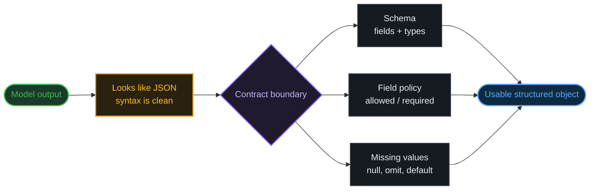

<!-- dli-course-cell {"id":"4-Structured-Output/41-Structured-Output:0","index":0,"schema":"dli-course-cell/1.0","source_sha256":"a02b89adac248acf1a7dcd255672fe17c3365c4c04ed4241788c5fc47642b555","type":"markdown"} -->
<br>
<a href="https://www.nvidia.com/en-us/training/">
    <div style="width: 55%; background-color: white; margin-top: 50px;">
    </div>
</a>
<h1 style="line-height: 1.4;"><font color="#76b900"><b>Building LLM Applications With Prompt Engineering</b></font></h1>
<h2><b>Structured Output</b></h2>
<br>
<!-- /dli-course-cell -->

<!-- dli-course-cell {"id":"4-Structured-Output/41-Structured-Output:1","index":1,"schema":"dli-course-cell/1.0","source_sha256":"67c0688497522187c84cef7048d1ff6af8866e54fe5dc1d964ac4ae0b183c8fa","type":"markdown"} -->
In this notebook you will use the model's strong JSON generation as a starting point, then inspect the more useful question: whether the JSON is dependable enough for downstream code.


<!-- /dli-course-cell -->

<!-- dli-course-cell {"id":"4-Structured-Output/41-Structured-Output:2","index":2,"schema":"dli-course-cell/1.0","source_sha256":"cb3f91d54eee30e53e35b2b99905f70f169ed549fd78909d3dac2defc9ed8d3b","type":"markdown"} -->
---
<!-- /dli-course-cell -->

<!-- dli-course-cell {"id":"4-Structured-Output/41-Structured-Output:3","index":3,"schema":"dli-course-cell/1.0","source_sha256":"7ed1d5d3598d9dfd44ff52aa769434d46ec975cd34ded253e39b3b255ea9be1a","type":"markdown"} -->
## Objectives
<!-- /dli-course-cell -->

<!-- dli-course-cell {"id":"4-Structured-Output/41-Structured-Output:4","index":4,"schema":"dli-course-cell/1.0","source_sha256":"b53652c996206384da7113ed8245f0ae13c2230d6608ef126db275049774a767","type":"markdown"} -->
By the time you complete this notebook you will:

- Prompt the model to generate structured JSON.
- Parse model output into Python objects.
- Check whether valid JSON also satisfies a minimal application contract.
- Use the chat model to batch process inputs into structured data.
<!-- /dli-course-cell -->

<!-- dli-course-cell {"id":"4-Structured-Output/41-Structured-Output:5","index":5,"schema":"dli-course-cell/1.0","source_sha256":"cb3f91d54eee30e53e35b2b99905f70f169ed549fd78909d3dac2defc9ed8d3b","type":"markdown"} -->
---
<!-- /dli-course-cell -->

<!-- dli-course-cell {"id":"4-Structured-Output/41-Structured-Output:6","index":6,"schema":"dli-course-cell/1.0","source_sha256":"d357b415148d05679d1f9802803fc0a4a039f4ece72445b0c3c596b0eb555b52","type":"markdown"} -->
## Imports
<!-- /dli-course-cell -->

<!-- dli-course-cell {"id":"4-Structured-Output/41-Structured-Output:7","index":7,"schema":"dli-course-cell/1.0","source_sha256":"a871e2da081dbb079fed91b73c93a7cdd65620f02b27e5f74364c0b0dce01cf8","type":"code"} -->
```python
import os
from langchain_nvidia_ai_endpoints import ChatNVIDIA
from langchain_core.prompts import ChatPromptTemplate
from langchain_core.output_parsers import StrOutputParser, SimpleJsonOutputParser
from langchain_core.runnables import RunnableLambda
from IPython.display import display, JSON
import json
```
<!-- /dli-course-cell -->

<!-- dli-course-cell {"id":"4-Structured-Output/41-Structured-Output:8","index":8,"schema":"dli-course-cell/1.0","source_sha256":"cb3f91d54eee30e53e35b2b99905f70f169ed549fd78909d3dac2defc9ed8d3b","type":"markdown"} -->
---
<!-- /dli-course-cell -->

<!-- dli-course-cell {"id":"4-Structured-Output/41-Structured-Output:9","index":9,"schema":"dli-course-cell/1.0","source_sha256":"70f5e78e300511808de404ed1d62799fc55c2b20e6c2a33706e13dbca5acc811","type":"markdown"} -->
## Create a Model Instance
<!-- /dli-course-cell -->

<!-- dli-course-cell {"id":"4-Structured-Output/41-Structured-Output:10","index":10,"schema":"dli-course-cell/1.0","source_sha256":"d741a922d2642a3fc57f5481f8c069b9cfe987622157b766b7bad7190f65996b","type":"code"} -->
```python
base_url = os.getenv("NVIDIA_BASE_URL")
model = 'nvidia/nemotron-nano-12b-v2-vl'
llm = ChatNVIDIA(base_url=base_url, model=model, temperature=0)
```
<!-- /dli-course-cell -->

<!-- dli-course-cell {"id":"4-Structured-Output/41-Structured-Output:11","index":11,"schema":"dli-course-cell/1.0","source_sha256":"cb3f91d54eee30e53e35b2b99905f70f169ed549fd78909d3dac2defc9ed8d3b","type":"markdown"} -->
---
<!-- /dli-course-cell -->

<!-- dli-course-cell {"id":"4-Structured-Output/41-Structured-Output:12","index":12,"schema":"dli-course-cell/1.0","source_sha256":"590aafa1e196c8aa25c41a9cae70dedc49660632f675feee845565b89719ff53","type":"markdown"} -->
## LLMs and Highly Structured Data Formats
<!-- /dli-course-cell -->

<!-- dli-course-cell {"id":"4-Structured-Output/41-Structured-Output:13","index":13,"schema":"dli-course-cell/1.0","source_sha256":"c478ecae5c4ca6be791b4d8f6651c60219be3dc25745a5cbaf41f5aefb8cc1a6","type":"markdown"} -->
A very common task we would like LLMs to perform is to generate outputs in a highly structured format. These formats could be as common as JSON, or a Python list, or some custom structure unique to our needs like a custom report or document structure, just to name a few examples.

Modern models are often quite good at this. In fact, the model used here can usually produce valid JSON from a simple instruction. That changes the lesson a bit: the limitation is less often *can the model write braces correctly?* and more often *did it create the exact object your application needs?*

Let's start with JSON, then add small checks that separate syntactic success from a reliable contract.
<!-- /dli-course-cell -->

<!-- dli-course-cell {"id":"4-Structured-Output/41-Structured-Output:14","index":14,"schema":"dli-course-cell/1.0","source_sha256":"cb3f91d54eee30e53e35b2b99905f70f169ed549fd78909d3dac2defc9ed8d3b","type":"markdown"} -->
---
<!-- /dli-course-cell -->

<!-- dli-course-cell {"id":"4-Structured-Output/41-Structured-Output:15","index":15,"schema":"dli-course-cell/1.0","source_sha256":"8c29b948e69099fa19d14d05402af2671628b7e3ac1ebf7ac0816ff76f680aa6","type":"markdown"} -->
## A Simple JSON Object
<!-- /dli-course-cell -->

<!-- dli-course-cell {"id":"4-Structured-Output/41-Structured-Output:16","index":16,"schema":"dli-course-cell/1.0","source_sha256":"2b32c0cc3157f21a909c13cca86187df5d4489f572f58adcb155194e7c9aca6a","type":"markdown"} -->
In the spirit of iterative prompt development, let's start simply by engineering a prompt instructing the model to construct a JSON object. For our example we'll ask the model to create a simple JSON object representing details about the city of Santa Clara.
<!-- /dli-course-cell -->

<!-- dli-course-cell {"id":"4-Structured-Output/41-Structured-Output:17","index":17,"schema":"dli-course-cell/1.0","source_sha256":"c75d60221e49748eead6dcfa677ba67b56f7b8fa779f3dfa8e2c1ee178dbe3cb","type":"code"} -->
```python
prompt = "Make a JSON object representing the city Santa Clara."
```
<!-- /dli-course-cell -->

<!-- dli-course-cell {"id":"4-Structured-Output/41-Structured-Output:18","index":18,"schema":"dli-course-cell/1.0","source_sha256":"6512e886413b5a9f0e5059ebb6792b3ba2d4858090030556cf101b671cd75993","type":"code"} -->
```python
result = llm.invoke(prompt).content
print(result)
```
<!-- /dli-course-cell -->

<!-- dli-course-cell {"id":"4-Structured-Output/41-Structured-Output:19","index":19,"schema":"dli-course-cell/1.0","source_sha256":"dbbb7ab85ac87e92ac938a0916fe42ecadcae997136c8c351890228db111cbb8","type":"markdown"} -->
Based on our primpting, this is probably pretty good! However, the systems we want to interface with may have specific assumptions:
<!-- /dli-course-cell -->

<!-- dli-course-cell {"id":"4-Structured-Output/41-Structured-Output:20","index":20,"schema":"dli-course-cell/1.0","source_sha256":"8e80ba12e361161afbd57b613030dde972ab90269702ada04609c6afaa71f0f3","type":"code"} -->
```python
def check_contract(result: str | dict, required_fields: set):
    ## Let's first see if it even properly generated a JSON output
    parsed_json = result
    if isinstance(result, str):
        try: 
            parsed_json = json.loads(result)
        except Exception as e:
            print(f"[CONTRACT FAILURE] Error parsing results via json.loads: {e}")
            parsed_json = {}

    ## Then, let's see if it has the required fields
    observed_fields = set(parsed_json)
    contract_check = {
        "valid_json": bool(parsed_json),
        "missing_fields": sorted(required_fields - observed_fields),
        "extra_fields": sorted(observed_fields - required_fields),
    }
    return contract_check
    

## Let's first see if it even properly worked. 
check_contract(result, {"name", "country", "fun_facts"})
```
<!-- /dli-course-cell -->

<!-- dli-course-cell {"id":"4-Structured-Output/41-Structured-Output:21","index":21,"schema":"dli-course-cell/1.0","source_sha256":"6d7766c5c9179b5487eeeea02eff9fc2a698978cc100bef1cbef9e54ba4f95cc","type":"markdown"} -->
You may get back clean JSON immediately. That is good news, but it is not the finish line.

Look at the contract check above. The object can parse successfully and still be awkward for downstream code: the model may choose a field like `city` instead of `name`, add useful-but-unrequested fields, or omit a field the next component expects. The next prompt narrows the request so the model has less freedom to invent the record shape. However, it still could fail in theory...
<!-- /dli-course-cell -->

<!-- dli-course-cell {"id":"4-Structured-Output/41-Structured-Output:22","index":22,"schema":"dli-course-cell/1.0","source_sha256":"5148ce1e038d113d8f1259dd0a09113b525d9cc4f4b69b4db28d6211b3d96feb","type":"code"} -->
```python
prompt = '''\
Make a JSON object representing the city Santa Clara. \
It should have fields for:
- The name of the city.
- The country the city is located in.
- Short fun facts about the city.
Only return the JSON block. Never return non-JSON text.'''
```
<!-- /dli-course-cell -->

<!-- dli-course-cell {"id":"4-Structured-Output/41-Structured-Output:23","index":23,"schema":"dli-course-cell/1.0","source_sha256":"d71fd872b112d0e1cec916624ca20a79e93d62c119f24e9ad5ae011f71c95cfa","type":"code"} -->
```python
result = llm.invoke(prompt).content
print(result)
check_contract(result, {"name", "country", "fun_facts"})
```
<!-- /dli-course-cell -->

<!-- dli-course-cell {"id":"4-Structured-Output/41-Structured-Output:24","index":24,"schema":"dli-course-cell/1.0","source_sha256":"40a7986de35f540be93bf2b27743c50d5e60fe29ae652b813cbdc05474b628cd","type":"markdown"} -->
This is getting closer. One more instruction makes the output safer for parsers if a model decides to wrap the JSON in Markdown backticks.
<!-- /dli-course-cell -->

<!-- dli-course-cell {"id":"4-Structured-Output/41-Structured-Output:25","index":25,"schema":"dli-course-cell/1.0","source_sha256":"a3131e0023a5be8a3ab89c1960b3d762fae225706354b16cc24dc61d869ec395","type":"code"} -->
```python
prompt = '''\
Make a JSON object representing the city Santa Clara. \
It should have fields for:
- The name of the city
- The country the city is located in.
- Short fun facts about the city.
Only return the JSON. Never return non-JSON text, including backtick wrappers around the JSON.'''
```
<!-- /dli-course-cell -->

<!-- dli-course-cell {"id":"4-Structured-Output/41-Structured-Output:26","index":26,"schema":"dli-course-cell/1.0","source_sha256":"d71fd872b112d0e1cec916624ca20a79e93d62c119f24e9ad5ae011f71c95cfa","type":"code"} -->
```python
result = llm.invoke(prompt).content
print(result)
check_contract(result, {"name", "country", "fun_facts"})
```
<!-- /dli-course-cell -->

<!-- dli-course-cell {"id":"4-Structured-Output/41-Structured-Output:27","index":27,"schema":"dli-course-cell/1.0","source_sha256":"b141ff2eceb2287b08bc29f1e604c7ae452c46ef978f6169472f497e378aeb25","type":"markdown"} -->
And hopefully, there you go (and if not, there is probably a small amount of extra code or prompt notes you could bring in to make it work)
<!-- /dli-course-cell -->

<!-- dli-course-cell {"id":"4-Structured-Output/41-Structured-Output:28","index":28,"schema":"dli-course-cell/1.0","source_sha256":"cb3f91d54eee30e53e35b2b99905f70f169ed549fd78909d3dac2defc9ed8d3b","type":"markdown"} -->
---
<!-- /dli-course-cell -->

<!-- dli-course-cell {"id":"4-Structured-Output/41-Structured-Output:29","index":29,"schema":"dli-course-cell/1.0","source_sha256":"b9f29fca3329e67ff234e1fa3e54cec6efff3a386c1502ab6809704af6d1a140","type":"markdown"} -->
## Make a Template Out of the Prompt
<!-- /dli-course-cell -->

<!-- dli-course-cell {"id":"4-Structured-Output/41-Structured-Output:30","index":30,"schema":"dli-course-cell/1.0","source_sha256":"ad0862084ddfa6c47b50f93613c497998a214af746f95426c0e68e7432b45d21","type":"markdown"} -->
Next let's convert our prompt to be a prompt template so we can parameterize the city name.
<!-- /dli-course-cell -->

<!-- dli-course-cell {"id":"4-Structured-Output/41-Structured-Output:31","index":31,"schema":"dli-course-cell/1.0","source_sha256":"a3ef227ef7d126f37e62d2a22ad54cf293a5aef353013756250d262b8a02e1ec","type":"code"} -->
```python
json_city_template = ChatPromptTemplate.from_template('''\
Make a JSON object representing the city {city_name}. \
It should have fields for:
- The name of the city
- The country the city is located in.
- Short fun facts about the city.
Only return the JSON. Never return non-JSON text, including backtick wrappers around the JSON.''')
```
<!-- /dli-course-cell -->

<!-- dli-course-cell {"id":"4-Structured-Output/41-Structured-Output:32","index":32,"schema":"dli-course-cell/1.0","source_sha256":"c1f90df43c091d1b1d6399438977208b2875ed6e26ed4c86ca5b9c3f2d275bc5","type":"markdown"} -->
Next we'll compose a simple chain.
<!-- /dli-course-cell -->

<!-- dli-course-cell {"id":"4-Structured-Output/41-Structured-Output:33","index":33,"schema":"dli-course-cell/1.0","source_sha256":"a45d5e7d2a81f7cdc07183c70e44e42aa65c9d434cd853383f168af4980f7d4d","type":"code"} -->
```python
parser = StrOutputParser()
```
<!-- /dli-course-cell -->

<!-- dli-course-cell {"id":"4-Structured-Output/41-Structured-Output:34","index":34,"schema":"dli-course-cell/1.0","source_sha256":"34df7a7502c0faed5f555ea0ab25975abdea45e6bdfdf3ed2f45488ef42a5ee6","type":"code"} -->
```python
chain = json_city_template | llm | parser
```
<!-- /dli-course-cell -->

<!-- dli-course-cell {"id":"4-Structured-Output/41-Structured-Output:35","index":35,"schema":"dli-course-cell/1.0","source_sha256":"2aa9aed108fc6e83fba5f6c0c2912942f800bfa01bc866fa3a67d4dc18fd313c","type":"code"} -->
```python
print(chain.invoke({'city_name': 'Santa Clara'}))
```
<!-- /dli-course-cell -->

<!-- dli-course-cell {"id":"4-Structured-Output/41-Structured-Output:36","index":36,"schema":"dli-course-cell/1.0","source_sha256":"176fe84dfec5555126f94360efa4c1b33118a2df900a370a98d9f00688a88676","type":"markdown"} -->
This also looks good.
<!-- /dli-course-cell -->

<!-- dli-course-cell {"id":"4-Structured-Output/41-Structured-Output:37","index":37,"schema":"dli-course-cell/1.0","source_sha256":"cb3f91d54eee30e53e35b2b99905f70f169ed549fd78909d3dac2defc9ed8d3b","type":"markdown"} -->
---
<!-- /dli-course-cell -->

<!-- dli-course-cell {"id":"4-Structured-Output/41-Structured-Output:38","index":38,"schema":"dli-course-cell/1.0","source_sha256":"4af87edc160f593f78cd2d8640572ef7de0e73922c1204c8667f2f4ae1c0c3e7","type":"markdown"} -->
## Simple JSON Parsing
<!-- /dli-course-cell -->

<!-- dli-course-cell {"id":"4-Structured-Output/41-Structured-Output:39","index":39,"schema":"dli-course-cell/1.0","source_sha256":"d022771bdf4434a08def6dddbb95810c0f08699fa73d68c1b55316d335d466c7","type":"markdown"} -->
To confirm that we can load the JSON object as a Python dict, we can use a custom runnable to parse the model response directly to a Python dict.
<!-- /dli-course-cell -->

<!-- dli-course-cell {"id":"4-Structured-Output/41-Structured-Output:40","index":40,"schema":"dli-course-cell/1.0","source_sha256":"11283d4cbba0eb647e0a6810c0c3dba00b5bbf3662ec7abc7dc95badeb4f41f1","type":"code"} -->
```python
parse_to_dict = RunnableLambda(lambda response: json.loads(response.content))
```
<!-- /dli-course-cell -->

<!-- dli-course-cell {"id":"4-Structured-Output/41-Structured-Output:41","index":41,"schema":"dli-course-cell/1.0","source_sha256":"74abad5de65f62bde83a49dfe64a48e32aa7433affc80ddcb314dc9f9a2fe222","type":"markdown"} -->
We'll re-compose our chain to use this custom parser.
<!-- /dli-course-cell -->

<!-- dli-course-cell {"id":"4-Structured-Output/41-Structured-Output:42","index":42,"schema":"dli-course-cell/1.0","source_sha256":"d0f957e21ba3299b09a5ab057c9a89f429421fc52a349c94425a21d8a3439b90","type":"code"} -->
```python
# chain = json_city_template | llm | parser | json.loads  ## Equivalent
chain = json_city_template | llm | parse_to_dict
```
<!-- /dli-course-cell -->

<!-- dli-course-cell {"id":"4-Structured-Output/41-Structured-Output:43","index":43,"schema":"dli-course-cell/1.0","source_sha256":"8eefde4d9fb31163750e0c43ed298c6eef51046e4ab624ae7a00282c802f4220","type":"code"} -->
```python
chain.invoke({'city_name': 'Santa Clara'})
```
<!-- /dli-course-cell -->

<!-- dli-course-cell {"id":"4-Structured-Output/41-Structured-Output:44","index":44,"schema":"dli-course-cell/1.0","source_sha256":"3a96a7624b84045a634fbb55b5d964fef1f1d5c497f8ca49a2be781bef4c1dfb","type":"markdown"} -->
This appears to work great because the response is valid JSON. Before trusting it in an application, though, remember what the parser has and has not checked: it checked syntax, but it did not check whether the object contains the right fields, whether the field names are stable, or whether the generated facts are acceptable for your use case.

As a small improvement, rather than creating our own parser, LangChain provides `SimpleJsonOutputParser` for just this use case. Let's reconstruct our chain using it.
<!-- /dli-course-cell -->

<!-- dli-course-cell {"id":"4-Structured-Output/41-Structured-Output:45","index":45,"schema":"dli-course-cell/1.0","source_sha256":"07f1648e7a20e8666bc272f52fa280326a64c2d71f4e52617d1600f866fab3a5","type":"code"} -->
```python
from langchain_core.output_parsers import SimpleJsonOutputParser
```
<!-- /dli-course-cell -->

<!-- dli-course-cell {"id":"4-Structured-Output/41-Structured-Output:46","index":46,"schema":"dli-course-cell/1.0","source_sha256":"7910e055d680228866c6036ceb595da2ff715be8ecd990f34fbca5657a798df3","type":"code"} -->
```python
json_parser = SimpleJsonOutputParser()
```
<!-- /dli-course-cell -->

<!-- dli-course-cell {"id":"4-Structured-Output/41-Structured-Output:47","index":47,"schema":"dli-course-cell/1.0","source_sha256":"9c984c0f8bd56d2147b0f51a4ea59539f3700072508039106bfdc989226a196d","type":"code"} -->
```python
chain = json_city_template | llm | json_parser
```
<!-- /dli-course-cell -->

<!-- dli-course-cell {"id":"4-Structured-Output/41-Structured-Output:48","index":48,"schema":"dli-course-cell/1.0","source_sha256":"8eefde4d9fb31163750e0c43ed298c6eef51046e4ab624ae7a00282c802f4220","type":"code"} -->
```python
chain.invoke({'city_name': 'Santa Clara'})
```
<!-- /dli-course-cell -->

<!-- dli-course-cell {"id":"4-Structured-Output/41-Structured-Output:49","index":49,"schema":"dli-course-cell/1.0","source_sha256":"cb3f91d54eee30e53e35b2b99905f70f169ed549fd78909d3dac2defc9ed8d3b","type":"markdown"} -->
---
<!-- /dli-course-cell -->

<!-- dli-course-cell {"id":"4-Structured-Output/41-Structured-Output:50","index":50,"schema":"dli-course-cell/1.0","source_sha256":"04db7a72d4de4daa749d203aabdf036b7afb2e54c7e6611c12fbc666fe3e57ae","type":"markdown"} -->
## Batch on Multiple Inputs
<!-- /dli-course-cell -->

<!-- dli-course-cell {"id":"4-Structured-Output/41-Structured-Output:51","index":51,"schema":"dli-course-cell/1.0","source_sha256":"2d91c533bc45f319261f779cfbd4309e0ca593429e4974f19e2ae9689beca7c1","type":"markdown"} -->
So far so good, but continuing in the spirit of iterative prompt development, now let's try our chain on several different inputs.
<!-- /dli-course-cell -->

<!-- dli-course-cell {"id":"4-Structured-Output/41-Structured-Output:52","index":52,"schema":"dli-course-cell/1.0","source_sha256":"07e2a6abdd77b1069e5323bb8cefab2cd9386b36da845820e305270e7cfc6aae","type":"code"} -->
```python
city_names = [
    {'city_name': 'Santa Clara'},
    {'city_name': 'New Orleans'},
    {'city_name': 'Busan'},
    {'city_name': 'Cairo'},
    {'city_name': 'Perth'}
]
```
<!-- /dli-course-cell -->

<!-- dli-course-cell {"id":"4-Structured-Output/41-Structured-Output:53","index":53,"schema":"dli-course-cell/1.0","source_sha256":"ca29c51c33c55e8a207b3eed916637defad5b53be296228bf0bd04b6051e7260","type":"code"} -->
```python
city_details = chain.batch(city_names)
```
<!-- /dli-course-cell -->

<!-- dli-course-cell {"id":"4-Structured-Output/41-Structured-Output:54","index":54,"schema":"dli-course-cell/1.0","source_sha256":"b3d45366cde6cf53194457d095aa89e4315ef49c5d33a3eeaa1a84fdc561c43f","type":"markdown"} -->
Now check the outputs as application records, not just JSON blobs. This tiny report asks whether every row has the fields the next step expects.
<!-- /dli-course-cell -->

<!-- dli-course-cell {"id":"4-Structured-Output/41-Structured-Output:55","index":55,"schema":"dli-course-cell/1.0","source_sha256":"96724e42ff1960207894d2e23908668d5d1614686ddddd9fda0a0d0766912e0d","type":"code"} -->
```python
required_city_fields = {"name", "country", "fun_facts"}
city_contract_report = []

for city_name, row in zip(city_names, city_details):
    city_contract_report.append(check_contract(row, required_city_fields))

city_contract_report
```
<!-- /dli-course-cell -->

<!-- dli-course-cell {"id":"4-Structured-Output/41-Structured-Output:56","index":56,"schema":"dli-course-cell/1.0","source_sha256":"29ed0048fd51d544a0a5006ac22e7df6a20e0e91f474c22e4b2f4c0969f2cead","type":"code"} -->
```python
city_details
```
<!-- /dli-course-cell -->

<!-- dli-course-cell {"id":"4-Structured-Output/41-Structured-Output:57","index":57,"schema":"dli-course-cell/1.0","source_sha256":"3ad6a8a5765e3380a80e0c786139cff9ba0e1742cfff98065e34e8ae1eb90a0f","type":"code"} -->
```python
for city in city_details:
    print("\nCity:", city['name'])
    print("Country:", city['country'])
    print("Fun Facts:")
    fun_vals = [val for key, val in city.items() if "fun" in key.lower()]
    if fun_vals:
        for fact in fun_vals[0]:
            print(f" - {fact}")
```
<!-- /dli-course-cell -->

<!-- dli-course-cell {"id":"4-Structured-Output/41-Structured-Output:58","index":58,"schema":"dli-course-cell/1.0","source_sha256":"cb3f91d54eee30e53e35b2b99905f70f169ed549fd78909d3dac2defc9ed8d3b","type":"markdown"} -->
---
<!-- /dli-course-cell -->

<!-- dli-course-cell {"id":"4-Structured-Output/41-Structured-Output:59","index":59,"schema":"dli-course-cell/1.0","source_sha256":"79eaed33b1bbd1b6c95048cfeafd8f1eb437b4b9a26d0f12518d5fc96b279994","type":"markdown"} -->
## Structure and Generation
<!-- /dli-course-cell -->

<!-- dli-course-cell {"id":"4-Structured-Output/41-Structured-Output:60","index":60,"schema":"dli-course-cell/1.0","source_sha256":"74c753e11645a890ac9f946c101fa942160bbde7f6aa82d6e5734d6c526a9265","type":"markdown"} -->
This may be obvious based on our prior use of LLMs, but it's worth highlighting: not only are we using the LLM as a means to structure data that we provide it, but we are combining this with its generative capabilities to pull from its training distribution and infer general transferable properties.

In the example we just worked through our input data was the name of a city, which we wanted structured into JSON. But more than just structuring the information we provided (the name of the city) we used the generative capabilities of the model to extend the structured data with the country that the city is located in, which we did not provide ourselves.

Generating structured output/data that has been augmented with the generative capacity of an LLM is tremendously powerful.
<!-- /dli-course-cell -->

<!-- dli-course-cell {"id":"4-Structured-Output/41-Structured-Output:61","index":61,"schema":"dli-course-cell/1.0","source_sha256":"cb3f91d54eee30e53e35b2b99905f70f169ed549fd78909d3dac2defc9ed8d3b","type":"markdown"} -->
---
<!-- /dli-course-cell -->

<!-- dli-course-cell {"id":"4-Structured-Output/41-Structured-Output:62","index":62,"schema":"dli-course-cell/1.0","source_sha256":"78c62994e8a4ee344ea9b2ea9595def3b6bff7028b9c01bfbfc20b28c78ce634","type":"markdown"} -->
## Exercise: Generate a List of Book Details
<!-- /dli-course-cell -->

<!-- dli-course-cell {"id":"4-Structured-Output/41-Structured-Output:63","index":63,"schema":"dli-course-cell/1.0","source_sha256":"b06e71567c6bf42b1a6d38f6249dbdd44b4766ca8613b7a29badb7bfbd945d16","type":"markdown"} -->
Using the techniques you've learned thus far, generate a python list containing dictionaries that each contain details about the following books.

Each dict should have the book's title, author, and year of original publication.

Feel free to check out the *Solution* below if you get stuck.
<!-- /dli-course-cell -->

<!-- dli-course-cell {"id":"4-Structured-Output/41-Structured-Output:64","index":64,"schema":"dli-course-cell/1.0","source_sha256":"3e88208f1b0ac157881a99ddce35b0ccd80e8d381deef75293f490fa34e308bc","type":"code"} -->
```python
sci_fi_books = [
    {"book_title": "Dune"},
    {"book_title": "Neuromancer"},
    {"book_title": "Snow Crash"},
    {"book_title": "The Left Hand of Darkness"},
    {"book_title": "Foundation"}
]
```
<!-- /dli-course-cell -->

<!-- dli-course-cell {"id":"4-Structured-Output/41-Structured-Output:65","index":65,"schema":"dli-course-cell/1.0","source_sha256":"58fa68be734d1b62b1ced799ad754353678f5cc20147be2dd226208550872042","type":"markdown"} -->
### Your Work Here
<!-- /dli-course-cell -->

<!-- dli-course-cell {"id":"4-Structured-Output/41-Structured-Output:66","index":66,"schema":"dli-course-cell/1.0","source_sha256":"e3b0c44298fc1c149afbf4c8996fb92427ae41e4649b934ca495991b7852b855","type":"code"} -->
```python
```
<!-- /dli-course-cell -->

<!-- dli-course-cell {"id":"4-Structured-Output/41-Structured-Output:67","index":67,"schema":"dli-course-cell/1.0","source_sha256":"eb90ed3f74a5e9009c6633c2e44657cd53d6fb3a6a0427e0f2be9986882c3530","type":"markdown"} -->
### Solution
<!-- /dli-course-cell -->

<!-- dli-course-cell {"id":"4-Structured-Output/41-Structured-Output:68","index":68,"schema":"dli-course-cell/1.0","source_sha256":"58470dd5e99973ef7731ed82d6c0de734d1f8554593645b9888f0a48d747963e","type":"code"} -->
```python
book_template = ChatPromptTemplate.from_template('''\
Make a JSON object representing the details of the following book: {book_title}. \
It should have fields for:
- The title of the book.
- The author of the book.
- The year the book was originally published.
- The aggregate score for the book.

Only return the JSON. Never return non-JSON text, including backtick wrappers around the JSON.''')
```
<!-- /dli-course-cell -->

<!-- dli-course-cell {"id":"4-Structured-Output/41-Structured-Output:69","index":69,"schema":"dli-course-cell/1.0","source_sha256":"3a8175d4c9f197fd8f9a8a5c0dfa0f9bde7ddc83a1006fd02a73f685665dd6f4","type":"code"} -->
```python
chain = book_template | llm | json_parser
```
<!-- /dli-course-cell -->

<!-- dli-course-cell {"id":"4-Structured-Output/41-Structured-Output:70","index":70,"schema":"dli-course-cell/1.0","source_sha256":"1aaf8c2ec09b6993cc3e9499b1c7eb21114e3a302a589ce39093e8d7929d177d","type":"code"} -->
```python
chain.batch(sci_fi_books)
```
<!-- /dli-course-cell -->

<!-- dli-course-cell {"id":"4-Structured-Output/41-Structured-Output:71","index":71,"schema":"dli-course-cell/1.0","source_sha256":"cb3f91d54eee30e53e35b2b99905f70f169ed549fd78909d3dac2defc9ed8d3b","type":"markdown"} -->
---
<!-- /dli-course-cell -->

<!-- dli-course-cell {"id":"4-Structured-Output/41-Structured-Output:72","index":72,"schema":"dli-course-cell/1.0","source_sha256":"30ac03ff33731529441be8fbe52a3bd0d4c5ec830e806d54692168ebb7f98ada","type":"markdown"} -->
## Summary
<!-- /dli-course-cell -->

<!-- dli-course-cell {"id":"4-Structured-Output/41-Structured-Output:73","index":73,"schema":"dli-course-cell/1.0","source_sha256":"34a90846aca21bbc95421d567cc5dc90882dd2f429af1a7bde06acd877a0425e","type":"markdown"} -->
In this notebook you began approaching the technique of LLMs generating structured output. In the next notebook you're going to drastically increase your capabilities in this arena by using Pydantic classes and LangChain's JsonOutputParser.

---

<!-- NEXT_STEP_CARD -->

<div style="border-left: 6px solid #76B900; background: #f7fdf2; padding: 14px 18px; border-radius: 10px; margin: 20px 0;">
<p style="margin: 0 0 6px; color: #315c00; font-weight: 700; letter-spacing: .04em; text-transform: uppercase;">Continue the unified course path</p>
<p style="margin: 0 0 8px; color: black;"><strong>Next step:</strong> Open <code>4-Structured-Output/42-Pydantic.ipynb</code> next: <strong>Structured Output with Pydantic</strong>.</p>
<p style="margin: 0; color: black;"><strong>Before moving on:</strong> Keep one output schema you care about, so the next notebook can show how typed validation tightens the contract around it.</p>
</div>
<!-- /dli-course-cell -->
