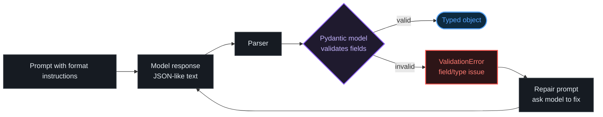

<!-- dli-course-cell {"id":"4-Structured-Output/42-Pydantic:0","index":0,"schema":"dli-course-cell/1.0","source_sha256":"3abccbb08bea461c9b9b0c06edf1dec97aafe66998a63545ad62a06635217551","type":"markdown"} -->
<br>
<a href="https://www.nvidia.com/en-us/training/">
    <div style="width: 55%; background-color: white; margin-top: 50px;">
    </div>
</a>
<h1 style="line-height: 1.4;"><font color="#76b900"><b>Building LLM Applications With Prompt Engineering</b></font></h1>
<h2><b>Structured Output with Pydantic</b></h2>
<br>
<!-- /dli-course-cell -->

<!-- dli-course-cell {"id":"4-Structured-Output/42-Pydantic:1","index":1,"schema":"dli-course-cell/1.0","source_sha256":"b40cb34b1a08bb4236735ba465d1ed643a34b4d0edab63ac93b6c021f43fb9cc","type":"markdown"} -->
In this notebook you will use Pydantic and LangChain's `JsonOutputParser` to upgrade from "the model returned JSON" to "the output satisfies a typed contract."
<!-- /dli-course-cell -->

<!-- dli-course-cell {"id":"4-Structured-Output/42-Pydantic:2","index":2,"schema":"dli-course-cell/1.0","source_sha256":"36396caa51f3dff219fac9eb321c19e66281db9232413841fc36c783d82dddb7","type":"markdown"} -->

<!-- /dli-course-cell -->

<!-- dli-course-cell {"id":"4-Structured-Output/42-Pydantic:3","index":3,"schema":"dli-course-cell/1.0","source_sha256":"cb3f91d54eee30e53e35b2b99905f70f169ed549fd78909d3dac2defc9ed8d3b","type":"markdown"} -->
---
<!-- /dli-course-cell -->

<!-- dli-course-cell {"id":"4-Structured-Output/42-Pydantic:4","index":4,"schema":"dli-course-cell/1.0","source_sha256":"7ed1d5d3598d9dfd44ff52aa769434d46ec975cd34ded253e39b3b255ea9be1a","type":"markdown"} -->
## Objectives
<!-- /dli-course-cell -->

<!-- dli-course-cell {"id":"4-Structured-Output/42-Pydantic:5","index":5,"schema":"dli-course-cell/1.0","source_sha256":"b510e53bc6bf3e6cd3dfaf7eb4efd31fa565ff12fda608dfe67de1d5f079f25d","type":"markdown"} -->
By the time you complete this notebook you will:

- Understand the limitations of our current approach to generating structured data.
- Learn to create class-driven schemas for structured data generation using Pydantic.
<!-- /dli-course-cell -->

<!-- dli-course-cell {"id":"4-Structured-Output/42-Pydantic:6","index":6,"schema":"dli-course-cell/1.0","source_sha256":"cb3f91d54eee30e53e35b2b99905f70f169ed549fd78909d3dac2defc9ed8d3b","type":"markdown"} -->
---
<!-- /dli-course-cell -->

<!-- dli-course-cell {"id":"4-Structured-Output/42-Pydantic:7","index":7,"schema":"dli-course-cell/1.0","source_sha256":"d357b415148d05679d1f9802803fc0a4a039f4ece72445b0c3c596b0eb555b52","type":"markdown"} -->
## Imports
<!-- /dli-course-cell -->

<!-- dli-course-cell {"id":"4-Structured-Output/42-Pydantic:8","index":8,"schema":"dli-course-cell/1.0","source_sha256":"aa851978cc4cdf5a01d9042594a84ff1fc816db7739639d1086ed752a0e87c4a","type":"code"} -->
```python
import os
from langchain_nvidia_ai_endpoints import ChatNVIDIA
from langchain_core.prompts import ChatPromptTemplate
from langchain_core.output_parsers import StrOutputParser, JsonOutputParser
from langchain_core.runnables import RunnableLambda
from pydantic import BaseModel, Field
```
<!-- /dli-course-cell -->

<!-- dli-course-cell {"id":"4-Structured-Output/42-Pydantic:9","index":9,"schema":"dli-course-cell/1.0","source_sha256":"cb3f91d54eee30e53e35b2b99905f70f169ed549fd78909d3dac2defc9ed8d3b","type":"markdown"} -->
---
<!-- /dli-course-cell -->

<!-- dli-course-cell {"id":"4-Structured-Output/42-Pydantic:10","index":10,"schema":"dli-course-cell/1.0","source_sha256":"70f5e78e300511808de404ed1d62799fc55c2b20e6c2a33706e13dbca5acc811","type":"markdown"} -->
## Create a Model Instance
<!-- /dli-course-cell -->

<!-- dli-course-cell {"id":"4-Structured-Output/42-Pydantic:11","index":11,"schema":"dli-course-cell/1.0","source_sha256":"fe8a07f8e29704ed8c72091c34ce44956cd4b2a6331a6a6220553baac2abf3d3","type":"code"} -->
```python
base_url = os.getenv("NVIDIA_BASE_URL")

# Use the model selected in the course connection panel, or keep the lesson default.
model = os.getenv("NVIDIA_MODEL") or "nvidia/nemotron-nano-12b-v2-vl"
# model = "nvidia/nemotron-3-nano-30b-a3b"  # Compatible fallback; responses may differ.
# model = "meta/llama-3.3-70b-instruct"  # Legacy fallback; responses may differ more.

llm = ChatNVIDIA(base_url=base_url, model=model, temperature=0)
```
<!-- /dli-course-cell -->

<!-- dli-course-cell {"id":"4-Structured-Output/42-Pydantic:12","index":12,"schema":"dli-course-cell/1.0","source_sha256":"cb3f91d54eee30e53e35b2b99905f70f169ed549fd78909d3dac2defc9ed8d3b","type":"markdown"} -->
---
<!-- /dli-course-cell -->

<!-- dli-course-cell {"id":"4-Structured-Output/42-Pydantic:13","index":13,"schema":"dli-course-cell/1.0","source_sha256":"5cbc686f2286d0978ac341ad444b55e1203bb834f939c2c4d3932a1a0f90fde6","type":"markdown"} -->
## Limitations of JSON-Only Structured Output
<!-- /dli-course-cell -->

<!-- dli-course-cell {"id":"4-Structured-Output/42-Pydantic:14","index":14,"schema":"dli-course-cell/1.0","source_sha256":"a9915f1e1ad3060dd3c305f520406a50345b577caf18ce7eace739f4ea0d183e","type":"markdown"} -->
You likely found some success in the previous exercise, but let us offer our outputs to demonstrate how successful the JSON generation was. Needless to say, it was pretty successful in at least making the outputs valid for our parser (probably because of copious amounts of training examples and strong interest from the model developers). The useful limitation to focus on is that plain JSON instructions do not create a stable interface by themselves: a field can be missing, renamed, loosely typed, or semantically too vague for the next component.

Start from the same book prompt, then replace informal field requests with an explicit schema.
<!-- /dli-course-cell -->

<!-- dli-course-cell {"id":"4-Structured-Output/42-Pydantic:15","index":15,"schema":"dli-course-cell/1.0","source_sha256":"58470dd5e99973ef7731ed82d6c0de734d1f8554593645b9888f0a48d747963e","type":"code"} -->
```python
book_template = ChatPromptTemplate.from_template('''\
Make a JSON object representing the details of the following book: {book_title}. \
It should have fields for:
- The title of the book.
- The author of the book.
- The year the book was originally published.
- The aggregate score for the book.

Only return the JSON. Never return non-JSON text, including backtick wrappers around the JSON.''')
```
<!-- /dli-course-cell -->

<!-- dli-course-cell {"id":"4-Structured-Output/42-Pydantic:16","index":16,"schema":"dli-course-cell/1.0","source_sha256":"eaeeae9a8e24d38f3b72aa9bb8228b03df90a852a396bbeb9a69df98020648bf","type":"markdown"} -->
Using this template, our solution implementation generated the following list of book details:
<!-- /dli-course-cell -->

<!-- dli-course-cell {"id":"4-Structured-Output/42-Pydantic:17","index":17,"schema":"dli-course-cell/1.0","source_sha256":"6a94cc1e5557fa0ab454110c9c2a5a451a460484e906353d94489954266f1d59","type":"markdown"} -->
```python
[{'title': 'Dune', 'author': 'Frank Herbert', 'yearPublished': 1965, 'aggregateScore': 8.2},
 {'title': 'Neuromancer', 'author': 'William Gibson', 'year': 1984, 'aggregate_score': 8.5},
 {'title': 'Snow Crash', 'author': 'Neal Stephenson', 'year': 1992, 'aggregate_score': 8.5},
 {'title': 'The Left Hand of Darkness', 'author': 'Ursula K. Le Guin', 'year': 1969, 'aggregate_score': 8.5},
 {'title': 'Foundation', 'author': 'Isaac Asimov', 'yearPublished': 1951, 'aggregateScore': 4.2}]
 ```
<!-- /dli-course-cell -->

<!-- dli-course-cell {"id":"4-Structured-Output/42-Pydantic:18","index":18,"schema":"dli-course-cell/1.0","source_sha256":"b9a1eca2546b7d43c54281f0bc7082e80543f4e7d8817f639bb29c0e48c70aed","type":"markdown"} -->
The result was well-formatted, but looking more carefully at it, we can see it has some issues:

- The key names are not consistent for all values, for example, `'year'`, and `'yearPublished'`.
- The score doesn't seem to be properly normalized, and we're not even sure where it came from.

At this point in the workshop, knowing what you already do, you're probably already full of ideas about how to address each of these. Perhaps the following ideas come to mind:

- Be more specific in our prompt about the names of the keys, the types of the values, and what to do when the LLM can't generate data for a field.
- Try including a system message to more strongly reinforce how we want the LLM to generate responses.
- Provide few-shot examples to help the model understand all the specifics of what it should and shouldn't do.

**If you're thinking along these lines, that's really fantastic, and you're correct about approaching the problem this way.**

But let's consider some of the ways that our task might get even more complicated:

- What if we wanted to templatize more of the prompt, for example, which fields to include?
- What if our data structure gets far more complicated?
- Since we are generating data, what if we wanted to capture a definition of our data type for use elsewhere?

Again, knowing what you already know, you can likely think of viable ways to accomplish each of these despite the likely complexity of the implementation. Luckily for us, LangChain ships with a variety of tools to help us accomplish generating structured data, and using them will greatly simplify our application code and allow us to perform more complicated structured data generation tasks more easily.
<!-- /dli-course-cell -->

<!-- dli-course-cell {"id":"4-Structured-Output/42-Pydantic:19","index":19,"schema":"dli-course-cell/1.0","source_sha256":"cb3f91d54eee30e53e35b2b99905f70f169ed549fd78909d3dac2defc9ed8d3b","type":"markdown"} -->
---
<!-- /dli-course-cell -->

<!-- dli-course-cell {"id":"4-Structured-Output/42-Pydantic:20","index":20,"schema":"dli-course-cell/1.0","source_sha256":"531e28ebf654b92f2aa3e793dc2d818a175af3b47c90a80fc123b04522b75ae8","type":"markdown"} -->
## Structured Data as a Class
<!-- /dli-course-cell -->

<!-- dli-course-cell {"id":"4-Structured-Output/42-Pydantic:21","index":21,"schema":"dli-course-cell/1.0","source_sha256":"ae1b3e4e2836c536592e8b356f75472bc142c0e3f0dac770682b98647c2491e3","type":"markdown"} -->
Even before we get to LangChain-specific tools to help us generate structured data, let's take a step back and think about how we might articulate a data structure in Python if we weren't working in the context of LLMs. One very sensible approach would be to create a Python class.

Here we define a `Book` class that captures what we hoped to describe in our prompt template above.
<!-- /dli-course-cell -->

<!-- dli-course-cell {"id":"4-Structured-Output/42-Pydantic:22","index":22,"schema":"dli-course-cell/1.0","source_sha256":"7ef4bb98db644b817a7119778ced6554888512f91a41d7327825a812f5bdf75d","type":"code"} -->
```python
class Book:
    """Information about a book."""
    
    def __init__(self, title, author, year_of_publication, review_scores):
        self.title = title
        self.author = author
        self.year_of_publication = year_of_publication
        self.review_scores = review_scores
```
<!-- /dli-course-cell -->

<!-- dli-course-cell {"id":"4-Structured-Output/42-Pydantic:23","index":23,"schema":"dli-course-cell/1.0","source_sha256":"ef51aabf2abf744f33e936371097392aba3e1f3d896202140c93f9b20386bc04","type":"markdown"} -->
However, there are some details we discussed above about our structured data that this class does not yet capture, like the type of the value for each field. Also, unlike our actual prompt template, there is no description, aside from its name, about what each field ought to contain.

Let's improve on this slightly by rewriting the class to include Python type hints, and some comments articulating the intended value of each field.
<!-- /dli-course-cell -->

<!-- dli-course-cell {"id":"4-Structured-Output/42-Pydantic:24","index":24,"schema":"dli-course-cell/1.0","source_sha256":"7a39294f55d1e916e3c78af88c013a491b13e306ac6fddb6dbf3b4c6c43a94c8","type":"code"} -->
```python
class Book:
    """Information about a book."""

    def __init__(self, title: str, author: str, year_of_publication: int):
        self.title: str = title                              # The title of the book
        self.author: str = author                            # The author of the book
        self.year_of_publication: int = year_of_publication  # The year the book was published
        self.review_scores: float = review_scores                   # Review scores
```
<!-- /dli-course-cell -->

<!-- dli-course-cell {"id":"4-Structured-Output/42-Pydantic:25","index":25,"schema":"dli-course-cell/1.0","source_sha256":"024fbf60e1dc87526884efba901ecc54ae27c533831454400dd3469dc737a581","type":"markdown"} -->
It's still missing aspects like default values and data validation, but for the most part, if we had a way to convey the infomation contained in the above class, including its comments, in a prompt, we might be in pretty good shape.
<!-- /dli-course-cell -->

<!-- dli-course-cell {"id":"4-Structured-Output/42-Pydantic:26","index":26,"schema":"dli-course-cell/1.0","source_sha256":"cb3f91d54eee30e53e35b2b99905f70f169ed549fd78909d3dac2defc9ed8d3b","type":"markdown"} -->
---
<!-- /dli-course-cell -->

<!-- dli-course-cell {"id":"4-Structured-Output/42-Pydantic:27","index":27,"schema":"dli-course-cell/1.0","source_sha256":"ec93cf6d4124eec432d70df7be601852871347d80a8fbe8f323d926dcc4e093c","type":"markdown"} -->
## Pydantic
<!-- /dli-course-cell -->

<!-- dli-course-cell {"id":"4-Structured-Output/42-Pydantic:28","index":28,"schema":"dli-course-cell/1.0","source_sha256":"8ea6f7d1cdac217fa6c294b53e18cf9871240b3d6f050d27d583d59cbd31af47","type":"markdown"} -->
LangChain provides us with exactly what we need to convey the information contained in classes to prompts. In doing so we have a powerful tool that enables us to articulate the structure of the data we want generated in a class, and then let LangChain do some of the more tedious work of conveying the information we capture in the class to a prompt.

The point is not that the model needs help writing JSON. The point is that the application needs a durable contract that explains what each field means and gives the parser a place to fail loudly when the response drifts.

In order to do this however, we need to use Pydantic classes instead of vanilla Python classes.

If you're unfamiliar, [Pydantic](https://docs.pydantic.dev/latest/) is "the most widely used data validation library for Python." If you're not using Pydantic in your object-oriented Python code, there's a good chance you'll enjoy learning how to use it.

For our purposes, we are only going to be using Pydantic to construct straightforward classes so that LangChain can then work with our class definitions to create prompts that will assist us in generating structured data.

The relevant Pydantic functionality has been integrated into LangChain, so to begin working with Pydantic classes, we need to import the following.
<!-- /dli-course-cell -->

<!-- dli-course-cell {"id":"4-Structured-Output/42-Pydantic:29","index":29,"schema":"dli-course-cell/1.0","source_sha256":"8b29efa95580abc3c8ced1e7b61e4b8d82818cd804ff9e1f933e697abbed360f","type":"code"} -->
```python
from pydantic import BaseModel, Field
```
<!-- /dli-course-cell -->

<!-- dli-course-cell {"id":"4-Structured-Output/42-Pydantic:30","index":30,"schema":"dli-course-cell/1.0","source_sha256":"99a6faa5ed4491f5d0150cf00d5824c9d3f898b505a0afa416cdbac9c300d0d6","type":"markdown"} -->
Having imported `BaseModel` and `Field` we are now able to rewrite our `Book` class using Pydantic as follows.
<!-- /dli-course-cell -->

<!-- dli-course-cell {"id":"4-Structured-Output/42-Pydantic:31","index":31,"schema":"dli-course-cell/1.0","source_sha256":"bacd6a96c92d9c29d130c288df929ab2a99d2fb7aa65aa712c0c21f8201f71eb","type":"code"} -->
```python
class Book(BaseModel):
    """Information about a book."""

    title: str = Field(description="The title of the book")
    author: str = Field(description="The author of the book")
    year_of_publication: int = Field(description="The year the book was published")
    review_scores: float = Field(description="The average review score of the book, out of 10")
```
<!-- /dli-course-cell -->

<!-- dli-course-cell {"id":"4-Structured-Output/42-Pydantic:32","index":32,"schema":"dli-course-cell/1.0","source_sha256":"f54f69be4cf01f48a8c3df9be75855ad453604b8e8f3e4730e6538c28eae1400","type":"markdown"} -->
As you can see, when we want to construct a Pydantic class, we create a class that inherits from `BaseModel` as we're doing above.

Rather than creating an `__init__` function, we can supply the class's fields at the top level of the class definition by defining them with `Field`, which, as a convenience, allows us to provide a `description` argument about the intended use of the field.
<!-- /dli-course-cell -->

<!-- dli-course-cell {"id":"4-Structured-Output/42-Pydantic:33","index":33,"schema":"dli-course-cell/1.0","source_sha256":"cb3f91d54eee30e53e35b2b99905f70f169ed549fd78909d3dac2defc9ed8d3b","type":"markdown"} -->
---
<!-- /dli-course-cell -->

<!-- dli-course-cell {"id":"4-Structured-Output/42-Pydantic:34","index":34,"schema":"dli-course-cell/1.0","source_sha256":"5df9d8d3fb19355417b2c0782cb82d4b5254a231662ba086c3d0ffcebac2be31","type":"markdown"} -->
## From Class to Formatting Instructions
<!-- /dli-course-cell -->

<!-- dli-course-cell {"id":"4-Structured-Output/42-Pydantic:35","index":35,"schema":"dli-course-cell/1.0","source_sha256":"e9d69cb207c5ad013801ee36f32c28c843c9c7143bad9978b0673f9680bddb32","type":"markdown"} -->
In order to take the structure defined in our Pydantic `Book` class and generate a JSON object, we need a prompt to provide the model. LangChain's `JsonOutputParser` will provide us with just that.

First we'll import the `JsonOutputParser` class.
<!-- /dli-course-cell -->

<!-- dli-course-cell {"id":"4-Structured-Output/42-Pydantic:36","index":36,"schema":"dli-course-cell/1.0","source_sha256":"c0256aaec300b98c4f81dc948c6329778677c7820c16b6d7eaf565dd44c71ff0","type":"code"} -->
```python
from langchain_core.output_parsers import JsonOutputParser
```
<!-- /dli-course-cell -->

<!-- dli-course-cell {"id":"4-Structured-Output/42-Pydantic:37","index":37,"schema":"dli-course-cell/1.0","source_sha256":"d00831d2c61a279a972ddf4d4773973b9ac81d38f95f3fa4219e3971793876d5","type":"markdown"} -->
Just like with the `StrOutputParser` and `SimpleJsonOutputParser` parsers that we've used previously, we need to create an instance of the parser to use in our chain.

Different from the parsers we've worked with earlier, however, we can provide `JsonOutputParser` with an argument `pydantic_object` and provide a Pydantic object expressing how we want the JSON to be parsed. Here we'll pass in our Pydantic `Book`.
<!-- /dli-course-cell -->

<!-- dli-course-cell {"id":"4-Structured-Output/42-Pydantic:38","index":38,"schema":"dli-course-cell/1.0","source_sha256":"61926da45e3404c71e1a91596334b756c39c014ea2b497e76dc856cd51b95f57","type":"code"} -->
```python
parser = JsonOutputParser(pydantic_object=Book)
```
<!-- /dli-course-cell -->

<!-- dli-course-cell {"id":"4-Structured-Output/42-Pydantic:39","index":39,"schema":"dli-course-cell/1.0","source_sha256":"791aa1c9f53cd40966695c3de14c4d57b3c91dc96daf99da7bda2d997d9047bb","type":"markdown"} -->
Instances of `JsonOutputParser` contain a `get_format_instructions` method which create explicit instructions for formatting the JSON based on the provided Pydantic object.
<!-- /dli-course-cell -->

<!-- dli-course-cell {"id":"4-Structured-Output/42-Pydantic:40","index":40,"schema":"dli-course-cell/1.0","source_sha256":"ab809e6935a1f6ea6756a4fd38c4eadfb66c269ed8aa89885c67044ade853900","type":"code"} -->
```python
format_instructions = parser.get_format_instructions()
```
<!-- /dli-course-cell -->

<!-- dli-course-cell {"id":"4-Structured-Output/42-Pydantic:41","index":41,"schema":"dli-course-cell/1.0","source_sha256":"0adf4c2e58571b6d1421cada1ef1c177ed23c9aefb8b46b6ac0671484e95652b","type":"code"} -->
```python
print(format_instructions)
```
<!-- /dli-course-cell -->

<!-- dli-course-cell {"id":"4-Structured-Output/42-Pydantic:42","index":42,"schema":"dli-course-cell/1.0","source_sha256":"c48af5ef998c1722a05607d27f413f3031ec2f726751805447b6dc8eeff3c577","type":"markdown"} -->
This is a really fantastic convenience to have the parser generate these detailed formatting instructions for us.
<!-- /dli-course-cell -->

<!-- dli-course-cell {"id":"4-Structured-Output/42-Pydantic:43","index":43,"schema":"dli-course-cell/1.0","source_sha256":"cb3f91d54eee30e53e35b2b99905f70f169ed549fd78909d3dac2defc9ed8d3b","type":"markdown"} -->
---
<!-- /dli-course-cell -->

<!-- dli-course-cell {"id":"4-Structured-Output/42-Pydantic:44","index":44,"schema":"dli-course-cell/1.0","source_sha256":"0a40f9e9b59331520b40f69017f58ac3447b97e876790f417c0927a91fafceb7","type":"markdown"} -->
## The Importance of Docstrings and Field Descriptions
<!-- /dli-course-cell -->

<!-- dli-course-cell {"id":"4-Structured-Output/42-Pydantic:45","index":45,"schema":"dli-course-cell/1.0","source_sha256":"0ee7f514f142fd220317d475883df47e480b3029ec07a41d6d934dac7a794eb0","type":"markdown"} -->
In the `format_instructions` above you'll notice several `"description"` fields. The top level `"description"` field states `""Information about a book.""`, the `"title"` `"description"` field states `"The title of the book"`. If we look again at our Pydantic class definition...
<!-- /dli-course-cell -->

<!-- dli-course-cell {"id":"4-Structured-Output/42-Pydantic:46","index":46,"schema":"dli-course-cell/1.0","source_sha256":"bacd6a96c92d9c29d130c288df929ab2a99d2fb7aa65aa712c0c21f8201f71eb","type":"code"} -->
```python
class Book(BaseModel):
    """Information about a book."""

    title: str = Field(description="The title of the book")
    author: str = Field(description="The author of the book")
    year_of_publication: int = Field(description="The year the book was published")
    review_scores: float = Field(description="The average review score of the book, out of 10")
```
<!-- /dli-course-cell -->

<!-- dli-course-cell {"id":"4-Structured-Output/42-Pydantic:47","index":47,"schema":"dli-course-cell/1.0","source_sha256":"ce743325982313952e3e576bae6c09160a783e0f970e9a20d2bc6d35ed5f0d99","type":"markdown"} -->
...you'll see that these descriptions were created from the class's docstring (for the top level description) and for each of the passed in `description` values (for each of the fields).

These texts are critical for conveying our intent to the LLM. When creating Pydantic classes to be used as formatting tools with LLMs, always take care to provide a meaningful docstring for the entire class, as well as good descriptions for each of its fields.
<!-- /dli-course-cell -->

<!-- dli-course-cell {"id":"4-Structured-Output/42-Pydantic:48","index":48,"schema":"dli-course-cell/1.0","source_sha256":"cb3f91d54eee30e53e35b2b99905f70f169ed549fd78909d3dac2defc9ed8d3b","type":"markdown"} -->
---
<!-- /dli-course-cell -->

<!-- dli-course-cell {"id":"4-Structured-Output/42-Pydantic:49","index":49,"schema":"dli-course-cell/1.0","source_sha256":"b821ba236f2d1542c4c5d336eab499fa6adb9e4915fc041c3b7f2b40d3e62d05","type":"markdown"} -->
## Using Formatting Instructions in Prompts
<!-- /dli-course-cell -->

<!-- dli-course-cell {"id":"4-Structured-Output/42-Pydantic:50","index":50,"schema":"dli-course-cell/1.0","source_sha256":"4731bcb3ce264bb839a6ff1db1bf421589f7d303a2a1c70c621b350dd0aebda8","type":"markdown"} -->
Let's leverage the formatting instructions created by `JsonOutputParser` based on the Pydantic `Book` class in a prompt. While we are at it, we might as well also supply a system message to support our intended goal.
<!-- /dli-course-cell -->

<!-- dli-course-cell {"id":"4-Structured-Output/42-Pydantic:51","index":51,"schema":"dli-course-cell/1.0","source_sha256":"734d33ed1a0aae16087cc00f762056019ca21196e3af627feed3e3a3e1bbf5fa","type":"code"} -->
```python
template = ChatPromptTemplate.from_messages([
    ("system", "You are an AI that generates JSON and only JSON according to the instructions provided to you."),
    ("human", (
        "Generate JSON about the user input according to the provided format instructions.\n" +
        "Input: {input}\n" +
        "Format instructions {format_instructions}")
    )
])
```
<!-- /dli-course-cell -->

<!-- dli-course-cell {"id":"4-Structured-Output/42-Pydantic:52","index":52,"schema":"dli-course-cell/1.0","source_sha256":"2f907cda42b3ee51aa58e95abb7900969b824b4a0fdbf7f702e1079a9d7ef3a4","type":"markdown"} -->
Next we'll create our chain.
<!-- /dli-course-cell -->

<!-- dli-course-cell {"id":"4-Structured-Output/42-Pydantic:53","index":53,"schema":"dli-course-cell/1.0","source_sha256":"26e1af8b5a9a49b814c0e047feeffcef5142d69671e6c9577f1e44387a51586e","type":"code"} -->
```python
chain = template | llm | parser 
# Parser created above with `parser = JsonOutputParser(pydantic_object=Book)`
```
<!-- /dli-course-cell -->

<!-- dli-course-cell {"id":"4-Structured-Output/42-Pydantic:54","index":54,"schema":"dli-course-cell/1.0","source_sha256":"b63adaf83be61e2a84bdf83824cae5d4bd20e7aad48353b24778a9226aeaa25c","type":"markdown"} -->
When we invoke this template, we'll need to provide an `input`, which in this case should be a book title, as well as `format_instructions`, which we have already obtained from `parser.format_instructions()`.
<!-- /dli-course-cell -->

<!-- dli-course-cell {"id":"4-Structured-Output/42-Pydantic:55","index":55,"schema":"dli-course-cell/1.0","source_sha256":"a277224825b8b4cdbd08abf4a16c48ae5037fbe234c8dac456f3bb56d7c1b7dd","type":"code"} -->
```python
chain.invoke({
    "input": "East of Eden",
    "format_instructions": format_instructions
})
```
<!-- /dli-course-cell -->

<!-- dli-course-cell {"id":"4-Structured-Output/42-Pydantic:56","index":56,"schema":"dli-course-cell/1.0","source_sha256":"ab9ee19583aa1fce473bc4763caecc412aea1b3b96605b3fa6e92e0e82e4be17","type":"markdown"} -->
Since we are going to want to provide different `input` values, but retain the same `format_instructions`, we can partially apply our existing `format_instructions` to the prompt template using the template's `.partial` method.
<!-- /dli-course-cell -->

<!-- dli-course-cell {"id":"4-Structured-Output/42-Pydantic:57","index":57,"schema":"dli-course-cell/1.0","source_sha256":"6c1c35cb4be62c4058d9f3ff022b698df48195ed7070fc4b2cf1ecfc0652ad80","type":"code"} -->
```python
chain = template.partial(format_instructions=format_instructions) | llm | parser # Created above with `parser = JsonOutputParser(pydantic_object=Book)`
```
<!-- /dli-course-cell -->

<!-- dli-course-cell {"id":"4-Structured-Output/42-Pydantic:58","index":58,"schema":"dli-course-cell/1.0","source_sha256":"655748a1c2f31c39d5d1a5e3a7f9fd2d52cbd2260a7ef20ae82cce4e90a6b9f1","type":"markdown"} -->
Let's try our new chain with a batch of books.
<!-- /dli-course-cell -->

<!-- dli-course-cell {"id":"4-Structured-Output/42-Pydantic:59","index":59,"schema":"dli-course-cell/1.0","source_sha256":"7b50bf38655c88bbc3398ce7d9fd7aa77734a75463f0e8e3de7eed3b7c5ba5c7","type":"code"} -->
```python
book_titles = ["Dune", "Neuromancer", "Snow Crash", "The Left Hand of Darkness", "Foundation"]
```
<!-- /dli-course-cell -->

<!-- dli-course-cell {"id":"4-Structured-Output/42-Pydantic:60","index":60,"schema":"dli-course-cell/1.0","source_sha256":"c3f77538597a2c8aafc636b87185b60f112039747314e2e233f333719acb49cb","type":"code"} -->
```python
chain.batch(book_titles)
```
<!-- /dli-course-cell -->

<!-- dli-course-cell {"id":"4-Structured-Output/42-Pydantic:61","index":61,"schema":"dli-course-cell/1.0","source_sha256":"8930e912635cc1846f6f90071817730ae3f6c2b66ad11792f35e413d58a0f65e","type":"markdown"} -->
Comparing this to the output from the previous notebook (see immediately below), you can see our results are more consistent and better.
<!-- /dli-course-cell -->

<!-- dli-course-cell {"id":"4-Structured-Output/42-Pydantic:62","index":62,"schema":"dli-course-cell/1.0","source_sha256":"6a94cc1e5557fa0ab454110c9c2a5a451a460484e906353d94489954266f1d59","type":"markdown"} -->
```python
[{'title': 'Dune', 'author': 'Frank Herbert', 'yearPublished': 1965, 'aggregateScore': 8.2},
 {'title': 'Neuromancer', 'author': 'William Gibson', 'year': 1984, 'aggregate_score': 8.5},
 {'title': 'Snow Crash', 'author': 'Neal Stephenson', 'year': 1992, 'aggregate_score': 8.5},
 {'title': 'The Left Hand of Darkness', 'author': 'Ursula K. Le Guin', 'year': 1969, 'aggregate_score': 8.5},
 {'title': 'Foundation', 'author': 'Isaac Asimov', 'yearPublished': 1951, 'aggregateScore': 4.2}]
 ```
<!-- /dli-course-cell -->

<!-- dli-course-cell {"id":"4-Structured-Output/42-Pydantic:63","index":63,"schema":"dli-course-cell/1.0","source_sha256":"cb3f91d54eee30e53e35b2b99905f70f169ed549fd78909d3dac2defc9ed8d3b","type":"markdown"} -->
---
<!-- /dli-course-cell -->

<!-- dli-course-cell {"id":"4-Structured-Output/42-Pydantic:64","index":64,"schema":"dli-course-cell/1.0","source_sha256":"53c98c4a8ee4d81f52afaede7429189f5e57423fbad05f4681f2cca861b1b5e6","type":"markdown"} -->
## Using with_structured_output
<!-- /dli-course-cell -->

<!-- dli-course-cell {"id":"4-Structured-Output/42-Pydantic:65","index":65,"schema":"dli-course-cell/1.0","source_sha256":"4a0d6c4f8da6dbf03dbfe28e6b0715849ed5147b93b5e7e93ab621156d47c1dd","type":"markdown"} -->
As an alternative, and improved way to generate structured output, many LLMs now support the `with_structured_output` method, which allows us to replace the following...
<!-- /dli-course-cell -->

<!-- dli-course-cell {"id":"4-Structured-Output/42-Pydantic:66","index":66,"schema":"dli-course-cell/1.0","source_sha256":"c176192474452ca79da12ecc0df226dfbc087ad45ef635df3978221656487e78","type":"markdown"} -->
```python
template = ChatPromptTemplate.from_messages([
    ("system", (
        "You are an AI that generates JSON and only JSON"
        " according to the instructions provided to you."
    )),
    ("human", (
        "Generate JSON about the user input according to the format instructions.\n" +
        "Input: {input}\n" +
        "Format instructions {format_instructions}"
    ))
])

chain = (
    template.partial(format_instructions=format_instructions)
    | llm
    | JsonOutputParser(pydantic_object=Book)
)
```
<!-- /dli-course-cell -->

<!-- dli-course-cell {"id":"4-Structured-Output/42-Pydantic:67","index":67,"schema":"dli-course-cell/1.0","source_sha256":"24bcc2e9018802ef6cf4ab4d606043e0852c103f8d4b2657e85058630e255f32","type":"markdown"} -->
... with:
<!-- /dli-course-cell -->

<!-- dli-course-cell {"id":"4-Structured-Output/42-Pydantic:68","index":68,"schema":"dli-course-cell/1.0","source_sha256":"4755158687c3b16cdb9aac4629dd48b8e580006bcfb54144e26ac0acda591c7f","type":"markdown"} -->
```python
llm_structured = llm.with_structured_output(Book)
```
<!-- /dli-course-cell -->

<!-- dli-course-cell {"id":"4-Structured-Output/42-Pydantic:69","index":69,"schema":"dli-course-cell/1.0","source_sha256":"26486947aea5f3a972c3a4a914d5ca934bae17cec5b83e16d6771b3d3888fda7","type":"markdown"} -->
`llm_structured` can be invoked, batched, or streamed just like `chain`, but the syntax is much more concise.

In this lab, `nvidia/nemotron-nano-12b-v2-vl` can produce structured results through this interface, though the connector may still warn that the model is not formally listed as supporting structured output. Treat that as a useful production lesson: test the path you plan to ship, and keep Pydantic validation in the loop even when the model is excellent at JSON.
<!-- /dli-course-cell -->

<!-- dli-course-cell {"id":"4-Structured-Output/42-Pydantic:70","index":70,"schema":"dli-course-cell/1.0","source_sha256":"cb3f91d54eee30e53e35b2b99905f70f169ed549fd78909d3dac2defc9ed8d3b","type":"markdown"} -->
---
<!-- /dli-course-cell -->

<!-- dli-course-cell {"id":"4-Structured-Output/42-Pydantic:71","index":71,"schema":"dli-course-cell/1.0","source_sha256":"d2d927e3aeb8deb054fb7ba8ad0ae7d21e6c50237b1e641a0ac4e03038f5bd66","type":"markdown"} -->
## Exercise: Leverage Pydantic for Structured Data Generation
<!-- /dli-course-cell -->

<!-- dli-course-cell {"id":"4-Structured-Output/42-Pydantic:72","index":72,"schema":"dli-course-cell/1.0","source_sha256":"bc165fec699d294b2b241862af4695b626f95cc2d9f3ef0bc79b1f82eed32589","type":"markdown"} -->
For this exercise you are going to generate a batch of structured data for the following cities.
<!-- /dli-course-cell -->

<!-- dli-course-cell {"id":"4-Structured-Output/42-Pydantic:73","index":73,"schema":"dli-course-cell/1.0","source_sha256":"6db1b2dbaf88aa4ab8db7582e762d266888a626ba01342692fda3dc9d09ac010","type":"code"} -->
```python
city_names = ['Tokyo', 'New Orleans', 'Busan', 'Cairo', 'Perth']
```
<!-- /dli-course-cell -->

<!-- dli-course-cell {"id":"4-Structured-Output/42-Pydantic:74","index":74,"schema":"dli-course-cell/1.0","source_sha256":"05b4c74bb860d25c40bd140d63a3a25a22babcfc79b4b218a4dac9688a9ca32d","type":"markdown"} -->
For each of these cities you should create a JSON blob that contains information about the city, including:
- The name of the city.
- The country that the city is located within.
- Whether or not the city is the capital city of the country it is located in.
- The population of the city.
- Great restaurants in the area.
- Food quality concensus rating.

Feel free to check out the Solution below if you get stuck.
<!-- /dli-course-cell -->

<!-- dli-course-cell {"id":"4-Structured-Output/42-Pydantic:75","index":75,"schema":"dli-course-cell/1.0","source_sha256":"58fa68be734d1b62b1ced799ad754353678f5cc20147be2dd226208550872042","type":"markdown"} -->
### Your Work Here
<!-- /dli-course-cell -->

<!-- dli-course-cell {"id":"4-Structured-Output/42-Pydantic:76","index":76,"schema":"dli-course-cell/1.0","source_sha256":"e3b0c44298fc1c149afbf4c8996fb92427ae41e4649b934ca495991b7852b855","type":"code"} -->
```python
```
<!-- /dli-course-cell -->

<!-- dli-course-cell {"id":"4-Structured-Output/42-Pydantic:77","index":77,"schema":"dli-course-cell/1.0","source_sha256":"eb90ed3f74a5e9009c6633c2e44657cd53d6fb3a6a0427e0f2be9986882c3530","type":"markdown"} -->
### Solution
<!-- /dli-course-cell -->

<!-- dli-course-cell {"id":"4-Structured-Output/42-Pydantic:78","index":78,"schema":"dli-course-cell/1.0","source_sha256":"871029829e96aa2ba5568553fcc0e590b3fc66787d13e11db2b3a6ab7988ad0e","type":"code"} -->
```python
class City(BaseModel):
    """Information about a city."""

    name: str = Field(description="The name of the city")
    country: str = Field(description="The the country the city is located in")
    capital: bool = Field(description="Is the city the capital of the country it is located in")
    population: int = Field(description="The population of the city")
    restaurants: list = Field(description="List of known great restaurants in the area. Minimum 3")
    avg_food_quality: float = Field(description="Food quality concensus rating")
```
<!-- /dli-course-cell -->

<!-- dli-course-cell {"id":"4-Structured-Output/42-Pydantic:79","index":79,"schema":"dli-course-cell/1.0","source_sha256":"734d33ed1a0aae16087cc00f762056019ca21196e3af627feed3e3a3e1bbf5fa","type":"code"} -->
```python
template = ChatPromptTemplate.from_messages([
    ("system", "You are an AI that generates JSON and only JSON according to the instructions provided to you."),
    ("human", (
        "Generate JSON about the user input according to the provided format instructions.\n" +
        "Input: {input}\n" +
        "Format instructions {format_instructions}")
    )
])
```
<!-- /dli-course-cell -->

<!-- dli-course-cell {"id":"4-Structured-Output/42-Pydantic:80","index":80,"schema":"dli-course-cell/1.0","source_sha256":"241151f8b7f65122ebdaef682a09e91ec39e5dce1695403e556b59db15091b53","type":"code"} -->
```python
parser = JsonOutputParser(pydantic_object=City)
```
<!-- /dli-course-cell -->

<!-- dli-course-cell {"id":"4-Structured-Output/42-Pydantic:81","index":81,"schema":"dli-course-cell/1.0","source_sha256":"604f336d00243701cb992b0c094d937d5b63be64e5432542170a33c899247f93","type":"code"} -->
```python
template_with_format_instructions = template.partial(format_instructions=parser.get_format_instructions())
```
<!-- /dli-course-cell -->

<!-- dli-course-cell {"id":"4-Structured-Output/42-Pydantic:82","index":82,"schema":"dli-course-cell/1.0","source_sha256":"01b9f99baae80ec974fd6dac8271ef842345c2862f9699fa3f4f1c75416a9654","type":"code"} -->
```python
chain = template_with_format_instructions | llm | parser
```
<!-- /dli-course-cell -->

<!-- dli-course-cell {"id":"4-Structured-Output/42-Pydantic:83","index":83,"schema":"dli-course-cell/1.0","source_sha256":"2ed1df996ef10f01a38af4950a7c4697ed8fd3ed934dd7e2360c06e1243d8a25","type":"code"} -->
```python
chain.batch(city_names)
```
<!-- /dli-course-cell -->

<!-- dli-course-cell {"id":"4-Structured-Output/42-Pydantic:84","index":84,"schema":"dli-course-cell/1.0","source_sha256":"cb3f91d54eee30e53e35b2b99905f70f169ed549fd78909d3dac2defc9ed8d3b","type":"markdown"} -->
---
<!-- /dli-course-cell -->

<!-- dli-course-cell {"id":"4-Structured-Output/42-Pydantic:85","index":85,"schema":"dli-course-cell/1.0","source_sha256":"30ac03ff33731529441be8fbe52a3bd0d4c5ec830e806d54692168ebb7f98ada","type":"markdown"} -->
## Summary
<!-- /dli-course-cell -->

<!-- dli-course-cell {"id":"4-Structured-Output/42-Pydantic:86","index":86,"schema":"dli-course-cell/1.0","source_sha256":"7c939fb149dcc0235422dacaac8dc0d58d49f3eac6f3dc27d5c5545ddc76f519","type":"markdown"} -->
In this notebook you took a tremendous leap in your ability to generate structured data. In the next notebook, you are going to extend this skill set even further. Rather than providing individual data samples to drive data generation, you'll pipe long-form text into the model which you will equip to extract and tag data as you specify.

---

<!-- NEXT_STEP_CARD -->

<div style="border-left: 6px solid #76B900; background: #f7fdf2; padding: 14px 18px; border-radius: 10px; margin: 20px 0;">
<p style="margin: 0 0 6px; color: #315c00; font-weight: 700; letter-spacing: .04em; text-transform: uppercase;">Continue the unified course path</p>
<p style="margin: 0 0 8px; color: black;"><strong>Next step:</strong> Open <code>4-Structured-Output/43-Document-Tagging.ipynb</code> next: <strong>Document Tagging</strong>.</p>
<p style="margin: 0; color: black;"><strong>Before moving on:</strong> Remember one field that became easier to trust with validation, because the next notebook applies that same discipline to long-form documents.</p>
</div>
<!-- /dli-course-cell -->
