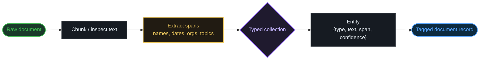

<!-- dli-course-cell {"id":"4-Structured-Output/43-Document-Tagging:0","index":0,"schema":"dli-course-cell/1.0","source_sha256":"50e57a13ce7ddd50e09219e6da2820874c94ffd75cdf57a2e666736bcc757c4f","type":"markdown"} -->
<br>
<a href="https://www.nvidia.com/en-us/training/">
    <div style="width: 55%; background-color: white; margin-top: 50px;">
    </div>
</a>
<h1 style="line-height: 1.4;"><font color="#76b900"><b>Building LLM Applications With Prompt Engineering</b></font></h1>
<h2><b>Document Tagging</b></h2>
<br>
<!-- /dli-course-cell -->

<!-- dli-course-cell {"id":"4-Structured-Output/43-Document-Tagging:1","index":1,"schema":"dli-course-cell/1.0","source_sha256":"40d1e4535e7c1ce200e2948a03e67428b47174de385090e5fc52dbdef9046910","type":"markdown"} -->
In this notebook you'll extend your structured-output skill set to long-form text. The model can usually return clean JSON; the harder part is deciding what evidence belongs in each field, what to omit, and how to represent uncertainty.


<!-- /dli-course-cell -->

<!-- dli-course-cell {"id":"4-Structured-Output/43-Document-Tagging:2","index":2,"schema":"dli-course-cell/1.0","source_sha256":"cb3f91d54eee30e53e35b2b99905f70f169ed549fd78909d3dac2defc9ed8d3b","type":"markdown"} -->
---
<!-- /dli-course-cell -->

<!-- dli-course-cell {"id":"4-Structured-Output/43-Document-Tagging:3","index":3,"schema":"dli-course-cell/1.0","source_sha256":"7ed1d5d3598d9dfd44ff52aa769434d46ec975cd34ded253e39b3b255ea9be1a","type":"markdown"} -->
## Objectives
<!-- /dli-course-cell -->

<!-- dli-course-cell {"id":"4-Structured-Output/43-Document-Tagging:4","index":4,"schema":"dli-course-cell/1.0","source_sha256":"bee1cb65883f357e782cd4a44d93c5f39cb204b4bb5dd49e46a9a275b1b74e10","type":"markdown"} -->
By the time you complete this notebook you will:

- Be able to construct Pydantic classes that represent collections of other Pydantic classes.
- Perform extraction and tagging against long-form text.
<!-- /dli-course-cell -->

<!-- dli-course-cell {"id":"4-Structured-Output/43-Document-Tagging:5","index":5,"schema":"dli-course-cell/1.0","source_sha256":"cb3f91d54eee30e53e35b2b99905f70f169ed549fd78909d3dac2defc9ed8d3b","type":"markdown"} -->
---
<!-- /dli-course-cell -->

<!-- dli-course-cell {"id":"4-Structured-Output/43-Document-Tagging:6","index":6,"schema":"dli-course-cell/1.0","source_sha256":"d357b415148d05679d1f9802803fc0a4a039f4ece72445b0c3c596b0eb555b52","type":"markdown"} -->
## Imports
<!-- /dli-course-cell -->

<!-- dli-course-cell {"id":"4-Structured-Output/43-Document-Tagging:7","index":7,"schema":"dli-course-cell/1.0","source_sha256":"5a90160627f5ce2ac43809730edd720b7f758f5663c7daa4219a36a63bf1505b","type":"code"} -->
```python
import os
from typing import List
from pprint import pprint

from langchain_nvidia_ai_endpoints import ChatNVIDIA
from langchain_core.prompts import ChatPromptTemplate
from langchain_core.output_parsers import JsonOutputParser
from pydantic import BaseModel, Field
```
<!-- /dli-course-cell -->

<!-- dli-course-cell {"id":"4-Structured-Output/43-Document-Tagging:8","index":8,"schema":"dli-course-cell/1.0","source_sha256":"cb3f91d54eee30e53e35b2b99905f70f169ed549fd78909d3dac2defc9ed8d3b","type":"markdown"} -->
---
<!-- /dli-course-cell -->

<!-- dli-course-cell {"id":"4-Structured-Output/43-Document-Tagging:9","index":9,"schema":"dli-course-cell/1.0","source_sha256":"70f5e78e300511808de404ed1d62799fc55c2b20e6c2a33706e13dbca5acc811","type":"markdown"} -->
## Create a Model Instance
<!-- /dli-course-cell -->

<!-- dli-course-cell {"id":"4-Structured-Output/43-Document-Tagging:10","index":10,"schema":"dli-course-cell/1.0","source_sha256":"fe8a07f8e29704ed8c72091c34ce44956cd4b2a6331a6a6220553baac2abf3d3","type":"code"} -->
```python
base_url = os.getenv("NVIDIA_BASE_URL")

# Use the model selected in the course connection panel, or keep the lesson default.
model = os.getenv("NVIDIA_MODEL") or "nvidia/nemotron-nano-12b-v2-vl"
# model = "nvidia/nemotron-3-nano-30b-a3b"  # Compatible fallback; responses may differ.
# model = "meta/llama-3.3-70b-instruct"  # Legacy fallback; responses may differ more.

llm = ChatNVIDIA(base_url=base_url, model=model, temperature=0)
```
<!-- /dli-course-cell -->

<!-- dli-course-cell {"id":"4-Structured-Output/43-Document-Tagging:11","index":11,"schema":"dli-course-cell/1.0","source_sha256":"cb3f91d54eee30e53e35b2b99905f70f169ed549fd78909d3dac2defc9ed8d3b","type":"markdown"} -->
---
<!-- /dli-course-cell -->

<!-- dli-course-cell {"id":"4-Structured-Output/43-Document-Tagging:12","index":12,"schema":"dli-course-cell/1.0","source_sha256":"dd3410c3cbb460618b351de542bc5d0166430a1299c544d29ff662b176b8b47d","type":"markdown"} -->
## Document Tagging
<!-- /dli-course-cell -->

<!-- dli-course-cell {"id":"4-Structured-Output/43-Document-Tagging:13","index":13,"schema":"dli-course-cell/1.0","source_sha256":"123948cef48fc436c634f12ef741deaff72a7d70c8bd521cb2c60ace499c5a52","type":"markdown"} -->
Knowing what you already do about Pydantic specifications, extending this skill to extraction and tagging will feel straightforward. The new limitation is not JSON syntax; it is evidence selection. A long document can mention many possible entities, aliases, dates, and partial facts, and your schema decides which of those are worth carrying forward.

To learn the technique let's assume that we want to extract the name of any piece of fruit mentioned in a piece of text. We'll begin, as we have been, by defining a schema for our data, and instantiating a parser that, in conjunction with a prompt using its format instructions, will be able to parse structured data out of our prompt and what the LLM can ascertain about it.
<!-- /dli-course-cell -->

<!-- dli-course-cell {"id":"4-Structured-Output/43-Document-Tagging:14","index":14,"schema":"dli-course-cell/1.0","source_sha256":"bad54bca54ce5df3429a9949d86b2c4ac2681d15803b118f11618c0b1fdfac24","type":"code"} -->
```python
class Fruit(BaseModel):
    """The name of a piece of fruit."""

    name: str = Field(description="The name of the piece of fruit")
```
<!-- /dli-course-cell -->

<!-- dli-course-cell {"id":"4-Structured-Output/43-Document-Tagging:15","index":15,"schema":"dli-course-cell/1.0","source_sha256":"34ccb61eb7cf6f2b54041a6b04808e52a81e36d903abe965f49b7ae9e2a708bc","type":"code"} -->
```python
parser = JsonOutputParser(pydantic_object=Fruit)
```
<!-- /dli-course-cell -->

<!-- dli-course-cell {"id":"4-Structured-Output/43-Document-Tagging:16","index":16,"schema":"dli-course-cell/1.0","source_sha256":"ab809e6935a1f6ea6756a4fd38c4eadfb66c269ed8aa89885c67044ade853900","type":"code"} -->
```python
format_instructions = parser.get_format_instructions()
```
<!-- /dli-course-cell -->

<!-- dli-course-cell {"id":"4-Structured-Output/43-Document-Tagging:17","index":17,"schema":"dli-course-cell/1.0","source_sha256":"734d33ed1a0aae16087cc00f762056019ca21196e3af627feed3e3a3e1bbf5fa","type":"code"} -->
```python
template = ChatPromptTemplate.from_messages([
    ("system", "You are an AI that generates JSON and only JSON according to the instructions provided to you."),
    ("human", (
        "Generate JSON about the user input according to the provided format instructions.\n" +
        "Input: {input}\n" +
        "Format instructions {format_instructions}")
    )
])
```
<!-- /dli-course-cell -->

<!-- dli-course-cell {"id":"4-Structured-Output/43-Document-Tagging:18","index":18,"schema":"dli-course-cell/1.0","source_sha256":"c381ac4076532807ba6644544dfa8ce96540faf1abcf18337e5f428da8a4b50c","type":"code"} -->
```python
template_with_format_instructions = template.partial(format_instructions=format_instructions)
```
<!-- /dli-course-cell -->

<!-- dli-course-cell {"id":"4-Structured-Output/43-Document-Tagging:19","index":19,"schema":"dli-course-cell/1.0","source_sha256":"01b9f99baae80ec974fd6dac8271ef842345c2862f9699fa3f4f1c75416a9654","type":"code"} -->
```python
chain = template_with_format_instructions | llm | parser
```
<!-- /dli-course-cell -->

<!-- dli-course-cell {"id":"4-Structured-Output/43-Document-Tagging:20","index":20,"schema":"dli-course-cell/1.0","source_sha256":"f216ef0b7a41a47ecbaa5e732f194718f845222a8ec3aa4f02312efddb338bcf","type":"markdown"} -->
And now we do something slightly different than what we did in the previous notebook. Instead of providing a single entity meant to be transformed into a structured data entity, we provide free form text.

Given the simplicity of the following statement, however, it should come as no surprise that our chain is well-capable to identify and capture the single piece of fruit mentioned.
<!-- /dli-course-cell -->

<!-- dli-course-cell {"id":"4-Structured-Output/43-Document-Tagging:21","index":21,"schema":"dli-course-cell/1.0","source_sha256":"47197d092fbae81bad91c5018f98509e8e399188ffe02518fc8c76767636d89b","type":"code"} -->
```python
chain.invoke({"input": "An apple fell from the tree."})
```
<!-- /dli-course-cell -->

<!-- dli-course-cell {"id":"4-Structured-Output/43-Document-Tagging:22","index":22,"schema":"dli-course-cell/1.0","source_sha256":"cb3f91d54eee30e53e35b2b99905f70f169ed549fd78909d3dac2defc9ed8d3b","type":"markdown"} -->
---
<!-- /dli-course-cell -->

<!-- dli-course-cell {"id":"4-Structured-Output/43-Document-Tagging:23","index":23,"schema":"dli-course-cell/1.0","source_sha256":"a46f05f917051332bc9a166f9c67e848680b42bbaf30f2c47d0aaf46225540bc","type":"markdown"} -->
## Lists of Structured Data
<!-- /dli-course-cell -->

<!-- dli-course-cell {"id":"4-Structured-Output/43-Document-Tagging:24","index":24,"schema":"dli-course-cell/1.0","source_sha256":"a3e6faae482d065927faa7d24fbb17c2ad8c9de5cc7e99b63aaaadeb2b4e1a36","type":"markdown"} -->
When it comes to extracting and tagging multiple data entities out of free form text, we're still missing a key ingredient. We need to be able to specify that, rather than capture a single data type for a piece of given text, we wish to extract a **list** of some defined entity.

Using Pydantic, along with Python's `typing.List`, this is rather straightforward: we create a new Pydantic class, with a helpful docstring, that is comprised of a `List` of a another Pydantic class.
<!-- /dli-course-cell -->

<!-- dli-course-cell {"id":"4-Structured-Output/43-Document-Tagging:25","index":25,"schema":"dli-course-cell/1.0","source_sha256":"a293ad2bc50a19e26680fee92d41fa20fab81be92b94b88179788177f15df9ed","type":"code"} -->
```python
from typing import List
```
<!-- /dli-course-cell -->

<!-- dli-course-cell {"id":"4-Structured-Output/43-Document-Tagging:26","index":26,"schema":"dli-course-cell/1.0","source_sha256":"d63bda4cf9224bb3b0f9ed98c8e53b06440ff974a3f3ac6afe3c72c3a1261295","type":"code"} -->
```python
class Fruits(BaseModel):
    """The names of fruits"""
    fruits: List[Fruit]
```
<!-- /dli-course-cell -->

<!-- dli-course-cell {"id":"4-Structured-Output/43-Document-Tagging:27","index":27,"schema":"dli-course-cell/1.0","source_sha256":"494241d720e5eadae555daf9eeb80c4ba282f2b57df1116adc8f4a1539936413","type":"markdown"} -->
With the list-bearing `Fruits` class now at our disposal, we can construct a parser and chain as usual.
<!-- /dli-course-cell -->

<!-- dli-course-cell {"id":"4-Structured-Output/43-Document-Tagging:28","index":28,"schema":"dli-course-cell/1.0","source_sha256":"f7573c761ac632e4ac776e0201bf91038018683fd3473c9c076ad34491298d46","type":"code"} -->
```python
parser = JsonOutputParser(pydantic_object=Fruits)
```
<!-- /dli-course-cell -->

<!-- dli-course-cell {"id":"4-Structured-Output/43-Document-Tagging:29","index":29,"schema":"dli-course-cell/1.0","source_sha256":"ab809e6935a1f6ea6756a4fd38c4eadfb66c269ed8aa89885c67044ade853900","type":"code"} -->
```python
format_instructions = parser.get_format_instructions()
```
<!-- /dli-course-cell -->

<!-- dli-course-cell {"id":"4-Structured-Output/43-Document-Tagging:30","index":30,"schema":"dli-course-cell/1.0","source_sha256":"c381ac4076532807ba6644544dfa8ce96540faf1abcf18337e5f428da8a4b50c","type":"code"} -->
```python
template_with_format_instructions = template.partial(format_instructions=format_instructions)
```
<!-- /dli-course-cell -->

<!-- dli-course-cell {"id":"4-Structured-Output/43-Document-Tagging:31","index":31,"schema":"dli-course-cell/1.0","source_sha256":"01b9f99baae80ec974fd6dac8271ef842345c2862f9699fa3f4f1c75416a9654","type":"code"} -->
```python
chain = template_with_format_instructions | llm | parser
```
<!-- /dli-course-cell -->

<!-- dli-course-cell {"id":"4-Structured-Output/43-Document-Tagging:32","index":32,"schema":"dli-course-cell/1.0","source_sha256":"f648515979a8a6535ec2685f2fa7dbd4bb7a33dab13b004e903472f1f5352c91","type":"markdown"} -->
But now when we pass a longer piece of text containing multiple pieces of fruit, we can see we are able to extract and tag them all.
<!-- /dli-course-cell -->

<!-- dli-course-cell {"id":"4-Structured-Output/43-Document-Tagging:33","index":33,"schema":"dli-course-cell/1.0","source_sha256":"7718185690c0bc99d2c1722f9f33c108efdaf30f59c6e2d937541cd2c2f6cc33","type":"code"} -->
```python
chain.invoke({"input": "An apple fell from the tree. It hit the ground right next to a banana peel."})
```
<!-- /dli-course-cell -->

<!-- dli-course-cell {"id":"4-Structured-Output/43-Document-Tagging:34","index":34,"schema":"dli-course-cell/1.0","source_sha256":"cb3f91d54eee30e53e35b2b99905f70f169ed549fd78909d3dac2defc9ed8d3b","type":"markdown"} -->
---
<!-- /dli-course-cell -->

<!-- dli-course-cell {"id":"4-Structured-Output/43-Document-Tagging:35","index":35,"schema":"dli-course-cell/1.0","source_sha256":"afd008993f3b5b66dac6e3de4369d1fb7fcb0d4f08c0052418ad5f79ad300919","type":"markdown"} -->
## Exercise: Do Document Tagging for Apollo Story
<!-- /dli-course-cell -->

<!-- dli-course-cell {"id":"4-Structured-Output/43-Document-Tagging:36","index":36,"schema":"dli-course-cell/1.0","source_sha256":"67729588d20bf079a5d1be67918ccbee5d5a45b4361bd70bcecb531fc1bc4199","type":"markdown"} -->
Below is an account of the Apollo 11 landing. Your goal for this exercise is to extract and tag several entities from within the account.

Specifically, you should extract and tag the following:
- Details about the entire landing which will include
    - A list of any crew members mentioned in the account. For each crew member you should capture their:
        - name
        - role during the mission
    - A list of parts and modules belonging to any spacecraft mentioned in the account. For each part of a spacecraft extracted you should capture its:
        - name
        - the specific part or module of the spacecraft that it is
    - A list of any significant quotes made during the account. For each significant quote you should extract and tag:
        - the quote itself
        - The name of the speaker of the quote

Feel free to jump right in if you'd like. If you prefer, you can also expand the _Walkthrough_ section below for step by step guidance on this exercise.
<!-- /dli-course-cell -->

<!-- dli-course-cell {"id":"4-Structured-Output/43-Document-Tagging:37","index":37,"schema":"dli-course-cell/1.0","source_sha256":"3af1195c0bebe657435eb01b2b7eab76a081d22282501e53e75fe45e46972c4b","type":"code"} -->
```python
apollo_story = """
On July 20, 1969, Apollo 11, the first manned mission to land on the Moon, successfully touched down in the Sea of Tranquility. \
The crew consisted of Neil Armstrong, who served as the mission commander, \
Edwin 'Buzz' Aldrin, the lunar module pilot, and Michael Collins, the command module pilot.

The spacecraft consisted of two main parts: the command module Columbia and the lunar module Eagle. \
As Armstrong stepped onto the lunar surface, he famously declared, "That's one small step for man, one giant leap for mankind."

Buzz Aldrin also descended onto the Moon's surface, where he and Armstrong conducted experiments and collected samples. \
Michael Collins remained in lunar orbit aboard Columbia, ensuring the successful return of his fellow astronauts.

The mission was a pivotal moment in space exploration and remains a significant achievement in human history.
"""
```
<!-- /dli-course-cell -->

<!-- dli-course-cell {"id":"4-Structured-Output/43-Document-Tagging:38","index":38,"schema":"dli-course-cell/1.0","source_sha256":"58fa68be734d1b62b1ced799ad754353678f5cc20147be2dd226208550872042","type":"markdown"} -->
### Your Work Here
<!-- /dli-course-cell -->

<!-- dli-course-cell {"id":"4-Structured-Output/43-Document-Tagging:39","index":39,"schema":"dli-course-cell/1.0","source_sha256":"e3b0c44298fc1c149afbf4c8996fb92427ae41e4649b934ca495991b7852b855","type":"code"} -->
```python
```
<!-- /dli-course-cell -->

<!-- dli-course-cell {"id":"4-Structured-Output/43-Document-Tagging:40","index":40,"schema":"dli-course-cell/1.0","source_sha256":"cb3f91d54eee30e53e35b2b99905f70f169ed549fd78909d3dac2defc9ed8d3b","type":"markdown"} -->
---
<!-- /dli-course-cell -->

<!-- dli-course-cell {"id":"4-Structured-Output/43-Document-Tagging:41","index":41,"schema":"dli-course-cell/1.0","source_sha256":"ab4647b3a89a95fdc30036524ef700d4028f35820e6aaa60e1cafdeed7efb9c0","type":"markdown"} -->
## Walkthrough
<!-- /dli-course-cell -->

<!-- dli-course-cell {"id":"4-Structured-Output/43-Document-Tagging:42","index":42,"schema":"dli-course-cell/1.0","source_sha256":"b94b5415aa230b2e533bb01c85b3f87d74c7bd702824edd3d820722dc73450ad","type":"markdown"} -->
### Define Crew Member Details
<!-- /dli-course-cell -->

<!-- dli-course-cell {"id":"4-Structured-Output/43-Document-Tagging:43","index":43,"schema":"dli-course-cell/1.0","source_sha256":"65a4c31048f41dc605cc4be208962ad5e9ca55f41980a5ea32502939672705f4","type":"markdown"} -->
Following the guidelines above, create a class that represents the details of a given crew member.

Feel free to check out the Solution below if you get stuck.
<!-- /dli-course-cell -->

<!-- dli-course-cell {"id":"4-Structured-Output/43-Document-Tagging:44","index":44,"schema":"dli-course-cell/1.0","source_sha256":"58fa68be734d1b62b1ced799ad754353678f5cc20147be2dd226208550872042","type":"markdown"} -->
### Your Work Here
<!-- /dli-course-cell -->

<!-- dli-course-cell {"id":"4-Structured-Output/43-Document-Tagging:45","index":45,"schema":"dli-course-cell/1.0","source_sha256":"e3b0c44298fc1c149afbf4c8996fb92427ae41e4649b934ca495991b7852b855","type":"code"} -->
```python
```
<!-- /dli-course-cell -->

<!-- dli-course-cell {"id":"4-Structured-Output/43-Document-Tagging:46","index":46,"schema":"dli-course-cell/1.0","source_sha256":"eb90ed3f74a5e9009c6633c2e44657cd53d6fb3a6a0427e0f2be9986882c3530","type":"markdown"} -->
### Solution
<!-- /dli-course-cell -->

<!-- dli-course-cell {"id":"4-Structured-Output/43-Document-Tagging:47","index":47,"schema":"dli-course-cell/1.0","source_sha256":"942fee9b51a1cdff58f623f9ab46ecf7ea64bbf838d1013efbe5ac9b8d9f43af","type":"code"} -->
```python
class CrewMember(BaseModel):
    """Details of a crew member"""
    name: str = Field(description="Name of the crew member")
    role: str = Field(description="Role of the crew member in the mission")
```
<!-- /dli-course-cell -->

<!-- dli-course-cell {"id":"4-Structured-Output/43-Document-Tagging:48","index":48,"schema":"dli-course-cell/1.0","source_sha256":"0b2a022f5b48d3a2d74bc6ed5ceb4c4e0974e91931bc9697f0fccd167a0ecf97","type":"markdown"} -->
### Define Spacecraft Details
<!-- /dli-course-cell -->

<!-- dli-course-cell {"id":"4-Structured-Output/43-Document-Tagging:49","index":49,"schema":"dli-course-cell/1.0","source_sha256":"dd7daeafc68eff313c8879baf4645e60068058170f052e6ca5450b98a8edf195","type":"markdown"} -->
Following the guidelines above, create a class that represents the details of the spacecraft mentioned in the account.

Feel free to check out the Solution below if you get stuck.
<!-- /dli-course-cell -->

<!-- dli-course-cell {"id":"4-Structured-Output/43-Document-Tagging:50","index":50,"schema":"dli-course-cell/1.0","source_sha256":"58fa68be734d1b62b1ced799ad754353678f5cc20147be2dd226208550872042","type":"markdown"} -->
### Your Work Here
<!-- /dli-course-cell -->

<!-- dli-course-cell {"id":"4-Structured-Output/43-Document-Tagging:51","index":51,"schema":"dli-course-cell/1.0","source_sha256":"e3b0c44298fc1c149afbf4c8996fb92427ae41e4649b934ca495991b7852b855","type":"code"} -->
```python
```
<!-- /dli-course-cell -->

<!-- dli-course-cell {"id":"4-Structured-Output/43-Document-Tagging:52","index":52,"schema":"dli-course-cell/1.0","source_sha256":"eb90ed3f74a5e9009c6633c2e44657cd53d6fb3a6a0427e0f2be9986882c3530","type":"markdown"} -->
### Solution
<!-- /dli-course-cell -->

<!-- dli-course-cell {"id":"4-Structured-Output/43-Document-Tagging:53","index":53,"schema":"dli-course-cell/1.0","source_sha256":"c893c010d4bc08a93101e4be0edb7941f5daeb02c48526cc5c655585cafeee32","type":"code"} -->
```python
class SpacecraftDetail(BaseModel):
    """Details of the spacecraft"""
    name: str = Field(description="Name of the spacecraft")
    part: str = Field(description="Specific part or module of the spacecraft")
```
<!-- /dli-course-cell -->

<!-- dli-course-cell {"id":"4-Structured-Output/43-Document-Tagging:54","index":54,"schema":"dli-course-cell/1.0","source_sha256":"f892154da9d3598af63fee936caa07aee87527be7bfbf52d06d8771e1b57fd26","type":"markdown"} -->
### Define Significant Quotes
<!-- /dli-course-cell -->

<!-- dli-course-cell {"id":"4-Structured-Output/43-Document-Tagging:55","index":55,"schema":"dli-course-cell/1.0","source_sha256":"c3f3df84b072f30410da9bcb33eef50a830341db855b25dd6d5ec23dfaf3e6a7","type":"markdown"} -->
Following the guidelines above, create a class that represents the details any significant quote made in the account.

Feel free to check out the Solution below if you get stuck.
<!-- /dli-course-cell -->

<!-- dli-course-cell {"id":"4-Structured-Output/43-Document-Tagging:56","index":56,"schema":"dli-course-cell/1.0","source_sha256":"58fa68be734d1b62b1ced799ad754353678f5cc20147be2dd226208550872042","type":"markdown"} -->
### Your Work Here
<!-- /dli-course-cell -->

<!-- dli-course-cell {"id":"4-Structured-Output/43-Document-Tagging:57","index":57,"schema":"dli-course-cell/1.0","source_sha256":"e3b0c44298fc1c149afbf4c8996fb92427ae41e4649b934ca495991b7852b855","type":"code"} -->
```python
```
<!-- /dli-course-cell -->

<!-- dli-course-cell {"id":"4-Structured-Output/43-Document-Tagging:58","index":58,"schema":"dli-course-cell/1.0","source_sha256":"eb90ed3f74a5e9009c6633c2e44657cd53d6fb3a6a0427e0f2be9986882c3530","type":"markdown"} -->
### Solution
<!-- /dli-course-cell -->

<!-- dli-course-cell {"id":"4-Structured-Output/43-Document-Tagging:59","index":59,"schema":"dli-course-cell/1.0","source_sha256":"2fbabc8e90e15c8671ff544fde9b47a3e939db9160bd4c289793cde03dd6d581","type":"code"} -->
```python
class SignificantQuote(BaseModel):
    """Details of a significant quote"""
    quote: str = Field(description="The quote")
    speaker: str = Field(description="Name of the person who said the quote")
```
<!-- /dli-course-cell -->

<!-- dli-course-cell {"id":"4-Structured-Output/43-Document-Tagging:60","index":60,"schema":"dli-course-cell/1.0","source_sha256":"997209a57daea4ef24f597ffd5d443d7d300a50b3b9eb09ed61cc27c21cb7240","type":"markdown"} -->
### Define Combined Details About the Entire Landing
<!-- /dli-course-cell -->

<!-- dli-course-cell {"id":"4-Structured-Output/43-Document-Tagging:61","index":61,"schema":"dli-course-cell/1.0","source_sha256":"376a8e4993eb42eee8e255ffa49848af703b8c6d47747749d23d552547814fc1","type":"markdown"} -->
Create a class for the combined details of the Apollo 11 mission. It should contains lists of the other 3 classes you created above.

Feel free to check out the Solution below if you get stuck.
<!-- /dli-course-cell -->

<!-- dli-course-cell {"id":"4-Structured-Output/43-Document-Tagging:62","index":62,"schema":"dli-course-cell/1.0","source_sha256":"58fa68be734d1b62b1ced799ad754353678f5cc20147be2dd226208550872042","type":"markdown"} -->
### Your Work Here
<!-- /dli-course-cell -->

<!-- dli-course-cell {"id":"4-Structured-Output/43-Document-Tagging:63","index":63,"schema":"dli-course-cell/1.0","source_sha256":"e3b0c44298fc1c149afbf4c8996fb92427ae41e4649b934ca495991b7852b855","type":"code"} -->
```python
```
<!-- /dli-course-cell -->

<!-- dli-course-cell {"id":"4-Structured-Output/43-Document-Tagging:64","index":64,"schema":"dli-course-cell/1.0","source_sha256":"eb90ed3f74a5e9009c6633c2e44657cd53d6fb3a6a0427e0f2be9986882c3530","type":"markdown"} -->
### Solution
<!-- /dli-course-cell -->

<!-- dli-course-cell {"id":"4-Structured-Output/43-Document-Tagging:65","index":65,"schema":"dli-course-cell/1.0","source_sha256":"abbbd2cc6959831d44cebfd7bcc97baeabf2f42b13db057887c54038f0cdcc1e","type":"code"} -->
```python
class Apollo11Details(BaseModel):
    """Combined details of the Apollo 11 mission"""
    crew_members: List[CrewMember]
    spacecraft_details: List[SpacecraftDetail]
    significant_quotes: List[SignificantQuote]
```
<!-- /dli-course-cell -->

<!-- dli-course-cell {"id":"4-Structured-Output/43-Document-Tagging:66","index":66,"schema":"dli-course-cell/1.0","source_sha256":"50f27a0f51cc438188d559a676db5a8c2ff30389a5183cd59b222caeda08b7f0","type":"markdown"} -->
### Create the Extraction Chain
<!-- /dli-course-cell -->

<!-- dli-course-cell {"id":"4-Structured-Output/43-Document-Tagging:67","index":67,"schema":"dli-course-cell/1.0","source_sha256":"0b3784508b382274b09a3ec5b7a939f9cf2e0f9b4d1000766a05c5de48ba45d7","type":"markdown"} -->
With all the data classes well defined, now it's time to create a chain, including the use of `JsonOutputParser` to be used in conjunction with our LLM instance to perform the actual extraction and tagging.

Feel free to check out the Solution below if you get stuck.
<!-- /dli-course-cell -->

<!-- dli-course-cell {"id":"4-Structured-Output/43-Document-Tagging:68","index":68,"schema":"dli-course-cell/1.0","source_sha256":"58fa68be734d1b62b1ced799ad754353678f5cc20147be2dd226208550872042","type":"markdown"} -->
### Your Work Here
<!-- /dli-course-cell -->

<!-- dli-course-cell {"id":"4-Structured-Output/43-Document-Tagging:69","index":69,"schema":"dli-course-cell/1.0","source_sha256":"e3b0c44298fc1c149afbf4c8996fb92427ae41e4649b934ca495991b7852b855","type":"code"} -->
```python
```
<!-- /dli-course-cell -->

<!-- dli-course-cell {"id":"4-Structured-Output/43-Document-Tagging:70","index":70,"schema":"dli-course-cell/1.0","source_sha256":"eb90ed3f74a5e9009c6633c2e44657cd53d6fb3a6a0427e0f2be9986882c3530","type":"markdown"} -->
### Solution
<!-- /dli-course-cell -->

<!-- dli-course-cell {"id":"4-Structured-Output/43-Document-Tagging:71","index":71,"schema":"dli-course-cell/1.0","source_sha256":"3aeab7ffcf66ee786d64dd86a03b46ddb9d04656625ed59cda680a91bfdb7eff","type":"code"} -->
```python
parser = JsonOutputParser(pydantic_object=Apollo11Details)

format_instructions = parser.get_format_instructions()

template_with_format_instructions = template.partial(format_instructions=format_instructions)

chain = template_with_format_instructions | llm | parser
```
<!-- /dli-course-cell -->

<!-- dli-course-cell {"id":"4-Structured-Output/43-Document-Tagging:72","index":72,"schema":"dli-course-cell/1.0","source_sha256":"5e27ca6c806693f1e16ba13eccf667775830af6acfcf4a53ab6fc0cb34419aea","type":"markdown"} -->
### Invoke the Extraction Chain
<!-- /dli-course-cell -->

<!-- dli-course-cell {"id":"4-Structured-Output/43-Document-Tagging:73","index":73,"schema":"dli-course-cell/1.0","source_sha256":"ea61d15fd5675098b5695f328c2c04f9293ec8d7fbe43f832a794deb07f7d29d","type":"markdown"} -->
All that's left to do now is invoke your chain with the apollo_story account above.

Feel free to check out the Solution below if you get stuck.
<!-- /dli-course-cell -->

<!-- dli-course-cell {"id":"4-Structured-Output/43-Document-Tagging:74","index":74,"schema":"dli-course-cell/1.0","source_sha256":"58fa68be734d1b62b1ced799ad754353678f5cc20147be2dd226208550872042","type":"markdown"} -->
### Your Work Here
<!-- /dli-course-cell -->

<!-- dli-course-cell {"id":"4-Structured-Output/43-Document-Tagging:75","index":75,"schema":"dli-course-cell/1.0","source_sha256":"e3b0c44298fc1c149afbf4c8996fb92427ae41e4649b934ca495991b7852b855","type":"code"} -->
```python
```
<!-- /dli-course-cell -->

<!-- dli-course-cell {"id":"4-Structured-Output/43-Document-Tagging:76","index":76,"schema":"dli-course-cell/1.0","source_sha256":"eb90ed3f74a5e9009c6633c2e44657cd53d6fb3a6a0427e0f2be9986882c3530","type":"markdown"} -->
### Solution
<!-- /dli-course-cell -->

<!-- dli-course-cell {"id":"4-Structured-Output/43-Document-Tagging:77","index":77,"schema":"dli-course-cell/1.0","source_sha256":"1735697453fc88d102aedfb5314a94ae4f8a1eea0db0661d6204281113126c6f","type":"code"} -->
```python
apollo_details = chain.invoke({"input": apollo_story})
```
<!-- /dli-course-cell -->

<!-- dli-course-cell {"id":"4-Structured-Output/43-Document-Tagging:78","index":78,"schema":"dli-course-cell/1.0","source_sha256":"d9da47cbfb2e4d97cc5492437349099bd4dcba34ead4c130c0181b96c6850ebb","type":"code"} -->
```python
pprint(apollo_details)
```
<!-- /dli-course-cell -->

<!-- dli-course-cell {"id":"4-Structured-Output/43-Document-Tagging:79","index":79,"schema":"dli-course-cell/1.0","source_sha256":"cb3f91d54eee30e53e35b2b99905f70f169ed549fd78909d3dac2defc9ed8d3b","type":"markdown"} -->
---
<!-- /dli-course-cell -->

<!-- dli-course-cell {"id":"4-Structured-Output/43-Document-Tagging:80","index":80,"schema":"dli-course-cell/1.0","source_sha256":"30ac03ff33731529441be8fbe52a3bd0d4c5ec830e806d54692168ebb7f98ada","type":"markdown"} -->
## Summary
<!-- /dli-course-cell -->

<!-- dli-course-cell {"id":"4-Structured-Output/43-Document-Tagging:81","index":81,"schema":"dli-course-cell/1.0","source_sha256":"1256adb918dffbf24fd5bc23fe0dcb5e04abc5babdb785337e03bffd6e5596ea","type":"markdown"} -->
This notebook concludes this section on structured data generation, which we hope you'll agree is a powerful tool with a great number of applications.

Related to their ability to generate structured data, LLMs can generate structured data intended to indicate when and how an application ought to invoke (potentially) non-LLM-related functionality. We call this technique tool use, and in the next section you'll learn how to create tools, and integrate their use with LLM interactions via agents.

---

<!-- NEXT_STEP_CARD -->

<div style="border-left: 6px solid #76B900; background: #f7fdf2; padding: 14px 18px; border-radius: 10px; margin: 20px 0;">
<p style="margin: 0 0 6px; color: #315c00; font-weight: 700; letter-spacing: .04em; text-transform: uppercase;">Continue the unified course path</p>
<p style="margin: 0 0 8px; color: black;"><strong>Next step:</strong> Open <code>5-Tools/50-Section-Introduction.ipynb</code> next: <strong>Section 5: Tool Use and Agents</strong>.</p>
<p style="margin: 0; color: black;"><strong>Before moving on:</strong> Keep one structured field that could trigger an action, since the next section shows how model output can call tools instead of only producing text.</p>
</div>
<!-- /dli-course-cell -->
