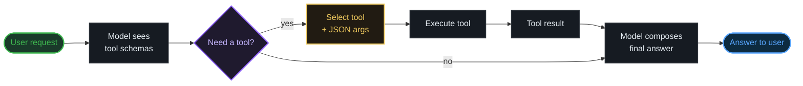

<!-- dli-course-cell {"id":"5-Tools/51-Tool-Calling:0","index":0,"schema":"dli-course-cell/1.0","source_sha256":"9804a5d2287674cb358d64f55649e4fc832bb40dc03cdc5e5696fef349751177","type":"markdown"} -->
<br>
<a href="https://www.nvidia.com/en-us/training/">
    <div style="width: 55%; background-color: white; margin-top: 50px;">
    </div>
</a>
<h1 style="line-height: 1.4;"><font color="#76b900"><b>Building LLM Applications With Prompt Engineering</b></font></h1>
<h2><b>Tool Calling</b></h2>
<br>
<!-- /dli-course-cell -->

<!-- dli-course-cell {"id":"5-Tools/51-Tool-Calling:1","index":1,"schema":"dli-course-cell/1.0","source_sha256":"9a25bc86d6a49b84d106c1881e84d3eb8e4a5ca0fd5cbceda49f041bd1b67a32","type":"markdown"} -->
In this notebook you learn to augment your LLM with the ability to indicate that external, non-LLM related functionality ought to be utilized, a technique we call tool use.


<!-- /dli-course-cell -->

<!-- dli-course-cell {"id":"5-Tools/51-Tool-Calling:2","index":2,"schema":"dli-course-cell/1.0","source_sha256":"cb3f91d54eee30e53e35b2b99905f70f169ed549fd78909d3dac2defc9ed8d3b","type":"markdown"} -->
---
<!-- /dli-course-cell -->

<!-- dli-course-cell {"id":"5-Tools/51-Tool-Calling:3","index":3,"schema":"dli-course-cell/1.0","source_sha256":"7ed1d5d3598d9dfd44ff52aa769434d46ec975cd34ded253e39b3b255ea9be1a","type":"markdown"} -->
## Objectives
<!-- /dli-course-cell -->

<!-- dli-course-cell {"id":"5-Tools/51-Tool-Calling:4","index":4,"schema":"dli-course-cell/1.0","source_sha256":"5528c9448d159cad8c77dca6c4e04c65ad45ee9612b5bc7b7a6e83574a8ff609","type":"markdown"} -->
By the time you complete this notebook you will:

- Understand what a tool is in the context of LLM applications.
- Be able to create tools.
- Learn about how model recommendations about when and how to use a tool are materialized.
<!-- /dli-course-cell -->

<!-- dli-course-cell {"id":"5-Tools/51-Tool-Calling:5","index":5,"schema":"dli-course-cell/1.0","source_sha256":"cb3f91d54eee30e53e35b2b99905f70f169ed549fd78909d3dac2defc9ed8d3b","type":"markdown"} -->
---
<!-- /dli-course-cell -->

<!-- dli-course-cell {"id":"5-Tools/51-Tool-Calling:6","index":6,"schema":"dli-course-cell/1.0","source_sha256":"d357b415148d05679d1f9802803fc0a4a039f4ece72445b0c3c596b0eb555b52","type":"markdown"} -->
## Imports
<!-- /dli-course-cell -->

<!-- dli-course-cell {"id":"5-Tools/51-Tool-Calling:7","index":7,"schema":"dli-course-cell/1.0","source_sha256":"a0c9c5e9f01857a08fea5d6b2b5dfbea0d288f221deb8e8f8bf185171d5963b5","type":"code"} -->
```python
import os
from langchain_nvidia_ai_endpoints import ChatNVIDIA
from langchain_core.prompts import ChatPromptTemplate
from langchain_core.runnables import RunnableLambda
from pydantic import BaseModel, Field
import wikipediaapi
```
<!-- /dli-course-cell -->

<!-- dli-course-cell {"id":"5-Tools/51-Tool-Calling:8","index":8,"schema":"dli-course-cell/1.0","source_sha256":"cb3f91d54eee30e53e35b2b99905f70f169ed549fd78909d3dac2defc9ed8d3b","type":"markdown"} -->
---
<!-- /dli-course-cell -->

<!-- dli-course-cell {"id":"5-Tools/51-Tool-Calling:9","index":9,"schema":"dli-course-cell/1.0","source_sha256":"70f5e78e300511808de404ed1d62799fc55c2b20e6c2a33706e13dbca5acc811","type":"markdown"} -->
## Create a Model Instance
<!-- /dli-course-cell -->

<!-- dli-course-cell {"id":"5-Tools/51-Tool-Calling:10","index":10,"schema":"dli-course-cell/1.0","source_sha256":"fe8a07f8e29704ed8c72091c34ce44956cd4b2a6331a6a6220553baac2abf3d3","type":"code"} -->
```python
base_url = os.getenv("NVIDIA_BASE_URL")

# Use the model selected in the course connection panel, or keep the lesson default.
model = os.getenv("NVIDIA_MODEL") or "nvidia/nemotron-nano-12b-v2-vl"
# model = "nvidia/nemotron-3-nano-30b-a3b"  # Compatible fallback; responses may differ.
# model = "meta/llama-3.3-70b-instruct"  # Legacy fallback; responses may differ more.

llm = ChatNVIDIA(base_url=base_url, model=model, temperature=0)
```
<!-- /dli-course-cell -->

<!-- dli-course-cell {"id":"5-Tools/51-Tool-Calling:11","index":11,"schema":"dli-course-cell/1.0","source_sha256":"cb3f91d54eee30e53e35b2b99905f70f169ed549fd78909d3dac2defc9ed8d3b","type":"markdown"} -->
---
<!-- /dli-course-cell -->

<!-- dli-course-cell {"id":"5-Tools/51-Tool-Calling:12","index":12,"schema":"dli-course-cell/1.0","source_sha256":"876e3d7c4a6276dea2561d0922fd5763a645f1351ee3ab95d76c4d63666cc2e6","type":"markdown"} -->
## LLMs Using Tools
<!-- /dli-course-cell -->

<!-- dli-course-cell {"id":"5-Tools/51-Tool-Calling:13","index":13,"schema":"dli-course-cell/1.0","source_sha256":"1b1b7c79fecabc74671513acade023390ded8b52cd7b7dfc2d94fbab1c3fdf6b","type":"markdown"} -->
Throughout the workshop we've been exploring some of the amazing tasks that LLMs are capable of doing, but of course they aren't well-suited to every task. Whether it's for a task that a model would try to do but probably shouldn't, like math or other calculation-based tasks, or for a task that is downright impossible for an LLM, like making calls to external services, sometimes we want to augment our LLM-based applications to be able to use tools external to the LLM itself.

You've done some of this already by creating custom runnables via `RunnableLambda` and including them in your chains. These custom runnables can perform arbitrary tasks, not necessarily using an LLM.

Now we are going to look at a different powerful technique whereby we provide an LLM with a collection of functions, or "tools" that might be appropriate to use, depending on the user's input, and allow the LLM to decide when using one or several of the tools will be appropriate. Additionally, we will use the LLM to provide details about how the tool (or tools) it deems appropriate to use ought to be called.

A lot of what you learned in the previous section around structured data generation applies to LLM tool calling: The LLM is able to generate output conforming to a specific structure. In the case of tool calling, the LLM will be generating its output to indicate which tool ought to be called, and what arguments ought to be passed to it.
<!-- /dli-course-cell -->

<!-- dli-course-cell {"id":"5-Tools/51-Tool-Calling:14","index":14,"schema":"dli-course-cell/1.0","source_sha256":"cb3f91d54eee30e53e35b2b99905f70f169ed549fd78909d3dac2defc9ed8d3b","type":"markdown"} -->
---
<!-- /dli-course-cell -->

<!-- dli-course-cell {"id":"5-Tools/51-Tool-Calling:15","index":15,"schema":"dli-course-cell/1.0","source_sha256":"d024e7759fb371bb411c6ab83c8a2c27071328b8996878366f228fa61303b1dc","type":"markdown"} -->
## Simple Tool Creation
<!-- /dli-course-cell -->

<!-- dli-course-cell {"id":"5-Tools/51-Tool-Calling:16","index":16,"schema":"dli-course-cell/1.0","source_sha256":"303a2cfce12dec6fc596b09d78da6f7e1b69e3ea219a6c5c24a5a67d510996f6","type":"markdown"} -->
To begin, we need to know how to create an LLM tool. Perhaps the easiest way is with the `tool` decorator, which we can apply to any function, converting the function into a tool.
<!-- /dli-course-cell -->

<!-- dli-course-cell {"id":"5-Tools/51-Tool-Calling:17","index":17,"schema":"dli-course-cell/1.0","source_sha256":"7a73f2b915bbdf6c61f20a487a6e1c192acb881f301962ace569ec620453bfa6","type":"code"} -->
```python
from langchain_core.tools import tool
```
<!-- /dli-course-cell -->

<!-- dli-course-cell {"id":"5-Tools/51-Tool-Calling:18","index":18,"schema":"dli-course-cell/1.0","source_sha256":"98da0c7b36cb2ea6d2d0b9de98326e04fb4cb744eb3f47f926faf66d563b7f10","type":"markdown"} -->
Here we apply the `tool` decorator to a very simple `add` function
<!-- /dli-course-cell -->

<!-- dli-course-cell {"id":"5-Tools/51-Tool-Calling:19","index":19,"schema":"dli-course-cell/1.0","source_sha256":"1bb718b6fdab97cf1fac339b1f5fc93141323f60a48921019b8394d0b5404d98","type":"code"} -->
```python
@tool
def add(a: int, b: int) -> int:
    """Add two numbers"""
    return a + b
```
<!-- /dli-course-cell -->

<!-- dli-course-cell {"id":"5-Tools/51-Tool-Calling:20","index":20,"schema":"dli-course-cell/1.0","source_sha256":"57361117293a691e297b1dfdb6d432dfc312312987767305e60f08cbc7523598","type":"markdown"} -->
Since `add` is no longer a Python function, but rather a tool, it has some specific attributes associated with it that we can inspect. The first is its name, a string based on the name we used for the decorated Python function.
<!-- /dli-course-cell -->

<!-- dli-course-cell {"id":"5-Tools/51-Tool-Calling:21","index":21,"schema":"dli-course-cell/1.0","source_sha256":"ae54a458d9581c0cfaf539e3a0f56dc61ebb5211ce0f9d2426a5a0e6ab28d987","type":"code"} -->
```python
add.name
```
<!-- /dli-course-cell -->

<!-- dli-course-cell {"id":"5-Tools/51-Tool-Calling:22","index":22,"schema":"dli-course-cell/1.0","source_sha256":"d19c06d67a93a5a97d600f08bfc824a9857f77dd8911aaaca7c9b92e233fa5ec","type":"markdown"} -->
Next is a `description`, which you'll notice is created from the decorated function's docstring.
<!-- /dli-course-cell -->

<!-- dli-course-cell {"id":"5-Tools/51-Tool-Calling:23","index":23,"schema":"dli-course-cell/1.0","source_sha256":"490d9365831c0589e6c340df14c3ba1f0643aedc9c51b2a18d7e898bc1ed14aa","type":"code"} -->
```python
add.description
```
<!-- /dli-course-cell -->

<!-- dli-course-cell {"id":"5-Tools/51-Tool-Calling:24","index":24,"schema":"dli-course-cell/1.0","source_sha256":"528ddd03c8cb6ffb21bfbbbee2c0991ed1f4818f9f5b9e57d23738ac9bb80e15","type":"markdown"} -->
As was the case with Pydantic classes used for structured data output in the previous section, our docstrings are going to be used by LangChain under the hood to convey information to the LLM, and thus, not only is it important to add a meaningful docstring to your tools, but it is in fact required.

Tools also have an `args` attribute. Because we used type hints on our definition above, we see that each arg has some additional information around its type associated with it.
<!-- /dli-course-cell -->

<!-- dli-course-cell {"id":"5-Tools/51-Tool-Calling:25","index":25,"schema":"dli-course-cell/1.0","source_sha256":"ae5b9faae87b16f83074ef8d4509688fd87914435151fcf202ccfe3945314017","type":"code"} -->
```python
add.args
```
<!-- /dli-course-cell -->

<!-- dli-course-cell {"id":"5-Tools/51-Tool-Calling:26","index":26,"schema":"dli-course-cell/1.0","source_sha256":"cb3f91d54eee30e53e35b2b99905f70f169ed549fd78909d3dac2defc9ed8d3b","type":"markdown"} -->
---
<!-- /dli-course-cell -->

<!-- dli-course-cell {"id":"5-Tools/51-Tool-Calling:27","index":27,"schema":"dli-course-cell/1.0","source_sha256":"71aa4736d54040a9ecf70335099b5c986adea8a52243ab383c87248013c09e17","type":"markdown"} -->
## Invoking Tools
<!-- /dli-course-cell -->

<!-- dli-course-cell {"id":"5-Tools/51-Tool-Calling:28","index":28,"schema":"dli-course-cell/1.0","source_sha256":"a1cc8c9bea53b716b135b3144dbbb2ae2506db01cb048e8f0e07cad1f765960e","type":"markdown"} -->
Tools are not literal functions, and we cannot call them with `()` as we would a vanilla Python function. Trying to do so will throw an exception.
<!-- /dli-course-cell -->

<!-- dli-course-cell {"id":"5-Tools/51-Tool-Calling:29","index":29,"schema":"dli-course-cell/1.0","source_sha256":"156e9fa50509576f8fffe3e3cf99dbfa2de3d0c721600f2d348b075374cd9151","type":"code"} -->
```python
try:
    add(3, 4)
except Exception as e:
    print(e)
```
<!-- /dli-course-cell -->

<!-- dli-course-cell {"id":"5-Tools/51-Tool-Calling:30","index":30,"schema":"dli-course-cell/1.0","source_sha256":"9670a22cf48a878143c75cf5d515b67c5ce9d2d7de7e893a4f29aed4d29ad2c5","type":"markdown"} -->
Rather, tools have an `invoke` method, which we always supply with a dict mapping the decorated function's expected arguments to the actual values we want to pass in.
<!-- /dli-course-cell -->

<!-- dli-course-cell {"id":"5-Tools/51-Tool-Calling:31","index":31,"schema":"dli-course-cell/1.0","source_sha256":"ad5c1e2f7ff8ce298100cd6e35a030214feafe21a3ea343ae45a09505be92166","type":"code"} -->
```python
add.invoke({'a': 3, 'b': 5})
```
<!-- /dli-course-cell -->

<!-- dli-course-cell {"id":"5-Tools/51-Tool-Calling:32","index":32,"schema":"dli-course-cell/1.0","source_sha256":"cb3f91d54eee30e53e35b2b99905f70f169ed549fd78909d3dac2defc9ed8d3b","type":"markdown"} -->
---
<!-- /dli-course-cell -->

<!-- dli-course-cell {"id":"5-Tools/51-Tool-Calling:33","index":33,"schema":"dli-course-cell/1.0","source_sha256":"e607384bd5bb8967451d7079d53c15fbff98e1ada69bdac01ccef81362833d78","type":"markdown"} -->
## Pydantic Classes with Tools
<!-- /dli-course-cell -->

<!-- dli-course-cell {"id":"5-Tools/51-Tool-Calling:34","index":34,"schema":"dli-course-cell/1.0","source_sha256":"48034684fbb28000465892e96265af586d884a4d0304f074e64812ad01fbe250","type":"markdown"} -->
Just as we used Pydantic classes in the previous section to articulate the specific structure of a data type we wanted the LLMs output to conform to, we also can use them to articulate the schema for the arguments that the LLM will recommend we pass to a given tool.

Here we create a Pydantic class `Add` to specify the schema for the arguments that would be passed into the `add` tool. Using Pydantic gives us a great deal more control over the intended structure of a tool's argument schema, including field validation and more which we won't be covering today. At the least it gives us an easy and clean way to specify the schema, and makes it very simple to provide the LLM with additional information about how the tool should be called by adding descriptions to each of the schema's fields.

It's worth mentioning that the `...` in the `Field` description indicates that the field is required.
<!-- /dli-course-cell -->

<!-- dli-course-cell {"id":"5-Tools/51-Tool-Calling:35","index":35,"schema":"dli-course-cell/1.0","source_sha256":"6903cb88f82de7a4e5c13962a06b6e9412433d370ef4518f728bd8e580566df7","type":"code"} -->
```python
class Add(BaseModel):
    """Use when and if you need to add two numbers."""
    a: int = Field(..., description="First integer")
    b: int = Field(..., description="Second integer")
```
<!-- /dli-course-cell -->

<!-- dli-course-cell {"id":"5-Tools/51-Tool-Calling:36","index":36,"schema":"dli-course-cell/1.0","source_sha256":"c457564256b331d816b02823c9c528fdba401c355eb889836d2b87fd01214488","type":"markdown"} -->
Having defined a Pydantic class for the `add` tool's argument schema, we can associate it with the actual `add` tool by supplying it as the value to an `args_schema` argument passed into the `tool` decorator.
<!-- /dli-course-cell -->

<!-- dli-course-cell {"id":"5-Tools/51-Tool-Calling:37","index":37,"schema":"dli-course-cell/1.0","source_sha256":"19f0afa213dd34493297030c05e3e23e028e7c97325f2ea73b3dd0bea7984fe7","type":"code"} -->
```python
@tool(args_schema=Add)
def add(a: int, b: int) -> int:
    return a + b 
```
<!-- /dli-course-cell -->

<!-- dli-course-cell {"id":"5-Tools/51-Tool-Calling:38","index":38,"schema":"dli-course-cell/1.0","source_sha256":"5790c85c96582554db6083a01ef2cd340db26e057137a237ea9818baced08ae9","type":"markdown"} -->
You'll notice that we no longer supply a docstring directly to the tool definition, since we have provided it as part of the Pydantic class associated with it.
<!-- /dli-course-cell -->

<!-- dli-course-cell {"id":"5-Tools/51-Tool-Calling:39","index":39,"schema":"dli-course-cell/1.0","source_sha256":"cb3f91d54eee30e53e35b2b99905f70f169ed549fd78909d3dac2defc9ed8d3b","type":"markdown"} -->
---
<!-- /dli-course-cell -->

<!-- dli-course-cell {"id":"5-Tools/51-Tool-Calling:40","index":40,"schema":"dli-course-cell/1.0","source_sha256":"9c9f3feeb94eb3634335d373a0f05f7b969f769d1a4c04ca525873c0b35d4f26","type":"markdown"} -->
## Exercise: Make a Multiply Tool
<!-- /dli-course-cell -->

<!-- dli-course-cell {"id":"5-Tools/51-Tool-Calling:41","index":41,"schema":"dli-course-cell/1.0","source_sha256":"062eec8f63a0860ad8e85ad72baa3aa1d8644fa94853595ce7c814aaa01e043c","type":"markdown"} -->
As a simple exercise, create a multiply tool intended to multiply together 2 whole numbers. Use a Pydantic class to specify the tool's argument schema.

Feel free to check out the _Solution_ below if you get stuck.
<!-- /dli-course-cell -->

<!-- dli-course-cell {"id":"5-Tools/51-Tool-Calling:42","index":42,"schema":"dli-course-cell/1.0","source_sha256":"58fa68be734d1b62b1ced799ad754353678f5cc20147be2dd226208550872042","type":"markdown"} -->
### Your Work Here
<!-- /dli-course-cell -->

<!-- dli-course-cell {"id":"5-Tools/51-Tool-Calling:43","index":43,"schema":"dli-course-cell/1.0","source_sha256":"e3b0c44298fc1c149afbf4c8996fb92427ae41e4649b934ca495991b7852b855","type":"code"} -->
```python
```
<!-- /dli-course-cell -->

<!-- dli-course-cell {"id":"5-Tools/51-Tool-Calling:44","index":44,"schema":"dli-course-cell/1.0","source_sha256":"eb90ed3f74a5e9009c6633c2e44657cd53d6fb3a6a0427e0f2be9986882c3530","type":"markdown"} -->
### Solution
<!-- /dli-course-cell -->

<!-- dli-course-cell {"id":"5-Tools/51-Tool-Calling:45","index":45,"schema":"dli-course-cell/1.0","source_sha256":"487320dbf627f8958064dd186ff12da3ae731813480e9c5e72f1d38652296197","type":"code"} -->
```python
class Multiply(BaseModel):
    """Use when and if you need to multiply to numbers."""
    a: int = Field(..., description="First integer")
    b: int = Field(..., description="Second integer") 
```
<!-- /dli-course-cell -->

<!-- dli-course-cell {"id":"5-Tools/51-Tool-Calling:46","index":46,"schema":"dli-course-cell/1.0","source_sha256":"88a4679e47dbaf634572e504bcc421d4c3420b5fb29a5801ac401e1d71c95730","type":"code"} -->
```python
@tool(args_schema=Multiply)
def multiply(a: int, b: int) -> int:
    return a * b 
```
<!-- /dli-course-cell -->

<!-- dli-course-cell {"id":"5-Tools/51-Tool-Calling:47","index":47,"schema":"dli-course-cell/1.0","source_sha256":"cb3f91d54eee30e53e35b2b99905f70f169ed549fd78909d3dac2defc9ed8d3b","type":"markdown"} -->
---
<!-- /dli-course-cell -->

<!-- dli-course-cell {"id":"5-Tools/51-Tool-Calling:48","index":48,"schema":"dli-course-cell/1.0","source_sha256":"ccb7f663eb359f84f9bc5307da96c6611e544ce60c4ea45e4a9278f9245bdd08","type":"markdown"} -->
## Binding Tools to a Model
<!-- /dli-course-cell -->

<!-- dli-course-cell {"id":"5-Tools/51-Tool-Calling:49","index":49,"schema":"dli-course-cell/1.0","source_sha256":"53722eac6321c650224154fce167bee986ae3f0dcfd9dafb94810e2783ae9ee0","type":"markdown"} -->
Now that we have created a couple of LLM tools, we want to make an LLM aware that they are available to be used. The most straightforward way to do this is with the `bind_tools` method available on LLM instances, which expects a list of tool definitions. We already defined an LLM instance `llm` above, so let's construct a list containing our 2 tools and bind them to the LLM instance.
<!-- /dli-course-cell -->

<!-- dli-course-cell {"id":"5-Tools/51-Tool-Calling:50","index":50,"schema":"dli-course-cell/1.0","source_sha256":"35e06fa651de2f8da9e1bf38e60a30dd021a74e8ef9cadcfa7cacb68271d200a","type":"code"} -->
```python
tools = [add, multiply]
```
<!-- /dli-course-cell -->

<!-- dli-course-cell {"id":"5-Tools/51-Tool-Calling:51","index":51,"schema":"dli-course-cell/1.0","source_sha256":"27da949ae1066c8154224bd0df147389b95b4bb5d778ee490a13dd12b41964e4","type":"code"} -->
```python
llm_with_tools = llm.bind_tools(tools)
```
<!-- /dli-course-cell -->

<!-- dli-course-cell {"id":"5-Tools/51-Tool-Calling:52","index":52,"schema":"dli-course-cell/1.0","source_sha256":"6c652eb3f93380099d88641ae5b0cd0ca967c64c41ee39c597effc0ab5319836","type":"markdown"} -->
When an LLM instance has had tools bound to it, we can still use it for non-tool related calls as we usually would. Here we provide a prompt that has nothing to do with addition or multiplication.
<!-- /dli-course-cell -->

<!-- dli-course-cell {"id":"5-Tools/51-Tool-Calling:53","index":53,"schema":"dli-course-cell/1.0","source_sha256":"1dff6ab73bd0f4f6e53543b68ead7e2bbb0dc175fb9a3c96e8f9fd010f457c2f","type":"code"} -->
```python
response = llm_with_tools.invoke('Who are you?')
```
<!-- /dli-course-cell -->

<!-- dli-course-cell {"id":"5-Tools/51-Tool-Calling:54","index":54,"schema":"dli-course-cell/1.0","source_sha256":"f05d4003280b9d10075cc394a1aadce0bf36e2876d9c917f9eca6169d2af41c2","type":"markdown"} -->
Looking at the response we see a typical `AIMessage` response from the LLM.
<!-- /dli-course-cell -->

<!-- dli-course-cell {"id":"5-Tools/51-Tool-Calling:55","index":55,"schema":"dli-course-cell/1.0","source_sha256":"a9f4b3d22a523fdada41c85c175425bcd15b32b4cd0f54d9433accd52d7195a1","type":"code"} -->
```python
response
```
<!-- /dli-course-cell -->

<!-- dli-course-cell {"id":"5-Tools/51-Tool-Calling:56","index":56,"schema":"dli-course-cell/1.0","source_sha256":"db6cf4dc5c0460b31a5f4b4a6379648bc284eb7656f9e616115eca7660ad1084","type":"markdown"} -->
The content of the response is pretty much what we would expect.
<!-- /dli-course-cell -->

<!-- dli-course-cell {"id":"5-Tools/51-Tool-Calling:57","index":57,"schema":"dli-course-cell/1.0","source_sha256":"ff3cb3a31d8550e85bf9576e3c138ed74c1f77820bfa2146cf96a6fb2973ff93","type":"code"} -->
```python
response.content
```
<!-- /dli-course-cell -->

<!-- dli-course-cell {"id":"5-Tools/51-Tool-Calling:58","index":58,"schema":"dli-course-cell/1.0","source_sha256":"9b07fa12c0bae78953cc495460832863de949381160fff44e5d27c1a731f9937","type":"markdown"} -->
If, however, we prompt the model with a prompt having to do with multiplication, a task for which we have bound a tool to manage, we see some very important differences.
<!-- /dli-course-cell -->

<!-- dli-course-cell {"id":"5-Tools/51-Tool-Calling:59","index":59,"schema":"dli-course-cell/1.0","source_sha256":"ff131e9f72cd5e9d09edf635073e84b6701f928d9b681036ce30090192bed47c","type":"code"} -->
```python
response = llm_with_tools.invoke('What is 1234 times 5678?') 
```
<!-- /dli-course-cell -->

<!-- dli-course-cell {"id":"5-Tools/51-Tool-Calling:60","index":60,"schema":"dli-course-cell/1.0","source_sha256":"a9f4b3d22a523fdada41c85c175425bcd15b32b4cd0f54d9433accd52d7195a1","type":"code"} -->
```python
response
```
<!-- /dli-course-cell -->

<!-- dli-course-cell {"id":"5-Tools/51-Tool-Calling:61","index":61,"schema":"dli-course-cell/1.0","source_sha256":"513af5cb5830f3a9dea95b628c6b851fbf4415f9bd067729e3249254b6769123","type":"markdown"} -->
At a glance it appears that the content of the response is empty, which we can confirm here.
<!-- /dli-course-cell -->

<!-- dli-course-cell {"id":"5-Tools/51-Tool-Calling:62","index":62,"schema":"dli-course-cell/1.0","source_sha256":"4cf689f414b001c7e6d94f1ad9abdf1ec92e50886d25dab05e267d8c1817f6ea","type":"code"} -->
```python
response.content 
```
<!-- /dli-course-cell -->

<!-- dli-course-cell {"id":"5-Tools/51-Tool-Calling:63","index":63,"schema":"dli-course-cell/1.0","source_sha256":"7e39b5588e3afd9e64e1679e015f6337e72a25e53dceb076c8048483e1e51b69","type":"markdown"} -->
However, there is a new property associated with the response that we haven't seen before: `tool_calls`.
<!-- /dli-course-cell -->

<!-- dli-course-cell {"id":"5-Tools/51-Tool-Calling:64","index":64,"schema":"dli-course-cell/1.0","source_sha256":"9abc4bc783d4c35e9f5f7e13998cb202cb044f4b0701e25cd69b035815ee32d0","type":"code"} -->
```python
response.tool_calls
```
<!-- /dli-course-cell -->

<!-- dli-course-cell {"id":"5-Tools/51-Tool-Calling:65","index":65,"schema":"dli-course-cell/1.0","source_sha256":"f46811559ed4b4c5206f49773cf1eba49f3369b673e37b59cdbeb3853889e780","type":"markdown"} -->
As you can see, `tool_calls` is a list containing, in this case, a single dict. The dict contains the name of one of the tools we've bound to the model (`multiply`) as well as an inner dict conforming to the arg schema associated with the tool, namely, two integer arguments `a` and `b`. Just like when we used the LLM to generate structured data, the LLM has conformed to our specification while supplying the details of the values, this time `1234` and `5678` which it was able to extract from user-provided prompt `"What is 1234 times 5678?"`.
<!-- /dli-course-cell -->

<!-- dli-course-cell {"id":"5-Tools/51-Tool-Calling:66","index":66,"schema":"dli-course-cell/1.0","source_sha256":"cb3f91d54eee30e53e35b2b99905f70f169ed549fd78909d3dac2defc9ed8d3b","type":"markdown"} -->
---
<!-- /dli-course-cell -->

<!-- dli-course-cell {"id":"5-Tools/51-Tool-Calling:67","index":67,"schema":"dli-course-cell/1.0","source_sha256":"9425cd34bf1c89725b8733ade95502d0dbd3696239217e664d26726cdfdfc89f","type":"markdown"} -->
## LLMs Don't Call Tools
<!-- /dli-course-cell -->

<!-- dli-course-cell {"id":"5-Tools/51-Tool-Calling:68","index":68,"schema":"dli-course-cell/1.0","source_sha256":"4bf01676cd5af004a3bbd08b1d8811c288dded1ddd0d85448baf820e88e52af0","type":"markdown"} -->
As we just saw, our LLM is up to the task of indicating when a tool ought to be called, and of *supplying arguments* for how the tool ought to be called, but when we say the model is "making a tool call," is is not actually invoking the tool.
<!-- /dli-course-cell -->

<!-- dli-course-cell {"id":"5-Tools/51-Tool-Calling:69","index":69,"schema":"dli-course-cell/1.0","source_sha256":"cb3f91d54eee30e53e35b2b99905f70f169ed549fd78909d3dac2defc9ed8d3b","type":"markdown"} -->
---
<!-- /dli-course-cell -->

<!-- dli-course-cell {"id":"5-Tools/51-Tool-Calling:70","index":70,"schema":"dli-course-cell/1.0","source_sha256":"6e7d04f208ae3c5c112d843e4c0bc84b0cfe3b87453dee3df38c5aadc93a12ce","type":"markdown"} -->
## Actually Calling Tools
<!-- /dli-course-cell -->

<!-- dli-course-cell {"id":"5-Tools/51-Tool-Calling:71","index":71,"schema":"dli-course-cell/1.0","source_sha256":"f2125c1fe97f14088917088bea6e62cff1a75862e1f19696c43885cff8d3b209","type":"markdown"} -->
There are a lot of ways to actually call the tool(s) the model indicates we should with the arguments it supplies, and importantly, to supply the result of an actual tool invocation back to the model so that it can use what the tool returns in its response back to the prompt it was given. By far the most common way to do this is with something we call agents, a topic we will look at in the next notebook.

As you'll see when we build agents in the next notebook, LangChain is going to be doing a lot of work under the hood and hidden from us. With that in mind we'd like to spend a little time here, even though using agents is a much better approach in general, showing how to actually invoke tools when a model indicates we should.

Recall that the response we got back to our multiplication prompt from`llm_with_tools` contained a `tool_calls` property.
<!-- /dli-course-cell -->

<!-- dli-course-cell {"id":"5-Tools/51-Tool-Calling:72","index":72,"schema":"dli-course-cell/1.0","source_sha256":"c5e1854ba6c089a00b24de8b7c15a8fe344c428474502d625f866d48779e9fe1","type":"code"} -->
```python
response.tool_calls 
```
<!-- /dli-course-cell -->

<!-- dli-course-cell {"id":"5-Tools/51-Tool-Calling:73","index":73,"schema":"dli-course-cell/1.0","source_sha256":"0475aedf7a3e732d3cd22b003d5019975c2947d5ece0edd39c20b9e964c8c089","type":"markdown"} -->
Let's get a single `tool` call (and in this case the only tool call) out of the `tool_calls` list.
<!-- /dli-course-cell -->

<!-- dli-course-cell {"id":"5-Tools/51-Tool-Calling:74","index":74,"schema":"dli-course-cell/1.0","source_sha256":"a46699f7fde32ab40309024ef405104cb83064be06048808ccbcd2da17b532ca","type":"code"} -->
```python
tool_call = response.tool_calls[0] 
```
<!-- /dli-course-cell -->

<!-- dli-course-cell {"id":"5-Tools/51-Tool-Calling:75","index":75,"schema":"dli-course-cell/1.0","source_sha256":"7d668bcfd1ba8c4632e82b8ed72020f78e945928ff7a58cebe75c671c91f58e0","type":"code"} -->
```python
tool_call 
```
<!-- /dli-course-cell -->

<!-- dli-course-cell {"id":"5-Tools/51-Tool-Calling:76","index":76,"schema":"dli-course-cell/1.0","source_sha256":"ada84bef41b8a7360de6f79605b8b2b3320178c621c02301061c068d1a74682a","type":"markdown"} -->
As you'll recall `tool_call` contains the args intended to be passed to the actual tool invocation...
<!-- /dli-course-cell -->

<!-- dli-course-cell {"id":"5-Tools/51-Tool-Calling:77","index":77,"schema":"dli-course-cell/1.0","source_sha256":"3f26c3c4c4c282da5b767593c20fd806d8bdfe7b3240a26c21606b1bc11cb1bc","type":"code"} -->
```python
tool_call_args = tool_call["args"] 
```
<!-- /dli-course-cell -->

<!-- dli-course-cell {"id":"5-Tools/51-Tool-Calling:78","index":78,"schema":"dli-course-cell/1.0","source_sha256":"180992987644532b261f0f892fd60938e583ba69bc7b60dc5fb8849da78decc8","type":"markdown"} -->
... and a name field indicating which `tool` ought to be called.
<!-- /dli-course-cell -->

<!-- dli-course-cell {"id":"5-Tools/51-Tool-Calling:79","index":79,"schema":"dli-course-cell/1.0","source_sha256":"65b092d0ac9988bf2499bab00743a323931c3bb0f66fe135bf26cf09f39ec1df","type":"code"} -->
```python
tool_to_call_name = tool_call["name"]
```
<!-- /dli-course-cell -->

<!-- dli-course-cell {"id":"5-Tools/51-Tool-Calling:80","index":80,"schema":"dli-course-cell/1.0","source_sha256":"df0f25239ef9541c1b15a80bcb6c757801fb8408ec296a1aaabe2b8e140aa12f","type":"markdown"} -->
This value is a string and matches the name field on the `tool` itself.
<!-- /dli-course-cell -->

<!-- dli-course-cell {"id":"5-Tools/51-Tool-Calling:81","index":81,"schema":"dli-course-cell/1.0","source_sha256":"b78f71668e4f58a6ced8adc11e36d16495881467fa4d3c69e4dba6f515feebd5","type":"code"} -->
```python
tool_to_call_name 
```
<!-- /dli-course-cell -->

<!-- dli-course-cell {"id":"5-Tools/51-Tool-Calling:82","index":82,"schema":"dli-course-cell/1.0","source_sha256":"611e1f52fd585542cafae8ed3dbf74216100a667a9ef6cdbf4e4f6e881ad7322","type":"code"} -->
```python
tool_to_call_name == multiply.name 
```
<!-- /dli-course-cell -->

<!-- dli-course-cell {"id":"5-Tools/51-Tool-Calling:83","index":83,"schema":"dli-course-cell/1.0","source_sha256":"5709785fe201f5c855b1ba121585292fd53f524e401fcd0c29c8c86cf15c9529","type":"markdown"} -->
The tool itself, however, is not a string, and we can't invoke `tool_to_call_name`. Therefore we need some way to map the tool name to the actual tool, in this case `multiply` (not a string). For this we'll create a simple mapping of tool name to actual tool, including both our `add` and `multiply` tools.
<!-- /dli-course-cell -->

<!-- dli-course-cell {"id":"5-Tools/51-Tool-Calling:84","index":84,"schema":"dli-course-cell/1.0","source_sha256":"cc7722103ea233a07181f87c2d7106031cb8267d917b8d3490af16102a3943d9","type":"code"} -->
```python
tool_map = {
    "add": add,
    "multiply": multiply
}
```
<!-- /dli-course-cell -->

<!-- dli-course-cell {"id":"5-Tools/51-Tool-Calling:85","index":85,"schema":"dli-course-cell/1.0","source_sha256":"ce2debca8e832e6d5ffb346a57495e6b07b0e1bbfd29ebcc57d9aac78e079019","type":"markdown"} -->
With this map and the name of the tool, now we can get back the actual tool to call.
<!-- /dli-course-cell -->

<!-- dli-course-cell {"id":"5-Tools/51-Tool-Calling:86","index":86,"schema":"dli-course-cell/1.0","source_sha256":"1b30178936a84aa2667033d18217b59244250e7737280c60fd567f0995f473c9","type":"code"} -->
```python
tool_to_call = tool_map[tool_to_call_name]
```
<!-- /dli-course-cell -->

<!-- dli-course-cell {"id":"5-Tools/51-Tool-Calling:87","index":87,"schema":"dli-course-cell/1.0","source_sha256":"577b7e33df33268281d10bf8574c086086e89b2fa9e330069fe26899708143c5","type":"markdown"} -->
We can print `tool_to_call` and `multiply` to compare that they are the same.
<!-- /dli-course-cell -->

<!-- dli-course-cell {"id":"5-Tools/51-Tool-Calling:88","index":88,"schema":"dli-course-cell/1.0","source_sha256":"bcdad17dbcc6a32e97db0434597f020e702afea8d891bd101d8d4f2e6c19f8ce","type":"code"} -->
```python
print(tool_to_call)
```
<!-- /dli-course-cell -->

<!-- dli-course-cell {"id":"5-Tools/51-Tool-Calling:89","index":89,"schema":"dli-course-cell/1.0","source_sha256":"edaccd3c1b534191b488a20f099b078f293da09889a45b1e8f76d3dd285ae9cd","type":"code"} -->
```python
print(multiply)
```
<!-- /dli-course-cell -->

<!-- dli-course-cell {"id":"5-Tools/51-Tool-Calling:90","index":90,"schema":"dli-course-cell/1.0","source_sha256":"87113421f84d7dfbcd581a08fe4801b319c67273b1ed016f79c83c519cfaabcb","type":"code"} -->
```python
tool_to_call is multiply
```
<!-- /dli-course-cell -->

<!-- dli-course-cell {"id":"5-Tools/51-Tool-Calling:91","index":91,"schema":"dli-course-cell/1.0","source_sha256":"7125dff598cb9cbe62cde0e053a33dc0fb2c2fd55768061c8e28d07880217c87","type":"markdown"} -->
Finally, we can test invoking our tool by invoking it with the supplied arguments.
<!-- /dli-course-cell -->

<!-- dli-course-cell {"id":"5-Tools/51-Tool-Calling:92","index":92,"schema":"dli-course-cell/1.0","source_sha256":"e3e5cfe9608d3750bf42fbb240a7cfb501411f6665d73631b1d704269ae1c113","type":"code"} -->
```python
tool_to_call.invoke(tool_call_args)
```
<!-- /dli-course-cell -->

<!-- dli-course-cell {"id":"5-Tools/51-Tool-Calling:93","index":93,"schema":"dli-course-cell/1.0","source_sha256":"3b6fa07d6add32283e7abb21f694515eb6e5f99967618b245282bf60103a18ed","type":"code"} -->
```python
tool_to_call.invoke({'a': 1234, 'b': 5678})
```
<!-- /dli-course-cell -->

<!-- dli-course-cell {"id":"5-Tools/51-Tool-Calling:94","index":94,"schema":"dli-course-cell/1.0","source_sha256":"cb3f91d54eee30e53e35b2b99905f70f169ed549fd78909d3dac2defc9ed8d3b","type":"markdown"} -->
---
<!-- /dli-course-cell -->

<!-- dli-course-cell {"id":"5-Tools/51-Tool-Calling:95","index":95,"schema":"dli-course-cell/1.0","source_sha256":"a7083dd49f2f607236fa4c013f39d1b89f340f6ba31bde96968eddb4f09da604","type":"markdown"} -->
## Adding Actual Tool Calling to a Chain
<!-- /dli-course-cell -->

<!-- dli-course-cell {"id":"5-Tools/51-Tool-Calling:96","index":96,"schema":"dli-course-cell/1.0","source_sha256":"34d9aae04dd24393c9d7e066547b8db8814f87cc669b8a5e9de0a8f6b66ad86d","type":"markdown"} -->
That was a lot of detail, but we wanted you to understand what was going on when we provided you with the following function, which will expect a model response and if there is a tool call, go through the process we just walked through to actually invoke the tool with the LLM-supplied arguments and return the result of the actual tool invocation.

In the case that the LLM did not indicate a tool call, then the function simply returns the content of the model's (non-tool call) response.
<!-- /dli-course-cell -->

<!-- dli-course-cell {"id":"5-Tools/51-Tool-Calling:97","index":97,"schema":"dli-course-cell/1.0","source_sha256":"44ef6572a1ce8c9f475b44ef792612fd07f0fb9fcd6d1a3c5777bb3570107cf4","type":"code"} -->
```python
# Very naive implementation of actual tool calling.
def call_tools(response):

    if not response.tool_calls:
        return response.content

    tool_map = {
        "add": add,
        "multiply": multiply
    }

    # In this naive implementation, we are only supporting a single tool call.
    tool_call = response.tool_calls[0]
    selected_tool = tool_map[tool_call["name"]]
    args = tool_call["args"]
        
    return selected_tool.invoke(args) 
```
<!-- /dli-course-cell -->

<!-- dli-course-cell {"id":"5-Tools/51-Tool-Calling:98","index":98,"schema":"dli-course-cell/1.0","source_sha256":"8ef7ef9d1fec3c2a9db43fecc9becb583cb2a743004994f13aaa75fdc225d4f4","type":"markdown"} -->
We ought now to be able to create a simple chain with our tool-bound LLM and a custom runnable using the `call_tools` function we just defined.
<!-- /dli-course-cell -->

<!-- dli-course-cell {"id":"5-Tools/51-Tool-Calling:99","index":99,"schema":"dli-course-cell/1.0","source_sha256":"a1b29fa9d0af35f97014b3c06d778fb36c23bd3abf827b0ac4ac98ad97cd833a","type":"code"} -->
```python
chain = llm_with_tools | RunnableLambda(call_tools)
```
<!-- /dli-course-cell -->

<!-- dli-course-cell {"id":"5-Tools/51-Tool-Calling:100","index":100,"schema":"dli-course-cell/1.0","source_sha256":"21b0ea9306ed68a768c3e9f175d14aa6989de8df2eba5f59596d9b0987593c60","type":"markdown"} -->
First, let's invoke the chain on a non add or multiply related prompt
<!-- /dli-course-cell -->

<!-- dli-course-cell {"id":"5-Tools/51-Tool-Calling:101","index":101,"schema":"dli-course-cell/1.0","source_sha256":"c1952bf58017d202da9385969015fc7b34d833159010226980301505bb070bda","type":"code"} -->
```python
chain.invoke("Who are you?")
```
<!-- /dli-course-cell -->

<!-- dli-course-cell {"id":"5-Tools/51-Tool-Calling:102","index":102,"schema":"dli-course-cell/1.0","source_sha256":"ae3852b64a7578a9a2b1ae7b84fb8adbbb51fbf9b91a0e0a8c6bcb38a49b66ae","type":"markdown"} -->
And now we'll try it with some multiplication.
<!-- /dli-course-cell -->

<!-- dli-course-cell {"id":"5-Tools/51-Tool-Calling:103","index":103,"schema":"dli-course-cell/1.0","source_sha256":"4ca7df8844803e88c214865933d037378942d7fb28fb8a24bc3e6973c65d40dc","type":"code"} -->
```python
chain.invoke("What is the product of 1234 and 5678?") 
```
<!-- /dli-course-cell -->

<!-- dli-course-cell {"id":"5-Tools/51-Tool-Calling:104","index":104,"schema":"dli-course-cell/1.0","source_sha256":"ef649bbba7253f9dd3f20434eee669945f8f2a84fce241efd5e4ba18f09a43fd","type":"code"} -->
```python
1234 * 5678
```
<!-- /dli-course-cell -->

<!-- dli-course-cell {"id":"5-Tools/51-Tool-Calling:105","index":105,"schema":"dli-course-cell/1.0","source_sha256":"54e66913701e2da407704aa20285cb28949920f2e1e5f07d1fd524c2501bef7a","type":"markdown"} -->
And now we'll try some addition.
<!-- /dli-course-cell -->

<!-- dli-course-cell {"id":"5-Tools/51-Tool-Calling:106","index":106,"schema":"dli-course-cell/1.0","source_sha256":"5a1b380bfcba03c12c6c48fb1c84cef2402502250ed8e8e65d136fa958878372","type":"code"} -->
```python
chain.invoke("What 1234567 plus 10111213?") 
```
<!-- /dli-course-cell -->

<!-- dli-course-cell {"id":"5-Tools/51-Tool-Calling:107","index":107,"schema":"dli-course-cell/1.0","source_sha256":"8295bc9610f3b942d9f84731f7916ec85686b5a8d7726cb390510c1750efeb3e","type":"code"} -->
```python
1234567 + 10111213
```
<!-- /dli-course-cell -->

<!-- dli-course-cell {"id":"5-Tools/51-Tool-Calling:108","index":108,"schema":"dli-course-cell/1.0","source_sha256":"cb3f91d54eee30e53e35b2b99905f70f169ed549fd78909d3dac2defc9ed8d3b","type":"markdown"} -->
---
<!-- /dli-course-cell -->

<!-- dli-course-cell {"id":"5-Tools/51-Tool-Calling:109","index":109,"schema":"dli-course-cell/1.0","source_sha256":"3ff9e8509272d0f885c66e87f9b0af91fb91b6ac979a41f6363737e5ec71ab4e","type":"markdown"} -->
## Tool Calling is Not Perfect
<!-- /dli-course-cell -->

<!-- dli-course-cell {"id":"5-Tools/51-Tool-Calling:110","index":110,"schema":"dli-course-cell/1.0","source_sha256":"d3bd551e400f1ed96ff4e238767eee3c8df98ddb5a7ce0038eae30619b5a5c81","type":"markdown"} -->
Let's make the problem a bit more difficult for the model by providing it an addition problem to perform stated mostly in natural language rather than numbers.
<!-- /dli-course-cell -->

<!-- dli-course-cell {"id":"5-Tools/51-Tool-Calling:111","index":111,"schema":"dli-course-cell/1.0","source_sha256":"860ceb37b64458e1f8cbe458ee4cb73896d85d4d42bddbca9f6514d5bd585e13","type":"code"} -->
```python
chain.invoke("What is 9 million and 115 plus thirteen thousand three hundred and sixty three?")
```
<!-- /dli-course-cell -->

<!-- dli-course-cell {"id":"5-Tools/51-Tool-Calling:112","index":112,"schema":"dli-course-cell/1.0","source_sha256":"5d384cbda90d27d242c9fae45a2fae49cdf35a6a99d44f72cae53f924b44f177","type":"code"} -->
```python
9000115 + 13363
```
<!-- /dli-course-cell -->

<!-- dli-course-cell {"id":"5-Tools/51-Tool-Calling:113","index":113,"schema":"dli-course-cell/1.0","source_sha256":"3892dad285f82655662243da580fa87b411419c9f778902eb0bdfe1dc7c247ec","type":"markdown"} -->
In this case we can see that we did not get the correct answer out of our chain. Let's look at the `tool_calls` property when invoking `llm_with_tools` on the same prompt to get more information about what might have gone wrong.
<!-- /dli-course-cell -->

<!-- dli-course-cell {"id":"5-Tools/51-Tool-Calling:114","index":114,"schema":"dli-course-cell/1.0","source_sha256":"007c2bd9eee363cd4841d806e5c02e5272378405078cb065531e2adc3852702e","type":"code"} -->
```python
llm_with_tools.invoke("What is 9 million and 115 plus thirteen thousand three hundred and sixty three?").tool_calls
```
<!-- /dli-course-cell -->

<!-- dli-course-cell {"id":"5-Tools/51-Tool-Calling:115","index":115,"schema":"dli-course-cell/1.0","source_sha256":"318163acdee2f1842f788ea9d802e862ae889fcbdbb67e871cc47ef63417d840","type":"markdown"} -->
If we're unlucky enough to get a bad answer and look at the `args` property, we might see the model set `a` to `9000000` instead of `9000115` to consequently return the wrong result. This likely stems from language/intent ambiguity combined with some inconsistency in prompting, but it's still an error from our perspective. 

Though tool calling is powerful, it can supply our applications with functionality that an LLM is ill-suited for. All of the same considerations we've made regarding hallucination still apply when using tools, so keep that in mind before adopting LLM-powered tool connectors across your problem stack. 
<!-- /dli-course-cell -->

<!-- dli-course-cell {"id":"5-Tools/51-Tool-Calling:116","index":116,"schema":"dli-course-cell/1.0","source_sha256":"cb3f91d54eee30e53e35b2b99905f70f169ed549fd78909d3dac2defc9ed8d3b","type":"markdown"} -->
---
<!-- /dli-course-cell -->

<!-- dli-course-cell {"id":"5-Tools/51-Tool-Calling:117","index":117,"schema":"dli-course-cell/1.0","source_sha256":"0d9ff4553681d8ae168a367fa08a892a7401ced768b9aa5d4f1651c446a2d8bb","type":"markdown"} -->
## Exercise: Build a Tool to Query Wikipedia
<!-- /dli-course-cell -->

<!-- dli-course-cell {"id":"5-Tools/51-Tool-Calling:118","index":118,"schema":"dli-course-cell/1.0","source_sha256":"22c9e1fc564664fb2ca99ce2830e905e5b66303e6455cda525a1784d4033479d","type":"markdown"} -->
For this exercise you'll create and utilize a tool that can use the Wikipedia API.

The following function takes a given topic and returns either the first paragraph of the topic's Wikipedia summary, or a message that a Wikipedia page for the topic could not be found.
<!-- /dli-course-cell -->

<!-- dli-course-cell {"id":"5-Tools/51-Tool-Calling:119","index":119,"schema":"dli-course-cell/1.0","source_sha256":"96ee51b8ca5a437a6486b8ec4e27f2ffd8be08b0a2bf0724889a7d8119d8c21c","type":"code"} -->
```python
def get_wikipedia_intro(topic):
    user_agent = 'MyApp/1.0 (myemail@example.com)'
    wiki_wiki = wikipediaapi.Wikipedia(user_agent=user_agent)
    page = wiki_wiki.page(topic)
    if page.exists():
        return page.summary.split('\n')[0]  # Get the first paragraph of the summary
    else:
        return f"No Wikipedia page found for '{topic}'" 
```
<!-- /dli-course-cell -->

<!-- dli-course-cell {"id":"5-Tools/51-Tool-Calling:120","index":120,"schema":"dli-course-cell/1.0","source_sha256":"69573b4bce2ef87c4bd2095bbd9e1e02ffa06caa9cd526d651ef967e45c0ef47","type":"markdown"} -->
We want to use the tool you create out of this function to augment an LLM by allowing it to use the tool when it is asked about a topic too recent for it to actually know anything about.

Use the following approach:
- Create a tool out of the above function, being sure to give an explicit use case for it in its schema.
- Bind the tool to your LLM.
- Construct a chain with your tool-bound LLM and a custom runnable made out of the `call_tools` function immediately below (which contains a mapping to `get_wikipedia_intro`.
- Invoke your chain with a prompt about something the LLM itself could not know about, like the 2024 Summer Olympics.


Feel free to check out the Solution below if you get stuck.
<!-- /dli-course-cell -->

<!-- dli-course-cell {"id":"5-Tools/51-Tool-Calling:121","index":121,"schema":"dli-course-cell/1.0","source_sha256":"f67267ee5a13597e9ea355156ba27076bbce2c136ec590f9eb497c40bacc78d7","type":"code"} -->
```python
def call_tools(response):

    if not response.tool_calls:
        return response.content

    tool_map = {
        "get_wikipedia_intro": get_wikipedia_intro
    }
    
    for tool_call in response.tool_calls:
        selected_tool = tool_map[tool_call["name"]]
        args = tool_call["args"]
        
        return selected_tool.invoke(args) 
```
<!-- /dli-course-cell -->

<!-- dli-course-cell {"id":"5-Tools/51-Tool-Calling:122","index":122,"schema":"dli-course-cell/1.0","source_sha256":"58fa68be734d1b62b1ced799ad754353678f5cc20147be2dd226208550872042","type":"markdown"} -->
### Your Work Here
<!-- /dli-course-cell -->

<!-- dli-course-cell {"id":"5-Tools/51-Tool-Calling:123","index":123,"schema":"dli-course-cell/1.0","source_sha256":"e3b0c44298fc1c149afbf4c8996fb92427ae41e4649b934ca495991b7852b855","type":"code"} -->
```python
```
<!-- /dli-course-cell -->

<!-- dli-course-cell {"id":"5-Tools/51-Tool-Calling:124","index":124,"schema":"dli-course-cell/1.0","source_sha256":"eb90ed3f74a5e9009c6633c2e44657cd53d6fb3a6a0427e0f2be9986882c3530","type":"markdown"} -->
### Solution
<!-- /dli-course-cell -->

<!-- dli-course-cell {"id":"5-Tools/51-Tool-Calling:125","index":125,"schema":"dli-course-cell/1.0","source_sha256":"020c5e9b718b35518f061fcfc252866c5332b9c873f073da433866539d613009","type":"code"} -->
```python
class GetWikipediaIntro(BaseModel):
    """Look up information for events that happened after the year 2022."""
    topic: str = Field(..., description="Topic to get more info about") 
```
<!-- /dli-course-cell -->

<!-- dli-course-cell {"id":"5-Tools/51-Tool-Calling:126","index":126,"schema":"dli-course-cell/1.0","source_sha256":"5480a2f39dccd93c4dedb764907bbd81fd77a9636a70a4662739060f62166080","type":"code"} -->
```python
@tool(args_schema=GetWikipediaIntro)
def get_wikipedia_intro(topic):
    user_agent = 'MyApp/1.0 (myemail@example.com)'
    wiki_wiki = wikipediaapi.Wikipedia(user_agent=user_agent)
    page = wiki_wiki.page(topic)
    if page.exists():
        return page.summary.split('\n')[0]  # Get the first paragraph of the summary
    else:
        return f"No Wikipedia page found for '{topic}'" 
```
<!-- /dli-course-cell -->

<!-- dli-course-cell {"id":"5-Tools/51-Tool-Calling:127","index":127,"schema":"dli-course-cell/1.0","source_sha256":"3aa8f795e6f513baa1ad0ba79f11f9249cac5aedc680a153375fd9f0d2d9d2ff","type":"code"} -->
```python
llm_with_tools = llm.bind_tools([get_wikipedia_intro]) 
```
<!-- /dli-course-cell -->

<!-- dli-course-cell {"id":"5-Tools/51-Tool-Calling:128","index":128,"schema":"dli-course-cell/1.0","source_sha256":"69f3be9ff5b676bf9ebabff5cc395fc487e4bd1bf07c14a375522dd6808a340e","type":"code"} -->
```python
chain = llm_with_tools | RunnableLambda(call_tools) 
```
<!-- /dli-course-cell -->

<!-- dli-course-cell {"id":"5-Tools/51-Tool-Calling:129","index":129,"schema":"dli-course-cell/1.0","source_sha256":"945153469e23d3b0a64fba381f07d28d269fa5332b448f79c19909abc968efdb","type":"code"} -->
```python
chain.invoke("Give me a short summary about the 2024 Summer Olympics") 
```
<!-- /dli-course-cell -->

<!-- dli-course-cell {"id":"5-Tools/51-Tool-Calling:130","index":130,"schema":"dli-course-cell/1.0","source_sha256":"cb3f91d54eee30e53e35b2b99905f70f169ed549fd78909d3dac2defc9ed8d3b","type":"markdown"} -->
---
<!-- /dli-course-cell -->

<!-- dli-course-cell {"id":"5-Tools/51-Tool-Calling:131","index":131,"schema":"dli-course-cell/1.0","source_sha256":"30ac03ff33731529441be8fbe52a3bd0d4c5ec830e806d54692168ebb7f98ada","type":"markdown"} -->
## Summary
<!-- /dli-course-cell -->

<!-- dli-course-cell {"id":"5-Tools/51-Tool-Calling:132","index":132,"schema":"dli-course-cell/1.0","source_sha256":"357e1077205c3ac057eed457840258eedb7726f3ded53892159475fe62fac094","type":"markdown"} -->
In this notebook you learned how to create tools for tasks an LLM is not well suited for. You also got to see the results, in a naive chain, of actually invoking a tool. In the next notebook we'll introduce agents, a much more powerful method of orchestrating tool use, allowing models to reason about tool use, and provide the results of actually calling tools as inputs back to the model in service of composing a helpful response.

---

<!-- NEXT_STEP_CARD -->

<div style="border-left: 6px solid #76B900; background: #f7fdf2; padding: 14px 18px; border-radius: 10px; margin: 20px 0;">
<p style="margin: 0 0 6px; color: #315c00; font-weight: 700; letter-spacing: .04em; text-transform: uppercase;">Continue the unified course path</p>
<p style="margin: 0 0 8px; color: black;"><strong>Next step:</strong> Open <code>5-Tools/52-Agents.ipynb</code> next: <strong>Agents</strong>.</p>
<p style="margin: 0; color: black;"><strong>Before moving on:</strong> Keep one case where a tool result should feed back into the model, because the next notebook adds the control loop that decides when and how to do that.</p>
</div>
<!-- /dli-course-cell -->
