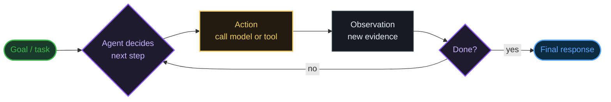

<!-- dli-course-cell {"id":"5-Tools/52-Agents:0","index":0,"schema":"dli-course-cell/1.0","source_sha256":"6a7556fd9918b4213ac0c322cd8d129448f6963ca2f90f8c755e2cef5c9f77cc","type":"markdown"} -->
<br>
<a href="https://www.nvidia.com/en-us/training/">
    <div style="width: 55%; background-color: white; margin-top: 50px;">
    </div>
</a>
<h1 style="line-height: 1.4;"><font color="#76b900"><b>Building LLM Applications With Prompt Engineering</b></font></h1>
<h2><b>Introduction to Agents</b></h2>
<br>
<!-- /dli-course-cell -->

<!-- dli-course-cell {"id":"5-Tools/52-Agents:1","index":1,"schema":"dli-course-cell/1.0","source_sha256":"7e5e81b6ae90a9ecc30ecaddcd9819471fa1a77f8c3c58b4834a4c69759e228d","type":"markdown"} -->
In this notebook we introduce agents which can reason about tool use and integrate the actual invocation of tools into LLM responses. Think of this as a bit of extra credit: you just learned about tool calling, and agents are a fun and powerful next step that you're well prepared for.


<!-- /dli-course-cell -->

<!-- dli-course-cell {"id":"5-Tools/52-Agents:2","index":2,"schema":"dli-course-cell/1.0","source_sha256":"cb3f91d54eee30e53e35b2b99905f70f169ed549fd78909d3dac2defc9ed8d3b","type":"markdown"} -->
---
<!-- /dli-course-cell -->

<!-- dli-course-cell {"id":"5-Tools/52-Agents:3","index":3,"schema":"dli-course-cell/1.0","source_sha256":"7ed1d5d3598d9dfd44ff52aa769434d46ec975cd34ded253e39b3b255ea9be1a","type":"markdown"} -->
## Objectives
<!-- /dli-course-cell -->

<!-- dli-course-cell {"id":"5-Tools/52-Agents:4","index":4,"schema":"dli-course-cell/1.0","source_sha256":"9d7f9bb0e2cecee2b9700780fdc15f28ec74b4dab81d84b2fa4aa52bd5ab0941","type":"markdown"} -->
By the time you complete this notebook you will:

- Understand the role of agents in the context of LLM tool use.
- Create and utilize a simple agent capable of folding tool use results into LLM responses.
- Integrate agents you create into LCEL chains.
<!-- /dli-course-cell -->

<!-- dli-course-cell {"id":"5-Tools/52-Agents:5","index":5,"schema":"dli-course-cell/1.0","source_sha256":"cb3f91d54eee30e53e35b2b99905f70f169ed549fd78909d3dac2defc9ed8d3b","type":"markdown"} -->
---
<!-- /dli-course-cell -->

<!-- dli-course-cell {"id":"5-Tools/52-Agents:6","index":6,"schema":"dli-course-cell/1.0","source_sha256":"d357b415148d05679d1f9802803fc0a4a039f4ece72445b0c3c596b0eb555b52","type":"markdown"} -->
## Imports
<!-- /dli-course-cell -->

<!-- dli-course-cell {"id":"5-Tools/52-Agents:7","index":7,"schema":"dli-course-cell/1.0","source_sha256":"b5e4613fe82ab72fcd3e9baf12db45782c7b06fd482b34f3349b3064e22fb2e2","type":"code"} -->
```python
import os
import math
import requests

from langchain_nvidia_ai_endpoints import ChatNVIDIA

from pydantic import BaseModel, Field
from langchain_core.tools import tool
from langchain_core.runnables import RunnableLambda
from langchain_core.prompts import ChatPromptTemplate

from langchain.agents import create_agent

from IPython.display import Image, display
```
<!-- /dli-course-cell -->

<!-- dli-course-cell {"id":"5-Tools/52-Agents:8","index":8,"schema":"dli-course-cell/1.0","source_sha256":"cb3f91d54eee30e53e35b2b99905f70f169ed549fd78909d3dac2defc9ed8d3b","type":"markdown"} -->
---
<!-- /dli-course-cell -->

<!-- dli-course-cell {"id":"5-Tools/52-Agents:9","index":9,"schema":"dli-course-cell/1.0","source_sha256":"70f5e78e300511808de404ed1d62799fc55c2b20e6c2a33706e13dbca5acc811","type":"markdown"} -->
## Create a Model Instance
<!-- /dli-course-cell -->

<!-- dli-course-cell {"id":"5-Tools/52-Agents:10","index":10,"schema":"dli-course-cell/1.0","source_sha256":"d741a922d2642a3fc57f5481f8c069b9cfe987622157b766b7bad7190f65996b","type":"code"} -->
```python
base_url = os.getenv("NVIDIA_BASE_URL")
model = 'nvidia/nemotron-nano-12b-v2-vl'
llm = ChatNVIDIA(base_url=base_url, model=model, temperature=0)
```
<!-- /dli-course-cell -->

<!-- dli-course-cell {"id":"5-Tools/52-Agents:11","index":11,"schema":"dli-course-cell/1.0","source_sha256":"cb3f91d54eee30e53e35b2b99905f70f169ed549fd78909d3dac2defc9ed8d3b","type":"markdown"} -->
---
<!-- /dli-course-cell -->

<!-- dli-course-cell {"id":"5-Tools/52-Agents:12","index":12,"schema":"dli-course-cell/1.0","source_sha256":"a37ac4f1a2b23183e0de43bf4db0c3d0cb431295272096a38195239684c4af32","type":"markdown"} -->
## Agents
<!-- /dli-course-cell -->

<!-- dli-course-cell {"id":"5-Tools/52-Agents:13","index":13,"schema":"dli-course-cell/1.0","source_sha256":"a3751627dc5a33681bedc93b18d99499bb2ea5334ab2d4cd36a46361ad0a35f8","type":"markdown"} -->
In the previous notebook we created tools, used LLMs to decide when to invoke them, and wrote a simple dispatch function to execute tool calls. That approach had a critical gap: we never fed the tool's return value back to the LLM, so it couldn't incorporate tool results into its response. **Agents** solve this.

An agent uses an LLM as a reasoning engine that decides which tools to call, actually calls them, and uses the results to formulate a response. You'll recognize that agents operate on the same message types you used in Section 3, and that tool argument schemas use the same Pydantic patterns from Section 4. Agents are a deep topic worthy of their own study; here we'll cover the fundamentals.
<!-- /dli-course-cell -->

<!-- dli-course-cell {"id":"5-Tools/52-Agents:14","index":14,"schema":"dli-course-cell/1.0","source_sha256":"cb3f91d54eee30e53e35b2b99905f70f169ed549fd78909d3dac2defc9ed8d3b","type":"markdown"} -->
---
<!-- /dli-course-cell -->

<!-- dli-course-cell {"id":"5-Tools/52-Agents:15","index":15,"schema":"dli-course-cell/1.0","source_sha256":"6d260b8b8d7f0c2d05eea02d41e045eea74e4e2df6b7bc82d4d4c9cfdf56fc4f","type":"markdown"} -->
## A Tool for an Agent
<!-- /dli-course-cell -->

<!-- dli-course-cell {"id":"5-Tools/52-Agents:16","index":16,"schema":"dli-course-cell/1.0","source_sha256":"3eb80af44c90b2287627d78c5e7816fc012743b326fdc06cf1079915d2814bd3","type":"markdown"} -->
Before we can create agents, we need tools for them to use. We'll create two simple tools: one for multiplication and one for square roots. Having two tools will let us see how agents can chain multiple tool calls together.
<!-- /dli-course-cell -->

<!-- dli-course-cell {"id":"5-Tools/52-Agents:17","index":17,"schema":"dli-course-cell/1.0","source_sha256":"8a3822f92f059f1894ec3894f1438067171e2ce6cf35ffde174b310e889119ac","type":"code"} -->
```python
class Multiply(BaseModel):
    """Use when needed to get the product of multiplying two integers together."""
    a: int = Field(..., description="First integer to multiply.")
    b: int = Field(..., description="Second integer to multiply.")
```
<!-- /dli-course-cell -->

<!-- dli-course-cell {"id":"5-Tools/52-Agents:18","index":18,"schema":"dli-course-cell/1.0","source_sha256":"88a4679e47dbaf634572e504bcc421d4c3420b5fb29a5801ac401e1d71c95730","type":"code"} -->
```python
@tool(args_schema=Multiply)
def multiply(a: int, b: int) -> int:
    return a * b 
```
<!-- /dli-course-cell -->

<!-- dli-course-cell {"id":"5-Tools/52-Agents:19","index":19,"schema":"dli-course-cell/1.0","source_sha256":"c4e586d908b7f992658404a1b04bed14d27944d58f47a29483b073645d80b931","type":"code"} -->
```python
class SquareRoot(BaseModel):
    """Use when needed to get the square root of a number."""
    x: float = Field(..., description="The number to take the square root of.")

@tool(args_schema=SquareRoot)
def square_root(x: float) -> float:
    return math.sqrt(x)
```
<!-- /dli-course-cell -->

<!-- dli-course-cell {"id":"5-Tools/52-Agents:20","index":20,"schema":"dli-course-cell/1.0","source_sha256":"5503fa08a6b9fb3eb0d60dddf79ae09ac672d2b8bfc23e5dc61a1f5a9854afb4","type":"markdown"} -->
Here we do a quick sanity check to make sure the tools behave as expected.
<!-- /dli-course-cell -->

<!-- dli-course-cell {"id":"5-Tools/52-Agents:21","index":21,"schema":"dli-course-cell/1.0","source_sha256":"2b3749de4d76ba28ac700fc129508d2e43ae0774332bc8a0804a543aba2d9df8","type":"code"} -->
```python
multiply.invoke({'a': 12, 'b': 10}), square_root.invoke({'x': 144})
```
<!-- /dli-course-cell -->

<!-- dli-course-cell {"id":"5-Tools/52-Agents:22","index":22,"schema":"dli-course-cell/1.0","source_sha256":"d69cdbf82d7b346dab8e4acb34517d17a21dd3a71c20b61a5dd381ecd515439f","type":"code"} -->
```python
tools = [multiply, square_root] 
```
<!-- /dli-course-cell -->

<!-- dli-course-cell {"id":"5-Tools/52-Agents:23","index":23,"schema":"dli-course-cell/1.0","source_sha256":"cb3f91d54eee30e53e35b2b99905f70f169ed549fd78909d3dac2defc9ed8d3b","type":"markdown"} -->
---
<!-- /dli-course-cell -->

<!-- dli-course-cell {"id":"5-Tools/52-Agents:24","index":24,"schema":"dli-course-cell/1.0","source_sha256":"b90c979b2a43045aaf9ab7f6f9994596136b980acd67467a00d8f070058d72fb","type":"markdown"} -->
## Creating a Simple Agent with LangGraph
<!-- /dli-course-cell -->

<!-- dli-course-cell {"id":"5-Tools/52-Agents:25","index":25,"schema":"dli-course-cell/1.0","source_sha256":"cd08d7ab64e57a900a2dd25e6159bfab49863b4d8fe6e9d6390955e52ae24543","type":"markdown"} -->
To create an agent capable of utilizing tools when appropriate, and integrating the result of a tool call into its response, we will use [LangGraph](https://langchain-ai.github.io/langgraph/).

LangGraph is a spinoff open-source project from the folks who created LangChain. At a high level, LangGraph promotes the easy creation of graph-based workflows. Graphs are a collection of nodes, each responsible for doing some sort of computational work, and edges, which map between nodes and define when and how nodes will be invoked to perform work.

We are going to limit our work with LangGraph here to using a simple, yet powerful, prebuilt agent that ships with LangGraph, but if you find yourself wanting to learn more about agent creation, we highly recommend taking the time to learn more about [LangGraph](https://langchain-ai.github.io/langgraph/).
<!-- /dli-course-cell -->

<!-- dli-course-cell {"id":"5-Tools/52-Agents:26","index":26,"schema":"dli-course-cell/1.0","source_sha256":"cb3f91d54eee30e53e35b2b99905f70f169ed549fd78909d3dac2defc9ed8d3b","type":"markdown"} -->
---
<!-- /dli-course-cell -->

<!-- dli-course-cell {"id":"5-Tools/52-Agents:27","index":27,"schema":"dli-course-cell/1.0","source_sha256":"b90c979b2a43045aaf9ab7f6f9994596136b980acd67467a00d8f070058d72fb","type":"markdown"} -->
## Creating a Simple Agent with LangGraph
<!-- /dli-course-cell -->

<!-- dli-course-cell {"id":"5-Tools/52-Agents:28","index":28,"schema":"dli-course-cell/1.0","source_sha256":"33dc02f60d45ac6de86a8c1bfc13ce52ff49f1d2c2bb00b75a83bd48b1624d24","type":"markdown"} -->
As we mentioned above, agent creation is a large topic worthy of its own coverage. However, LangGraph ships with some pre-built graphs that are very easy to use, and we are going to leverage one of them in this workshop, namely, a **ReAct** agent graph.

**ReAct** stands for "Reason and Act" ([link to paper](https://arxiv.org/abs/2210.03629)). For this workshop we can think about the ReAct paradigm as a way of instructing an LLM to reason about whether or not it should use an external tool, or tools, and then when appropriate, utilize these tools before generating a final response.

With LangGraph, to create a ReAct agent, we can simply import the `create_agent` function, and pass it an LLM instance (created above), and a list of tools (also created above) that the agent should have access to.
<!-- /dli-course-cell -->

<!-- dli-course-cell {"id":"5-Tools/52-Agents:29","index":29,"schema":"dli-course-cell/1.0","source_sha256":"10b5c1fd637a18308380a9962c95abd1bb3dda646ed03350b20a2cbeada76e59","type":"code"} -->
```python
from langchain.agents import create_agent
```
<!-- /dli-course-cell -->

<!-- dli-course-cell {"id":"5-Tools/52-Agents:30","index":30,"schema":"dli-course-cell/1.0","source_sha256":"70095d1e0b37f2b3219334ca55476230f8ab095a8febf57e7eedecaed51dc220","type":"code"} -->
```python
agent = create_agent(llm, tools=tools)
```
<!-- /dli-course-cell -->

<!-- dli-course-cell {"id":"5-Tools/52-Agents:31","index":31,"schema":"dli-course-cell/1.0","source_sha256":"15dc49f1d736463e0e04a2e09684998368e50e116542ee2f20a9de60612e03cd","type":"markdown"} -->
We can use some helper methods on the agent to get a visual of how the agent graph is constructed.
<!-- /dli-course-cell -->

<!-- dli-course-cell {"id":"5-Tools/52-Agents:32","index":32,"schema":"dli-course-cell/1.0","source_sha256":"f41e0ffc989b60c1d135bbba4469247cb91905d56e6da74bab958469b22c97ca","type":"code"} -->
```python
display(Image(agent.get_graph().draw_mermaid_png()))
```
<!-- /dli-course-cell -->

<!-- dli-course-cell {"id":"5-Tools/52-Agents:33","index":33,"schema":"dli-course-cell/1.0","source_sha256":"225d7eaaa2c778194568b3a6aa55a5807c2eb471fa8dd507eed0ddb3b238e14c","type":"markdown"} -->
As mentioned above, the graph consists of nodes, capable of performing work, and edges which describe how data ought to be passed between nodes in order to accomplish work.

Looking at the image, we can see that at the incoming data will be routed to `agent` at this start of the graph. This is typically our LLM instance, which is then prompted to reason about whether or not to utilize any tools we provided to the agent or to give a direct response. Depending on whether or not the LLM believes a tool should be utilized, the agent will either continue on to the `tools` node, where an appropriate tool will be invoked, then returning its return value back to the agent. Alternatively, the agent node can send a final response to jump to the end of the graph. This would then cause the graph to relinquish control of the output buffer and shifts control back to the user. 
<!-- /dli-course-cell -->

<!-- dli-course-cell {"id":"5-Tools/52-Agents:34","index":34,"schema":"dli-course-cell/1.0","source_sha256":"cb3f91d54eee30e53e35b2b99905f70f169ed549fd78909d3dac2defc9ed8d3b","type":"markdown"} -->
---
<!-- /dli-course-cell -->

<!-- dli-course-cell {"id":"5-Tools/52-Agents:35","index":35,"schema":"dli-course-cell/1.0","source_sha256":"b6d5beae8667394fd3dce8a1924acd647d76714fe9ae4c7a151c386bd0ccfcc9","type":"markdown"} -->
## Invoking the Agent
<!-- /dli-course-cell -->

<!-- dli-course-cell {"id":"5-Tools/52-Agents:36","index":36,"schema":"dli-course-cell/1.0","source_sha256":"12484ea4fb7ba5e5681aee472dae6a4f2433a4e9797da990ad05b0db73917799","type":"markdown"} -->
LangGraph graphs are stateful, meaning, every graph has some state defined (usually a dict) that different parts of the graph can read from and write to.

In the case of the pre-built `create_agent` graph we are using here, the graph's state has already been defined for us as a dict with a single `messages` key which itself contains a list of messages.

What this means for us presently is that when we use the `agent` graph, we need to add our human message prompt to its state, namely, the `messages` property of a dict, and, that any other activity (such as AI messages) in the graph will also be added to this same `messages` property.

Just like LangChain chains, our LangGraph agent has `invoke`, `batch` and `stream` methods on it. To begin, let's use the `invoke` method on the graph using a simple prompt, and one where we would not expect the agent to believe it requires the use of the `multiply` tool we have provided.

The return value of invoking the graph will be the state of the agent graph after it completes, which we'll store in a variable for further exploration below.
<!-- /dli-course-cell -->

<!-- dli-course-cell {"id":"5-Tools/52-Agents:37","index":37,"schema":"dli-course-cell/1.0","source_sha256":"f762d85ef13596b80ab4c2ae2e603119147a629320715603d3138e8768b0b690","type":"code"} -->
```python
agent_state = agent.invoke({"messages": ["Give a short summary of directed cyclical graphs in the context of computer science."]})
```
<!-- /dli-course-cell -->

<!-- dli-course-cell {"id":"5-Tools/52-Agents:38","index":38,"schema":"dli-course-cell/1.0","source_sha256":"2051a30987afac043b68ebe2e80f14d3700853be2825e451df190577bb4390b6","type":"markdown"} -->
The returned `agent_state` is a dict with a `messages` key as seen below.
<!-- /dli-course-cell -->

<!-- dli-course-cell {"id":"5-Tools/52-Agents:39","index":39,"schema":"dli-course-cell/1.0","source_sha256":"e99f465d026a95626224f0e48d92143de745912dbbcd6d86a4e20bc76eee290d","type":"code"} -->
```python
print(agent_state)
```
<!-- /dli-course-cell -->

<!-- dli-course-cell {"id":"5-Tools/52-Agents:40","index":40,"schema":"dli-course-cell/1.0","source_sha256":"b930cb01c7264aeadf646e5bccc57f95093c143944a8c0caaa6deb3da2825056","type":"markdown"} -->
As a convenience, LangGraph messages have a `pretty_print` method. Let's loop over the messages and use this helper method to get a clearer read out.
<!-- /dli-course-cell -->

<!-- dli-course-cell {"id":"5-Tools/52-Agents:41","index":41,"schema":"dli-course-cell/1.0","source_sha256":"13adfe4b9474329d4fa9da58de6ab840f85ed639d1b53c892fffdff4e621a389","type":"code"} -->
```python
for message in agent_state['messages']:
    message.pretty_print()
```
<!-- /dli-course-cell -->

<!-- dli-course-cell {"id":"5-Tools/52-Agents:42","index":42,"schema":"dli-course-cell/1.0","source_sha256":"cb3f91d54eee30e53e35b2b99905f70f169ed549fd78909d3dac2defc9ed8d3b","type":"markdown"} -->
---
<!-- /dli-course-cell -->

<!-- dli-course-cell {"id":"5-Tools/52-Agents:43","index":43,"schema":"dli-course-cell/1.0","source_sha256":"0392f0a4763cf592f5d60a0256b0c86e7586792d1b7cc4924395c8fa20346b89","type":"markdown"} -->
## Invoking the Agent to Use a Tool
<!-- /dli-course-cell -->

<!-- dli-course-cell {"id":"5-Tools/52-Agents:44","index":44,"schema":"dli-course-cell/1.0","source_sha256":"cab209bec6227ada1e044a84117bd4252ffef8f002843ea3adf043f97927d4bc","type":"markdown"} -->
Next let's invoke our agent graph, but this time expect the use of the `multiply` tool.
<!-- /dli-course-cell -->

<!-- dli-course-cell {"id":"5-Tools/52-Agents:45","index":45,"schema":"dli-course-cell/1.0","source_sha256":"8ef5f045c86e2efaefbb23a915ff10e6a03c1f838cf1f52e03df3ffac20abb8c","type":"code"} -->
```python
agent_state = agent.invoke({"messages": ["What is 19944 times 2342?"]})
```
<!-- /dli-course-cell -->

<!-- dli-course-cell {"id":"5-Tools/52-Agents:46","index":46,"schema":"dli-course-cell/1.0","source_sha256":"13adfe4b9474329d4fa9da58de6ab840f85ed639d1b53c892fffdff4e621a389","type":"code"} -->
```python
for message in agent_state['messages']:
    message.pretty_print()
```
<!-- /dli-course-cell -->

<!-- dli-course-cell {"id":"5-Tools/52-Agents:47","index":47,"schema":"dli-course-cell/1.0","source_sha256":"60f5b0c41b9b64abaed653d82563d46b1eb486248e255a76ee5225a2286d21ad","type":"markdown"} -->
Notice the sequence: our `HumanMessage`, then an `AIMessage` indicating a tool call (not a direct response), then a `ToolMessage` with the tool's return value, and finally another `AIMessage` that uses the tool result to answer the original question.

Let's try one more prompt, but this time using a prompt that ought to require that the `multiply` tool be used more than once.
<!-- /dli-course-cell -->

<!-- dli-course-cell {"id":"5-Tools/52-Agents:48","index":48,"schema":"dli-course-cell/1.0","source_sha256":"2718e72322c3872d6cd45734ec2f97bdc5ed817b6b646f9b30d29911441ba782","type":"code"} -->
```python
agent_state = agent.invoke({"messages": ["What is 9877 times 22875, and then what is the square root of that result?"]})
```
<!-- /dli-course-cell -->

<!-- dli-course-cell {"id":"5-Tools/52-Agents:49","index":49,"schema":"dli-course-cell/1.0","source_sha256":"13adfe4b9474329d4fa9da58de6ab840f85ed639d1b53c892fffdff4e621a389","type":"code"} -->
```python
for message in agent_state['messages']:
    message.pretty_print()
```
<!-- /dli-course-cell -->

<!-- dli-course-cell {"id":"5-Tools/52-Agents:50","index":50,"schema":"dli-course-cell/1.0","source_sha256":"cb3f91d54eee30e53e35b2b99905f70f169ed549fd78909d3dac2defc9ed8d3b","type":"markdown"} -->
---
<!-- /dli-course-cell -->

<!-- dli-course-cell {"id":"5-Tools/52-Agents:51","index":51,"schema":"dli-course-cell/1.0","source_sha256":"6d1f21edee8475731fb59a68469a5e0d69a8a8b74d6521fb4acbc399466947ef","type":"markdown"} -->
## Verifying Correct Tool Selection
<!-- /dli-course-cell -->

<!-- dli-course-cell {"id":"5-Tools/52-Agents:52","index":52,"schema":"dli-course-cell/1.0","source_sha256":"120b12086696df6f16608a44dbf2b81e97bbc35c900d9a0583dd0ebacd2640ef","type":"markdown"} -->
Let's verify that our agent correctly avoids using the `multiply` tool when it's not needed by asking a question that doesn't involve multiplication.
<!-- /dli-course-cell -->

<!-- dli-course-cell {"id":"5-Tools/52-Agents:53","index":53,"schema":"dli-course-cell/1.0","source_sha256":"a959de050817d98c3c4526e46fe1a1d08cb59db0f4d8f02772801b92f1b4bba2","type":"code"} -->
```python
agent_state = agent.invoke({"messages": ["In what year was NVIDIA founded?"]}) # The actual answer is 1993
```
<!-- /dli-course-cell -->

<!-- dli-course-cell {"id":"5-Tools/52-Agents:54","index":54,"schema":"dli-course-cell/1.0","source_sha256":"13adfe4b9474329d4fa9da58de6ab840f85ed639d1b53c892fffdff4e621a389","type":"code"} -->
```python
for message in agent_state['messages']:
    message.pretty_print()
```
<!-- /dli-course-cell -->

<!-- dli-course-cell {"id":"5-Tools/52-Agents:55","index":55,"schema":"dli-course-cell/1.0","source_sha256":"d642d9faf712d1d270743f567d593119e3169b42fc5def3553e2610e256ea71e","type":"markdown"} -->
The agent correctly determined that the `multiply` tool was not needed to answer this question about NVIDIA's founding year, and responded directly with a helpful answer. This is exactly the behavior we want: the agent reasons about whether or not a tool is appropriate before deciding to use it.

It's worth noting that this correct tool selection behavior is not guaranteed with all models. Smaller models may struggle to reason about when to use tools, sometimes calling them unnecessarily. Choosing a capable model is an important consideration when building agents.
<!-- /dli-course-cell -->

<!-- dli-course-cell {"id":"5-Tools/52-Agents:56","index":56,"schema":"dli-course-cell/1.0","source_sha256":"cb3f91d54eee30e53e35b2b99905f70f169ed549fd78909d3dac2defc9ed8d3b","type":"markdown"} -->
---
<!-- /dli-course-cell -->

<!-- dli-course-cell {"id":"5-Tools/52-Agents:57","index":57,"schema":"dli-course-cell/1.0","source_sha256":"80b2fc6612dc1e317e64d3dec9ed3dc2e166b09e23ae2cd8e14ac8daace6437b","type":"markdown"} -->
## Prompt Engineer Better Tool Use
<!-- /dli-course-cell -->

<!-- dli-course-cell {"id":"5-Tools/52-Agents:58","index":58,"schema":"dli-course-cell/1.0","source_sha256":"99e25439dd32a20fc34131e81692df808700681e5d3b0d86edb8795ad9785d24","type":"markdown"} -->
At this point in the workshop we already know the importance of specific prompting. So let's try to be more specific in our prompt in order to get the LLM agent to behave as we would like.

If we wanted we could try being more specific about when the agent ought to be using its tools by writing a longer more specific prompt, but since we are trying to impact the overarching behavior of the model, it might make more sense for us to try including a system message.

Let's try the following which is quite explicit about the behavior we would like, and utilizes zero-shot COT prompting (in the form of "Think hard about...").
<!-- /dli-course-cell -->

<!-- dli-course-cell {"id":"5-Tools/52-Agents:59","index":59,"schema":"dli-course-cell/1.0","source_sha256":"e6f9e21dd163645bab6e99d71a135f26616f3d96813840ca2f8a7c3dc0df8982","type":"code"} -->
```python
system_message = """\
You are a helpful assistant capable of tool calling when helpful, necessary, and appropriate.

Think hard about whether or not you need to call a tool, \
based on your tools' descriptions and use them, but only when appropriate!

Whether or not you need to call a tool, address the user's query in a helpful informative way.
"""
```
<!-- /dli-course-cell -->

<!-- dli-course-cell {"id":"5-Tools/52-Agents:60","index":60,"schema":"dli-course-cell/1.0","source_sha256":"82d7727924f7f859249236051b52e3eabf22876635253d0bb432a0b5ac25b5dd","type":"markdown"} -->
`create_agent` accepts a `system_prompt` argument for including a system message. Here's the docstring if you'd like to explore the full API:
<!-- /dli-course-cell -->

<!-- dli-course-cell {"id":"5-Tools/52-Agents:61","index":61,"schema":"dli-course-cell/1.0","source_sha256":"833d9a7c8d192772de86b2755d16e3b5485d8de7985be2e6ece91d274488cc20","type":"code"} -->
```python
help(create_agent)
```
<!-- /dli-course-cell -->

<!-- dli-course-cell {"id":"5-Tools/52-Agents:62","index":62,"schema":"dli-course-cell/1.0","source_sha256":"83050a05d2fd28db5d181b22e58e975f63be5949536ba06c8e85d7367d8f7346","type":"markdown"} -->
With that in mind, we'll recreate our `agent` instance, but this time passing in the system message we drafted above.
<!-- /dli-course-cell -->

<!-- dli-course-cell {"id":"5-Tools/52-Agents:63","index":63,"schema":"dli-course-cell/1.0","source_sha256":"e7050be124cf721fbebdfd511805918f95e9d53473088a8ee44e23bbcab6eb3f","type":"code"} -->
```python
agent = create_agent(llm, tools=tools, system_prompt=system_message)
```
<!-- /dli-course-cell -->

<!-- dli-course-cell {"id":"5-Tools/52-Agents:64","index":64,"schema":"dli-course-cell/1.0","source_sha256":"5691abccd7d926bfa07e4c93bb1d9d5ac2a2c440289e56452e81395eac20405e","type":"markdown"} -->
Let's invoke our new agent with the same prompt that was giving us trouble above to see if the inclusion of the system message impacted its behavior.
<!-- /dli-course-cell -->

<!-- dli-course-cell {"id":"5-Tools/52-Agents:65","index":65,"schema":"dli-course-cell/1.0","source_sha256":"a94ed4df65ba6c3f113e4b301e568d0340c181aecadcf3d73f52e2069312d1be","type":"code"} -->
```python
agent_state = agent.invoke({"messages": ['In what year was NVIDIA founded?']})
```
<!-- /dli-course-cell -->

<!-- dli-course-cell {"id":"5-Tools/52-Agents:66","index":66,"schema":"dli-course-cell/1.0","source_sha256":"13adfe4b9474329d4fa9da58de6ab840f85ed639d1b53c892fffdff4e621a389","type":"code"} -->
```python
for message in agent_state['messages']:
    message.pretty_print()
```
<!-- /dli-course-cell -->

<!-- dli-course-cell {"id":"5-Tools/52-Agents:67","index":67,"schema":"dli-course-cell/1.0","source_sha256":"bbf45becfef98fe89300096ae781d23a5841659e08efbf6ce44b496aad7223b9","type":"markdown"} -->
The agent correctly answered the question without using the `multiply` tool. Let's also confirm multiplication still works as expected.
<!-- /dli-course-cell -->

<!-- dli-course-cell {"id":"5-Tools/52-Agents:68","index":68,"schema":"dli-course-cell/1.0","source_sha256":"fe335c0ce937b07edff2680587589eadb7d12fdda62695de4d790f261c5e84fd","type":"code"} -->
```python
agent_state = agent.invoke({"messages": ['What is 87889 times 23484?']})
```
<!-- /dli-course-cell -->

<!-- dli-course-cell {"id":"5-Tools/52-Agents:69","index":69,"schema":"dli-course-cell/1.0","source_sha256":"13adfe4b9474329d4fa9da58de6ab840f85ed639d1b53c892fffdff4e621a389","type":"code"} -->
```python
for message in agent_state['messages']:
    message.pretty_print()
```
<!-- /dli-course-cell -->

<!-- dli-course-cell {"id":"5-Tools/52-Agents:70","index":70,"schema":"dli-course-cell/1.0","source_sha256":"6c053c72dd5dcfa33be819de19fcd4caf98cdc937c45ec566a66cb23cb3bb8cb","type":"markdown"} -->
System prompts remain a valuable tool for shaping agent behavior, just as they are for standard LLM calls.
<!-- /dli-course-cell -->

<!-- dli-course-cell {"id":"5-Tools/52-Agents:71","index":71,"schema":"dli-course-cell/1.0","source_sha256":"cb3f91d54eee30e53e35b2b99905f70f169ed549fd78909d3dac2defc9ed8d3b","type":"markdown"} -->
---
<!-- /dli-course-cell -->

<!-- dli-course-cell {"id":"5-Tools/52-Agents:72","index":72,"schema":"dli-course-cell/1.0","source_sha256":"511056a5d40332797154110cce345721a5fd56baecf8ba23b4351f5c5cef4d72","type":"markdown"} -->
## Creating a Chain for Agent Invocation
<!-- /dli-course-cell -->

<!-- dli-course-cell {"id":"5-Tools/52-Agents:73","index":73,"schema":"dli-course-cell/1.0","source_sha256":"69eb2b1f394650a8024f526bf04cac15ee6ef363e1e6a13b4a42cae3e7e80f11","type":"markdown"} -->
We can invoke the agent directly, but let's build a chain that accepts a simple string prompt and returns a simple string response. We need two lightweight helpers:

1. A `RunnableLambda` to wrap a string prompt into the `{"messages": [...]}` format the agent expects.
2. Another `RunnableLambda` to extract just the final message content from the agent's state.
<!-- /dli-course-cell -->

<!-- dli-course-cell {"id":"5-Tools/52-Agents:74","index":74,"schema":"dli-course-cell/1.0","source_sha256":"43c6ed607d330a7b4f7a33223059ce8bc43cd02c9a417cd7166ef158fd129a27","type":"code"} -->
```python
convert_to_agent_state = RunnableLambda(lambda prompt: {'messages': [prompt]})
```
<!-- /dli-course-cell -->

<!-- dli-course-cell {"id":"5-Tools/52-Agents:75","index":75,"schema":"dli-course-cell/1.0","source_sha256":"6008d928df3c49fcfc194d750381bf100115b947330363fcec92be7d321cf27b","type":"code"} -->
```python
chain = convert_to_agent_state | agent
```
<!-- /dli-course-cell -->

<!-- dli-course-cell {"id":"5-Tools/52-Agents:76","index":76,"schema":"dli-course-cell/1.0","source_sha256":"c5e79db4505c628337fae3e3a43e028fa27b458b0ec5f7d8e59650aa3e2ef02e","type":"code"} -->
```python
agent_state = chain.invoke('In what year was NVIDIA founded?')
```
<!-- /dli-course-cell -->

<!-- dli-course-cell {"id":"5-Tools/52-Agents:77","index":77,"schema":"dli-course-cell/1.0","source_sha256":"13adfe4b9474329d4fa9da58de6ab840f85ed639d1b53c892fffdff4e621a389","type":"code"} -->
```python
for message in agent_state['messages']:
    message.pretty_print()
```
<!-- /dli-course-cell -->

<!-- dli-course-cell {"id":"5-Tools/52-Agents:78","index":78,"schema":"dli-course-cell/1.0","source_sha256":"b72d7db12b8d451d62638e8afca0fe2685eb40903bd84a5b55b1adb827ad8c94","type":"code"} -->
```python
agent_state_parser = RunnableLambda(lambda final_agent_state: final_agent_state['messages'][-1].content)
```
<!-- /dli-course-cell -->

<!-- dli-course-cell {"id":"5-Tools/52-Agents:79","index":79,"schema":"dli-course-cell/1.0","source_sha256":"3cec55d091dde60545836e7dceef644e2504ed8450510539b44ac3bd85d09c7b","type":"markdown"} -->
Now we can compose the full chain -- string in, string out:
<!-- /dli-course-cell -->

<!-- dli-course-cell {"id":"5-Tools/52-Agents:80","index":80,"schema":"dli-course-cell/1.0","source_sha256":"bab82e77b0db8893ac18e1724afd55182d3e7bc6e5f5f39c5806c956567c40cc","type":"code"} -->
```python
chain = convert_to_agent_state | agent | agent_state_parser
```
<!-- /dli-course-cell -->

<!-- dli-course-cell {"id":"5-Tools/52-Agents:81","index":81,"schema":"dli-course-cell/1.0","source_sha256":"f2e466068c353f64c53908fa7149becce5342bb363dfb5cd41236ecdb8586316","type":"code"} -->
```python
chain.invoke('In what year was NVIDIA founded?')
```
<!-- /dli-course-cell -->

<!-- dli-course-cell {"id":"5-Tools/52-Agents:82","index":82,"schema":"dli-course-cell/1.0","source_sha256":"663c43c18191d43bc18aa1f5de7a6224a79364683e2540742ba2fb31a7f61ef1","type":"markdown"} -->
Let's also verify multiplication still works through the chain.
<!-- /dli-course-cell -->

<!-- dli-course-cell {"id":"5-Tools/52-Agents:83","index":83,"schema":"dli-course-cell/1.0","source_sha256":"7ec2793a475af27f8b00d8afc43616b44b4ab2ce3fea5b8c92c253c1155be733","type":"code"} -->
```python
chain.invoke("What is 19944 times 2342?")
```
<!-- /dli-course-cell -->

<!-- dli-course-cell {"id":"5-Tools/52-Agents:84","index":84,"schema":"dli-course-cell/1.0","source_sha256":"994b9f9888ef5f4ee5db8a5248dde9498791b64ab1ec51e6e73c7e3ceda29a8b","type":"code"} -->
```python
19944*2342 
```
<!-- /dli-course-cell -->

<!-- dli-course-cell {"id":"5-Tools/52-Agents:85","index":85,"schema":"dli-course-cell/1.0","source_sha256":"cb3f91d54eee30e53e35b2b99905f70f169ed549fd78909d3dac2defc9ed8d3b","type":"markdown"} -->
---
<!-- /dli-course-cell -->

<!-- dli-course-cell {"id":"5-Tools/52-Agents:86","index":86,"schema":"dli-course-cell/1.0","source_sha256":"47f339870f533dc1cd96f401c1bc900ee44e1b36b701b787aa0dc173d5ba4714","type":"markdown"} -->
## Exercise: Create Air Quality Agent
<!-- /dli-course-cell -->

<!-- dli-course-cell {"id":"5-Tools/52-Agents:87","index":87,"schema":"dli-course-cell/1.0","source_sha256":"f11c2f812c453fc9955317c8a779cfbf09ea05f1ba85598d1d4646ee4d7ec772","type":"markdown"} -->
For this exercise you will create an agent that is capable of using an external API to fetch real-time air quality information for a given location.

To assist your work, we've provided the following function that given latitude and longitude coordinates will return the current air quality, as a categorical string, for that location.

You don't need to concern yourself too much with the inner workings of this function. Just know that it uses the free open source weather API Open Meteo to fetch results and then converts the numerical results retrieved from the API into a categorical string like "Good", "Fair", "Poor" etc.
<!-- /dli-course-cell -->

<!-- dli-course-cell {"id":"5-Tools/52-Agents:88","index":88,"schema":"dli-course-cell/1.0","source_sha256":"55b58b487693a19296631ea82839acbb52fe63415c842ff87be6e585e4c22e78","type":"code"} -->
```python
def get_air_quality_category_for_location(latitude: float, longitude: float) -> str:
    base_url = "https://air-quality-api.open-meteo.com/v1/air-quality"
    params = {
        "latitude": latitude,
        "longitude": longitude,
        "hourly": "european_aqi"
    }

    try:
        response = requests.get(base_url, params=params)
        response.raise_for_status()
        data = response.json()

        if "hourly" in data:
            euro_aqi = data['hourly']['european_aqi'][0]
            
            # Determine AQI category
            if euro_aqi <= 20:
                return "Good"
            elif euro_aqi <= 40:
                return "Fair"
            elif euro_aqi <= 60:
                return "Moderate"
            elif euro_aqi <= 80:
                return "Poor"
            elif euro_aqi <= 100:
                return "Very Poor"
            else:
                return "Extremely Poor"
        else:
            return "No air quality data found for the given coordinates."

    except requests.exceptions.RequestException as e:
        return f"An error occurred: {e}"
```
<!-- /dli-course-cell -->

<!-- dli-course-cell {"id":"5-Tools/52-Agents:89","index":89,"schema":"dli-course-cell/1.0","source_sha256":"24387b1dd0a9b4fec23f5984217a798af03bf3e541cd78e14f723daefd647445","type":"markdown"} -->
Our LLM can convert a location name into latitude and longitude on its own, so we don't need a separate tool for that. Let's verify by asking for Mumbai's coordinates.
<!-- /dli-course-cell -->

<!-- dli-course-cell {"id":"5-Tools/52-Agents:90","index":90,"schema":"dli-course-cell/1.0","source_sha256":"3770fd1dfa41a5ef722077f43ae5403384a89c9fe340e7346caff882e0b7a122","type":"code"} -->
```python
print(llm.invoke("Give me the latitude and longitude coordinates for Mumbai, India as floating point numbers.").content)
```
<!-- /dli-course-cell -->

<!-- dli-course-cell {"id":"5-Tools/52-Agents:91","index":91,"schema":"dli-course-cell/1.0","source_sha256":"701830422728cdfc7e4c82ecfc6a13856722efe2932d3f94a09f037e2ae764f2","type":"markdown"} -->
With thse coordinates we can now demonstrate how the `get_air_quality_category_for_location` is able to retrieve real-time air-quality information about the location.
<!-- /dli-course-cell -->

<!-- dli-course-cell {"id":"5-Tools/52-Agents:92","index":92,"schema":"dli-course-cell/1.0","source_sha256":"91283ef029f18d7adefc615210ea2945a12c2a79a5874c8c0bf7cdb87eaddc80","type":"code"} -->
```python
get_air_quality_category_for_location(19.0760, 72.8777)
```
<!-- /dli-course-cell -->

<!-- dli-course-cell {"id":"5-Tools/52-Agents:93","index":93,"schema":"dli-course-cell/1.0","source_sha256":"97a47a6b05dc1832385ac12093a1649fa69f1277798c261621949a3167b0ad06","type":"markdown"} -->
To complete this exercise, you'll need to do the following:
- Create a tool out of the provided `get_air_quality_category_for_location` function.
- Create an agent (using `create_agent`) that can utilize the tool you created and respond to the user.
- Create a chain utilizing your agent that will expect a string prompt and return a string response from the agent.

By the time you sucessfully complete your chain, you should be able to batch send it the following prompts, getting back appropriate responses to them all.
<!-- /dli-course-cell -->

<!-- dli-course-cell {"id":"5-Tools/52-Agents:94","index":94,"schema":"dli-course-cell/1.0","source_sha256":"d6e271c1b723bed4a3337c2393d46a470e906adcba4dedff63ef7bf67efd049e","type":"code"} -->
```python
air_quality_agent_test_prompts = [
    "What is the current air quality in Korobosea in Papua New Guinea?",
    "What is the current air quality in Washington DC?",
    "What is the current air quality in Mumbai?",
    "Where is the city of Rome located?" # Make sure agent behaves as expected when not needing to make a tool call.
]
```
<!-- /dli-course-cell -->

<!-- dli-course-cell {"id":"5-Tools/52-Agents:95","index":95,"schema":"dli-course-cell/1.0","source_sha256":"ae2c08bd68c6afec6ceadab8200f3e6b6034953d66af56dc6457a6b0710c4129","type":"markdown"} -->
If you're up for the challenge, feel free to jump right in. If you prefer, expand the _Walkthrough_ section below for step-by-step guidance.
<!-- /dli-course-cell -->

<!-- dli-course-cell {"id":"5-Tools/52-Agents:96","index":96,"schema":"dli-course-cell/1.0","source_sha256":"58fa68be734d1b62b1ced799ad754353678f5cc20147be2dd226208550872042","type":"markdown"} -->
### Your Work Here
<!-- /dli-course-cell -->

<!-- dli-course-cell {"id":"5-Tools/52-Agents:97","index":97,"schema":"dli-course-cell/1.0","source_sha256":"e3b0c44298fc1c149afbf4c8996fb92427ae41e4649b934ca495991b7852b855","type":"code"} -->
```python
```
<!-- /dli-course-cell -->

<!-- dli-course-cell {"id":"5-Tools/52-Agents:98","index":98,"schema":"dli-course-cell/1.0","source_sha256":"ab4647b3a89a95fdc30036524ef700d4028f35820e6aaa60e1cafdeed7efb9c0","type":"markdown"} -->
## Walkthrough
<!-- /dli-course-cell -->

<!-- dli-course-cell {"id":"5-Tools/52-Agents:99","index":99,"schema":"dli-course-cell/1.0","source_sha256":"3941f993ce69f995c45989fbccc58075cf03c996ef0602aace5db6298a3ca0b2","type":"markdown"} -->
### Create Tool
<!-- /dli-course-cell -->

<!-- dli-course-cell {"id":"5-Tools/52-Agents:100","index":100,"schema":"dli-course-cell/1.0","source_sha256":"22878077683752a70c92d51d79b2e23f7f8f00645d4e89a0a20769d6daaafb54","type":"markdown"} -->
As a first step, convert the `get_air_quality_category_for_location` function into a tool.

Feel free to check out the *Solution* below if you get stuck.
<!-- /dli-course-cell -->

<!-- dli-course-cell {"id":"5-Tools/52-Agents:101","index":101,"schema":"dli-course-cell/1.0","source_sha256":"58fa68be734d1b62b1ced799ad754353678f5cc20147be2dd226208550872042","type":"markdown"} -->
### Your Work Here
<!-- /dli-course-cell -->

<!-- dli-course-cell {"id":"5-Tools/52-Agents:102","index":102,"schema":"dli-course-cell/1.0","source_sha256":"e3b0c44298fc1c149afbf4c8996fb92427ae41e4649b934ca495991b7852b855","type":"code"} -->
```python
```
<!-- /dli-course-cell -->

<!-- dli-course-cell {"id":"5-Tools/52-Agents:103","index":103,"schema":"dli-course-cell/1.0","source_sha256":"eb90ed3f74a5e9009c6633c2e44657cd53d6fb3a6a0427e0f2be9986882c3530","type":"markdown"} -->
### Solution
<!-- /dli-course-cell -->

<!-- dli-course-cell {"id":"5-Tools/52-Agents:104","index":104,"schema":"dli-course-cell/1.0","source_sha256":"dea5cd0b916394bb8e214bf645f32f108d46cc91c7c36de2264cd9f6af395645","type":"markdown"} -->
As we've done previously, we create a tool first by using a Pydantic class that has a docstring describing what the tool does and `Field`s that describe each of the expected arguments.
<!-- /dli-course-cell -->

<!-- dli-course-cell {"id":"5-Tools/52-Agents:105","index":105,"schema":"dli-course-cell/1.0","source_sha256":"58b47bfd5e455c54fa48342193b2bed9720b7f97d6a1035066ba89300c1cb6e3","type":"code"} -->
```python
class GetAirQualityCategoryForLocation(BaseModel):
    """Use external API to get current and accurate air quality category ('Fair', 'Poor', etc.) for a specified location."""
    latitude: float = Field(..., description="Latitude of the city.")
    longitude: float = Field(..., description="Longitude of the city.")
```
<!-- /dli-course-cell -->

<!-- dli-course-cell {"id":"5-Tools/52-Agents:106","index":106,"schema":"dli-course-cell/1.0","source_sha256":"ffaad44395f511a527c929b07dd53e23a4b17616de46505517ef5cebafbcf47d","type":"markdown"} -->
We then decorate our function definition (copied from above) with the `tool` decorator, setting its `args_schema` to the Pydantic class we just created.
<!-- /dli-course-cell -->

<!-- dli-course-cell {"id":"5-Tools/52-Agents:107","index":107,"schema":"dli-course-cell/1.0","source_sha256":"e31ffa2f318c36965f14ab128336f17de7499eb40782af8eb852d1c084db1e8a","type":"code"} -->
```python
@tool(args_schema=GetAirQualityCategoryForLocation)
def get_air_quality_category_for_location(latitude, longitude) -> str:
    base_url = "https://air-quality-api.open-meteo.com/v1/air-quality"
    params = {
        "latitude": latitude,
        "longitude": longitude,
        "hourly": "european_aqi"
    }

    try:
        response = requests.get(base_url, params=params)
        response.raise_for_status()
        data = response.json()

        if "hourly" in data:
            euro_aqi = data['hourly']['european_aqi'][0]
            
            # Determine AQI category
            if euro_aqi <= 20:
                return "Good"
            elif euro_aqi <= 40:
                return "Fair"
            elif euro_aqi <= 60:
                return "Moderate"
            elif euro_aqi <= 80:
                return "Poor"
            elif euro_aqi <= 100:
                return "Very Poor"
            else:
                return "Extremely Poor"
        else:
            return "No air quality data found for the given coordinates."

    except requests.exceptions.RequestException as e:
        return f"An error occurred: {e}"
```
<!-- /dli-course-cell -->

<!-- dli-course-cell {"id":"5-Tools/52-Agents:108","index":108,"schema":"dli-course-cell/1.0","source_sha256":"f6f9b8ff137355243c6cf8d7a9d5d3d7fc2b0fe825bed8eaf63285c288989d4b","type":"markdown"} -->
Since `get_air_quality_category_for_location` is now a `tool`, we ought to be able to `invoke` it with a dict mapping to its expected arguments (as we learned to do in the previous notebook) and get back a meaningful response, which we'll try here.
<!-- /dli-course-cell -->

<!-- dli-course-cell {"id":"5-Tools/52-Agents:109","index":109,"schema":"dli-course-cell/1.0","source_sha256":"64a7ba6cf0384b02f97c180bd699fd48cf6ab0f097d9386cdb83f2fef26cace7","type":"code"} -->
```python
get_air_quality_category_for_location.invoke({'latitude': 19.0760, 'longitude': 72.8777})
```
<!-- /dli-course-cell -->

<!-- dli-course-cell {"id":"5-Tools/52-Agents:110","index":110,"schema":"dli-course-cell/1.0","source_sha256":"1b537f925e48b372b57b95f0b325447eec5993b44c26ceab1fd32549b3a95e84","type":"markdown"} -->
### Create System Message for Agent
<!-- /dli-course-cell -->

<!-- dli-course-cell {"id":"5-Tools/52-Agents:111","index":111,"schema":"dli-course-cell/1.0","source_sha256":"4896f6161b91a1b7a6f0f4842d240537f1fc50fdb732d914a863a234c69d1b7a","type":"markdown"} -->
If you were creating this agent from scratch, you would have eventually discovered on our test inputs that it had a tendency to discuss out loud that it wanted to use a the air quality tool, in a way that was not entirely helpful to the end user. Knowing what you do about iterative prompt engineering you would have then iterated on a system message to address this behavior.

For the sake of this walkthrough we are going to spare you the process of iteratively developing an effective system message yourself and just provide you here with an effective system message we arrived at through an iterative process.
<!-- /dli-course-cell -->

<!-- dli-course-cell {"id":"5-Tools/52-Agents:112","index":112,"schema":"dli-course-cell/1.0","source_sha256":"277660809fcffcbd6dfb38f5d72d31306872656093da5a8f8e749281ccac0eaf","type":"code"} -->
```python
system_message = """\
You are a helpful assistant capable of tool calling when helpful, necessary, and appropriate.

Think hard about whether or not you need to call a tool, \
based on your tools' descriptions and use them, but only when appropriate!

Whether or not you need to call a tool, address the user's query in a helpful informative way.

As you do not have a tool for long/lat, you should use your knowledge to predict the latitute and longitude.
You should roughly know the long/lat of most locations from training, so be confident and do not ask for it.

You should ALWAYS actually address the query and NEVER discuss your thought process about whether or not to use a tool.
"""
```
<!-- /dli-course-cell -->

<!-- dli-course-cell {"id":"5-Tools/52-Agents:113","index":113,"schema":"dli-course-cell/1.0","source_sha256":"375d61bc98e8bf750c5cc9423197b3ef0cdce6d9587fa7babf8ea62883b67c1c","type":"markdown"} -->
### Create an Agent
<!-- /dli-course-cell -->

<!-- dli-course-cell {"id":"5-Tools/52-Agents:114","index":114,"schema":"dli-course-cell/1.0","source_sha256":"cbaebeeea2dc7cb224d148458d57de47c5ef00d3784a04137689ae9b2fb1eb1c","type":"markdown"} -->
Now that you've created the tool you'd like your agent to utilize, a system message to guide its behavior, and an LLM instance (defined above as `llm`), you are ready to create an agent instance using `create_agent`.

Feel free to check out the *Solution* below if you get stuck.
<!-- /dli-course-cell -->

<!-- dli-course-cell {"id":"5-Tools/52-Agents:115","index":115,"schema":"dli-course-cell/1.0","source_sha256":"58fa68be734d1b62b1ced799ad754353678f5cc20147be2dd226208550872042","type":"markdown"} -->
### Your Work Here
<!-- /dli-course-cell -->

<!-- dli-course-cell {"id":"5-Tools/52-Agents:116","index":116,"schema":"dli-course-cell/1.0","source_sha256":"e3b0c44298fc1c149afbf4c8996fb92427ae41e4649b934ca495991b7852b855","type":"code"} -->
```python
```
<!-- /dli-course-cell -->

<!-- dli-course-cell {"id":"5-Tools/52-Agents:117","index":117,"schema":"dli-course-cell/1.0","source_sha256":"eb90ed3f74a5e9009c6633c2e44657cd53d6fb3a6a0427e0f2be9986882c3530","type":"markdown"} -->
### Solution
<!-- /dli-course-cell -->

<!-- dli-course-cell {"id":"5-Tools/52-Agents:118","index":118,"schema":"dli-course-cell/1.0","source_sha256":"d85de45b58dd9d06f6dff2fa33fb6ac47df82823d9fb24db43def3ec69b5d8aa","type":"markdown"} -->
First we need to create a list containing the tool we would like our agent to have access to.
<!-- /dli-course-cell -->

<!-- dli-course-cell {"id":"5-Tools/52-Agents:119","index":119,"schema":"dli-course-cell/1.0","source_sha256":"8c77dc7e0205320eb626623574bc3df1aad6453e6dee9e0c3d650732f694d7f0","type":"code"} -->
```python
tools = [get_air_quality_category_for_location]
```
<!-- /dli-course-cell -->

<!-- dli-course-cell {"id":"5-Tools/52-Agents:120","index":120,"schema":"dli-course-cell/1.0","source_sha256":"aa1a9bab6a2cfebc34dc1284a9386b363d6274ceffb40b3627f0c50c7c9bd4f2","type":"markdown"} -->
Now we have everything we need to create an agent instance.
<!-- /dli-course-cell -->

<!-- dli-course-cell {"id":"5-Tools/52-Agents:121","index":121,"schema":"dli-course-cell/1.0","source_sha256":"e7050be124cf721fbebdfd511805918f95e9d53473088a8ee44e23bbcab6eb3f","type":"code"} -->
```python
agent = create_agent(llm, tools=tools, system_prompt=system_message)
```
<!-- /dli-course-cell -->

<!-- dli-course-cell {"id":"5-Tools/52-Agents:122","index":122,"schema":"dli-course-cell/1.0","source_sha256":"58fbd79fa414d8ef3b136aac0bf21e4b24d06ded74bfc9d70b38504c7206c545","type":"markdown"} -->
Let's sanity check that our agent works as expected.
<!-- /dli-course-cell -->

<!-- dli-course-cell {"id":"5-Tools/52-Agents:123","index":123,"schema":"dli-course-cell/1.0","source_sha256":"e035f0f333eaf8c2535ab2fb4b137b830c08db01f1649277a1ae9577c191d5c2","type":"code"} -->
```python
agent_state = agent.invoke({"messages": ['What is the current air quality in Mumbai?']})
```
<!-- /dli-course-cell -->

<!-- dli-course-cell {"id":"5-Tools/52-Agents:124","index":124,"schema":"dli-course-cell/1.0","source_sha256":"13adfe4b9474329d4fa9da58de6ab840f85ed639d1b53c892fffdff4e621a389","type":"code"} -->
```python
for message in agent_state['messages']:
    message.pretty_print()
```
<!-- /dli-course-cell -->

<!-- dli-course-cell {"id":"5-Tools/52-Agents:125","index":125,"schema":"dli-course-cell/1.0","source_sha256":"211c010ac6be01bf953259209db1fee3e4dcefe433c3c42f77206a45cfcf6ed6","type":"markdown"} -->
At least on our sample input, the agent appears to be working as expected, converting the location into the correct floating point latitude and longitude coordinates for use with the tool, invoking the tool, and using the results of the tool call in its final response.
<!-- /dli-course-cell -->

<!-- dli-course-cell {"id":"5-Tools/52-Agents:126","index":126,"schema":"dli-course-cell/1.0","source_sha256":"173c9f9f620c0479fef7b84595929d7e0cead43f964166f8e953f6149242d65b","type":"markdown"} -->
### Create Chain
<!-- /dli-course-cell -->

<!-- dli-course-cell {"id":"5-Tools/52-Agents:127","index":127,"schema":"dli-course-cell/1.0","source_sha256":"be70aa4adf4d02d1a67b38e8eb5fe9910cd88311532582b3b24cb7cf0c6f59e5","type":"markdown"} -->
Now let's create a chain that we can invoke with a simple string prompt and receive back a simple string response. You're welcome to re-use any of the code from earlier in the notebook.

Feel free to check out the *Solution* below if you get stuck.
<!-- /dli-course-cell -->

<!-- dli-course-cell {"id":"5-Tools/52-Agents:128","index":128,"schema":"dli-course-cell/1.0","source_sha256":"58fa68be734d1b62b1ced799ad754353678f5cc20147be2dd226208550872042","type":"markdown"} -->
### Your Work Here
<!-- /dli-course-cell -->

<!-- dli-course-cell {"id":"5-Tools/52-Agents:129","index":129,"schema":"dli-course-cell/1.0","source_sha256":"e3b0c44298fc1c149afbf4c8996fb92427ae41e4649b934ca495991b7852b855","type":"code"} -->
```python
```
<!-- /dli-course-cell -->

<!-- dli-course-cell {"id":"5-Tools/52-Agents:130","index":130,"schema":"dli-course-cell/1.0","source_sha256":"eb90ed3f74a5e9009c6633c2e44657cd53d6fb3a6a0427e0f2be9986882c3530","type":"markdown"} -->
### Solution
<!-- /dli-course-cell -->

<!-- dli-course-cell {"id":"5-Tools/52-Agents:131","index":131,"schema":"dli-course-cell/1.0","source_sha256":"b77aa17a30ef91b074616c0129c921dfe0f209ee78c8b76d20eb390077afd7a7","type":"markdown"} -->
We are going to use our new `agent` along with the `convert_to_agent_state` and `agent_state_parser` custom runnables we created earlier in the notebook to create our chain.
<!-- /dli-course-cell -->

<!-- dli-course-cell {"id":"5-Tools/52-Agents:132","index":132,"schema":"dli-course-cell/1.0","source_sha256":"bab82e77b0db8893ac18e1724afd55182d3e7bc6e5f5f39c5806c956567c40cc","type":"code"} -->
```python
chain = convert_to_agent_state | agent | agent_state_parser
```
<!-- /dli-course-cell -->

<!-- dli-course-cell {"id":"5-Tools/52-Agents:133","index":133,"schema":"dli-course-cell/1.0","source_sha256":"1d20e8cb48237d103d5b46724dd0b9ae31602b1058b4558045462c5c74ea1ffa","type":"markdown"} -->
Now that we have our runnable chain, let's test it out by sending it the test prompts, which we've copied here for easy reference.
<!-- /dli-course-cell -->

<!-- dli-course-cell {"id":"5-Tools/52-Agents:134","index":134,"schema":"dli-course-cell/1.0","source_sha256":"d6e271c1b723bed4a3337c2393d46a470e906adcba4dedff63ef7bf67efd049e","type":"code"} -->
```python
air_quality_agent_test_prompts = [
    "What is the current air quality in Korobosea in Papua New Guinea?",
    "What is the current air quality in Washington DC?",
    "What is the current air quality in Mumbai?",
    "Where is the city of Rome located?" # Make sure agent behaves as expected when not needing to make a tool call.
]
```
<!-- /dli-course-cell -->

<!-- dli-course-cell {"id":"5-Tools/52-Agents:135","index":135,"schema":"dli-course-cell/1.0","source_sha256":"f04fbece33d7979ed142f5e9752ce40c462b0a23d9023eda2bd3674a7a6e5ab6","type":"code"} -->
```python
chain.batch(air_quality_agent_test_prompts)
```
<!-- /dli-course-cell -->

<!-- dli-course-cell {"id":"5-Tools/52-Agents:136","index":136,"schema":"dli-course-cell/1.0","source_sha256":"662efaf46c617ddbcb8ff4a2a8f64cffd3d93630f1003f8e66511f369b87730f","type":"markdown"} -->
Success!
<!-- /dli-course-cell -->

<!-- dli-course-cell {"id":"5-Tools/52-Agents:137","index":137,"schema":"dli-course-cell/1.0","source_sha256":"cb3f91d54eee30e53e35b2b99905f70f169ed549fd78909d3dac2defc9ed8d3b","type":"markdown"} -->
---
<!-- /dli-course-cell -->

<!-- dli-course-cell {"id":"5-Tools/52-Agents:138","index":138,"schema":"dli-course-cell/1.0","source_sha256":"30ac03ff33731529441be8fbe52a3bd0d4c5ec830e806d54692168ebb7f98ada","type":"markdown"} -->
## Summary
<!-- /dli-course-cell -->

<!-- dli-course-cell {"id":"5-Tools/52-Agents:139","index":139,"schema":"dli-course-cell/1.0","source_sha256":"bcaa4a89b8e92f9176438b9cf85bb526b54d20213f311777bbea14e798551917","type":"markdown"} -->
In this notebook, you learned to create agents capable of using and integrating tools. Furthermore, you got hands-on experience composing agents into LCEL chains, thus integrating what you learned in this notebook with your previous efforts.

---

<!-- NEXT_STEP_CARD -->

<div style="border-left: 6px solid #76B900; background: #f7fdf2; padding: 14px 18px; border-radius: 10px; margin: 20px 0;">
<p style="margin: 0 0 6px; color: #315c00; font-weight: 700; letter-spacing: .04em; text-transform: uppercase;">Continue the unified course path</p>
<p style="margin: 0 0 8px; color: black;"><strong>Next step:</strong> Open <code>6-Assessment/61-Assessment.ipynb</code> next: <strong>Assessment: Identify Sources of Customer Complaints</strong>.</p>
<p style="margin: 0; color: black;"><strong>Before moving on:</strong> Save one agent pattern that felt reliable, because the assessment asks you to combine prompts, messages, tools, and evidence into one inspectable workflow.</p>
</div>
<!-- /dli-course-cell -->
