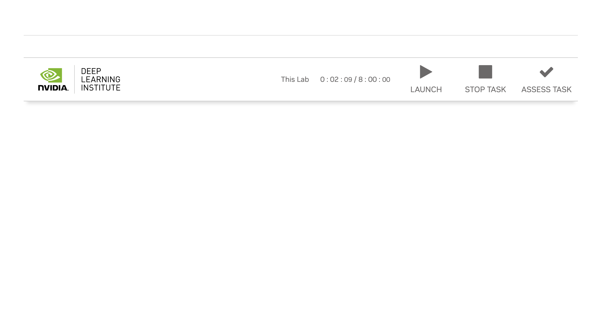

<!-- dli-course-cell {"id":"6-Assessment/61-Assessment:0","index":0,"schema":"dli-course-cell/1.0","source_sha256":"4f3737acec54d5d6c9c24be14382a5cc3e74948a8cc68f3e2039d932165fb2ae","type":"markdown"} -->
<br>
<a href="https://www.nvidia.com/en-us/training/">
    <div style="width: 55%; background-color: white; margin-top: 50px;">
    </div>
</a>
<h1 style="line-height: 1.4;"><font color="#76b900"><b>Building LLM Applications With Prompt Engineering</b></font></h1>
<h2><b>Assessment: Identify Sources of Customer Complaints</b></h2>
<br>
<!-- /dli-course-cell -->

<!-- dli-course-cell {"id":"6-Assessment/61-Assessment:1","index":1,"schema":"dli-course-cell/1.0","source_sha256":"90123d96345f21572706bfffe2cd795ca43b9c5df8415815e0588061e44ae7db","type":"markdown"} -->
In this notebook you will complete a final workshop project and earn a certificate of competency for the workshop.
<!-- /dli-course-cell -->

<!-- dli-course-cell {"id":"6-Assessment/61-Assessment:2","index":2,"schema":"dli-course-cell/1.0","source_sha256":"cb3f91d54eee30e53e35b2b99905f70f169ed549fd78909d3dac2defc9ed8d3b","type":"markdown"} -->
---
<!-- /dli-course-cell -->

<!-- dli-course-cell {"id":"6-Assessment/61-Assessment:3","index":3,"schema":"dli-course-cell/1.0","source_sha256":"d357b415148d05679d1f9802803fc0a4a039f4ece72445b0c3c596b0eb555b52","type":"markdown"} -->
## Imports
<!-- /dli-course-cell -->

<!-- dli-course-cell {"id":"6-Assessment/61-Assessment:4","index":4,"schema":"dli-course-cell/1.0","source_sha256":"5be41ede49e2512438c8adedf35dce476276a163f8e07719bea27a108a7da75e","type":"markdown"} -->
We believe the following imports will be helpful in your work, but feel free to modify them as you deem necessary.
<!-- /dli-course-cell -->

<!-- dli-course-cell {"id":"6-Assessment/61-Assessment:5","index":5,"schema":"dli-course-cell/1.0","source_sha256":"4d17ccf3b01496ba2744567dbbbc4c18d6361e78bea2c7e04946447b95fb66c6","type":"code"} -->
```python
import os
import json

from typing import List
from pprint import pprint

from langchain_nvidia_ai_endpoints import ChatNVIDIA
from langchain_core.prompts import ChatPromptTemplate
from langchain_core.output_parsers import JsonOutputParser, StrOutputParser
from langchain_core.runnables import RunnableLambda
from pydantic import BaseModel, Field

from assessment_helper import run_assessment
```
<!-- /dli-course-cell -->

<!-- dli-course-cell {"id":"6-Assessment/61-Assessment:6","index":6,"schema":"dli-course-cell/1.0","source_sha256":"cb3f91d54eee30e53e35b2b99905f70f169ed549fd78909d3dac2defc9ed8d3b","type":"markdown"} -->
---
<!-- /dli-course-cell -->

<!-- dli-course-cell {"id":"6-Assessment/61-Assessment:7","index":7,"schema":"dli-course-cell/1.0","source_sha256":"70f5e78e300511808de404ed1d62799fc55c2b20e6c2a33706e13dbca5acc811","type":"markdown"} -->
## Create a Model Instance
<!-- /dli-course-cell -->

<!-- dli-course-cell {"id":"6-Assessment/61-Assessment:8","index":8,"schema":"dli-course-cell/1.0","source_sha256":"3b4dbb5e588ed584c0c8066b44a3ab421a8c5f8004fb32f42ce1fc257aa5d56b","type":"markdown"} -->
For the assessment, you will be working with the same model you have been utilizing for the entirety of the workshop.
<!-- /dli-course-cell -->

<!-- dli-course-cell {"id":"6-Assessment/61-Assessment:9","index":9,"schema":"dli-course-cell/1.0","source_sha256":"d741a922d2642a3fc57f5481f8c069b9cfe987622157b766b7bad7190f65996b","type":"code"} -->
```python
base_url = os.getenv("NVIDIA_BASE_URL")
model = 'nvidia/nemotron-nano-12b-v2-vl'
llm = ChatNVIDIA(base_url=base_url, model=model, temperature=0)
```
<!-- /dli-course-cell -->

<!-- dli-course-cell {"id":"6-Assessment/61-Assessment:10","index":10,"schema":"dli-course-cell/1.0","source_sha256":"cb3f91d54eee30e53e35b2b99905f70f169ed549fd78909d3dac2defc9ed8d3b","type":"markdown"} -->
---
<!-- /dli-course-cell -->

<!-- dli-course-cell {"id":"6-Assessment/61-Assessment:11","index":11,"schema":"dli-course-cell/1.0","source_sha256":"b3e569945ccb5b4b7b0c07fb88e292110adf434c0ece132584f627b1d303f254","type":"markdown"} -->
## Assessment Objective
<!-- /dli-course-cell -->

<!-- dli-course-cell {"id":"6-Assessment/61-Assessment:12","index":12,"schema":"dli-course-cell/1.0","source_sha256":"649320b0a59e9ce2b719bfc0c6a2e85de12ab4d32518f032323d5bf817a497a8","type":"markdown"} -->
For the assessment, you will be provided with a small collection of 10 fictitious synthetically generated emails from customers of a mega retail store called BuyBuy. Each of these emails involves a customer from a specified store location either praising or complaining about a specific product they recently bought.

**Your objective is to create a LangChain chain that when invoked with the emails, will respond concisely with what category of product is most associated with negative customer sentiment, and also, which store location has the most customer complaints.**

The grader will also run your chain against a second, small counterfactual dataset. This prevents a memorized answer from passing: the chain needs to inspect the emails it receives.
<!-- /dli-course-cell -->

<!-- dli-course-cell {"id":"6-Assessment/61-Assessment:13","index":13,"schema":"dli-course-cell/1.0","source_sha256":"cb3f91d54eee30e53e35b2b99905f70f169ed549fd78909d3dac2defc9ed8d3b","type":"markdown"} -->
---
<!-- /dli-course-cell -->

<!-- dli-course-cell {"id":"6-Assessment/61-Assessment:14","index":14,"schema":"dli-course-cell/1.0","source_sha256":"153f7d59af56abcee6213539cb7c801535d943d087c3886562d557ff063527fb","type":"markdown"} -->
## Customer Emails
<!-- /dli-course-cell -->

<!-- dli-course-cell {"id":"6-Assessment/61-Assessment:15","index":15,"schema":"dli-course-cell/1.0","source_sha256":"02e34387f30fffe1b88ca6ff462350d6192389107fadd3b8072eab78f7347cb1","type":"markdown"} -->
Here we load the synthetic emails into a list called `emails`.
<!-- /dli-course-cell -->

<!-- dli-course-cell {"id":"6-Assessment/61-Assessment:16","index":16,"schema":"dli-course-cell/1.0","source_sha256":"05e9dd8bb278463a1891a7a73843d70862c476aed1fe6f45120db34dd6185f10","type":"code"} -->
```python
with open('data/emails.json', 'r') as f:
    emails = json.load(f)
```
<!-- /dli-course-cell -->

<!-- dli-course-cell {"id":"6-Assessment/61-Assessment:17","index":17,"schema":"dli-course-cell/1.0","source_sha256":"6f338ff30e9ebacf8538ed2c33f5a0a7a703e3a10c890e0daa5cae335278484b","type":"markdown"} -->
As a sample, here is the first 3 emails in the collection.
<!-- /dli-course-cell -->

<!-- dli-course-cell {"id":"6-Assessment/61-Assessment:18","index":18,"schema":"dli-course-cell/1.0","source_sha256":"cd51b1bb63094e6809b32d01035aefe8717003c978608f60c7ece444d01c6526","type":"code"} -->
```python
for email in emails[:3]:
    print(email+'\n')
```
<!-- /dli-course-cell -->

<!-- dli-course-cell {"id":"6-Assessment/61-Assessment:19","index":19,"schema":"dli-course-cell/1.0","source_sha256":"cb3f91d54eee30e53e35b2b99905f70f169ed549fd78909d3dac2defc9ed8d3b","type":"markdown"} -->
---
<!-- /dli-course-cell -->

<!-- dli-course-cell {"id":"6-Assessment/61-Assessment:20","index":20,"schema":"dli-course-cell/1.0","source_sha256":"6353aad50d1e0e6b5ce355c97dbce0286259623a665a4fd5fe6711684b8481fc","type":"markdown"} -->
## Product Categories
<!-- /dli-course-cell -->

<!-- dli-course-cell {"id":"6-Assessment/61-Assessment:21","index":21,"schema":"dli-course-cell/1.0","source_sha256":"b3ddecc51f2a132d512489c957aa96bc86ecb5369a1ea4d3bdc2f0160b9bad9d","type":"markdown"} -->
As stated above, we are interested in your chain being able to identify the **category of product** most associated with a negative sentiment. For example, if there were a complaint about a shirt, another about a jacket, and a third about some jeans, it would be fair to say that there were 3 complaints about **clothing**. If there were a complaint about a desk, and another about a couch, it would be fair to say that there were 2 complaints about **furniture**.

Asking an LLM to make such an identification is sensible since we are leveraging its language capabilities to help us gain insight where it might not otherwise be obvious.

On a more practical note, this means that you won't simply be able to count the number of occurences of a given product, but rather, need to ask the LLM to identify the correct `"category of product"`.
<!-- /dli-course-cell -->

<!-- dli-course-cell {"id":"6-Assessment/61-Assessment:22","index":22,"schema":"dli-course-cell/1.0","source_sha256":"cb3f91d54eee30e53e35b2b99905f70f169ed549fd78909d3dac2defc9ed8d3b","type":"markdown"} -->
---
<!-- /dli-course-cell -->

<!-- dli-course-cell {"id":"6-Assessment/61-Assessment:23","index":23,"schema":"dli-course-cell/1.0","source_sha256":"c504c6f1192776b2e54d809350bcc7389c730d99c3fc40927b38c6273685b10e","type":"markdown"} -->
## Checking Your Work
<!-- /dli-course-cell -->

<!-- dli-course-cell {"id":"6-Assessment/61-Assessment:24","index":24,"schema":"dli-course-cell/1.0","source_sha256":"1b1daa8c37223fe02ad51680dd3e8bad146ffcb8c893c300d8202958a91601f8","type":"markdown"} -->
Eventually, you will have created a LangChain chain that can be invoked with `emails` and then outputs the product category and store location most associated with customer complaints.

When you're ready, pass your chain into the provided `run_assessment` function, which will evaluate the behavior of your chain on the assessment emails and on a small counterfactual set.

Here we create a mock chain just to show the invocation pattern. It is intentionally wrong because it ignores the emails.
<!-- /dli-course-cell -->

<!-- dli-course-cell {"id":"6-Assessment/61-Assessment:25","index":25,"schema":"dli-course-cell/1.0","source_sha256":"d8e924e4e8dae76cfcc0bf5aaf634dd4be916fd4f7ae014030b2ba07b2a4a955","type":"code"} -->
```python
mock_prompt = '''Ignore the following emails: {emails}

Always and only respond with the following response:
"The product category with the most negative sentiment is clothing."
" The store location with the most negative sentiment is Dallas."'''
```
<!-- /dli-course-cell -->

<!-- dli-course-cell {"id":"6-Assessment/61-Assessment:26","index":26,"schema":"dli-course-cell/1.0","source_sha256":"1e8dddd57b07a36b88a73b46ce7dd615d3707458a0449778b75cc48f2c2f03c3","type":"code"} -->
```python
mock_chain = ChatPromptTemplate.from_template(mock_prompt) | llm | StrOutputParser()
```
<!-- /dli-course-cell -->

<!-- dli-course-cell {"id":"6-Assessment/61-Assessment:27","index":27,"schema":"dli-course-cell/1.0","source_sha256":"550584d0a53277075c41ea4304b313a87294a118d32a9efdd5afb8e2e5e3f04a","type":"code"} -->
```python
mock_chain.invoke(emails)
```
<!-- /dli-course-cell -->

<!-- dli-course-cell {"id":"6-Assessment/61-Assessment:28","index":28,"schema":"dli-course-cell/1.0","source_sha256":"fed60596844142a5f994292b417b4a193bfbeb9abba7b3a2121cbe3ff355c8de","type":"code"} -->
```python
try:
    run_assessment(mock_chain)
except Exception as e:
    print(e)
```
<!-- /dli-course-cell -->

<!-- dli-course-cell {"id":"6-Assessment/61-Assessment:29","index":29,"schema":"dli-course-cell/1.0","source_sha256":"cb3f91d54eee30e53e35b2b99905f70f169ed549fd78909d3dac2defc9ed8d3b","type":"markdown"} -->
---
<!-- /dli-course-cell -->

<!-- dli-course-cell {"id":"6-Assessment/61-Assessment:30","index":30,"schema":"dli-course-cell/1.0","source_sha256":"54cd0837bb6620f10aefa1f020523f5f2040dca5385d8e1967c8b0eb15aed110","type":"markdown"} -->
## Your Work Here
<!-- /dli-course-cell -->

<!-- dli-course-cell {"id":"6-Assessment/61-Assessment:31","index":31,"schema":"dli-course-cell/1.0","source_sha256":"a18969e52d85643f1b3c8f32ba517820172e41c9d788b1902fe0fc08720d0f0b","type":"markdown"} -->
There are any number of ways that you might approach this problem. We recommend you take some time to plan out how you plan to tackle it.

Remember, once you've completed a chain to your satisfaction, pass it into `run_assessment` to check your work. A passing chain should answer the real assessment emails and change its answer when the counterfactual emails change the complaint pattern. Once you've successfully completed the task, see the instructions below for how to generate your certificate of competency in the workshop.
<!-- /dli-course-cell -->

<!-- dli-course-cell {"id":"6-Assessment/61-Assessment:32","index":32,"schema":"dli-course-cell/1.0","source_sha256":"e3b0c44298fc1c149afbf4c8996fb92427ae41e4649b934ca495991b7852b855","type":"code"} -->
```python
```
<!-- /dli-course-cell -->

<!-- dli-course-cell {"id":"6-Assessment/61-Assessment:33","index":33,"schema":"dli-course-cell/1.0","source_sha256":"cb3f91d54eee30e53e35b2b99905f70f169ed549fd78909d3dac2defc9ed8d3b","type":"markdown"} -->
---
<!-- /dli-course-cell -->

<!-- dli-course-cell {"id":"6-Assessment/61-Assessment:34","index":34,"schema":"dli-course-cell/1.0","source_sha256":"1069983fcc39514f31c361063d4b7548c76d57865e365f02e8e95cc3f5060d19","type":"markdown"} -->
## Get Certificate for the Workshop
<!-- /dli-course-cell -->

<!-- dli-course-cell {"id":"6-Assessment/61-Assessment:35","index":35,"schema":"dli-course-cell/1.0","source_sha256":"6aa7de86a9edd612180e16b8b82f5e3b6886d9bac372efc55db15e274d706976","type":"markdown"} -->
Assuming you've received a message from `run_assessment` that you successfully completed the assessment, you're ready to generate a certificate of competency for the workshop.

In your web browser, return to the DLI course page you used to launch this lab and click the check-mark `ASSESS TASK` button (see the screenshot below). After a few seconds you should get a congratulatory message, after which you can visit your [personal DLI learning page](https://learn.nvidia.com/my-learning) and view your certificate.
<!-- /dli-course-cell -->

<!-- dli-course-cell {"id":"6-Assessment/61-Assessment:36","index":36,"schema":"dli-course-cell/1.0","source_sha256":"bcfafae94bf5054341027d8781d1703c3666d0c6ffba65430be5b4cb5f7c8e5b","type":"markdown"} -->


---

<!-- NEXT_STEP_CARD -->

<div style="border-left: 6px solid #76B900; background: #f7fdf2; padding: 14px 18px; border-radius: 10px; margin: 20px 0;">
<p style="margin: 0 0 6px; color: #315c00; font-weight: 700; letter-spacing: .04em; text-transform: uppercase;">Continue the unified course path</p>
<p style="margin: 0 0 8px; color: black;"><strong>Next step:</strong> Open <code>6-Assessment/62-Conclusion.ipynb</code> next: <strong>Workshop Conclusion</strong>.</p>
<p style="margin: 0; color: black;"><strong>Before moving on:</strong> Keep the strongest artifact or reasoning pattern from your assessment, because the conclusion turns that work into a reusable summary and next-step plan.</p>
</div>
<!-- /dli-course-cell -->
